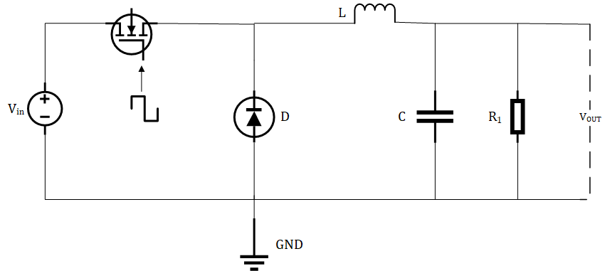

# DC-DC BUCK电路仿真

> 专栏：电力电子 · Notion 最后编辑：2026-10-25T14:10:00.000Z
>
> 来源：https://www.notion.so/4029d738588380bdb6a2dfc694e04715

### 异步BUCK电路原理图

matlab仿真图

### 电路原理分析

输入电压$V_{in}$，输出电压为$V_{out}$，电容为$C$，电感$L$，$PWM$ 的占空比设为 $D = T_{on}/T_{s}$，电阻为$R$

当在$T_{on}$时期，$MOSFET $ 导通有：

$$
V_{L}=V_{in}-V_{out} \tag{1}
$$

对电感$L$有：

$$
V_{L}=V_{in}-V_{out}=L\frac{\mathrm{d}i_{L}}{\mathrm{d}t} \tag{2}
$$

$$
\int_0^{t}V_{L} \mathrm{d}t=\int_0^{t}V_{in}-V_{out}\mathrm{d}t=L[{i_{L}(t)-i_{L}(0)}] \tag{3}
$$

$$
i_{L}(t)=\frac{(V_{in}-V_{out})t}{L}+i_{L}(0) \tag{4}
$$

其中$i_{L}(0)$是从上一周期结束时的值

能量方面，电感磁能$E_{L}$:

$$
E_{L}(t)=\frac{1}{2}L{i_{L}^2(t)} \tag{5}
$$

$$
\frac{\mathrm{d}E_{L}}{\mathrm{d}t}=Li_{L}(t)\frac{\mathrm{d}i_{L}(t)}{\mathrm{d}t}=\frac{(V_{in}-V_{out})^2t}{L}+(V_{in}-V_{out})i_{L}(0) \tag{6}
$$

对电容$C$有：

$$
V_{C}\approx V_{out} \tag{7}
$$

$$
i_{C}={C}\frac{\mathrm{d}V_{C}}{\mathrm{d}t} \tag{8}
$$

对电阻$R$有：

$$
i_{R}=\frac{V_{out}}{R} \tag{9}
$$

当$i_{L}<i_{R}$时，$i_{C}<0$，电容$C$放电，$V_{C}$减小

当$i_{L}=i_{R}$时，$i_{C}=0$，电容$C$电流过零，$V_{C}$到达最小

当$i_{L}>i_{R}$时，$i_{C}>0$，电容$C$充电，$V_{C}$增大

当在$T_{off}$时期，$MOSFET$未导通时期有：

$$
V_{L}=0-V_{out}-V_{D}\approx -V_{out} \tag{10}
$$

其中，$V_{D}$是续流二极管 $D$的压降大小。

$$
\frac{\mathrm{d}i_{L}}{\mathrm{d}t}=\frac{-V_{out}}{L} \tag{11}
$$

$$
i_{L}(t)-i_{L}(T_{on})=-\frac{V_{out}}{L}\int_{T_{on}}^t\mathrm{d}t \tag{12}
$$

$$
i_{L}(t)=i_{L}(T_{on})-\frac{V_{out}（t-T_{on})}{L},\qquad T_{\mathrm{on}}<t<T_{s} \tag{13}
$$

$MOSFET$ 关断后，电感电流不能突变，经续流二极管 $D$ 继续向负载流动（异步 BUCK）。此时电感两端电压为负，电感电流线性下降。其中 $i_{L}(T_{on})$ 是 $T_{on}$ 结束时的峰值电流。

电感磁能减小，释放的能量供给负载和电容：

$$
\frac{\mathrm{d}E_{L}}{\mathrm{d}t}=Li_{L}\frac{\mathrm{d}i_{L}}{\mathrm{d}t}=-V_{out}i_{L}<0 \tag{14}
$$

各支路电流：

$$
i_{D}=i_{L},\qquad i_{MOSFET}=0 \tag{15}
$$

电容电流 $i_{C}=i_{L}-i_{R}$：$i_{L}$ 下降过程中，在 $i_{L}=i_{R}$ 时刻 $i_{C}$ 由正过零变负，$V_{C}$（即 $V_{out}$）在该时刻达到最大值，之后电容放电，$V_{out}$ 缓慢下降。

伏秒平衡：$T_{on}$ 内 $\Delta i_{L}=\frac{(V_{in}-V_{out})DT_{s}}{L}$，$T_{off}$ 内 $\Delta i_{L}=-\frac{V_{out}(1-D)T_{s}}{L}$，两者相等得

$$
V_{out}=DV_{in} \tag{16}
$$

计入二极管正向压降时：

$$
V_{out}=DV_{in}-(1-D)V_{D} \tag{17}
$$

若 $T_{off}$ 结束前 $i_{L}$ 已降到零，二极管关断，电路进入 DCM：此时 $V_{L}=0$，$V_{out}$ 由电容维持，高于 $DV_{in}$。

