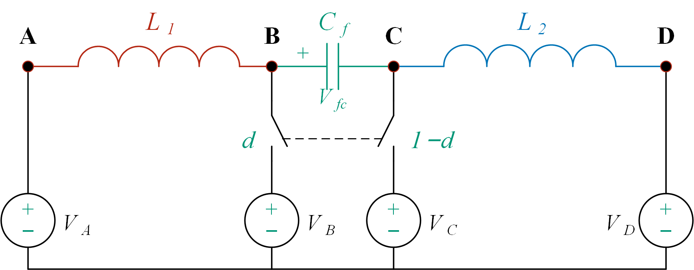
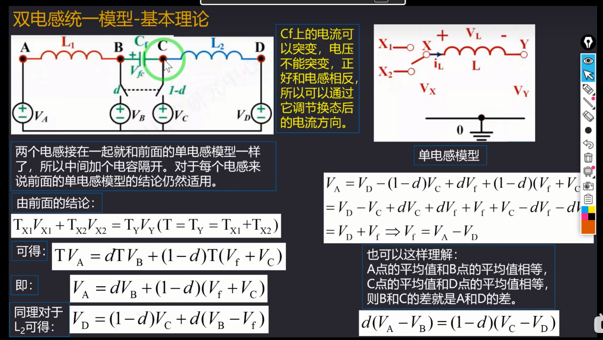

# 双电感统一模型｜基本理论

> 专栏：电力电子 · Notion 最后编辑：2026-11-17T12:47:00.000Z
>
> 来源：https://www.notion.so/41b9d738588381e6a08ff50b4177f42d

整理日期：2026-11-17。依据用户提供的“双电感统一模型—基本理论”截图整理；开关状态表、符号区分和适用条件为本次补充推导。原始截图保留在页末，原课程名称及链接未提供。

相关基础：[B站——木秀于林UP主学习](<single-inductor-model.md>)。

### 1. 模型与符号

模型的主支路为 A—$L_1$—B—$C_f$—C—$L_2$—D；两个开关分别把 B 节点接到电压源 $V_B$、把 C 节点接到电压源 $V_C$，两者互补动作。

为避免把节点电压与电压源混淆，采用以下记法：

<table>
<tr><th>符号</th><th>含义</th></tr>
<tr><td>$V_A、V_D$</td><td>A、D 两端相对公共参考点的固定电压；实际变换器中可视为一个周期内近似不变的端口电压</td></tr>
<tr><td>$V_B、V_C$</td><td>图中两个开关下方的固定电压源值，不是 B、C 节点始终具有的电压</td></tr>
<tr><td>$v_B(t)、v_C(t)$</td><td>B、C 节点相对公共参考点的瞬时电压</td></tr>
<tr><td>$v_f(t)=v_B(t)-v_C(t)$</td><td>中间电容电压，参考极性为 B 端正、C 端负</td></tr>
<tr><td>$V_f$</td><td>小纹波近似下的电容电压；更一般时使用平均值 $\overline{v_f}$</td></tr>
<tr><td>$T_s、d$</td><td>开关周期及 B 侧开关闭合的时间占比；$0&lt;d&lt;1$</td></tr>
</table>

取 $i_1$ 正方向为 A→B，$i_2$ 正方向为 C→D，两个电感电压均采用与电流关联的参考方向：

$$
v_{L_1}=V_A-v_B(t)=L_1\frac{\mathrm di_1}{\mathrm dt}
$$

$$
v_{L_2}=v_C(t)-V_D=L_2\frac{\mathrm di_2}{\mathrm dt}
$$

电流参考方向只是符号约定，实际电流可以为负；具体方向应由所实现的变换器及工作状态判断。

### 2. 电感与中间电容的作用

理想电感满足 $v_L=L\,\mathrm di_L/\mathrm dt$，因此在有限电压下电感电流不能瞬间跳变，电感电压可以随开关换态发生阶跃。

理想电容满足 $i_f=C_f\,\mathrm dv_f/\mathrm dt$，因此在没有冲激电流时电容电压不能瞬间跳变，电容电流可以随换态发生阶跃。

中间电容 $C_f$ 是能量传递与电压耦合元件。它使 B、C 两个节点具有电压差，并在换态瞬间约束：

$$
v_B(t^+)-v_C(t^+)=v_B(t^-)-v_C(t^-)
$$

因而，开关将某一端节点钳位到电压源时，另一端的电位由电容当时的电压确定。电容电压在换态时连续，不代表它在整个周期内严格不变；将其写成常数 $V_f$ 还需要小纹波近似。

两个电感的电流仍各自连续，其变化方向由各自电感电压决定。截图中“通过电容调节换态后的电流方向”应理解为：电容影响换态后的节点电压，从而影响电感电流斜率及传能路径，不能据此认为电感电流可以瞬间反向。此处也不表示电气安全意义上的隔离。

### 3. 两个开关状态

以下用 $V_f$ 表示一个周期内近似恒定的电容电压。

<table>
<tr><th>项目</th><th>状态Ⅰ：持续 $dT_s$</th><th>状态Ⅱ：持续 $(1-d)T_s$</th></tr>
<tr><td>B 侧开关</td><td>闭合，接通 $V_B$</td><td>断开</td></tr>
<tr><td>C 侧开关</td><td>断开</td><td>闭合，接通 $V_C$</td></tr>
<tr><td>B 节点电压</td><td>$v_B=V_B$</td><td>$v_B=V_C+V_f$</td></tr>
<tr><td>C 节点电压</td><td>$v_C=V_B-V_f$</td><td>$v_C=V_C$</td></tr>
<tr><td>$L_1$ 电压</td><td>$V_A-V_B$</td><td>$V_A-V_C-V_f$</td></tr>
<tr><td>$L_2$ 电压</td><td>$V_B-V_f-V_D$</td><td>$V_C-V_D$</td></tr>
</table>

判断每段电流上升或下降时，直接使用 $\mathrm di_1/\mathrm dt=v_{L_1}/L_1$、$\mathrm di_2/\mathrm dt=v_{L_2}/L_2$。由于端口电压尚未指定，不能预先把某个状态一概叫作两个电感共同的“储能阶段”。

### 4. 分别对两个电感应用伏秒平衡

周期稳态下，每个电感电流在一个周期末回到初值，因此：

$$
\int_0^{T_s}v_{L_1}\,\mathrm dt=0,\qquad
\int_0^{T_s}v_{L_2}\,\mathrm dt=0
$$

对 $L_1$：

$$
d(V_A-V_B)+(1-d)(V_A-V_C-V_f)=0
$$

整理为：

$$
\boxed{V_A=dV_B+(1-d)(V_C+V_f)}
$$

对 $L_2$：

$$
d(V_B-V_f-V_D)+(1-d)(V_C-V_D)=0
$$

整理为：

$$
\boxed{V_D=d(V_B-V_f)+(1-d)V_C}
$$

这就是把单电感的伏秒平衡分别应用于两个电感所得的两条方程。

### 5. 电容平均电压

将上述两式相减：

$$
V_A-V_D=(1-d)V_f+dV_f
$$

得到：

$$
\boxed{V_f=V_A-V_D}
$$

更一般地，这个平均值结论可以不借助“小纹波近似”证明。由两只理想电感的稳态伏秒平衡：

$$
\overline{v_B}=V_A,\qquad
\overline{v_C}=V_D
$$

又因为 $v_f=v_B-v_C$，所以：

$$
\boxed{\overline{v_f}=V_A-V_D}
$$

注意：等式约束的是电容电压的平均值；瞬时值 $v_f(t)$ 仍可以有纹波。

### 6. 双电感统一模型的电压关系

将 $V_f=V_A-V_D$ 代入 $L_1$ 的平衡式：

$$
V_A=dV_B+(1-d)(V_C+V_A-V_D)
$$

移项整理：

$$
\boxed{d(V_A-V_B)=(1-d)(V_C-V_D)}
$$

等价形式为：

$$
V_A-V_B=\frac{1-d}{d}(V_C-V_D)
$$

这条关系把四个端口电压与占空比联系起来。将具体电路中的输入、输出和零电位，按实际连接对应到 $V_A、V_B、V_C、V_D$，即可继续推导该拓扑的电压变换比；判断极性时必须沿用同一参考方向。

它与单电感模型的对应关系是：单电感对一个电感写伏秒平衡；双电感分别写两条伏秒平衡，再用中间电容的电压关系把两者联立。

#### 6.1. 端口电位的分配思路

为由统一模型构造具体的 DC–DC 变换器，将公共参考电位 $0$、输入端电位 $V_{\mathrm{in}}$ 和输出端电位 $V_{\mathrm{out}}$ 分配给模型的四个端口电压 $V_A、V_B、V_C、V_D$。

在三种电位彼此不同、且均被使用的前提下，四个端口中必有两个端口分配到同一电位。为便于分类，将重复使用的电位记为 $V_{x1}$，其余两个电位分别记为 $V_{x2}$ 和 $V_{x3}$。先确定重复电位所在的端口，再将 $0、V_{\mathrm{in}}、V_{\mathrm{out}}$ 一一对应到 $V_{x1}、V_{x2}、V_{x3}$。

这里分配的是模型中的端口基准电位。特别地，$V_B、V_C$ 表示两个开关下方电压源的电压值，仍应与开关节点的瞬时电压 $v_B(t)、v_C(t)$ 区分。

#### 6.2. 非退化分配的筛选原则

由双电感统一模型的稳态电压关系：

$$
d(V_A-V_B)=(1-d)(V_C-V_D)
$$

对于具有正常占空比调节范围 $0<d<1$ 的非退化工作情形，应避免以下分配：

<table>
<tr><th>筛选条件</th><th>依据与含义</th></tr>
<tr><td>$V_A\ne V_B$</td><td>若 $V_A=V_B$，而 $V_C\ne V_D$，则上式只能在 $d=1$ 时成立，失去正常的两状态切换与占空比调节范围。</td></tr>
<tr><td>$V_C\ne V_D$</td><td>若 $V_C=V_D$，而 $V_A\ne V_B$，则上式只能在 $d=0$ 时成立，同样属于边界情形。</td></tr>
<tr><td>通常取 $V_A\ne V_D$</td><td>由 $\overline{v_f}=V_A-V_D$，若 $V_A=V_D$，则中间电容电压的平均值为零。为筛选电容具有非零平均电压的常规情形，本节排除此类分配。</td></tr>
</table>

若同时有 $V_A=V_B$ 和 $V_C=V_D$，电压关系退化为 $0=0$，不能再由该式确定占空比；因此不能把这一情形直接归结为“占空比必为 0 或 1”。

截图中“电容就是导线了”宜改为：**电容电压的平均值为零，不再具有非零的直流电压偏置。** 平均值为零并不意味着瞬时电压恒为零，也不意味着真实电容可以直接替换成导线；其纹波、动态过程和电流约束仍需保留。

#### 6.3. 重复电位的三种端口组合

按上述筛选条件，重复电位不能分配给 A、B 两端，也不能分配给 C、D 两端；本节还排除 A、D 两端重复。因此，重复电位的位置可归纳为以下三类：

<table>
<tr><th>类别</th><th>重复电位的位置</th><th>$V_A$</th><th>$V_B$</th><th>$V_C$</th><th>$V_D$</th></tr>
<tr><td>Ⅰ</td><td>A、C 两端</td><td>$V_{x1}$</td><td>$V_{x2}$</td><td>$V_{x1}$</td><td>$V_{x3}$</td></tr>
<tr><td>Ⅱ</td><td>B、C 两端</td><td>$V_{x2}$</td><td>$V_{x1}$</td><td>$V_{x1}$</td><td>$V_{x3}$</td></tr>
<tr><td>Ⅲ</td><td>B、D 两端</td><td>$V_{x2}$</td><td>$V_{x1}$</td><td>$V_{x3}$</td><td>$V_{x1}$</td></tr>
</table>

表中 $V_{x2}$ 与 $V_{x3}$ 只是其余两种电位的占位符，输入、输出和零电位的具体对应关系尚未指定。B、C 两端分配同一电压源值，也不表示两个开关节点在所有时刻都等电位。

实际整理时，依次完成以下步骤：

1. 选定重复电位对应的端口组合。

2. 将 $0、V_{\mathrm{in}}、V_{\mathrm{out}}$ 分配给 $V_{x1}、V_{x2}、V_{x3}$，并明确输出电压的参考极性。

3. 代入统一电压关系，求出电压变换比。

4. 检查所得占空比是否满足 $0<d<1$，并进一步核对两种开关状态及器件导通条件。

当两个电压差均非零时，$0<d<1$ 还要求：

$$
(V_A-V_B)(V_C-V_D)>0
$$

即 $V_A-V_B$ 与 $V_C-V_D$ 必须同号。端口电位分配只是拓扑筛选的起点，仍需结合实际电路判断其可实现性。

来源与整理说明：本节依据用户于 2026-11-17 提供的两张“电位分配”截图整理；边界情形、重复端口分类及同号条件为依据本页统一电压关系所作的补充推导。“电容等同导线”的口语表述已作上述限定与修正。

### 7. 稳态条件与使用边界

- 上述两状态占空比公式假定理想器件、周期稳态，且 $C_f$ 电压纹波足够小，端口电压在一个周期内近似不变。

- 若由 MOSFET 和二极管实现这两个开关，必须确认两个预期导通状态确实覆盖整个周期。CCM 时通常可按此处理；进入 DCM 后可能出现额外导通状态，需按实际电路重新分析。

- 伏秒平衡本身不因 DCM 失效；需要调整的是各阶段的电路状态、电压与持续时间。

- 电容还必须满足电荷平衡：

$$
\int_0^{T_s}i_f(t)\,\mathrm dt=0
\quad\Longleftrightarrow\quad
\overline{i_f}=0
$$

这保证周期末电容电压回到周期初值；不表示电容每时每刻都没有电流。推导端口电流、功率关系时，还需要各状态的电流路径及电荷平衡。

### 8. Visio 可编辑电路图

2026-11-17：按用户提供的电路截图重绘。主支路 A—$L_1$—B—$C_f$—C—$L_2$—D，保留四个电压源的上正下负、$V_{fc}$ 的 B 端正极性、$d$ 与 $1-d$ 标记及开关之间的联动虚线。虚线为联动标记，不是电气导线。

使用本机 Visio 原生电气母版：2 个电感、1 个电容、4 个电压源和 2 个开关；19 条导线的 38 个端点已粘附到连接点。已重新打开 VSDX 核验并检查预览。附件 ZIP 包含可编辑 VSDX、PNG、SVG 与 PDF；本次仅重绘示意图。

修正记录（2026-11-17）：用户指出电容极板间出现横线。已修正电容母版的不等比例缩放，使左右引线分别止于极板，极板间无横线；已核对实际几何端点与预览，以下预览和完整附件均为修正版。

[双电感电路图\_源文件与导出图.zip](assets/dual-inductor-model-41b9d73858838171b87be7c700ebefaf.zip)

### 9. 原始截图

以下为用户提供的原始资料；上文对节点符号、近似条件及电容作用作了说明性补充。

双电感统一模型—基本理论，用户于 2026-11-17 提供

