# 第一章 图的基本概念

> 专栏：图论 · Notion 最后编辑：2026-11-10T14:07:00.000Z
>
> 来源：https://www.notion.so/4059d73858838131b63bc5175947aef2

> **本章内容**：图和简单图 · 子图与图的运算 · 路与图的连通性 · 最短路及其算法 · 图的代数表示及其特征 · 极图

### 1.1 图和简单图

#### 一、图的定义

**定义** 一个图 $G$ 定义为一个有序对 $(V, E)$，记为 $G=(V, E)$，其中

1. $V$ 是一个非空集合，称为顶点集或点集，其元素称为顶点或点；

2. $E$ 是由 $V$ 中的点组成的无序点对构成的集合，称为边集，其元素称为边，且同一点对在 $E$ 中可出现多次。

**注** 图 $G$ 的顶点集记为 $V(G)$，边集记为 $E(G)$。图 $G$ 的顶点数（或阶数）和边数可分别用符号 $n(G)$ 和 $m(G)$ 表示。

**例** 设 $V=\left\{v_{1}, v_{2}, v_{3}, v_{4}\right\}, E=\left\{v_{1} v_{2}, v_{1} v_{2}, v_{2} v_{3}\right\}$，则 $G=(V, E)$ 是一个4阶图。

若用小圆点代表点，连线代表边，则可将一个图用＂图形＂来表示，如例中的图可表示为

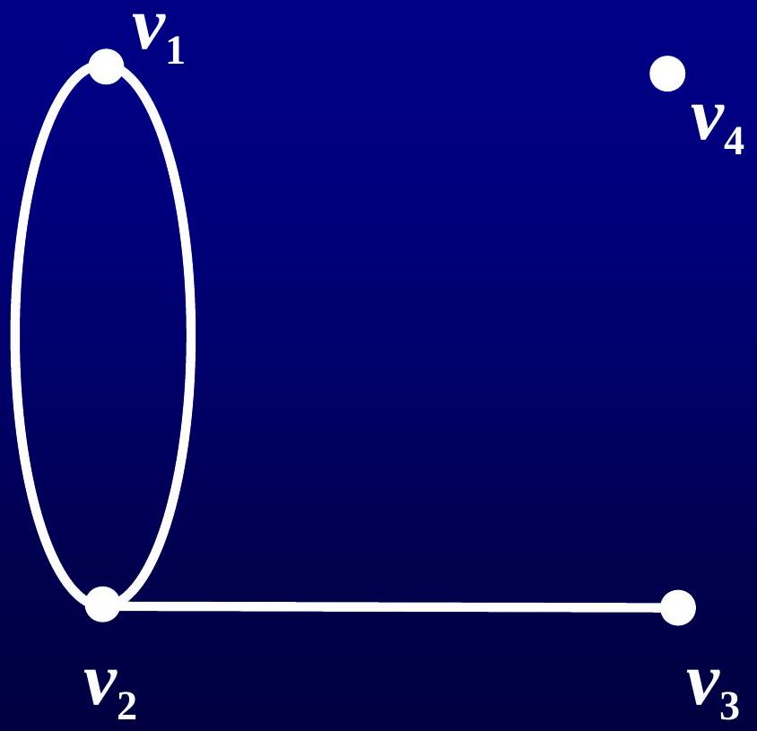

**图＝事物＋联系**

**注** 也可记边 $u v$ 为 $e$，即 $e=u v$。

**例** 设 $V=\left\{v_{1}, v_{2}, v_{3}, v_{4}\right\}, E=\left\{e_{1}, e_{2}, e_{3}, e_{4}, e_{5}\right\}$，其中

$$
e_{1}=v_{1} v_{2}, \quad e_{2}=v_{2} v_{3}, \quad e_{3}=v_{2} v_{3}, \quad e_{4}=v_{3} v_{4}, \quad e_{5}=v_{4} v_{4},
$$

则 $G=(V, E)$ 是一个图。

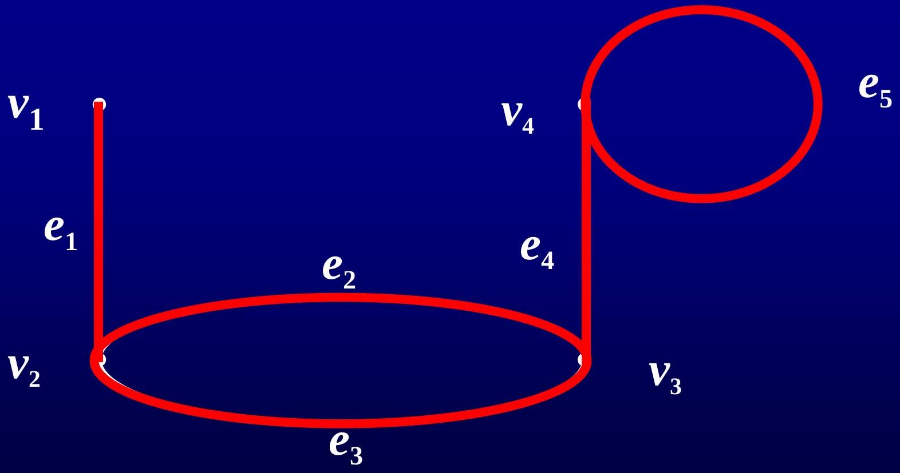

（1）若边 $e=u v$，称 $u$ 和 $v$ 是 $e$ 的端点；称 $u$ 和 $v$ 相邻，$u$ 是 $v$ 的邻居或者 $v$ 是 $u$ 的邻居；称 $u$（或 $v$）与 $e$ 相关联。若两条边有一个共同的端点，则称这两条边相邻。

（2）孤立点：不与任何边相关联的点；

- 自环：两端点重合的边；

- 重边：连接两个相同顶点的边的条数，叫做边的重数。重数大于1的边称为重边。

（3）点集与边集均为有限集合的图称为有限图，本书只讨论有限图。只有一个顶点而无边的图称为平凡图。边集为空的图称为空图。

（4）既没有环也没有重边的图称为**简单图**。其他所有的图都称为复合图。

**例**

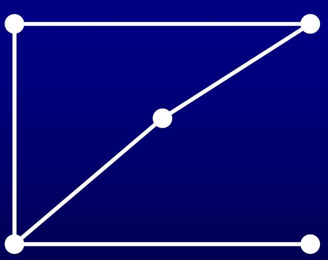

简单图

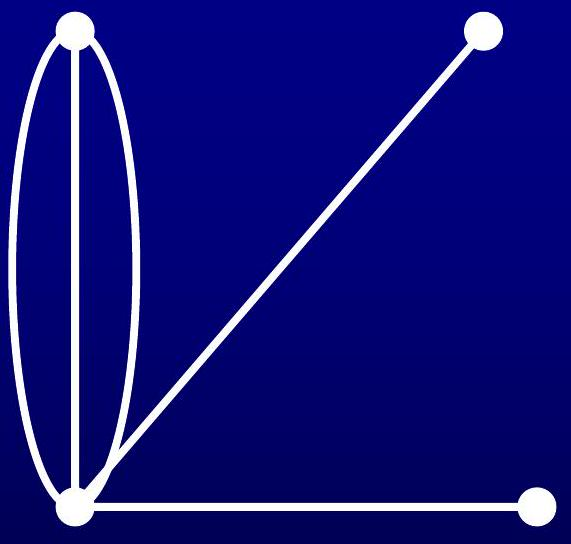

#### 二、图的同构

**定义** ：设有两个图 $G_{1}=\left(V_{1}, E_{1}\right)$ 和 $G_{2}=\left(V_{2}, E_{2}\right)$，若在其顶点集合之间存在双射，即存在一一对应的关系，使得边之间有如下的关系：设 $u_{1}, v_{1} \in V_{1}, u_{2}, v_{2} \in V_{2}, u_{1} \leftrightarrow u_{2}, v_{1} \leftrightarrow v_{2}$，$u_{1} v_{1} \in E_{1}$ 当且仅当 $u_{2} v_{2} \in E_{2}$，且 $u_{1} v_{1}$ 的重数与 $u_{2} v_{2}$ 相等，则称两图同构，记为 $G_{1} \cong G_{2}$。

**例**

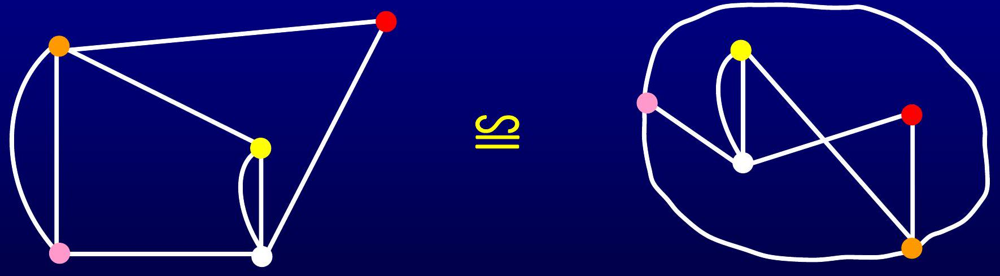

**注**

1. 两个同构的图均有相同的结构，没有本质上的差异，差异只是顶点和边的名称不同。

2. 图同构的几个必要条件：（1）顶点数相同；（2）边数相同；（3）若将各点所关联的边数记录下来，则所得到的数组相同。

3. 在图的图形表示中我们可以不给图的点和边标上符号，称这样的图为非标定（号）图，否则称为标定（号）图。非标定图实际上是代表一类相互同构的图。不误解时我们也不严格区分标定图与非标定图。

4. 判定图的同构是很困难的。对于规模不大的两个图，判定其是否同构，可以采用观察加推证的方法。

**例** 证明下面两图同构。

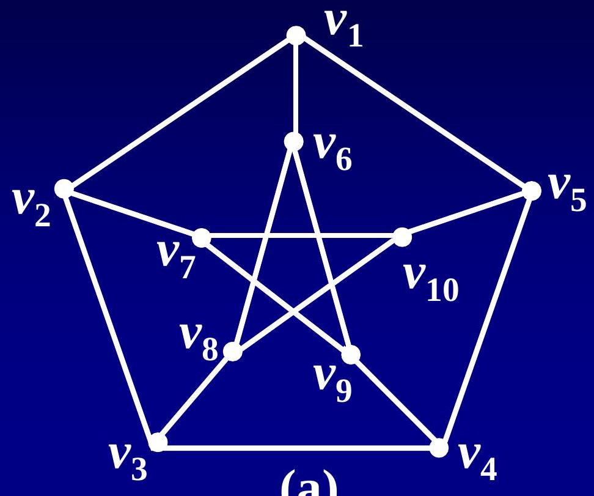

（a）

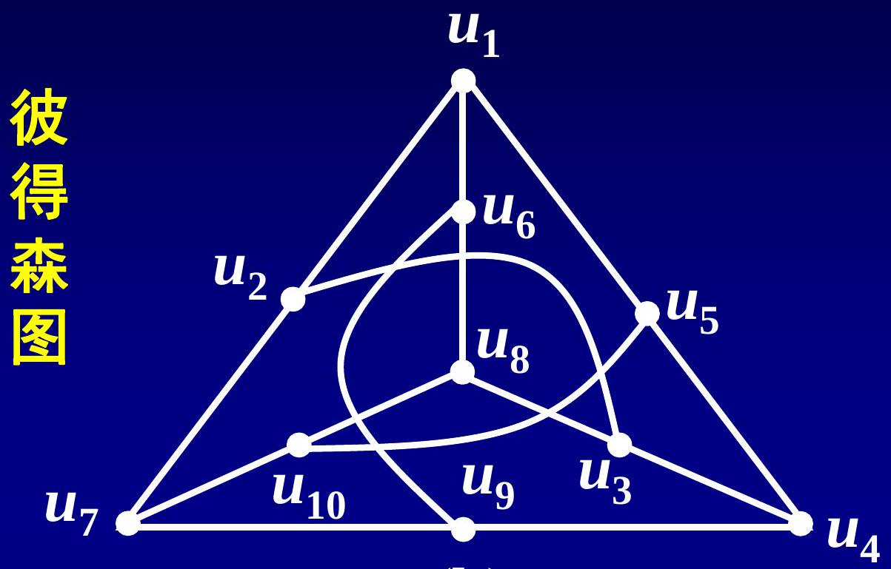

（b）

**证明** 作映射 $f: v_{i} \leftrightarrow u_{i}(i=1,2, \ldots, 10)$，易知该映射为双射。容易验证，对 $\forall v_{i} v_{j} \in E((\mathrm{a}))$，有

$$
f\left(v_{i} v_{j}\right)=u_{i} u_{j} \in E((b)), \quad(1 \leq i \leq 10,1 \leq j \leq 10)
$$

由图的同构定义知，图（a）与（b）是同构的。

**例** 判断下面两图是否同构。

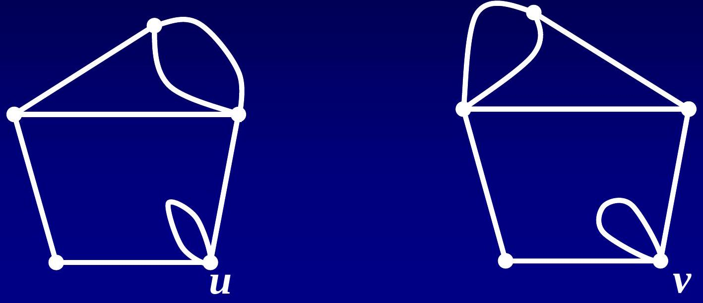

**解** 两图不同构。

若两图同构，则两图中唯一的与环关联的两个点 $u$ 与 $v$ 一定相对应，而 $u$ 的两个邻接点与 $v$ 的两个邻接点状况不同，$u$ 邻接有一个关联着 4 条边的点，而 $v$ 没有。

所以，两图不同构。

**例** 指出 4 个顶点的非同构的所有简单图。

**分析** 四个顶点的简单图最少边数为 0，最多边数为 6，所以可按边数进行枚举。

**解**

（a）0 条边

（b）1 条边

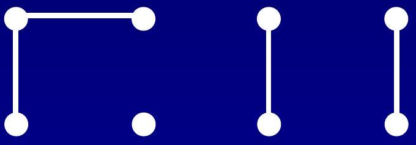

（c）2 条边（2 个图）

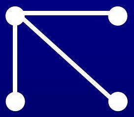

（d）3 条边（3 个图）

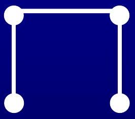

（d）3 条边（3 个图）

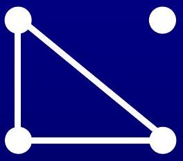

（d）3 条边（3 个图）

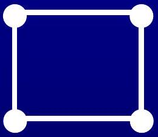

（e）4 条边（2 个图）

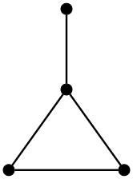

（e）4 条边（第 2 个图，据原 PDF 补绘）

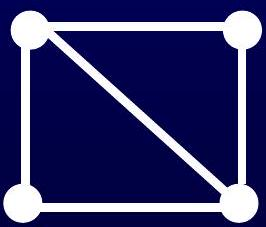

（f）5 条边

（g）6 条边

#### 三、完全图、偶图、补图

**定义** 任意两点均相邻的简单图称为完全图。在同构意义下，$n$ 阶完全图只有一个，记为 $K_{n}$。

**例** $K_{2}, K_{3}, K_{4}$ 分别如下图所示。

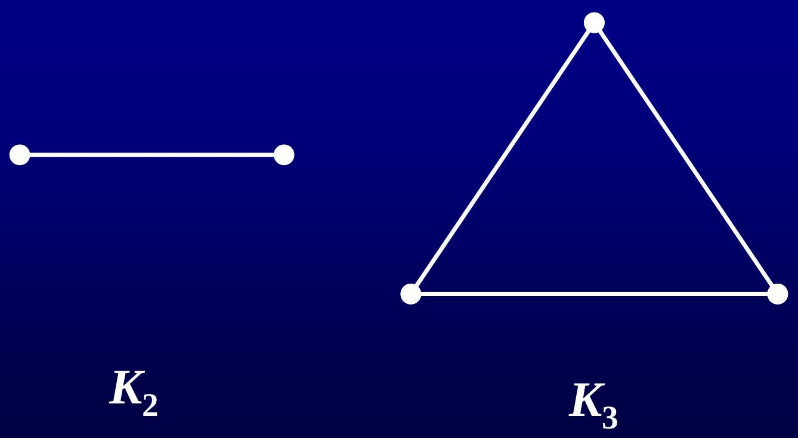

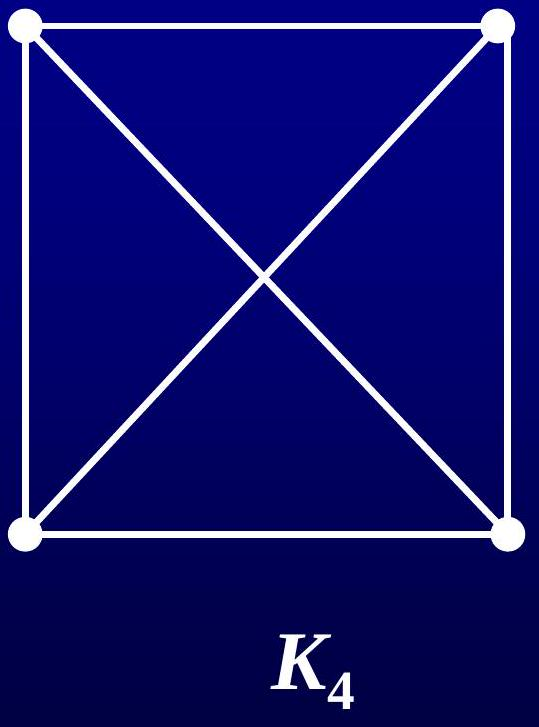

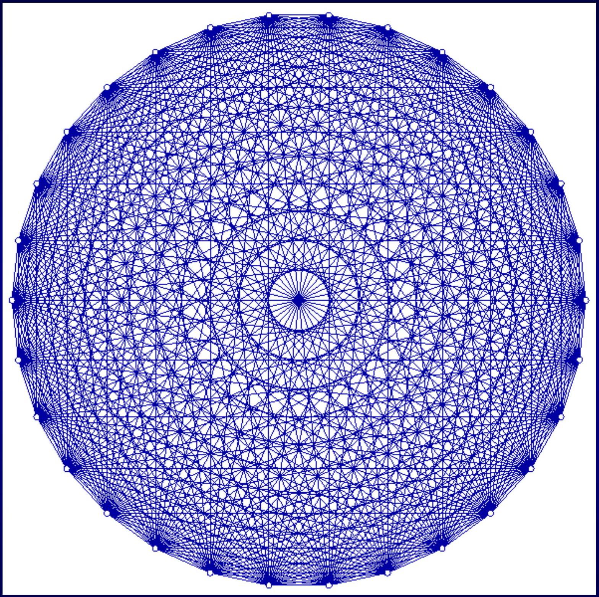

$\boldsymbol{K}_{\mathbf{3 0}}$

**定义** 若一个图的点集可以分解为两个非空子集 $X$ 和 $Y$，使得每条边的一个端点在 $X$ 中，另一个端点在 $Y$ 中，则这样的图称为具有二分类 $(X, Y)$ 的偶图或二部图。

完全偶图是指具有二分类 $(X, Y)$ 的简单偶图，其中 $X$ 的每个顶点与 $Y$ 的每个顶点相连。若 $|X|=m$，$|Y|=n$，则这样的偶图记为 $K_{m, n}$。

**例**

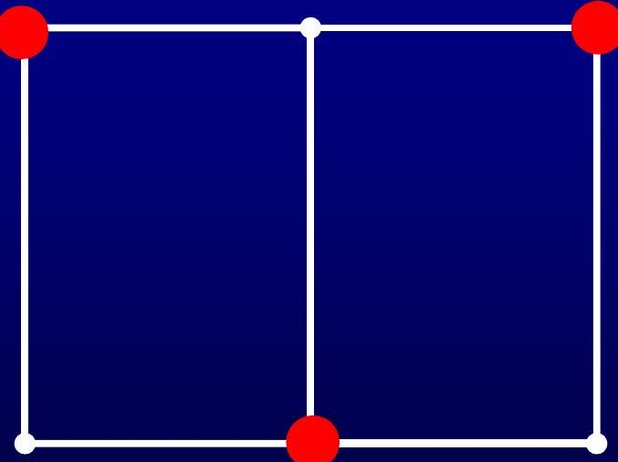

> 偶图

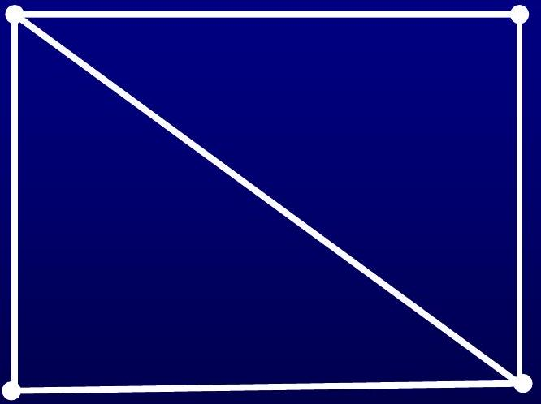

> 不是偶图

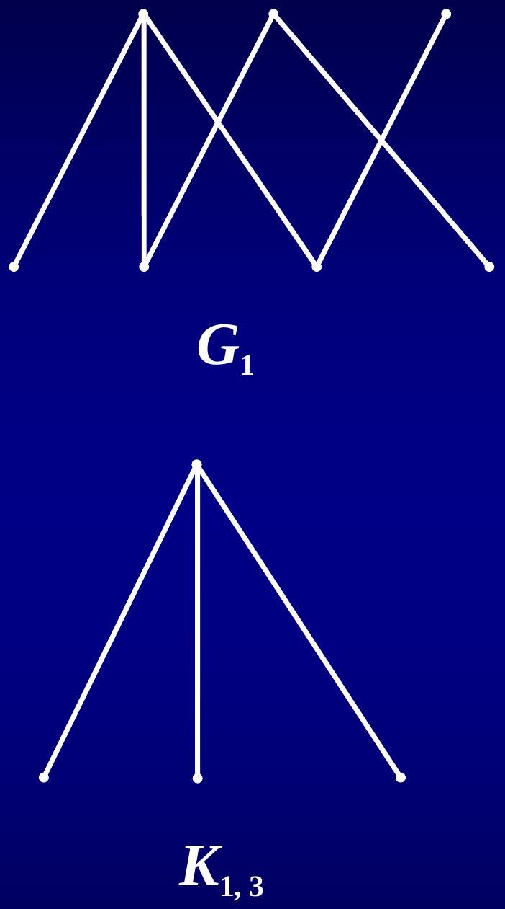

> $G_{1}$为偶图，$K_{1,3}$为完全偶图

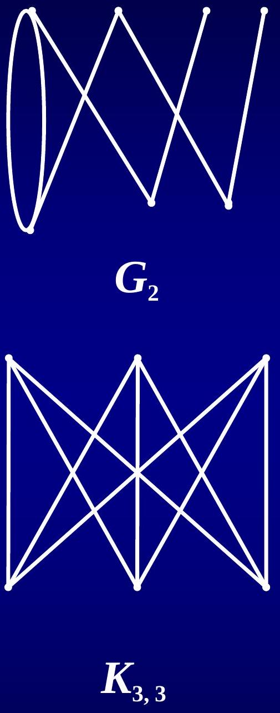

$K_{1,3}, K_{3,3}$为完全偶图

偶图是一种常见数学模型。

**例** 学校有6位教师将开设6门课程。六位教师的代号分别是$x_{i}(i=1,2, \ldots, 6)$，六门课程代号是 $y_{i}(i=1,2, \ldots, 6)$。已知教师$x_{1}$ 能够胜任课程 $y_{2}$ 和 $y_{3}$；教师 $x_{2}$ 能够胜任课程 $y_{4}$ 和 $y_{5}$；教师 $x_{3}$能够胜任课程 $y_{2}$；教师 $x_{4}$ 能够胜任课程 $y_{6}$ 和 $y_{3}$；教师 $x_{5}$ 能够胜任课程 $y_{1}$ 和 $y_{6}$；教师 $x_{6}$ 能够胜任课程 $y_{5}$ 和 $y_{6}$。请画出老师和课程之间的状态图。

**解**

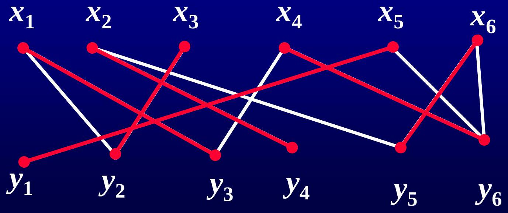

简单图 $G$ 的补图：设 $G=(V, E)$，则图 $H=\left(V, E_{1} \backslash E\right)$ 称为 $G$ 的补图，记为 $H=\bar{G}$，其中集合

$$
E_{1}=\{u v \mid u \neq v, u, v \in V\} .
$$

**例** 下图中的（a），（b）两图是互补的。

（a）

（b）

**定理** 若 $n$ 阶图 $G$ 是自补的（即 $G \cong \bar{G}$），则

$$
n \equiv 0,1(\bmod 4) \text { 。 }
$$

**证明** 因为 $G$ 是自补的，则 $G$ 和其补图有同样多的边数，且边数满足

$$
m(G)+m(\bar{G})=m\left(K_{n}\right)=\mathrm{C}_{n}^2=\frac{n(n-1)}{2} 。
$$

从而

$$
m(G)=\frac{n(n-1)}{4} .
$$

又因 $G$ 的边数 $m(G)$ 是整数，故 $n(n-1) / 4$ 为整数，即只能有$n \equiv 0(\bmod 4)$ 或 $(n-1) \equiv 0(\bmod 4)$。

#### 四、度与度序列

设 $v$ 为 $G$ 的顶点，$G$ 中以 $v$ 为端点的边的条数（环计算两次）称为点 $v$ 的度数，简称为点 $v$ 的度，记为 $d_{G}(v)$，简记为 $d(v)$。

**相关术语和记号**

- $\delta(G)$：图 $G$ 的顶点的最小度

- $\Delta(G)$：图 $G$ 的顶点的最大度

- 奇点：度数为奇数的顶点

- 偶点：度数为偶数的顶点

- $k$ 正则图：每个点的度均为 $k$ 的简单图。

例如，完全图 $K_{n}$ 和完全偶图 $K_{n, n}$ 均是正则图。

**例**

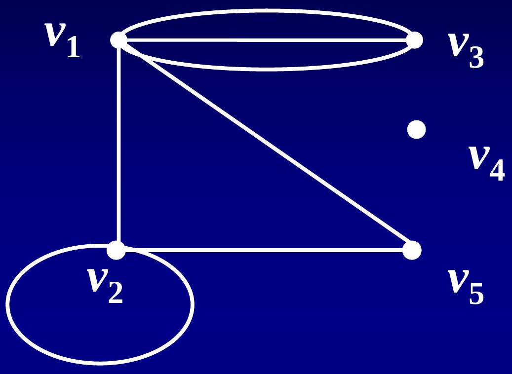

$$
d\left(v_{1}\right)=5
$$

$$
d\left(v_{2}\right)=4
$$

$$
d\left(v_{3}\right)=3
$$

$$
d\left(v_{4}\right)=0
$$

$$
d\left(v_{5}\right)=2
$$

$$
\delta=0
$$

$$
\Delta=5
$$

**注** 该图中各点的度数之和等于14，恰好是边数7的两倍。

> **握手定理**（图论基本定理） 对任意的有 $m$ 条边的图 $G=(V, E)$，有
> 
> $$
> \sum_{v \in V} d(v)=2 m .
> $$

**证明** 因图 $G$ 的任一条边均有两个端点（可以相同），在计算度时恰被计算两次（每个端点各被计算了一次），所以各点的度数之和恰好为边数的两倍。

**注** 该定理也称为握手定理，是由欧拉提出的：在一个聚会上，朋友相互见面时握一次手，则握手人次是握手次数的两倍。

> **推论** 在任意图 $G$ 中，奇点的个数为偶数。

**证明** 设 $V_{1}, ~ V_{2}$ 分别是由 $G$ 的奇点和偶点构成的集合，则由握手定理知：

$$
\sum_{v \in V_{1}} d(v)+\sum_{v \in V_{2}} d(v)=2 m(G)
$$

显然第二个求和式为偶数，而第一个求和式中的每一项均为奇数，所以第一个求和式必然有偶数项，即度数为奇数的顶点个数必为偶数。

> **推论** 正则图的阶数和度数不同时为奇数。

**证明** 设 $G$ 是 $n$ 阶 $k$ 正则图，因为度数之和 $n k$ 为偶数，所以 $n$和 $k$ 不能同时为奇数。

**例** 设 $\Delta$ 与 $\delta$ 是简单图 $G$ 的最大度与最小度，求证：

$$
\delta \leq \frac{2 m}{n} \leq \Delta
$$

**证明** 由握手定理知

$$
n \delta \leq \sum_{v \in V(G)} d(v)=2 m \leq n \Delta,
$$

所以

$$
\delta \leq \frac{2 m}{n} \leq \Delta
$$

**定义** 一个图 $G$ 的各个点的度 $d_{1}, d_{2}, \ldots, d_{n}$ 构成的非负整数组$\left(d_{1}, d_{2}, \ldots, d_{n}\right)$ 称为 $G$ 的度序列。

> **定理** 非负整数组 $\left(d_{1}, d_{2}, \ldots, d_{n}\right)$ 是图的度序列的充分必要条件是：$\sum d_{i}$ 为偶数。

**证明** 

必要性：由握手定理立即得到。

充分性证明：如果 $\sum d_{i}$ 为偶数，则数组中奇数的个数必为偶数。

按照如下方式作图 $G$：若 $d_{i}$ 为偶数，则在与之对应的点作$d_{i} / 2$ 个环；对于剩下的偶数个奇数 $d_{j}$，两两配对后分别在每配对点间先连一条边，然后在每个顶点作 $\left(d_{j}-1\right) / 2$ 个环。

该图的度序列就是已知数组。

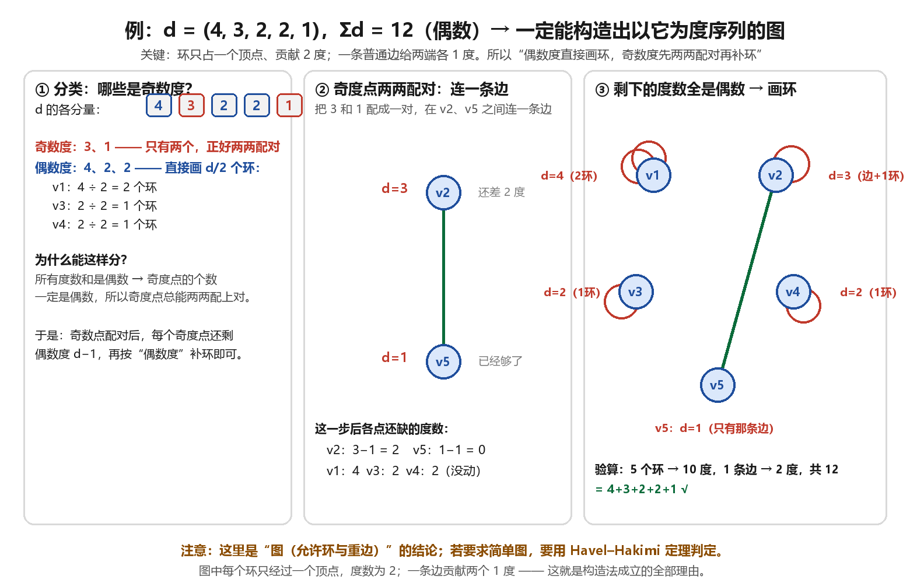

> **定义** 对于一个非负整数组 $\left(d_{1}, d_{2}, \ldots, d_{n}\right)$，若存在一个简单图以它为度序列，则称这个数组是可图的。可图的序列简称为可图序列或图序列。

关于可图序列，主要研究 3 个问题：

1. 判定问题：什么样的整数组是可图序列？

2. 计数问题：一个可图序列对应多少不同构的图？

3. 构造问题：如何画出可图序列对应的所有不同构图？

**研究现状**

1. 彻底解决了；

2. 解决得不好；

3. 没有解决。

> **定理** 设有非负整数组 $\Pi=\left(d_{1}, d_{2}, \ldots, d_{n}\right)$ 满足
> 
> $$
> n-1 \geq d_{1} \geq d_{2} \geq \cdots \geq d_{n}, \quad \sum d_{i}=2 m,
> $$
> 
> 则 $\Pi$ 是可图序列的充分必要条件是：
> 
> $$
> \Pi_{1}=\left(d_{2}-1, d_{3}-1, \ldots, d_{d_{1}+1}-1, d_{d_{1}+2}, \ldots, d_{n}\right)
> $$
> 
> 是可图序列。

**证明** 充分性显然，我们只需证明必要性。

设 $G$ 是 $\Pi$ 对应的简单图，$d\left(v_{i}\right)=d_{i}$。

- **情形1**：点 $v_{1}$ 与点 $v_{2}, v_{3}, \ldots, v_{d_{1}+1}$ 邻接，则删去顶点 $v_{1}$ 及其关联的边所得到的图的度序列正好为 $\Pi_{1}$。

- **情形2**：点 $v_{1}$ 与点 $v_{d_{1}+2}, \ldots, v_{n}$ 中的某些顶点邻接。

假设：设 $v_{1}$ 与 $v_{j_{0}}$ 邻接，但当 $k>j_{0}$ 时，$v_{1}$ 与 $v_{k}$ 不邻接；又设 $v_{1}$ 与$v_{i_{0}}$ 不邻接，但当 $k<i_{0}$ 时，$v_{1}$ 与点 $v_{k}$ 邻接。

接下来证明：在图中必然存在一点 $u$，使得 $u$ 与 $v_{i 0}$ 相邻，但是它与 $v_{j 0}$ 不相邻！

若不然，对任意的与 $v_{i 0}$ 邻接的点，若都与 $v_{j 0}$ 邻接，那么有 $d_{j 0} \geq d_{i 0}+1$，这与条件矛盾！

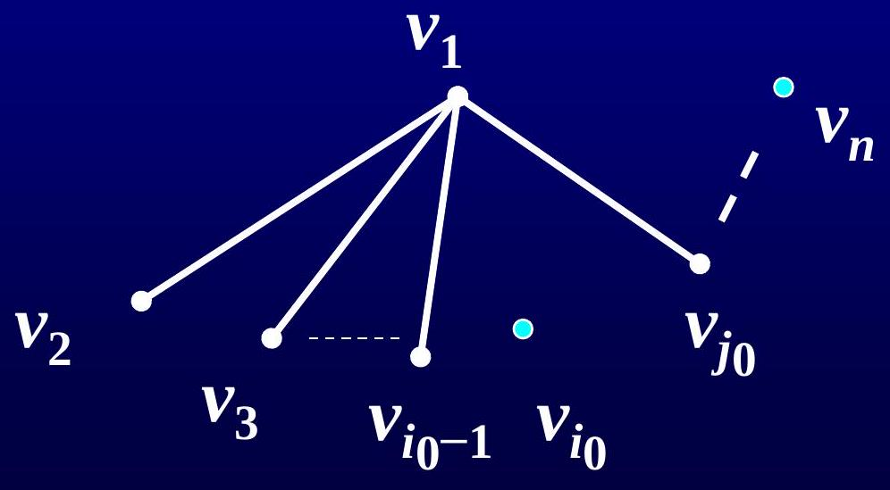

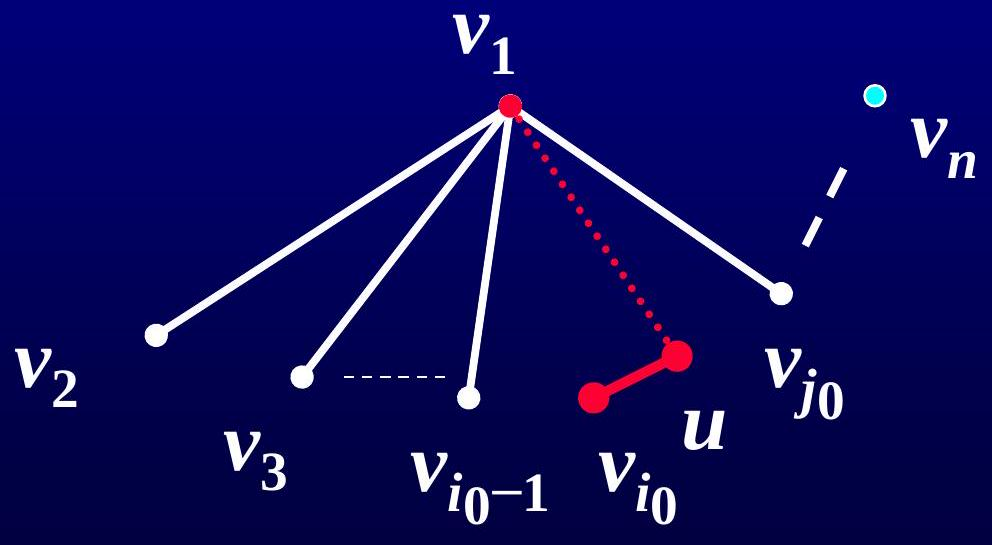

此时在图中去掉边 $v_{1} v_{j 0}$ 和 $v_{i 0} u$，加上边 $v_{j 0} u$ 和 $v_{1} v_{i 0}$。

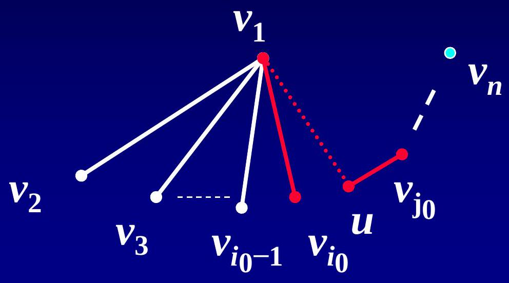

显然新图与原图度序列相同，但 $j_{0}$ 减小了，$i_{0}$ 增大了！如此不断进行下去，最后可以将情形2变为情形1。

> **例** 试判断非负整数组
> 
> $$
> \Pi=(5,5,3,3,2,2,2)
> $$
> 
> 是否可图？

**解** 根据定理可得下列非负整数组

$$
\begin{aligned}
& \Pi_{1}=(\quad 4,2,2,1,1,2) \\
& \Pi_{1}=(\quad 4,2,2,2,1,1) \\
& \Pi_{2}=(\quad 1,1,1,0,1)
\end{aligned}
$$

显然 $\Pi_{2}$ 是可图序列，因此

$$
\Pi=(5,5,3,3,2,2,2)
$$

是可图的。

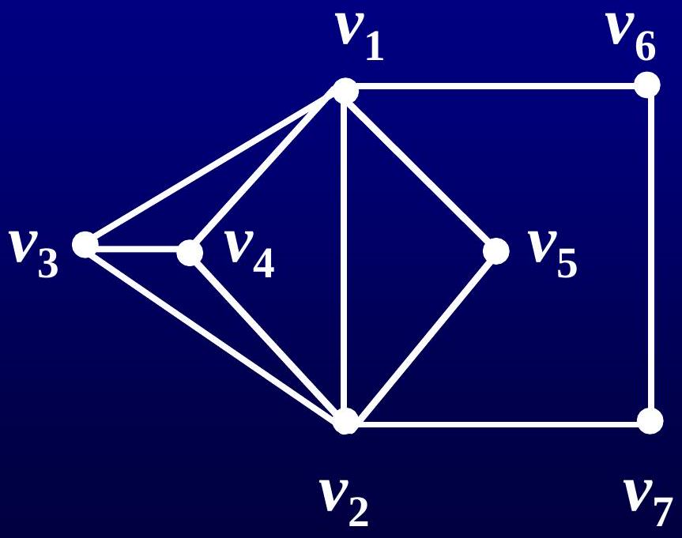

#### 五、图的频序列

> **定理** 任意一个 $n$ 阶简单图 $G$ 的点的度不能互不相同。

**证明** 因为图 $G$ 为简单图，对任意点 $v$，有 $0 \leq d(v) \leq n-1$。

- **情形1**：若 $G$ 没有孤立点，则

$$
1 \leq d(v) \leq n-1, \forall v \in V(G) 。
$$

因为顶点个数为 $n$，所以必有两个顶点度数相同。

- **情形2**：若 $G$ 仅有一个孤立点，设 $G_{1}$ 表示 $G$ 去掉孤立点后的部分，则

$$
1 \leq d(v) \leq n-2, \forall v \in V\left(G_{1}\right) .
$$

同理，在 $G_{1}$ 中必有两顶点度数相同。

- **情形3**：若 $G$ 有两个以上的孤立点，则定理显然成立。

> **定义** 设 $n$ 阶图简单图 $G$ 的各个顶点的度取 $s$ 个不同的非负整数$d_{1}, d_{2}, \ldots, d_{s}$。 又设度为 $d_{i}$ 的点有 $b_{i}$ 个 $\left(\sum b_{i}=n\right)$，则称 $\left(b_{1}, b_{2}, \ldots, b_{s}\right)$为 $G$ 的频序列。
> 
> **定理** 一个 $n$ 阶简单图 $G$ 和它的补图有相同的频序列。

**证明** 由补图的定义知，点 $v$ 在图 $G$ 及其补图中的度数之和为 $n-1$，即

$$
d_{G}(v)+d_{\bar{G}}(v)=n-1
$$

因此，若 $G$ 中有 $b_{i}$ 个度为 $d_{i}$ 的点，则这 $b_{i}$ 个点在 $G$ 的补图中的度变为 $n-1-d_{i}$。

故 $G$ 与其补图有相同的频序列。

### 1.2 子图与图的运算

#### 一、子图

> **定义** 设 $G$ 和 $H$ 为两个图，若 $V(H) \subseteq V(G), E(H) \subseteq E(G)$，则称 $H$ 是 $G$ 的子图，记为 $H \subseteq G$。

简单地说，图 $G$ 的任意一部分（包括 $G$ 自身和空图）都称为是图 $G$ 的一个子图。

> **注** 当 $m \leq n$ 时，$K_{m}$ 是 $K_{n}$ 的一个子图。

当 $H \subseteq G$ 但 $H \neq G$ 时，称 $H$ 为 $G$ 的真子图，记为 $H \subset G$。

> 当子图 $H$ 满足 $V(H)=V(G)$ 时，称 $H$ 为 $G$ 的生成子图。

**例**

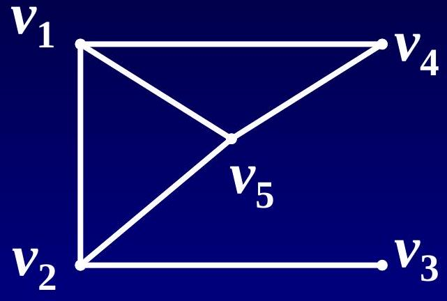

G

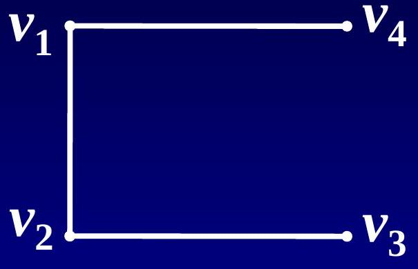

$\boldsymbol{H}_{\mathbf{1}}$

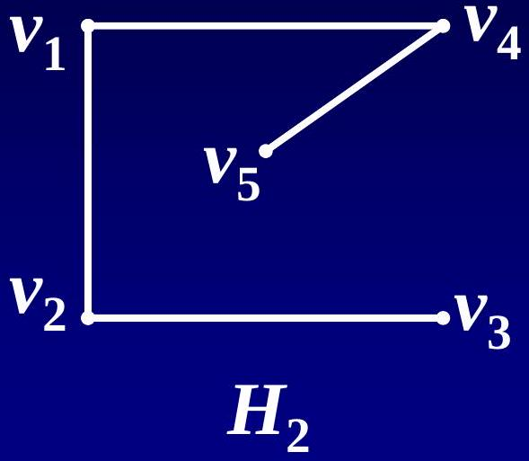

在上图中，$H_{1}$ 与 $H_{2}$ 均为 $G$ 的子图，其中 $H_{2}$ 是 $G$ 的生成子图，而 $H_{1}$ 则不是。

**例** 求 $G$ 的所有生成子图。

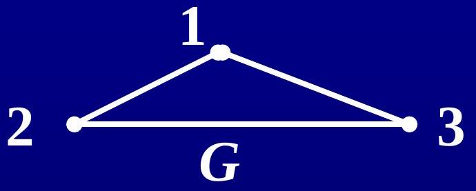

**解**

> **定理** 具有 $m$ 条边的简单标号图的生成子图的个数为 $2^{m}$。

**定义** 设 $V^{\prime}$ 是 $V$ 的一个非空子集。以 $V^{\prime}$ 为顶点集，以两端点均在 $V^{\prime}$ 中的边的全体为边集所组成的子图，称为 $G$ 的由 $V^{\prime}$导出的子图，简称为 $G$ 的导出子图，记为 $G\left[V^{\prime}\right]$。

$G-V^{\prime}$ 表示从 $G$ 中删除 $V^{\prime}$ 中的顶点以及与这些顶点相关联的边所得到的子图。若 $V^{\prime}=\{v\}$，则把 $G-\{v\}$ 简记为 $G-v$。

**例** 求 $G\left[V \backslash V^{\prime}\right]$，其中 $V^{\prime}=\{2,4\}$。

**解**

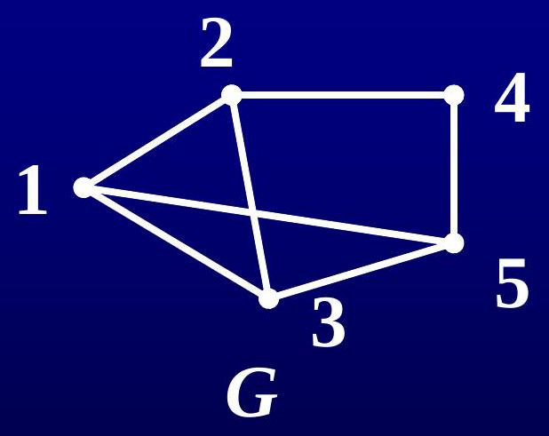

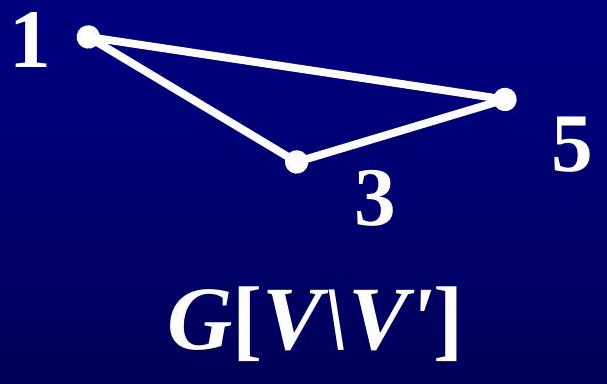

> **注** $\boldsymbol{G}-\boldsymbol{V}^{\boldsymbol{\prime}}=\boldsymbol{G} \boldsymbol{[} \boldsymbol{V} \backslash \boldsymbol{V}^{\boldsymbol{\prime}} \boldsymbol{]}$

**定义** 假设 $E^{\prime}$ 是 $E$ 的非空子集。以 $E^{\prime}$ 为边集，以 $E^{\prime}$ 中边的端点全体为顶点集所组成的子图称为 $G$ 的由 $E^{\prime}$ 导出的子图，简称为 $G$ 的边导出子图，记为 $G\left[E^{\prime}\right]$。

$G-E^{\prime}$ 表示从图 $G$ 中删去 $E^{\prime}$ 中的边之后的子图。若 $E^{\prime}=\{e\}$，则用 $G-e$ 来代替 $G-\{e\}$。

**例** 求 $G\left[E \backslash E^{\prime}\right]$，其中 $E^{\prime}=\{13,24,35\}$。

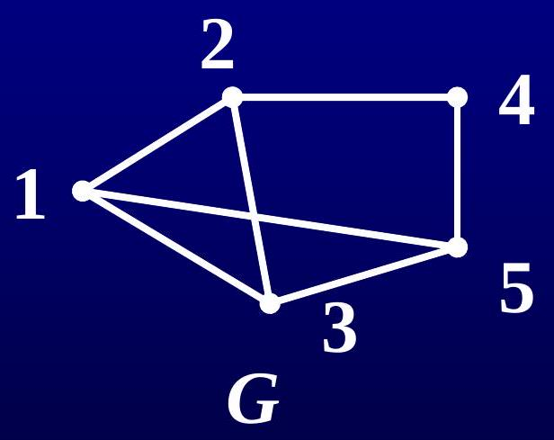

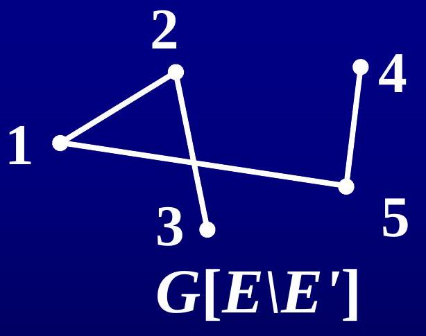

**注** $\boldsymbol{G}-\boldsymbol{E}^{\prime} \neq \boldsymbol{G}\left[\boldsymbol{E} \backslash \boldsymbol{E}^{\prime}\right]$

#### 二、图的运算

设 $G_{1}, G_{2}$ 是 $G$ 的子图，有下列术语与概念：

$G_{1}$ 和 $G_{2}$ 不相交：指它们无公共顶点。

$G_{1}$ 和 $G_{2}$ 边不重：指它们无公共边。

并图 $G_{1} \cup G_{2}$：是指其顶点集为 $V\left(G_{1}\right) \cup V\left(G_{2}\right)$，边集为$E\left(G_{1}\right) \cup E\left(G_{2}\right)$ 的 $G$ 的一个子图；如果 $G_{1}$ 和 $G_{2}$ 是不相交的，就记其并图为 $G_{1}+G_{2}$。

交图 $G_{1} \cap G_{2}$：类似地定义，但二者至少要有一个公共顶点。

差图 $G_{1}-G_{2}$：在 $G_{1}$ 中去掉 $G_{2}$ 中的边组成的图。

对称差 $G_{1} \Delta G_{2}$：

$$
G_{1} \Delta G_{2}=\left(G_{1}-G_{2}\right) \cup\left(G_{2}-G_{1}\right) \text { 或 }\left(G_{1} \cup G_{2}\right)-\left(G_{1} \cap G_{2}\right) \text { 。 }
$$

**例**

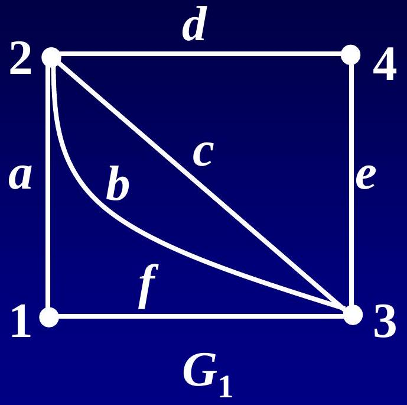

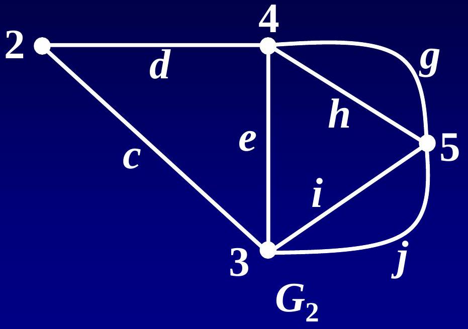

则

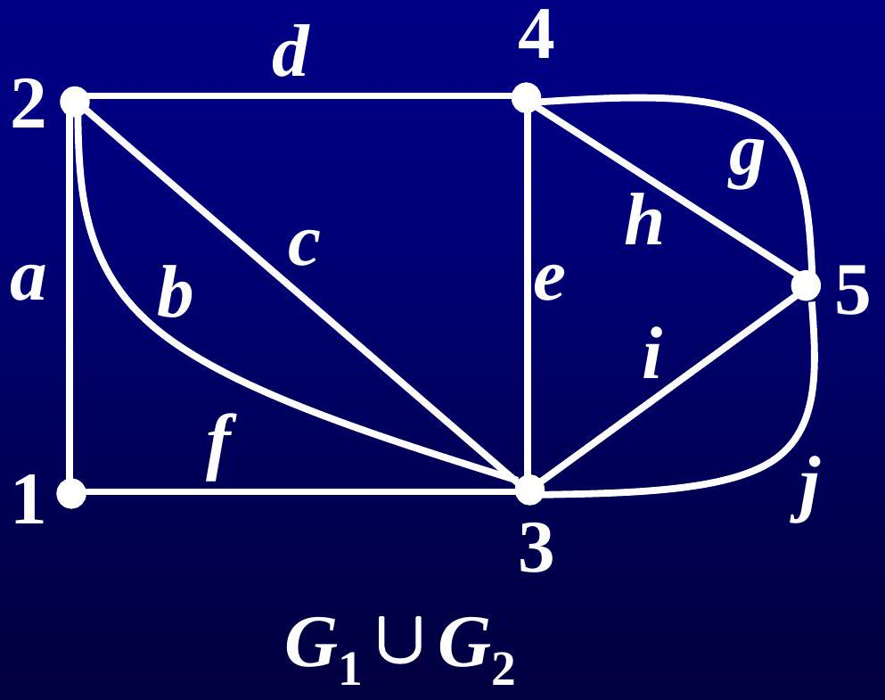

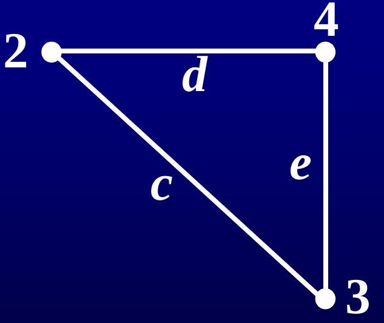

$\boldsymbol{G}_{\mathbf{1}} \cap \boldsymbol{G}_{\mathbf{2}}$

**例**

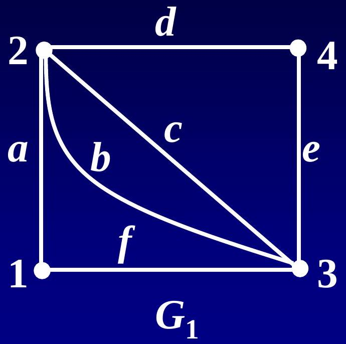

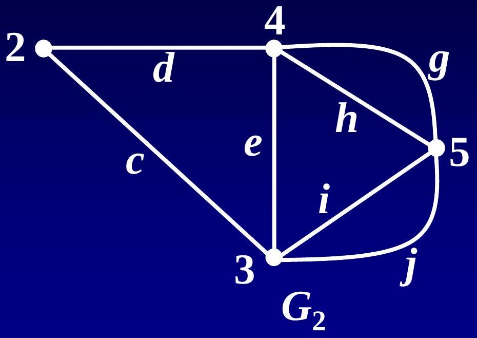

则

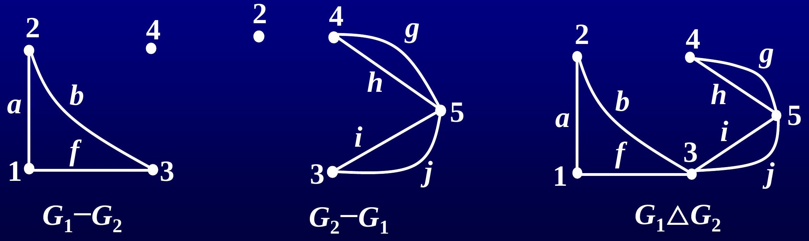

> **定义** 在不相交的 $G_{1}$ 和 $G_{2}$ 的并图 $G_{1}+G_{2}$ 中，把 $G_{1}$ 的每个顶点和 $G_{2}$ 的每个顶点连接起来所得到的图称为 $G_{1}$ 和 $G_{2}$ 的联图，记为 $G_{1} \vee G_{2}$。

**例**

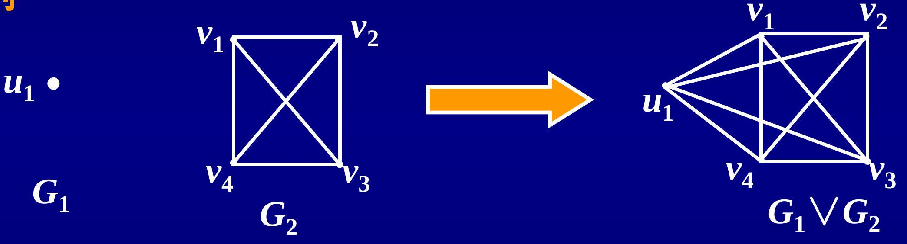

不难看出：

> 
> 
> $$
> \begin{array}{ll}
> K_{1} \vee K_{4}=K_{5}, & K_{2} \vee K_{3}=K_{5} \\
> K_{1} \vee K_{5}=K_{6}, & K_{2} \vee K_{4}=K_{6}, \quad K_{3} \vee K_{3}=K_{6} 。
> \end{array}
> $$
> 
> $$
> K_{m} \vee K_{n}=K_{m+n}
> $$

> **定义** 设 $G_{1}=\left(V_{1}, E_{1}\right), G_{2}=\left(V_{2}, E_{2}\right)$，对点集 $V=V_{1} \times V_{2}$ 中的任意两个点 $u=\left(u_{1}, u_{2}\right)$ 和 $v=\left(v_{1}, v_{2}\right)$，当（$u_{1}=v_{1}$ 且 $u_{2} v_{2} \in E_{2}$）或（$u_{2}=v_{2}$ 且 $u_{1} v_{1} \in E_{1}$）时就把 $u$ 和 $v$ 连接起来所得到的图 $G$ 称为 $G_{1}$ 和 $G_{2}$ 的积图，记为 $G=G_{1} \times G_{2}$。

**例**

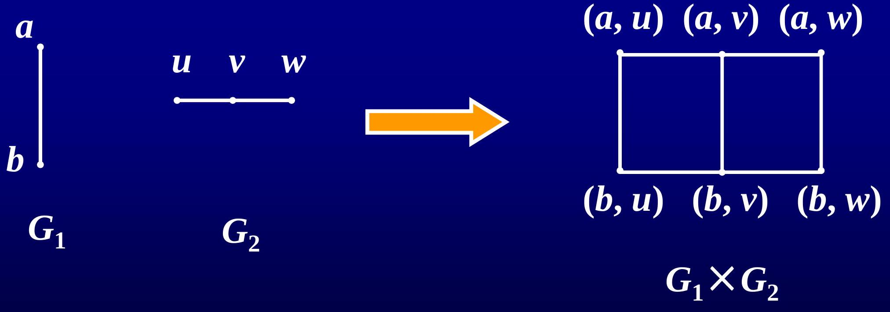

> **定义** 设 $G_{1}=\left(V_{1}, E_{1}\right), G_{2}=\left(V_{2}, E_{2}\right)$，对点集 $V=V_{1} \times V_{2}$ 中的任意两个点 $u=\left(u_{1}, u_{2}\right)$ 和 $v=\left(v_{1}, v_{2}\right)$，当 $u_{1} v_{1} \in E_{1}$ 或（$u_{1}=v_{1}$ 且 $u_{2} v_{2} \in E_{2}$）时就把 $u$ 和 $v$ 连接起来所得到的图 $G$ 称为 $G_{1}$ 和 $G_{2}$ 的合成图，记为 $G=G_{1}\left[G_{2}\right]$。

**例** 已知 $G_{1}$ 与 $G_{2}$，求 $G_{1}\left[G_{2}\right]$ 和$G_{2}\left[G_{1}\right]$。

**解**

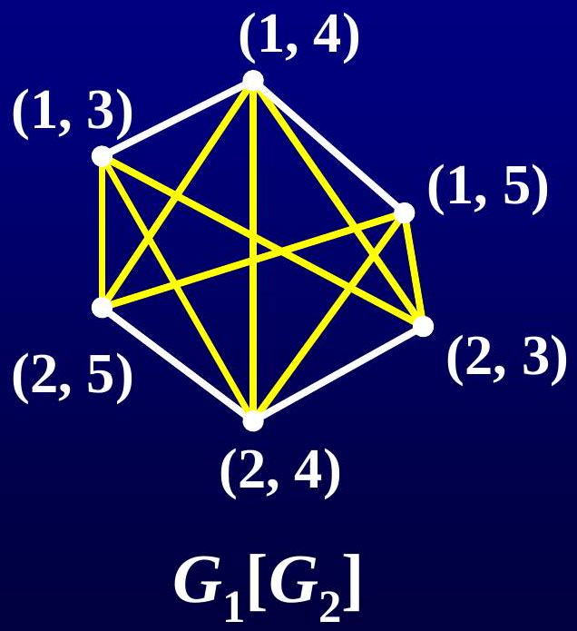

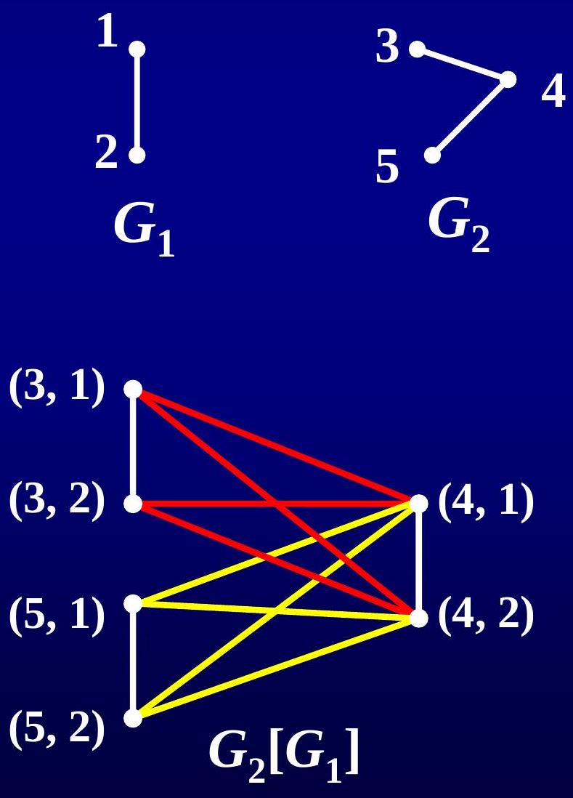

若 $G_{1}$ 的点数和边数为 $n_{1}, m_{1}$，$G_{2}$ 的点数和边数为 $n_{2}, m_{2}$，经过联、积、合成三种运算，图的点数和边数为

<table>
<tr><th>运算</th><th>点数</th><th>边数</th></tr>
<tr><td>$\boldsymbol{G}_{\mathbf{1}} \boldsymbol{\vee} \boldsymbol{G}_{\mathbf{2}}$</td><td>$\boldsymbol{n}_{\mathbf{1}} \boldsymbol{+} \boldsymbol{n}_{\mathbf{2}}$</td><td>$\boldsymbol{m}_{\mathbf{1}} \boldsymbol{+} \boldsymbol{m}_{\mathbf{2}} \boldsymbol{+} \boldsymbol{n}_{\mathbf{1}} \boldsymbol{n}_{\mathbf{2}}$</td></tr>
<tr><td>$\boldsymbol{G}_{\mathbf{1}} \boldsymbol{\times} \boldsymbol{G}_{\mathbf{2}}$</td><td>$\boldsymbol{n}_{\mathbf{1}} \boldsymbol{n}_{\mathbf{2}}$</td><td>$\boldsymbol{n}_{\mathbf{1}} \boldsymbol{m}_{\mathbf{2}} \boldsymbol{+} \boldsymbol{n}_{\mathbf{2}} \boldsymbol{m}_{\mathbf{1}}$</td></tr>
<tr><td>$\boldsymbol{G}_{\mathbf{1}} \boldsymbol{[} \boldsymbol{G}_{\mathbf{2}} \boldsymbol{]}$</td><td>$\boldsymbol{n}_{\mathbf{1}} \boldsymbol{n}_{\mathbf{2}}$</td><td>$\boldsymbol{n}_{\mathbf{1}} \boldsymbol{m}_{\mathbf{2}} \boldsymbol{+} \boldsymbol{n}_{\mathbf{2}}^{\mathbf{2}} \boldsymbol{m}_{\mathbf{1}}$</td></tr>
<tr><td>$\boldsymbol{G}_{\mathbf{2}} \boldsymbol{[} \boldsymbol{G}_{\mathbf{1}} \boldsymbol{]}$</td><td>$\boldsymbol{n}_{\mathbf{1}} \boldsymbol{n}_{\mathbf{2}}$</td><td>$\boldsymbol{n}_{\mathbf{2}} \boldsymbol{m}_{\mathbf{1}} \boldsymbol{+} \boldsymbol{n}_{\mathbf{1}}^{\mathbf{2}} \boldsymbol{m}_{\mathbf{2}}$</td></tr>
</table>

图的积运算是网络构造的常用方法。并行计算机中的网络拓扑常采用所谓的＂超立方体＂结构。采用该结构可使网络具有较好的可靠性、较小的通信延迟和很好的可扩展性以及便于并行编程等优点。

超立方体 $Q_{n}$，简称 $n$ 方体，可以采用积图来递归构造：

1. 1 方体：$Q_{1}=K_{2}$。

2. $n$ 方体定义为： $\boldsymbol{Q}_{\boldsymbol{n}}=\boldsymbol{Q}_{\boldsymbol{1}} \times \boldsymbol{Q}_{\boldsymbol{n}-1}$。

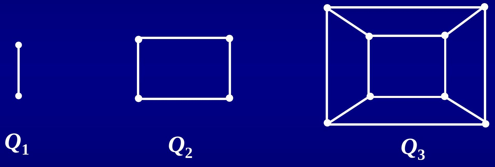

> 利用归纳法不难证明：超立方体 $Q_{n}$ 是具有 $2^{n}$ 个顶点，$n 2^{n-1}$ 条边的 $n$ 正则二部图。

超立方体可以采用下面简单的方法来构造。

$n$ 方体 $Q_{n}$ 的顶点数目正好等于 $2^{n}$，因此可用长度为 $n$ 的二进制码来表示 $Q_{n}$ 的顶点。

构造方法：

1. 将每个长度为 $n$ 的二进制码表示成一个顶点；

2. 在两个顶点之间连线当且仅当这两个顶点的二进制码只有一位对应位数字不同。

**例**

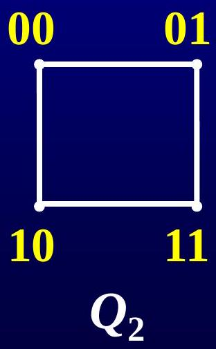

在 $n$ 方体 $Q_{n}$ 中，如果取一半那么多的顶点，这些顶点可以两两之间没有边。比如当 $n=2$ 时，取 00 和 11，或者取 01 和 10，它们之间没有边；当 $n=3$ 时，可以取 $000 、 110 、 101$ 和 011 这四个顶点，它们之间没有边。

**定理** 设 $G$ 是 $Q_{n}$ 的任意的 $2^{n-1}+1$ 阶点导出子图，则

$$
\Delta(G) \geq \sqrt{n} .
$$

借助该定理，可以直接证明理论计算机科学领域中著名的敏感性猜想（Sensitivity Conjecture）。它是具体复杂性理论 （concrete complexity）中一个广为人知的猜想，由耶路撒冷希伯来大学的Noam Nisan和罗格斯大学的Mario Szegedy于1992年所提出。

H．Huang，Induced subgraphs of hypercubes and a proof of the Sensitivity Conjecture，Ann．Math．，190（2019），949－955。

关于 $n$ 方体 $Q_{n}$ 的性质研究，可以查阅到很多文献。

经典文章是：Y．Saad and M．H．Schultz，Topological Properties of Hypercubes，IEEE Trans．Comput．， 37 （1988），867－872．

**定义** 把 $G_{1}$ 的任意一个顶点和 $G_{2}$ 的任意一个顶点等同起来得到的新图称为 $G_{1}$ 与 $G_{2}$ 的联合，记为 $G_{1} \cdot G_{2}$。

**例**

### 1.3 路和连通性

对图的路与连通性进行研究，在计算机网络研究中有着十分重要的意义。因为网络的抽象就是一个图。研究网络信息传递，信息寻径是主要问题之一，这恰对应于图中路的研究；在网络研究中，可靠性也是主要问题之一，它与图的连通性问题相对应。

#### 一、途径、迹、路圈、距离和直径

> **定义** 给定图 $G=(V, E), w=v_{0} e_{1} v_{1} e_{2} \ldots e_{k} v_{k}$ 是 $G$ 中点边交替组成的序列，其中 $v_{i} \in V, e_{i} \in E$，若 $w$ 满足 $e_{i}$ 的端点为 $v_{i-1}$ 与 $v_{i}$，则称 $w$ 为一条从顶点 $v_{0}$ 到顶点 $v_{k}$ 的途径（或通道或通路），简称$\left(v_{0}, v_{k}\right)$ 途径。

顶点 $v_{0}$ 和 $v_{k}$ 分别称为 $w$ 的起点和终点，其他点称为内部点，途径中的边数称为它的长度。

在简单图中，途径可以简单地由其顶点序列来表示。

> **定义** 边不重复的途径称为迹；点不重复的迹称为路。

> **定义** 起点和终点相同的途径、迹和路分别称为闭途径、闭迹和圈。闭途径也称为环游，闭迹也称为回路。

长度为 $k$ 的圈称为 $k$ 圈，$k$ 为奇数时称为奇圈，$k$ 为偶数时称为偶圈。自环是长度为1的圈。3圈常称为三角形。

若图中两个不同点 $u$ 与 $v$ 间存在途径，则 $u$ 与 $v$ 间必存在路；若过点 $u$ 存在闭迹，则过点 $u$ 必存在圈。

**注** 若过点 $u$ 存在闭途径，则过点 $u$ 不一定存在圈。

> **定义** 联结 $u$ 和 $v$ 的长度最短的路的长度，称为 $u$ 与 $v$ 的距离，记为 $d(u, v)$。

> **定义** 图 $G$ 的直径定义为
> 
> $$
> d(G)=\max \{d(u, v) \mid u, v \in V\} 。
> $$

**例** 在图 $G$ 中，取 $w_{1}=v_{1} v_{2} v_{3}, w_{2}=v_{1} v_{2} v_{3} v_{4} v_{2}, w_{3}=v_{1} v_{2} v_{3} v_{2} v_{3} v_{4}$，则 $w_{1}$ 是长度为 2 的路；$w_{2}$ 是长度为 4 的迹；$w_{3}$ 是长度为 5 的途径。

$v_{1} v_{2} v_{5} v_{1}$ 是长度为 3 的圈；$v_{1} v_{2} v_{3} v_{4} v_{2} v_{5} v_{1}$ 是长为6的回路。

直径 $d(G)=2$。

#### 二、图的连通性

> **定义** 图 $G$ 中点 $u$ 与 $v$ 称为是连通的，如果 $u$ 与 $v$ 间存在途径。否则称 $u$ 与 $v$ 不连通。
> 
> **定义** 如果图 $G$ 中任意两点是连通的，称 $G$ 是连通图，否则称 $G$ 是非连通图。在图中，每一个极大的连通部分称为 $G$ 的连通分支。

$G$ 的连通分支的个数，称为 $G$ 的分支数，记为 $\omega(G)$。

> **定理** 若 $e$ 是连通图 $G$ 的圈 $C$ 上的一条边，则 $G-e$ 是连通图。

**证明** 设 $e=u v$，令 $P=C-e$，易知 $P$ 是 $G-e$ 中一条 $(u, v)$ 路。

任取 $G-e$ 中两个不同点 $x$ 和 $y$，因为 $G$ 连通，所以 $G$ 中存在$(x, y)$ 路 $\Gamma$。

若 $\Gamma$ 不含 $e$，则 $\Gamma$ 也是 $G-e$ 中一条 $(x, y)$ 路；若 $\Gamma$ 含 $e$，用 $P$ 替换 $e$ 后也可得到 $G-e$ 中一条 $(x, y)$ 路。

因此，$G-e$ 是连通图。

> **定理** 若图 $G$ 是非连通图，则其补图是连通图。

**证明** 因 $G$ 不连通，故 $G$ 中至少两个分支。

设 $u, v$ 是 $G$ 的任意两个顶点。

若 $u$ 和 $v$ 在 $G$ 中不邻接，则在补图中它们邻接。

若 $u$ 和 $v$ 在 $G$ 中邻接，则它们属于 $G$ 的同一分支。

在另一个分支中取一点 $w$，则在补图中 $u$ 和 $v$ 均与 $w$ 邻接，从而 $u w v$ 是一条途径，故在补图中 $u$ 和 $v$ 连通。

因此，$G$ 的补图是连通图。

> **注** 非连通图的补图的直径小于等于 2。

> **定理** 设图 $G$ 为 $n$ 阶简单图，若 $G$ 中任意两个不相邻顶点 $u$ 与 $v$ 满足 $d(u)+d(v) \geq n-1$，则 $G$ 是连通图且 $d(G) \leq 2$。

**证明** 我们将证明，对 $G$ 中任意两点 $x$ 与 $y$，一定存在一条长度至多为 2 的连接 $x$ 与 $y$ 的路。

若 $x$ 和 $y$ 相邻，则上述论断成立。

若 $x$ 和 $y$ 不相邻，则一定存在一点 $w$ 与 $x$ 和 $y$ 均相邻。

若不然，在 $G$ 的剩下的 $n-2$ 个顶点中，假设有 $k$ 个与 $x$ 邻接，但与 $y$ 不邻接，有 $l$ 个顶点和 $y$ 邻接，但不与 $x$ 邻接，同时假定有 $m$ 个顶点与 $x$ 和 $y$ 均不相邻。

那么，$d(x)=k, d(y)=l$。

$$
\because  k+l+m=n-2
$$

$$
\therefore  d(x)+d(y)=n-2-m \leq n-2，矛盾！
$$

**例** 证明：若 $\delta(G) \geq 2$，则 $G$ 中必然含有圈。

> **证明:** 只就连通的简单图证明即可！
> 
> 设 $W=v_{1} v_{2} \ldots v_{k-1} v_{k}$ 是 $G$ 中的一条最长路。
> 
> $\because$ $\delta(G) \geq 2$，$\therefore$  $v_{1}$ 必然有相异于 $v_{2}$ 的相邻顶点。
> 
> 又$\because$  $W$ 是 $G$ 中最长路，$\therefore$ 这样的点必然是 $v_{3}, v_{4}, \ldots, v_{k}$ 中的某一个。
> 
> 设该点为 $v_{m}$，则 $v_{1} v_{2} \ldots v_{m} v_{1}$ 为 $G$ 中的一个圈。
> 
> 事实上，与 $v_{1}$ 相邻的所有点都在路 $W$ 上。

**思考** 若 $\delta(G) \geq 2$，则简单图 $G$ 中必然包含长度至少为 $\delta(G)+1$ 的圈。

> 证明：设$W=v_{1}v_{2}v_{3}....v_{k-1}v_{k}$是$G$中的一条最长路
> 
> $\because \delta(G) \geq 2,\therefore v_{1}$必然有相异于$v_{2}$的相邻顶点
> 
> 取
> $m=\max\{i:\ v_{1}v_{i}\in E(G)\},
> $
> 
> 即 $v_m$ 是 $v_1$在路$ W $上**下标最大的邻点**。于是，$v_1 $的所有邻点都属于集合$
> \{v_2,v_3,\ldots,v_m\}.
> $
> 
> $\because$ 该集合有 $m-1$ 个顶点，$\therefore \delta(G)\leq d(v_1)\leq m-1$，$\therefore m\geq\delta(G)+1$。
> 
> 由于$ v_1v_m\in E(G)$，路段 $v_1v_2\cdots v_m$ 加上边 $v_mv_1$，便构成圈
> $
> C=v_1v_2\cdots v_mv_1.
> $
> 
> $\therefore \
> |E(C)|=m\ge \delta(G)+1.
> $
> 
> 因此，$G$中必然包含长度至少为$ \delta(G)+1$的圈。证毕。

**例** 证明：在 $n$ 阶连通图中，

1. 至少有 $n-1$ 条边；

2. 如果边数大于 $n-1$，则至少有一个圈。

**证明**

> （1）对 $G$ 的顶点数作数学归纳。
> 
> 当 $n=1$ 时，结论显然；设结论对 $n=k$ 时成立。
> 
> 当 $n=k+1$ 时，分两种情况讨论。
> 
> 若 $G$ 中存在 1 度顶点 $u$，则$G-u$仍然为连通图，所以 $G-u$至少含有 $k-1$ 条边。
> 
> 于是，$G$ 至少有 $k$ 条边。
> 
> 若 $G$ 中没有1度顶点，则 $\delta(G) \geq 2$。
> 
> 由握手定理知： $2 m=\sum d(v) \geq 2 n \Rightarrow m \geq n \Rightarrow m>n-1$。

> （2）对 $G$ 的顶点数作数学归纳。
> 
> 当 $n=1$ 时，结论显然成立。
> 
> 设结论对 $n=k$ 时成立。
> 
> 当 $n=k+1$ 时，分两种情况讨论。
> 
> 若 $G$ 中有 1 度顶点 $u$，$G$的边数大于$k$ ,考虑 $G-u$。
> 
> 显然，$G-u$ 为 $k$ 阶连通图且边数大于 $k-1$。由归纳假设知 $G-u$中存在圈。因此，图 $G$ 包含圈。
> 
> 若 $G$ 中没有1度顶点，则 $\delta(G) \geq 2$。此时，图 $G$ 必然包含圈。

**例** 设 $G$ 是具有 $m$ 条边的 $n$ 阶简单图，证明：若 $G$ 的直径为 2 且$\Delta=n-2$，则 $m \geq 2 n-4$。

> **证明** 设 $d(v)=\Delta=n-2$，且设 $v$ 的邻接点为 $v_{1}, v_{2}, \ldots, v_{n-2}, u$ 是剩下的一个顶点。
> 
> 由于 $d(G)=2$ 且 $u$ 不能和 $v$ 相邻，所以 $u$ 至少和 $v_{1}, v_{2} \ldots, v_{n-2}$ 中的一个顶点邻接，否则有 $d(G)>2$。（非连通图的直径定义为 $\infty$）不妨假设 $u$ 和 $v_{1}, v_{2}, \ldots, v_{k}$ 相邻。
> 
> 为了保证 $u$ 到各点距离不超过 2，$v_{k+1}, \ldots, v_{n-2}$ 这些顶点的每一个必须和前面 $v_{1}, v_{2}, \ldots, v_{k}$ 中某点相邻，这样图中至少又有 $n-2$ 条边。
> 
> 因此，总共至少有 $2 n-4$ 条边。

#### 三、偶图判定定理

> **定理** 一个图是偶图当且仅当它不包含奇圈。

**证明** 一个图是偶图当且仅当每个连通分支是偶图；一个图不包含奇圈当且仅当每个连通分支不包含奇圈。因此，我们只需对连通图证明即可。

> 设 $G$ 是具有二分类 $(X, Y)$ 的偶图，并且 $C=v_{1} v_{2} \ldots v_{k} v_{1}$ 是 $G$ 的任意一个圈。
> 
> 必要性证明：不失一般性，可假定 $v_{1} \in X$。这样，$v_{2 i-1} \in X$，且 $v_{2 i} \in Y$。又因为 $v_{1} \in X$，所以 $v_{k} \in Y$，即 $k$ 是偶数。由此得 $C$ 是偶圈。

充分性证明：

设 $G$ 是不包含奇圈的连通图。

$\forall u \in V(G)$且定义 $V$ 的一个分类 $(X, Y)$ 如下：

$$
\begin{aligned}
& X=\{x \mid d(u, x) \text { 是偶数, } x \in V(G)\}, \\
& Y=\{y \mid d(u, y) \text { 是奇数, } y \in V(G)\} \text { 。 }
\end{aligned}
$$

现在证明 $(X, Y)$ 是 $G$ 的一个二分类。

显然，对 $\forall v,w \in X$，$v,w$两点必不相邻！

设 $P$ 是一条最短 $(u, v)$ 路，而 $Q$ 是一条最短的（$u, w$）路。

设 $u_{1}$ 是 $P$ 和 $Q$ 的最后一个交点。

由于 $P, Q$ 是最短路，所以 $P, Q$ 中 $u$ 到 $u_{1}$ 段长度相同，因此奇偶性相同。

又因为 $P$，$Q$ 的长度均是偶数，所以 $P, Q$ 中 $u_{1} v$ 段和 $u_{1} w$ 段奇偶性相同。

如果 $v$ 与 $w$ 相邻，则可得到奇圈，矛盾！

类似地，$Y$ 中任意两个顶点也不相邻。

### 1.4 最短路及其算法

#### 一、赋权图

**定义** 若图 $G$ 的每一条边 $e$ 都附有一个实数 $w(e)$，称为 $e$ 的权，则 $G$ 连同它边上的权称为赋权图。

若 $G$ 是一个赋权图，则 $G$ 的各边权之和称为图 $G$ 的权，记为$W(G)$。

**例** 右图 $G$ 为赋权图，其中

$$
\begin{aligned}
& w\left(v_{1} v_{2}\right)=1, \\
& w\left(v_{1} v_{3}\right)=5, \\
& W(G)=20 .
\end{aligned}
$$

**定义** 设 $G$ 为赋权图，$u$ 与 $v$ 是 $G$ 中两点，在连接 $u$ 与 $v$ 的所有路中，各边权值之和最小的路，称为 $u$ 与 $v$ 间的最短路，最短路的权值称为 $u$ 与 $v$ 的距离，仍记为 $d(u, v)$。

易知，各边的权均为1的赋权图中的路长与非赋权图中的路长是一致的。

**例** 求 $v_{2}$ 与 $v_{4}$ 的距离。

**解** $d\left(v_{2}, v_{4}\right)=5$。

相应的最短路为

$$
\Gamma: v_{2} v_{1} v_{3} v_{4} .
$$

#### 二、最短路问题

##### Dijkstra算法（顶点标号法）

Dijkstra算法不仅找到了最短的 $(a, b)$ 路，而且给出了 $a$ 到图 $G$ 的所有其他顶点的最短路。

> **记号说明**
> 
> - $l(e)$：边 $e$ 的权重；
> 
> - $t\left(a_{k}\right)$：点 $a_{k}$ 的标号值，表示点 $a_{1}=a$ 到 $a_{k}$ 的最短路长度；
> 
> - $A_{i}=\left\{a_{1}, a_{2}, \ldots, a_{i}\right\}$：已经标号的顶点集合；
> 
> - $T_{i}$：$a_{1}$ 到 $a_{i}$ 的最短路上的边所在的集合；
> 
> - $N\left(a_{k}\right)$：与点 $a_{k}$ 相邻的所有点的集合，称为 $a_{k}$ 的邻集。

##### Dijkstra算法

（1）记 $a_{1}=a, t\left(a_{1}\right)=0, A_{1}=\left\{a_{1}\right\}, T_{1}=\emptyset$；

（2）若已经得到 $A_{i}=\left\{a_{1}, a_{2}, \ldots, a_{i}\right\}$，且对于 $1 \leq k \leq i, t\left(a_{k}\right)$ 已知。对每一个 $a_{k} \in A_{i}$，求一点：

$$
b_{k}^{(i)} \in N\left(a_{k}\right)-A_{i}=B_{k}^{(i)}
$$

> 即$b_k^{(i)}$是除去$A_i$中的点后与$a_k$的相邻点，$B_k^{(i)}$为$b_k^{(i)}$的点集合。

使得：

$$
l\left(a_{k} b_{k}^{(i)}\right)=\min _{v \in B_{k}^{(i)}} l\left(a_{k} v\right) ;
$$

> 即找到权值最小的边 $\min _{v \in B_{k}^{(i)}} l\left(a_{k} v\right) ;$

（3）设有 $m_{i}$， $1 \leq m_{i} \leq i$，而 $b_{m_{i}}{ }^{(i)}$ 使 $t\left(a_{m_{i}}\right)+l\left(a_{m_{i}} b_{m_{i}}{ }^{(i)}\right)$ 取最小值。令：

$$
a_{i+1}=b_{m_{i}}^{(i)}, t\left(a_{i+1}\right)=t\left(a_{m_{i}}\right)+l\left(a_{m_{i}} a_{i+1}\right), T_{i+1}=T_{i} \cup\left\{a_{m_{i}} a_{i+1}\right\} ;
$$

（4）若 $a_{i+1}=b$，停止；否则，记 $A_{i+1}=A_{i} \cup\left\{a_{i+1}\right\}$，转（2）。

**例** 如图所示，求点 $a$ 到点 $b$ 的距离。

**解**

1． $A_{1}=\{a\}, t(a)=0, T_{1}=\emptyset$；

$l(av_3)=1,l(av_2)=8,l(av_1)=6,min=l(av_3)$

2． $b_{1}{ }^{(1)}=v_{3}$；

3． $m_{1}=1, a_{2}=v_{3}, t\left(v_{3}\right)=t(a)+l\left(a v_{3}\right)=1$（最小），$T_{2}=\left\{a v_{3}\right\}$；

4． $A_{2}=\left\{a, v_{3}\right\}, \quad b_{1}{ }^{(2)}=v_{1}, \quad b_{2}{ }^{(2)}=v_{2} ;$

对$a$有$l(av_2)=8,l(av_1)=2,min=l(av_1),\therefore b_1^{(2)}=v_1$

对$v_3$有$l(v_3v_2)=7,l(v_3v_6)=9,min=l(v_3v_2),\therefore b_2^{(2)}=v_2$

5． $m_{2}=1, \quad a_{3}=v_{1}, \quad t\left(v_{1}\right)=t(a)+l\left(a v_{1}\right)=2$（最小），$T_{3}=\left\{a v_{3}, a v_{1}\right\}$；

6． $A_{3}=\left\{a, v_{3}, v_{1}\right\}, \quad b_{1}{ }^{(3)}=v_{2}, \quad b_{2}{ }^{(3)}=v_{2}, \quad b_{3}{ }^{(3)}=v_{4}$；

7． $m_{3}=3, a_{4}=v_{4}, t\left(v_{4}\right)=t\left(v_{1}\right)+l\left(v_{1} v_{4}\right)=3$（最小），

$$
T_{4}=\left\{a v_{3}, a v_{1}, v_{1} v_{4}\right\} ;
$$

8． $A_{4}=\left\{a, v_{3}, v_{1}, v_{4}\right\}, \quad b_{1}{ }^{(4)}=v_{2}, \quad b_{2}{ }^{(4)}=v_{2}, \quad b_{3}{ }^{(4)}=v_{2}, b_{4}{ }^{(4)}=v_{5} ;$

9． $m_{4}=4, a_{5}=v_{5}, t\left(v_{5}\right)=t\left(v_{4}\right)+l\left(v_{4} v_{5}\right)=6$（最小），

$$
T_{5}=\left\{a v_{3}, a v_{1}, v_{1} v_{4}, v_{4} v_{5}\right\}
$$

10． $A_{5}=\left\{a, v_{3}, v_{1}, v_{4}, v_{5}\right\}, \quad b_{1}{ }^{(5)}=v_{2}, \quad b_{2}{ }^{(5)}=v_{2}, \quad b_{3}{ }^{(5)}=v_{2}$，

$$
b_{4}{ }^{(5)}=v_{2}, \quad b_{5}{ }^{(5)}=v_{2} ;
$$

11． $m_{5}=4, a_{6}=v_{2}, t\left(v_{2}\right)=t\left(v_{4}\right)+l\left(v_{4} v_{2}\right)=7$（最小），

$$
T_{6}=\left\{a v_{3}, a v_{1}, v_{1} v_{4}, v_{4} v_{5}, v_{4} v_{2}\right\}
$$

12． $A_{6}=\left\{a, v_{3}, v_{1}, v_{4}, v_{5}, v_{2}\right\}, b_{2}{ }^{(6)}=v_{6}, b_{4}{ }^{(6)}=b, b_{5}{ }^{(6)}=v_{6}$，

$$
b_{6}{ }^{(6)}=v_{6} ;
$$

13． $m_{6}=6, \quad a_{7}=v_{6}, \quad t\left(v_{6}\right)=t\left(v_{2}\right)+l\left(v_{2} v_{6}\right)=9$（最小），

$$
T_{7}=\left\{a v_{3}, a v_{1}, v_{1} v_{4}, v_{4} v_{5}, v_{4} v_{2}, v_{2} v_{6}\right\} ;
$$

14． $A_{7}=\left\{a, v_{3}, v_{1}, v_{4}, v_{5}, v_{2}, v_{6}\right\}, b_{4}{ }^{(7)}=b, b_{5}{ }^{(7)}=b, b_{7}{ }^{(7)}=b$；

15． $m_{7}=7, a_{8}=b, t(b)=t\left(v_{6}\right)+l\left(v_{6} b\right)=11$（最小），

$$
T_{8}=\left\{a v_{3}, a v_{1}, v_{1} v_{4}, v_{4} v_{5}, v_{4} v_{2}, v_{2} v_{6}, v_{6} b\right\} ;
$$

$$
a \rightarrow v_{1} \rightarrow v_{4} \rightarrow v_{2} \rightarrow v_{6} \rightarrow b .
$$

### 1.5 图的代数表示及特征

用邻接矩阵或关联矩阵表示图，称为图的代数表示。用矩阵表示图，主要有两个优点：（1）能够把图输入到计算机中；（2）可以用代数方法研究图论。

#### 一、邻接矩阵

> **定义** 设 $n$ 阶标定图 $G=(V, E), V=\left\{v_{1}, v_{2}, \ldots, v_{n}\right\}$，则 $G$ 的邻接矩阵是一个 $n \times n$ 矩阵 $A(G)=\left[a_{i j}\right]$（简记为 $A$），其中若 $v_{i}$ 邻接 $v_{j}$，则 $a_{i j}=1$；否则 $a_{i j}=0$。

**注** 若 $a_{i j}$ 取为连接 $v_{i}$ 与 $v_{j}$ 的边的数目，则称 $A$ 为推广的邻接矩阵。

**例**

**邻接矩阵**

$$
\left(\begin{array}{llll}\mathbf{0} & \mathbf{1} & \mathbf{0} & \mathbf{0} \\ \mathbf{1} & \mathbf{0} & \mathbf{1} & \mathbf{0} \\ \mathbf{0} & \mathbf{1} & \mathbf{0} & \mathbf{1} \\ \mathbf{0} & \mathbf{0} & \mathbf{1} & \mathbf{1}\end{array}\right)
$$

**推广的邻接矩阵**

$$
\left(\begin{array}{llll}0 & 1 & 0 & 0 \\ 1 & 0 & 2 & 0 \\ 0 & 2 & 0 & 1 \\ 0 & 0 & 1 & 1\end{array}\right)
$$

**邻接矩阵的性质**

> 
> 
> 1. 邻接矩阵是一个对称方阵。
> 
> 2. 简单标号图的邻接矩阵的各行（列）元素之和是该行（列）对应的点的度。
> 
> 3. 若 $A_{1}$ 和 $A_{2}$ 是对应于同一个图的两种不同标号的邻接矩阵，则 $A_{1}$ 和 $A_{2}$ 是相似的，即存在一个可逆矩阵 $P$ 使得 $A_{1}=P^{-1} A_{2} P$。
> 
> 4. $G$ 是连通的当且仅当没有 $G$ 的点的一种标号法使它的邻接矩阵有约化的形式

> 
> 
> $$
> A=\left(\begin{array}{cc}
> A_{11} & 0 \\
> 0 & A_{22}
> \end{array}\right) .
> $$

**例**

左图的推广的邻接矩阵为

$$
\boldsymbol{A}=\left(\begin{array}{llll}
\mathbf{0} & \mathbf{1} & \mathbf{0} & \mathbf{0} \\
\mathbf{1} & \mathbf{0} & \mathbf{2} & \mathbf{0} \\
\mathbf{0} & \mathbf{2} & \mathbf{0} & \mathbf{1} \\
\mathbf{0} & \mathbf{0} & \mathbf{1} & \mathbf{1}
\end{array}\right)
$$

计算得

$$
A^{2}=\left(\begin{array}{llll}
1 & 0 & 2 & 0 \\
0 & 5 & 0 & 2 \\
2 & 0 & 5 & 1 \\
0 & 2 & 1 & 2
\end{array}\right)
$$

图中：

> 
> 
> - $v_{1}$ 到 $v_{1}$ 的长为 2 的途径的数目为 1；
> 
> - $v_{1}$ 到 $v_{2}$ 的长为 2 的途径的数目为 0；
> 
> - $v_{1}$ 到 $v_{3}$ 的长为 2 的途径的数目为 2；
> 
> - $v_{1}$ 到 $v_{4}$ 的长为 2 的途径的数目为 0；
> 
> - $v_{2}$ 到 $v_{2}$ 的长为 2 的途径的数目为 5。

> **定理** 令 $A$ 是 $n$ 阶标号图 $G$ 的推广的邻接矩阵，则 $A^{k}$ 的第 $i$ 行第$j$ 列元素 $a_{i j}{ }^{(k)}$ 等于由 $v_{i}$ 到 $v_{j}$ 的长度为 $k$ 的途径的数目。

**证明** 当 $k=1$ 时，$A^{1}=A$。顶点 $v_{i}$ 与顶点 $v_{j}$ 之间的每条边可以看成是从 $v_{i}$ 与 $v_{j}$ 的一条长度为 1 的途径。由定义知，$A$ 的 $i$ 行 $j$ 列的元素正好是 $v_{i}$ 与 $v_{j}$ 之间的边数。从而，当 $k=1$ 时，结论成立。

假设命题对 $k$ 成立，由于 $A^{k+1}=A A^{k}$，故

$$
a_{i j}^{(k+1)}=\sum_{t=1}^{n} a_{i t} a_{t j}^{(k)} \text { 。 }
$$

由于 $a_{i t}$ 是联结 $v_{i}$ 和 $v_{t}$ 的长度为 1 的途径的数目，$a_{t j}{ }^{(k)}$ 是联结 $v_{t}$ 和$v_{j}$ 的长度为 $k$ 的途径的数目，所以 $a_{i t} a_{t j}{ }^{(k)}$ 表示由 $v_{i}$ 经过 $v_{t}$ 到 $v_{j}$ 的长度为 $k+1$ 的途径数目。

于是对所有的 $t$ 求和便得到了由 $v_{i}$ 到 $v_{j}$ 的长度为 $k+1$ 的途径数目，即 $a_{i j}{ }^{(k+1)}$ 为由 $v_{i}$ 到 $v_{j}$ 的长度为 $k+1$ 的途径数目。

这表明命题对 $k+1$ 成立。

> **推论** 设 $A$ 为简单图 $G$ 的邻接矩阵，则
> 
> 1. $A^{2}$ 的元素 $a_{i i}{ }^{(2)}$ 是 $v_{i}$ 的度数；$A^{3}$ 的元素 $a_{i i}{ }^{(3)}$ 是含 $v_{i}$ 的三角形的数目的两倍。
> 
> 2. 若 $G$ 是连通的，对于 $i \neq j, v_{i}$ 与 $v_{j}$ 之间的距离是使 $A^{k}$ 的 $a_{i j}{ }^{(k)} \neq 0$的最小整数 $k$。

> **推论** 设 $A$ 为 $n$ 阶简单图 $G$ 的邻接矩阵，$\lambda_{1}, \lambda_{2}, \ldots, \lambda_{n}$ 是 $A$ 的全部特征值，则
> 
> $$
> \sum_{i=1}^{n} \lambda_{i}=0, \quad \sum_{i=1}^{n} \lambda_{i}^{2}=2 m
> $$

#### 二、关联矩阵

**定义** 无环图 $G$ 的关联矩阵 $B(G)=\left[b_{i j}\right]$（简记为 $B$）是一个 $n \times m$矩阵，当点 $v_{i}$ 与边 $e_{j}$ 关联时 $b_{i j}=1$，否则 $b_{i j}=0$。

**例**

$$
B=\left[\begin{array}{lllllll}
1 & 0 & 0 & 0 & 1 & 1 & 1 \\
1 & 1 & 0 & 0 & 0 & 0 & 0 \\
0 & 1 & 1 & 0 & 0 & 1 & 0 \\
0 & 0 & 1 & 1 & 0 & 0 & 1 \\
0 & 0 & 0 & 1 & 1 & 0 & 0
\end{array}\right]
$$

**注** 定义中＂无环＂的条件可去掉，此时 $b_{i j}$ 定义为点 $v_{i}$ 与边 $e_{j}$ 关联的次数（$0,1,2$（环））。

**例**

$$
B(G)=\left(\begin{array}{lllllll}
1 & 1 & 0 & 0 & 1 & 0 & 1 \\
1 & 1 & 1 & 0 & 0 & 0 & 0 \\
0 & 0 & 1 & 1 & 0 & 0 & 1 \\
0 & 0 & 0 & 1 & 1 & 2 & 0
\end{array}\right)
$$

**性质** 关联矩阵的每列和为2；其行和为对应顶点的度数。

#### 三、应用

全一问题：假设博物馆里有若干个房间，每个房间里有一盏灯和一个开关，每次按下某个房间的开关，可以改变这个房间以及它相邻的房间的灯的状态。能否找到一种方案，使得所有房间的灯由全亮变为全灭？

设 $G$ 是一个简单图，在每个点处有一盏点亮的灯和一个改变其自身和相邻灯状态的开关。

令 $N(v)$ 表示 $v$ 及其所有邻居构成的集合。

**定理** 对任意简单图 $G$，均存在子集 $S \subseteq V$ 使得 $|S \cap N(v)|$ 对所有$v \in V$ 都是奇数。

**证明** 设 $V=\left\{v_{1}, v_{2}, \ldots, v_{n}\right\}, A$ 为 $G$ 的邻接矩阵。

对任意的 $S \subseteq V$，令 $\chi_{S}=\left(a_{1}, a_{2}, \ldots, a_{n}\right)$ 表示 $S$ 的特征行向量，即

$$
a_{i}=\left\{\begin{array}{l}
1, \text { 若 } v_{i} \in S, \\
0, \text { 若 } v_{i} \notin S .
\end{array}\right.
$$

关闭 $S$ 中的开关可以熄灭所有的灯当且仅当

$$
\chi_{S} \cdot(A+I)=1 \text {. }
$$

（全一向量，二进制运算）

因此，需要证明向量 1 属于 $A+I$ 的行空间 $\operatorname{row}(A+I)$。Why？

显然，向量 $1 \in \operatorname{row}(A+I)$ 当且仅当 1 与 $\operatorname{row}(A+I)$ 的正交补空间中的每个向量正交。

因此，需要证明：若 $(A+I) \alpha^{T}=0$，则 $\alpha \cdot 1=0$。

- $\alpha \cdot 1=0$ 表示向量 $\alpha$ 中具有偶数个1；

- $(A+I) \alpha^{T}$ 是 $A+I$ 中被 $\alpha$ 中 1 的位置所标记的列向量之和；

假设向量 $\alpha$ 满足 $(A+I) \alpha^{T}=0$，$\alpha$ 中 1 所在的位置依次为

$$
s_{1}, s_{2}, \ldots, s_{k}
$$

令 $H=G\left[\left\{v_{s_{1}}, v_{s_{2}}, \ldots, v_{s_{k}}\right\}\right]$，即 $\left\{v_{s_{1}}, v_{s_{2}}, \ldots, v_{s_{k}}\right\}$ 导出的子图。

令 $b_{i, j}$ 为矩阵 $A+I$ 的第 $i$ 行第 $j$ 列的元素，由 $(A+I) \alpha^{T}=0$ 知

$$
\sum_{j=1}^{k} b_{i, s_{j}}=0, i=s_{1}, s_{2}, \ldots, s_{k} .
$$

由于 $b_{i, i}=1$，因此 $H$ 的每个点的度数均为奇数。

因为图中度数为奇数的点的个数必为偶数，所以 $H$ 包含偶数个点，即 $k$ 为偶数。

所以，若 $(A+I) \alpha^{T}=0$，则 $\alpha$ 中包含偶数个 1，从而 $\alpha \cdot 1=0$。

因此， $1 \in \operatorname{row}(A+I)$。

### 1.6 极图

极图属于极值图论的范畴，主要研究满足某个条件下的最大图或最小图问题。

P．Erdös是该研究领域的杰出人物，也是数学界的传奇人物，国际图论大师，Wolf奖获得者。他是20世纪最伟大的数学家之一，也是人类历史上发表数学论文最多的数学家（1525 篇），第二名是凯莱（967 篇），第三名是欧拉（850 余篇），第四名是柯西（789篇）。他于1996年9月20日因心脏病去世，享年83岁，他的逝世当时惊动了整个数学界。

20世纪70年代末，极值图论已经形成了相对完整的理论体系，但还有很多引人入胜的公开性问题没有解决。所以，直到现在，它仍然是重要研究方向。但是，该方向是比较困难的数学研究方向之一。

#### 一、$l$ 部图的概念与特征

> **定义** 若简单图 $G$ 的点集 $V$ 有一个划分：
> 
> $$
> V=\bigcup_{i=1}^{l} V_{i}, \quad V_{i} \cap V_{j}=\varnothing, \quad i \neq j
> $$
> 
> 且所有的 $V_{i}$ 非空，$V_{i}$ 内的点均不邻接，称 $G$ 是一个 $l$ 部图。

**例**

4部图

**注**

1. 如果 $l=2$，则 $G$ 就是偶图；

2. $n$ 阶无环图必是 $n$ 部图；

3. 若 $l_{1}<l_{2} \leq n$，则任意的 $l_{1}$ 部图也是 $l_{2}$ 部图。

> **定义** 如果在一个 $l$ 部图 $G$ 中，$\left|V_{i}\right|=n_{i}$，任何两点 $u \in V_{i}, v \in V_{j}$，$i \neq j, i, j=1,2, \ldots, l$ 均邻接，则称 $G$ 为完全 $l$ 部图，记作 $G=K_{n_{1}, n_{2}, \ldots, n_{l}}$。即不同组之间的点全部相连邻接

**例**

- 点数：$\sum n_{i}$

- 边数：

$$
m=\sum_{i<j} n_{i} n_{j}
$$

**定义** 如果在一个 $n$ 阶完全 $l$ 部图 $G$ 中，$n=k l+r(0 \leq r<l)$，

其实就是带余数除法，例如$n=7,l=3：$

$$
7=2\times3+1
$$

因此$ k=2,r=1$。意思是：

1. 先给每组 2 个点；

2. 还剩 1 个点，把它放进其中一组；

3. 最终得到$3,2,2$。

$r$组各有$k+1$个点，其余组各有 $k$ 个点

$$
即 \left|V_{1}\right|=\left|V_{2}\right|=\cdots=\left|V_{r}\right|=k+1,\left|V_{r+1}\right|=\left|V_{r+2}\right|=\cdots=\left|V_{l}\right|=k,
$$

则称 $G$ 为 $n$ 阶完全 $l$ 几乎等部图，记为 $T_{l, n}$。

图 $T_{l, n}$ 的 $n$ 个点的分布为：

$$
\underbrace{\left\lceil\frac{n}{l}\right\rceil,\left\lceil\frac{n}{l}\right\rceil, \ldots,\left\lceil\frac{n}{l}\right\rceil}_{r}, \underbrace{\left\lfloor\frac{n}{l}\right\rfloor,\left\lfloor\frac{n}{l}\right\rfloor, \ldots,\left\lfloor\frac{n}{l}\right\rfloor}_{l-r}
$$

$\left|V_{1}\right|=\left|V_{2}\right|=\cdots=\left|V_{l}\right|$ 的完全 $l$ 几乎等部图称为完全 $l$ 等部图。

> **定理** $n$ 阶完全偶图 $K_{n_{1}, n_{2}}$ 的边数 $m=n_{1} n_{2}$，且 $m \leq\left\lfloor n^{2} / 4\right\rfloor$。

**证明** 显然 $m=n_{1} n_{2}$。下面证明第二结论：

$$
m\left(K_{n_{1}, n_{2}}\right)=m\left(K_{n-n_{2}, n_{2}}\right)=\left(n-n_{2}\right) n_{2}=\frac{n^{2}}{4}-\left(\frac{n}{2}-n_{2}\right)^{2} \leq\left\lfloor\frac{n^{2}}{4}\right\rfloor .
$$

> **定理** $n$ 阶 $l$ 部图 $G$ 有最多边数的充要条件是 $G \cong T_{l, n}$。

**证明** 首先

$$
m(G) \leq m\left(K_{n_{1}, n_{2}, \ldots, n_{l}}\right) 。
$$

其次，考虑

$$
f\left(n_{1}, n_{2}, \ldots, n_{l}\right)=\sum_{i<j} n_{i} n_{j}, \text { s.t. } \sum_{i=1}^{l} n_{i}=n,
$$

则 $f$ 取最大值的充分必要条件：对任何的 $1 \leq i<j \leq l$，有$\left|n_{i}-n_{j}\right| \leq 1$。

此时 $G$ 的对应的顶点划分形成的 $l$ 部图正好为 $T_{l, n}$。

**思考** 图 $T_{l, n}$ 的边数为

$$
\frac{(l-1) n^{2}+r^{2}}{2 l}-\frac{r}{2} \text {, 其中 } n \equiv r(\bmod l) \text {. }
$$

#### 二、Turán定理

**定义** 设 $G$ 和 $H$ 是两个 $n$ 阶图，称 $G$ 度弱于 $H$，如果存在双射$\mu: V(G) \rightarrow V(H)$，使得对任何点 $v \in V(G)$，有

$$
d_{G}(v) \leq d_{H}(\mu(v)) \text { 。 }
$$

> **注** 若 $G$ 度弱于 $H$，一定有：$m(G) \leq m(H)$。但逆命题不成立。例如：$(1,1,2,4)$ 与 $(3,3,3,3)$ 没有度弱关系！
> 换成度序列怎么理解？
> 把两个图的度序列都从小到大排列：
> $G：g₁ ≤ g₂ ≤ … ≤ gₙ$
> 
> $H：h₁ ≤ h₂ ≤ … ≤ hₙ$
> 那么，$G $度弱于$ H$，等价于每个位置都满足 $gᵢ ≤ hᵢ$。也就是可以直接把排好序的两个度序列逐项比较。

**定理** （Erdös）若 $n$ 阶简单图 $G$ 不包含 $K_{l+1}$，则 $G$ 度弱于某个完全 $l$ 部图 $H$，且若 $G$ 具有与 $H$ 相同的度序列，则 $G \cong H$。

**定理** （Turán）若 $G$ 是 $n$ 阶简单图，并且不包含 $K_{l+1}$，则边数

$$
m(G) \leq m\left(T_{l, n}\right)=\frac{(1-\frac{1}{l})n^2}{2} .
$$

此外，仅当 $G \cong T_{l, n}$ 时，$m(G)=m\left(T_{l, n}\right)$。

#### 三、Turán定理应用

工兵排雷问题：一个由 $n$ 个人组成的小组在一个平原地区执行一项排雷任务。对于其中任意两个人，若其距离不超过 $g$米，则可用无线电保持联系；若发生触雷意外，地雷的杀伤半径为 $h$ 米。问：在任意的两个人之间均能保持联系的条件下，若发生意外，平均伤亡人数最低的可能值为多少？

**分析**

1. 为保持通信，排雷工兵相互之间距离不能超过 $g$米。因此，他们必须分布在直径是 $g$ 米的圆形区域内。

2. 若某人 $A$ 触雷，则与 $A$ 的距离大于 $h$ 米的人将是安全的，但究竟哪个人会发生触雷意外，事先是不知道的，所以此问题实际上是求在任意的两个人之间的距离不超过 $g$ 米的条件下，距离大于 $h$ 米的人数对最多能达到多少对。

3. 如果有 $n$ 个工兵：$x_{1}, x_{2}, \ldots, x_{n}$，每个工兵用一个点表示，两点连线当且仅当他们距离大于 $h$ 米。于是，问题转化为求一个与该连接方式对应的极图。

下面我们对 $g=1, h=1 / \sqrt{2}$ 展开讨论。

设 $A=\left\{x_{1}, x_{2}, \ldots, x_{n}\right\}$ 是 $n$ 个工兵构成的集合，他们分布在直径为1的圆形区域内。以 $A$ 中每个元素为顶点，两个顶点连线当且仅当它们距离大于 $1 / \sqrt{2}$，这样得到一个 $n$ 阶图 $G$。

对于 $A$ 中元素的每一分布，都会对应一个图。因此，所有的分布将对应一个所谓的图族。在该图族中，存在一个图，其包含边数最多。

首先，可以证明上面的图族中每个图都不包含 4 阶完全图。

事实上，若在 $G$ 中存在 $K_{4}$，则 $K_{4}$ 形式有如下两种类型：

类型1

类型2

1. 在类型1中，由于 $\angle 123, \angle 124, \angle 324$ 中至少有一个大于 90 度，由余弦定理，该三角所对的边中，至少有一条长度超过 1，与要求相矛盾！

2. 在类型2中，由于 $\angle 143, \angle 432, \angle 321, \angle 214$ 中至少有一个大于等于 90 度，由余弦定理，该四角所对的边中，至少有一条长度超过 1，与要求相矛盾！

所以，在 $G$ 中不存在 $K_{4}$。

因此，由Turán定理知

$$
|E(G)| \leq\left|E\left(T_{3, n}\right)\right|=\left\lfloor n^{2} / 3\right\rfloor
$$

上面结果表明：设 $A=\left\{x_{1}, x_{2}, \ldots, x_{n}\right\}$ 为任意一个直径为 1 的平面点集，则 $A$ 中距离大于 $1 / \sqrt{2}$ 的点对的最大数目为

$$
\left\lfloor n^{2} / 3\right\rfloor .
$$

> **定理** 设 $A=\left\{x_{1}, x_{2}, \ldots, x_{n}\right\}$ 为任意一个直径为 1 的平面点集，则 $A$ 中距离大于 $\frac{\sqrt{2} }{ 2}$ 的点对的最大数目为 $\left\lfloor \frac{n^{2}}  {3}\right\rfloor$。并且对每个 $n$，存在直径为 1 的点集 $A^{*}=\left\{x_{1}, x_{2}, \ldots, x_{n}\right\}$，它恰有 $\left\lfloor \frac{n^{2}} { 3}\right\rfloor$ 个点对，其距离大于 $\sqrt{2} / 2$。

## 作业

> **来源与范围**：整理自《图论作业1.pdf》（4 页），按本章 1.1—1.6 的知识点筛选，共 18 题：填空题 8 题、不定项选择题 4 题、解答题 6 题。保留原题号、原题条件和选项；公式转为可编辑公式，题图取自原 PDF。整理日期：2026-10-28。题目及已整理的解答见下方。

**跨章说明**：填空题第 11 题含“中心点”，解答题第 7 题涉及以最短距离进行选址，作为 1.3—1.4 的延伸保留；选择题第 1 题的 D、E 项及第 2 题的 C 项涉及第二章“树”，为保持原题完整，保留并标注。以森林、生成树、最小生成树及树的中心和形心为主题的填空题第 8—10 题、选择题第 5 题、解答题第 6 题未列入本章题目。

### 一、填空题

#### 原题 1｜同构与简单图（1.1）

在同构意义下，具有 3 条边的 4 阶简单图的个数为 \_\_\_3\_\_\_\_\_。

> **定义** ：设有两个图 $G_{1}=\left(V_{1}, E_{1}\right)$ 和 $G_{2}=\left(V_{2}, E_{2}\right)$，若在其顶点集合之间存在双射，即存在一一对应的关系，使得边之间有如下的关系：设 $u_{1}, v_{1} \in V_{1}, u_{2}, v_{2} \in V_{2}, u_{1} \leftrightarrow u_{2}, v_{1} \leftrightarrow v_{2}$，$u_{1} v_{1} \in E_{1}$ 当且仅当 $u_{2} v_{2} \in E_{2}$，且 $u_{1} v_{1}$ 的重数与 $u_{2} v_{2}$ 相等，则称两图同构，记为 $G_{1} \cong G_{2}$。

#### 原题 2｜正则图与补图（1.1）

若 $G$ 为 $n$ 阶 $k$ 正则图，则 $G$ 的补图的边数为 \_\_\_$\frac{n(n-1-k)}{2}$\_\_\_\_\_。

$$
\because G是k正则图\\ \therefore \forall v_i \in V(G),d(v_i)=k,且\sum_{v_i\in V(G)}d(v_i)=2m(握手定理)\\ \therefore n\times k=2m\\ \therefore m(G)=\frac{nk}{2}\\ \therefore K_n-G的边数m(K_n-G)=\mathrm{C_2^n}-\frac{nk}{2}=\frac{n(n-1-k)}{2}
$$

#### 原题 3｜积图与超立方体（1.2）

完全图 $K_3$ 与超立方体 $Q_3$ 的积图的边数为 \_\_\_\_60\_\_\_\_。

$$
由完全图K_3,可知 n(K_3)=3,m(K_3)=3\\ \because Q_1=K_2,Q_2=Q_1 \times Q_1,Q_3=Q_1\times Q_2 \\ \therefore n(Q_3)=2\times 4=8,m(Q_3)=2\times4+1\times4=12\\\therefore m(K_3\times Q_3)=n(K_3)\times m(Q_3)+m(K_3)\times n(Q_3)=3\times 12+3\times8=60
$$

#### 原题 4｜邻接矩阵的平方与边数（1.5）

设简单图 $G$ 的邻接矩阵为 $A$，且

$$
A^2=\begin{pmatrix}
3&1&1&2&0\\
1&2&1&1&1\\
1&1&3&0&2\\
2&1&0&2&0\\
0&1&2&0&2
\end{pmatrix},
$$

则图 $G$ 的边数为 \_\_\_\_\_\_\_\_。

$$
由A^2推论：简单图G的邻接矩阵为A，A^2主对角线元素a_{ii}^{(2)}是对应顶点v_i的度数，\\即d(v_i)=a_{ii}^{(2)}\\ \therefore \sum_{v_i \in V(G)}d(v_i)=\sum{a_{ii}^{(2)}}=2m=3+2+3+2+2=12\\\therefore m=6
$$

#### 原题 5｜邻接矩阵与途径计数（1.5）

已知简单图 $G$ 的邻接矩阵为

$$
A=\begin{pmatrix}
0&1&1&0&1\\
1&0&1&0&0\\
1&1&0&1&0\\
0&0&1&0&1\\
1&0&0&1&0
\end{pmatrix},
$$

则 $G$ 中长度为 2 的途径的数目为 \_\_\_\_\_\_\_\_。

$$
A=\begin{pmatrix}
0&1&1&0&1\\
1&0&1&0&0\\
1&1&0&1&0\\
0&0&1&0&1\\
1&0&0&1&0
\end{pmatrix}\\A^2=AA=\begin{pmatrix}
0&1&1&0&1\\
1&0&1&0&0\\
1&1&0&1&0\\
0&0&1&0&1\\
1&0&0&1&0
\end{pmatrix}\begin{pmatrix}
0&1&1&0&1\\
1&0&1&0&0\\
1&1&0&1&0\\
0&0&1&0&1\\
1&0&0&1&0
\end{pmatrix}=\begin{pmatrix}
3&1&1&2&0\\
1&2&1&1&1\\
1&1&3&0&2\\
2&1&0&2&0\\
0&1&2&0&2\\
\end{pmatrix}\\
\sum{a_{ij}^{(2)}}=7+6+7+5+5=30
$$

#### 原题 6｜最短路（1.4）

下图中从 $S$ 到 $T$ 的最短路的长度为 \_\_\_\_9\_\_\_\_。

填空题第 6 题原图（PDF 第 1 页）

> 
> 
> ##### 解析：Dijkstra 算法（顶点标号法）
> 
> 以下按课件中的 $B_k^{(i)}$、$b_k^{(i)}$、$m_i$、$a_{i+1}$、$t(a_{i+1})$ 和 $T_{i+1}$ 逐轮计算。各边权非负，因此可以使用 Dijkstra 算法。
> 
> 顶点位置对应如下：
> 
> $$
> \begin{array}{ccccc}
>  & A & D & G & \\
> S & B & E & H & T \\
>  & C & F & I &
> \end{array}
> $$
> 
> 比较每个已标号点的候选值后，取最小值对应的下标 $m_i$，按课件公式确定下一个点和标号：
> 
> $$
> a_{i+1}=b_{m_i}^{(i)},\quad t(a_{i+1})=t(a_{m_i})+l(a_{m_i}a_{i+1}),\quad T_{i+1}=T_i\cup\{a_{m_i}a_{i+1}\}.
> $$
> 
> ##### 顶点命名与记号
> 
> 原图三列从左到右、每列从上到下依次为 A、B、C；D、E、F；G、H、I。两端分别是 S、T。大写 B 是图中的点，小写 b 是课件候选点。
> 
> $a_1=S$，$t(a_1)=0$，$A_1=\{S\}$，$T_1=\varnothing$。每轮 $B_k^{(i)}=N(a_k)-A_i$；选边权最小的邻点作为 $b_k^{(i)}$，再比较 $t(a_k)+l(a_kb_k^{(i)})$。若候选点有并列，按本解所列选择。边集 $T_i$ 是本次所选前驱边的集合，最终最短路要从 T 沿前驱边回溯，不能把整个边集当作一条路。
> 
> ##### 第 1 轮：从 $A_1$ 选 $a_2$
> 
> $A_1=\{S\}$；当前 $T_1=\varnothing$。
> 
> - $a_1=S$：$B_1^{(1)}=\{A,C\}$，对应边权 $l(SA)=2$，$l(SC)=3$；最小边权为 2，故 $b_1^{(1)}=A$，$t(a_1)+l(SA)=0+2=2$。
> 
> 比较以上候选值，最小值为 2。选 $m_1=1$，所以 $a_2=b_1^{(1)}=A$。
> 
> $$
> t(a_2)=t(a_1)+l(a_1a_2)=t(S)+l(SA)=0+2=2.
> $$
> 
> $A_2=A_1\cup\{A\}=\{S,A\}$；$T_2=T_1\cup\{SA\}=\{SA\}$。
> 
> ##### 第 2 轮：从 $A_2$ 选 $a_3$
> 
> $A_2=\{S,A\}$；当前 $T_2=\{SA\}$。
> 
> - $a_1=S$：$B_1^{(2)}=\{C\}$，对应边权 $l(SC)=3$；最小边权为 3，故 $b_1^{(2)}=C$，$t(a_1)+l(SC)=0+3=3$。
> 
> - $a_2=A$：$B_2^{(2)}=\{B,D,E\}$，对应边权 $l(AB)=1$，$l(AD)=3$，$l(AE)=1$；最小边权为 1（B、E 并列，本轮选 B），故 $b_2^{(2)}=B$，$t(a_2)+l(AB)=2+1=3$。
> 
> 比较以上候选值，最小值为 3。选 $m_2=2$，所以 $a_3=b_2^{(2)}=B$。
> 
> $$
> t(a_3)=t(a_2)+l(a_2a_3)=t(A)+l(AB)=2+1=3.
> $$
> 
> $A_3=A_2\cup\{B\}=\{S,A,B\}$；$T_3=T_2\cup\{AB\}=\{SA,AB\}$。
> 
> ##### 第 3 轮：从 $A_3$ 选 $a_4$
> 
> $A_3=\{S,A,B\}$；当前 $T_3=\{SA,AB\}$。
> 
> - $a_1=S$：$B_1^{(3)}=\{C\}$，对应边权 $l(SC)=3$；最小边权为 3，故 $b_1^{(3)}=C$，$t(a_1)+l(SC)=0+3=3$。
> 
> - $a_2=A$：$B_2^{(3)}=\{D,E\}$，对应边权 $l(AD)=3$，$l(AE)=1$；最小边权为 1，故 $b_2^{(3)}=E$，$t(a_2)+l(AE)=2+1=3$。
> 
> - $a_3=B$：$B_3^{(3)}=\{C,E,F\}$，对应边权 $l(BC)=3$，$l(BE)=2$，$l(BF)=3$；最小边权为 2，故 $b_3^{(3)}=E$，$t(a_3)+l(BE)=3+2=5$。
> 
> 比较以上候选值，最小值为 3。选 $m_3=1$，所以 $a_4=b_1^{(3)}=C$。
> 
> $$
> t(a_4)=t(a_1)+l(a_1a_4)=t(S)+l(SC)=0+3=3.
> $$
> 
> $A_4=A_3\cup\{C\}=\{S,A,B,C\}$；$T_4=T_3\cup\{SC\}=\{SA,AB,SC\}$。
> 
> ##### 第 4 轮：从 $A_4$ 选 $a_5$
> 
> $A_4=\{S,A,B,C\}$；当前 $T_4=\{SA,AB,SC\}$。
> 
> - $a_1=S$：$B_1^{(4)}=\varnothing$，没有候选点。
> 
> - $a_2=A$：$B_2^{(4)}=\{D,E\}$，对应边权 $l(AD)=3$，$l(AE)=1$；最小边权为 1，故 $b_2^{(4)}=E$，$t(a_2)+l(AE)=2+1=3$。
> 
> - $a_3=B$：$B_3^{(4)}=\{E,F\}$，对应边权 $l(BE)=2$，$l(BF)=3$；最小边权为 2，故 $b_3^{(4)}=E$，$t(a_3)+l(BE)=3+2=5$。
> 
> - $a_4=C$：$B_4^{(4)}=\{F\}$，对应边权 $l(CF)=5$；最小边权为 5，故 $b_4^{(4)}=F$，$t(a_4)+l(CF)=3+5=8$。
> 
> 比较以上候选值，最小值为 3。选 $m_4=2$，所以 $a_5=b_2^{(4)}=E$。
> 
> $$
> t(a_5)=t(a_2)+l(a_2a_5)=t(A)+l(AE)=2+1=3.
> $$
> 
> $A_5=A_4\cup\{E\}=\{S,A,B,C,E\}$；$T_5=T_4\cup\{AE\}=\{SA,AB,SC,AE\}$。
> 
> ##### 第 5 轮：从 $A_5$ 选 $a_6$
> 
> $A_5=\{S,A,B,C,E\}$；当前 $T_5=\{SA,AB,SC,AE\}$。
> 
> - $a_1=S$：$B_1^{(5)}=\varnothing$，没有候选点。
> 
> - $a_2=A$：$B_2^{(5)}=\{D\}$，对应边权 $l(AD)=3$；最小边权为 3，故 $b_2^{(5)}=D$，$t(a_2)+l(AD)=2+3=5$。
> 
> - $a_3=B$：$B_3^{(5)}=\{F\}$，对应边权 $l(BF)=3$；最小边权为 3，故 $b_3^{(5)}=F$，$t(a_3)+l(BF)=3+3=6$。
> 
> - $a_4=C$：$B_4^{(5)}=\{F\}$，对应边权 $l(CF)=5$；最小边权为 5，故 $b_4^{(5)}=F$，$t(a_4)+l(CF)=3+5=8$。
> 
> - $a_5=E$：$B_5^{(5)}=\{D,F,H,I\}$，对应边权 $l(ED)=1$，$l(EF)=1$，$l(EH)=3$，$l(EI)=4$；最小边权为 1（D、F 并列，本轮选 D），故 $b_5^{(5)}=D$，$t(a_5)+l(ED)=3+1=4$。
> 
> 比较以上候选值，最小值为 4。选 $m_5=5$，所以 $a_6=b_5^{(5)}=D$。
> 
> $$
> t(a_6)=t(a_5)+l(a_5a_6)=t(E)+l(ED)=3+1=4.
> $$
> 
> $A_6=A_5\cup\{D\}=\{S,A,B,C,E,D\}$；$T_6=T_5\cup\{ED\}=\{SA,AB,SC,AE,ED\}$。
> 
> ##### 第 6 轮：从 $A_6$ 选 $a_7$
> 
> $A_6=\{S,A,B,C,E,D\}$；当前 $T_6=\{SA,AB,SC,AE,ED\}$。
> 
> - $a_1=S$：$B_1^{(6)}=\varnothing$，没有候选点。
> 
> - $a_2=A$：$B_2^{(6)}=\varnothing$，没有候选点。
> 
> - $a_3=B$：$B_3^{(6)}=\{F\}$，对应边权 $l(BF)=3$；最小边权为 3，故 $b_3^{(6)}=F$，$t(a_3)+l(BF)=3+3=6$。
> 
> - $a_4=C$：$B_4^{(6)}=\{F\}$，对应边权 $l(CF)=5$；最小边权为 5，故 $b_4^{(6)}=F$，$t(a_4)+l(CF)=3+5=8$。
> 
> - $a_5=E$：$B_5^{(6)}=\{F,H,I\}$，对应边权 $l(EF)=1$，$l(EH)=3$，$l(EI)=4$；最小边权为 1，故 $b_5^{(6)}=F$，$t(a_5)+l(EF)=3+1=4$。
> 
> - $a_6=D$：$B_6^{(6)}=\{G,H\}$，对应边权 $l(DG)=5$，$l(DH)=4$；最小边权为 4，故 $b_6^{(6)}=H$，$t(a_6)+l(DH)=4+4=8$。
> 
> 比较以上候选值，最小值为 4。选 $m_6=5$，所以 $a_7=b_5^{(6)}=F$。
> 
> $$
> t(a_7)=t(a_5)+l(a_5a_7)=t(E)+l(EF)=3+1=4.
> $$
> 
> $A_7=A_6\cup\{F\}=\{S,A,B,C,E,D,F\}$；$T_7=T_6\cup\{EF\}=\{SA,AB,SC,AE,ED,EF\}$。
> 
> ##### 第 7 轮：从 $A_7$ 选 $a_8$
> 
> $A_7=\{S,A,B,C,E,D,F\}$；当前 $T_7=\{SA,AB,SC,AE,ED,EF\}$。
> 
> - $a_1=S$：$B_1^{(7)}=\varnothing$，没有候选点。
> 
> - $a_2=A$：$B_2^{(7)}=\varnothing$，没有候选点。
> 
> - $a_3=B$：$B_3^{(7)}=\varnothing$，没有候选点。
> 
> - $a_4=C$：$B_4^{(7)}=\varnothing$，没有候选点。
> 
> - $a_5=E$：$B_5^{(7)}=\{H,I\}$，对应边权 $l(EH)=3$，$l(EI)=4$；最小边权为 3，故 $b_5^{(7)}=H$，$t(a_5)+l(EH)=3+3=6$。
> 
> - $a_6=D$：$B_6^{(7)}=\{G,H\}$，对应边权 $l(DG)=5$，$l(DH)=4$；最小边权为 4，故 $b_6^{(7)}=H$，$t(a_6)+l(DH)=4+4=8$。
> 
> - $a_7=F$：$B_7^{(7)}=\{I\}$，对应边权 $l(FI)=6$；最小边权为 6，故 $b_7^{(7)}=I$，$t(a_7)+l(FI)=4+6=10$。
> 
> 比较以上候选值，最小值为 6。选 $m_7=5$，所以 $a_8=b_5^{(7)}=H$。
> 
> $$
> t(a_8)=t(a_5)+l(a_5a_8)=t(E)+l(EH)=3+3=6.
> $$
> 
> $A_8=A_7\cup\{H\}=\{S,A,B,C,E,D,F,H\}$；$T_8=T_7\cup\{EH\}=\{SA,AB,SC,AE,ED,EF,EH\}$。
> 
> ##### 第 8 轮：从 $A_8$ 选 $a_9$
> 
> $A_8=\{S,A,B,C,E,D,F,H\}$；当前 $T_8=\{SA,AB,SC,AE,ED,EF,EH\}$。
> 
> - $a_1=S$：$B_1^{(8)}=\varnothing$，没有候选点。
> 
> - $a_2=A$：$B_2^{(8)}=\varnothing$，没有候选点。
> 
> - $a_3=B$：$B_3^{(8)}=\varnothing$，没有候选点。
> 
> - $a_4=C$：$B_4^{(8)}=\varnothing$，没有候选点。
> 
> - $a_5=E$：$B_5^{(8)}=\{I\}$，对应边权 $l(EI)=4$；最小边权为 4，故 $b_5^{(8)}=I$，$t(a_5)+l(EI)=3+4=7$。
> 
> - $a_6=D$：$B_6^{(8)}=\{G\}$，对应边权 $l(DG)=5$；最小边权为 5，故 $b_6^{(8)}=G$，$t(a_6)+l(DG)=4+5=9$。
> 
> - $a_7=F$：$B_7^{(8)}=\{I\}$，对应边权 $l(FI)=6$；最小边权为 6，故 $b_7^{(8)}=I$，$t(a_7)+l(FI)=4+6=10$。
> 
> - $a_8=H$：$B_8^{(8)}=\{G,I\}$，对应边权 $l(HG)=1$，$l(HI)=1$；最小边权为 1（G、I 并列，本轮选 G），故 $b_8^{(8)}=G$，$t(a_8)+l(HG)=6+1=7$。
> 
> 比较以上候选值，最小值为 7。选 $m_8=8$，所以 $a_9=b_8^{(8)}=G$。
> 
> $$
> t(a_9)=t(a_8)+l(a_8a_9)=t(H)+l(HG)=6+1=7.
> $$
> 
> $A_9=A_8\cup\{G\}=\{S,A,B,C,E,D,F,H,G\}$；$T_9=T_8\cup\{HG\}=\{SA,AB,SC,AE,ED,EF,EH,HG\}$。
> 
> ##### 第 9 轮：从 $A_9$ 选 $a_10$
> 
> $A_9=\{S,A,B,C,E,D,F,H,G\}$；当前 $T_9=\{SA,AB,SC,AE,ED,EF,EH,HG\}$。
> 
> - $a_1=S$：$B_1^{(9)}=\varnothing$，没有候选点。
> 
> - $a_2=A$：$B_2^{(9)}=\varnothing$，没有候选点。
> 
> - $a_3=B$：$B_3^{(9)}=\varnothing$，没有候选点。
> 
> - $a_4=C$：$B_4^{(9)}=\varnothing$，没有候选点。
> 
> - $a_5=E$：$B_5^{(9)}=\{I\}$，对应边权 $l(EI)=4$；最小边权为 4，故 $b_5^{(9)}=I$，$t(a_5)+l(EI)=3+4=7$。
> 
> - $a_6=D$：$B_6^{(9)}=\varnothing$，没有候选点。
> 
> - $a_7=F$：$B_7^{(9)}=\{I\}$，对应边权 $l(FI)=6$；最小边权为 6，故 $b_7^{(9)}=I$，$t(a_7)+l(FI)=4+6=10$。
> 
> - $a_8=H$：$B_8^{(9)}=\{I\}$，对应边权 $l(HI)=1$；最小边权为 1，故 $b_8^{(9)}=I$，$t(a_8)+l(HI)=6+1=7$。
> 
> - $a_9=G$：$B_9^{(9)}=\{T\}$，对应边权 $l(GT)=3$；最小边权为 3，故 $b_9^{(9)}=T$，$t(a_9)+l(GT)=7+3=10$。
> 
> 比较以上候选值，最小值为 7。选 $m_9=5$，所以 $a_10=b_5^{(9)}=I$。
> 
> $$
> t(a_10)=t(a_5)+l(a_5a_10)=t(E)+l(EI)=3+4=7.
> $$
> 
> $A_10=A_9\cup\{I\}=\{S,A,B,C,E,D,F,H,G,I\}$；$T_10=T_9\cup\{EI\}=\{SA,AB,SC,AE,ED,EF,EH,HG,EI\}$。
> 
> ##### 第 10 轮：从 $A_10$ 选 $a_11$
> 
> $A_10=\{S,A,B,C,E,D,F,H,G,I\}$；当前 $T_10=\{SA,AB,SC,AE,ED,EF,EH,HG,EI\}$。
> 
> - $a_1=S$：$B_1^{(10)}=\varnothing$，没有候选点。
> 
> - $a_2=A$：$B_2^{(10)}=\varnothing$，没有候选点。
> 
> - $a_3=B$：$B_3^{(10)}=\varnothing$，没有候选点。
> 
> - $a_4=C$：$B_4^{(10)}=\varnothing$，没有候选点。
> 
> - $a_5=E$：$B_5^{(10)}=\varnothing$，没有候选点。
> 
> - $a_6=D$：$B_6^{(10)}=\varnothing$，没有候选点。
> 
> - $a_7=F$：$B_7^{(10)}=\varnothing$，没有候选点。
> 
> - $a_8=H$：$B_8^{(10)}=\varnothing$，没有候选点。
> 
> - $a_9=G$：$B_9^{(10)}=\{T\}$，对应边权 $l(GT)=3$；最小边权为 3，故 $b_9^{(10)}=T$，$t(a_9)+l(GT)=7+3=10$。
> 
> - $a_10=I$：$B_10^{(10)}=\{T\}$，对应边权 $l(IT)=2$；最小边权为 2，故 $b_10^{(10)}=T$，$t(a_10)+l(IT)=7+2=9$。
> 
> 比较以上候选值，最小值为 9。选 $m_10=10$，所以 $a_11=b_10^{(10)}=T$。
> 
> $$
> t(a_11)=t(a_10)+l(a_10a_11)=t(I)+l(IT)=7+2=9.
> $$
> 
> $A_11=A_10\cup\{T\}=\{S,A,B,C,E,D,F,H,G,I,T\}$；$T_11=T_10\cup\{IT\}=\{SA,AB,SC,AE,ED,EF,EH,HG,EI,IT\}$。已标号点为终点 T，停止。
> 
> ##### 回溯与答案
> 
> 在所选前驱边中，$T\leftarrow I\leftarrow E\leftarrow A\leftarrow S$，因此最短路是 $S\to A\to E\to I\to T$，长度为 $2+1+4+2=9$。另一条同长最短路是 $S\to A\to E\to H\to I\to T$，长度 $2+1+3+1+2=9$。

#### 原题 7｜极图与 Turán 定理（1.6）

设 $G$ 是 $n$ 阶简单图，且不含完全子图 $K_3$，则其边数一定不会超过 \_\_\_\_\_\_\_\_。

> 由 Turán 定理，G 不含 K₃，故
> 
> $$
> m(G) \le m(T_2(n)).
> $$
> 
> 而 Turán 图 $T_2(n) = K_{\lfloor n/2 \rfloor,\ \lceil n/2 \rceil}$，所以
> 
> $$
> m(G) \le \left\lfloor \frac{n}{2} \right\rfloor \left\lceil \frac{n}{2} \right\rceil = \left\lfloor \frac{n^2}{4} \right\rfloor,
> $$
> 
> 等号成立当且仅当 $G \cong T_2(n) = K_{\lfloor n/2 \rfloor,\ \lceil n/2 \rceil}$。

#### 原题 11｜直径与中心点（1.3 延伸）

下图的直径为 \_\_\_\_\_\_\_\_，所有中心点构成的集合为 \_\_\_\_\_\_\_\_。

填空题第 11 题原图（PDF 第 2 页）

**范围注**：直径对应本章 1.3；中心点部分为延伸内容，完整保留原题。

### 二、不定项选择题

#### 原题 1｜度序列与度优关系（1.1、1.6；含跨章选项）

关于图的度序列，下列命题正确的是（　　）。

- （A）同构的两个图的度序列相同；

- （B）非负整数序列 $(d_1,d_2,\ldots,d_n)$ 是图的度序列当且仅当 $d_1+d_2+\cdots+d_n$ 是偶数；

- （C）非负整数序列 $(d_1,d_2,\ldots,d_n)$ 是图的度序列当且仅当 $d_1,d_2,\ldots,d_n$ 中有偶数个奇数；

- （D）如果正整数序列 $(d_1,d_2,\ldots,d_n)$ 是一棵树的度序列且 $n\geq2$，那么序列中至少有两个 1；

- （E）存在一棵非平凡树以正整数序列 $(d_1,d_2,\ldots,d_n)$ 为度序列当且仅当 $d_1+d_2+\cdots+d_n=2(n-1)$；

- （F）若图 $G$ 的顶点度数之和大于等于图 $H$ 的顶点度数之和，则图 $G$ 度优于图 $H$；

- （G）如果非负整数序列 $(d_1,d_2,\ldots,d_n)$ 是简单图的度序列，那么在同构意义下只能确定一个图。

**范围注**：D、E 项涉及第二章“树”，保留以维持整道选择题的完整性。

#### 原题 2｜度序列的判定（1.1；含跨章选项）

对于序列 $(5,5,4,4,4,1,1)$，下列说法正确的是（　　）。

- （A）可能是简单图的度序列；

- （B）可能是非简单图的度序列；

- （C）可能是森林的度序列；

- （D）一定是包含圈的图的度序列；

- （E）不是任意图的度序列。

**范围注**：C 项涉及第二章“树”中的森林，保留原选项。

#### 原题 3｜途径、圈、偶图与连通性（1.1、1.3）

下列说法错误的是（　　）。

- （A）若一个图中存在闭途径，则一定存在圈；

- （B）偶图中不存在奇圈；

- （C）若图 $G$ 不含三角形，则 $G$ 为偶图；

- （D）图的顶点之间的连通关系一定是等价关系；

- （E）存在每个顶点的度数互不相同的非平凡简单图。

#### 原题 4｜邻接矩阵及其特征（1.5）

关于简单图 $G$ 的邻接矩阵 $A$，下列说法错误的是（　　）。

- （A）矩阵 $A$ 的行和等于该行对应顶点的度数；

- （B）矩阵 $A$ 的所有元素之和等于该图边数的 2 倍；

- （C）矩阵 $A$ 的所有特征值之和等于该图边数的 2 倍；

- （D）矩阵 $A$ 的所有特征值的平方和等于该图边数的 2 倍；

- （E）矩阵 $A^2$ 的主对角线上的元素之和等于该图边数的 2 倍；

- （F）若 $G$ 是非连通图，则 $A$ 相似于某个准对角矩阵。

### 三、解答题

#### 原题 1｜握手定理与图序列（1.1）

设无向图 $G$ 有 10 条边，3 度与 4 度顶点各 2 个，其余顶点度数均小于 3，问 $G$ 中至少有几个顶点？在顶点数最少的情况下，写出 $G$ 的度序列，该度序列是一个图序列吗？

#### 原题 2｜最小度与圈长（1.3）

证明：若 $G$ 是简单图且 $\delta(G)\geq2$，则 $G$ 包含长度至少是 $\delta(G)+1$ 的圈。

#### 原题 3｜边数与圈的存在性（1.3）

设 $G$ 为具有 $n$ 个点、$m$ 条边的简单图，若 $m>n-1$，则 $G$ 一定包含圈。

#### 原题 4｜正则图与无三角形条件（1.1、1.3、1.6）

证明：若 $k$ 正则连通图 $G$ 中每个圈的长度至少为 4，则 $G$ 至少包含 $2k$ 个顶点。

#### 原题 5｜图与补图的直径（1.1、1.3）

证明：若图 $G$ 的直径大于 3，则图 $G$ 的补图的直径小于 3。

#### 原题 7｜最短路与消防站选址（1.4 延伸）

某市有 7 个化工厂，它们之间的公路及距离如图所示。拟修建一个消防站来负责这些工厂的安全工作，问消防站应设在哪个工厂，以便发生灾情时能够及时赶去处理？

解答题第 7 题原图（PDF 第 4 页）

### 原始题目来源

以下保留完整原卷，便于核对原题号、题图与跨章内容；本节整理范围以上述 18 题为准。

[打开附件](assets/graph-chapter-1-e222e56eebc843619d1901e9a4c0bda3.pdf)

图论作业1.pdf（4 页）
