# 第二章 树

> 专栏：图论 · Notion 最后编辑：2026-10-31T07:29:00.000Z
>
> 来源：https://www.notion.so/4059d738588381319731e1519b7e70d8

> **本章内容**：树的概念与性质 · 树的中心与形心 · 生成树 · 最小生成树

### 2.1 树的概念与性质

#### 一、树的概念

> **定义** 不含圈的图称为无圈图，连通的无圈图称为树。树常用符号 $T$ 表示。
> 
> 树有两个条件：  1. 连通    2. 无圈图

**例** 下面的图均是树。

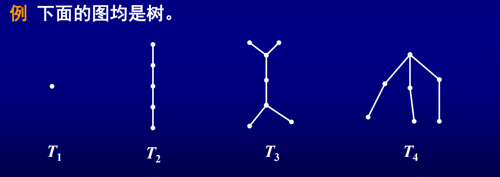

**注** 平凡图称为平凡树。

**定义** 无圈图称为森林。

**注**

> 
> 
> 1. 树与森林都是简单图；
> 
> 2. 树与森林都是偶图；
> 
> 3. 在一棵树中，度数为 1 的顶点称为树叶，度数大于 1 的顶点称为分支点。

**例** 画出所有不同构的 6 阶树。

**解** 按树中存在的最长路进行枚举。

#### 二、树的性质

**定理** 每棵非平凡树至少有两片树叶。

**定理** 设 $G$ 是具有 $n$ 个点 $m$ 条边的图，则下列命题等价：

> 
> 
> $$
> \begin{aligned}
> G \text{ 是树} &\iff G \text{ 无环且任意两点间存在唯一路} \\
> &\iff G \text{ 连通，删去任一边便不连通} \\
> &\iff G \text{ 连通，且 } m = n-1 \\
> &\iff G \text{ 无圈，且 } m = n-1 \\
> &\iff G \text{ 无圈，添加任一边可得唯一的圈}
> \end{aligned}
> $$

**注** （a）树是含有边数最少的连通图，因此树也被称为最小连通图；（b）树是含有边数最多的无圈图。

> **推论** 假定 $(n, m)$ 图 $G$ 是由 $k$ 棵树组成的森林，则 $m=n-k$。

**证明** 设 $G$ 的每棵树的点数与边数分别是 $n_{i}$ 和 $m_{i}(1 \leq i \leq k)$。则 $m_{i}=n_{i}-1, i=1,2, \ldots, k$。

**因此**

$$
m=\sum_{i=1}^{k} m_{i}=\sum_{i=1}^{k}\left(n_{i}-1\right)=n-k .
$$

**例** 设 $G$ 是树且最大度为 $\Delta$，则 $G$ 至少有 $\Delta$ 片叶子。

**证明** 若不然，设 $G$ 有 $n$ 个顶点，$m$ 条边且至多 $\Delta-1$ 片叶子。由握手定理得

$$
2 m=\sum d(v) \geq 1 \cdot(\Delta-1)+2 \cdot(n-\Delta)+\Delta \cdot 1=2 n-1>2 n-2 .
$$

> **注** 不等式右端的来源：在「叶子数不超过 $\Delta-1$」的前提下，把顶点分成三组，每组只估一个度数下界（最不利情形是恰有 $\Delta-1$ 片叶子，此时度数和最小）。
> （i）$\Delta-1$ 片叶子，每片度数为 $1$，贡献 $1\cdot(\Delta-1)$；
> （ii）度数达到最大度的点单独算 $1$ 个，贡献 $\Delta\cdot 1$；
> （iii）其余 $n-\Delta$ 个点都不是叶子，度数至少为 $2$，贡献 $2\cdot(n-\Delta)$。
> 三者相加即得右端：$1\cdot(\Delta-1)+2\cdot(n-\Delta)+\Delta\cdot 1=2n-1$；而 $G$ 是树时 $2m=2(n-1)=2n-2$，故 $2m\geq 2n-1>2n-2$，矛盾。

所以，$m>n-1$，与 $G$ 是树矛盾！

**例** 设 $T$ 为具有 12 条边的树，其顶点度的取值为 $1,2,5$。如果 $T$ 恰有 3 个度为 2 的顶点，那么 $T$ 有多少片树叶？

**解** 设 $T$ 有 $x$ 片树叶。

根据树的点数与边数的关系知，$T$ 有 13 个顶点。

**由握手定理**

$$
1 \times x+2 \times 3+5 \times(13-3-x)=2 \times 12,
$$

得 $x=8$，即 $T$ 有 8 片树叶。

**练习** 设树 $T$ 中度数为 $i$ 的顶点的个数为 $n_{i}(1 \leq i \leq k)$，则

$$
n_{1}=2+n_{3}+2 n_{4}+\cdots+(k-2) n_{k} .
$$

因为$T$是树，$\therefore m=\sum_i^k n_i -1$,又$\because 2m=\sum d(v_i)=\sum_i^k in_i$

$$
2\sum_i^k n_i-2
=\sum_{i=1}^k in_i\\
 \Leftrightarrow\sum_i^k(2-i)n_{i=1}=2\\
\Leftrightarrow n_1=2+\sum_{i=2}^k (i-2)n_i\\
=2+\sum_{i=3}^k(i-2)n_i
$$

与结论相同。

**例** 设 $G$ 是森林且恰有 $2 k$ 个奇度顶点，则在 $G$ 中有 $k$ 条边不重合的路 $P_{1}, P_{2}, \ldots, P_{k}$，使得：

> 
> 
> > 
> > 
> > $$
> > E(G)=E\left(P_{1}\right) \cup E\left(P_{2}\right) \cup \cdots \cup E\left(P_{k}\right) .
> > $$

**证明** 对 $k$ 作数学归纳。

当 $k=1$ 时，$G$ 只有两个奇度顶点，容易证明 $E(G)$ 是一条路。

假设当 $k=t$ 时，结论成立。接下来考虑 $k=t+1$ 时的情况。

在 $G$ 中一个分支中取两个叶子点 $u$ 与 $v$，令 $P$ 是连接该两个顶点的唯一路，则 $G-P$ 是有 $2 t$ 个奇度顶点的森林。

由归纳假设知，它可以分解为 $t$ 条边不重合的路之并，所以 $G$ 可以分解为 $t+1$ 条边不重合的路之并。

**例** 证明：单调不增正整数序列 $\left(d_{1}, d_{2}, \ldots, d_{n}\right)$ 是一棵非平凡树的度序列当且仅当 $\sum d_{i}=2(n-1)$。

**证明** 根据树的边数与点数之间的关系以及握手定理，必要性显然成立。

为证明充分性，我们对序列长度 $n$ 作归纳。

由题意知：$n \geq 2$。

当 $n=2$ 时，结论显然成立。

首先，序列中至少一个数为 1，否则序列和大于 $2 k$，与条件相矛盾！

所以，$d_{k+1}=1$。

我们从序列中删掉 $d_{1}$ 和 $d_{k+1}$，增加一个数 $d^{*}=d_{1}-1$，并把它放在应该所在的位置，得到一个新的序列 $S$。

序列 $S$ 长度为 $k$ 且序列之和为 $2(k-1)$。

由归纳假设知，存在一棵非平凡树 $T^{*}$ 以 $S$ 为度序列。

假设当 $n=k$ 时，结论成立。下面考虑当 $n=k+1$ 时的情况。

在树 $T^{*}$ 中添加一点 $v$，并让 $v$ 与 $d^{*}$ 所对应的点相邻，得到一棵新的树 $T$。

显然，树 $T$ 的度序列恰好为已知的序列。

**例** 设 $T$ 是 $k$ 阶树，证明：若简单图 $G$ 满足 $\delta(G) \geq k-1$，则 $T$ 同构于 $G$ 的某个子图。

**证明** 对 $k$ 作归纳证明。

当 $k=1$ 时，结论显然成立。

假设对 $l(l \geq 2)$ 阶的每棵树 $T_{1}$，以及最小度至少为 $l-1$ 的每个图 $H$，$T_{1}$ 同构于 $H$ 的某个子图。

现在设 $T$ 是 $l+1$ 阶树，且 $G$ 是满足 $\delta(G) \geq l$ 的图。

设 $u$ 是 $T$ 的树叶，$v$ 是 $u$ 的邻接顶点，则 $T-u$ 是 $l$ 阶树。

由于 $\delta(G) \geq l>l-1$，由归纳假设知，$T-u$ 同构于 $G$ 的某个子图 $F$。

设 $v_{1}$ 是 $F$ 中与 $T-u$ 中顶点 $v$ 相对应的顶点。

由于 $d_{G}\left(v_{1}\right) \geq l$ 且 $d_{F}\left(v_{1}\right) \leq l-1$，所以 $v_{1}$ 在 $G$ 中一定有不属于 $F$ 的邻点 $u_{1}$，作 $F \cup\left\{v_{1} u_{1}\right\}$，则该子图和 $T$ 同构。

### 2.2 树的中心和形心

#### 一、树的中心

**定义** 设 $G=(V, E)$ 是连通图，$v \in V$，令

$$
e(v)=\max \{d(u, v) \mid u \in V\},
$$

则称 $e(v)$ 为顶点 $v$ 的离心率；又令

$$
r(G)=\min \{e(v) \mid v \in V\},d(G)=\max\{e(v)\mid v\in V\}
$$

称 $r(G)$ 为图 $G$ 的半径，$d(G)$为$G$的直径。

**注** 图 $G$ 的直径是 $G$ 的最大离心率。

> **定义** 若对一个点 $v$，$e(v)=r(G)$，称 $v$ 为 $G$ 的一个中心点。图 $G$ 的全体中心点构成的集合称为 $G$ 的中心。

**例** 在下图所示的树中，图中每个顶点处标出的数字表示该点的离心率，图中的顶点 $u$ 为该树的中心，该树的半径 $r(G)=4$，直径 $d(G)=8$。在该图中，树的中心是点 $u$。

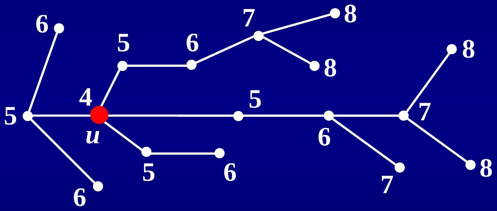

**例** 右图是一棵具有两个中心点的树。

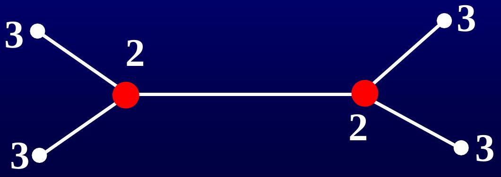

**定理** 每棵树的中心由一个点或两个相邻点组成。

**证明** 对树 $T$ 的阶数 $n$ 作归纳证明。

当 $n=1$ 或 2 时，结论显然成立。

设对 $n<k(k \geq 3)$ 的树结论成立，假设 $T$ 是 $k$ 阶树。

删掉 $T$ 的所有树叶，得到新的树 $T_{1}$。

因为 $T$ 的树叶不可能是中心点，所以 $T$ 的中心点在 $T_{1}$ 中。

$T_{1}$ 的每个点的离心率比它们在 $T$ 中的离心率减少 1。

因此，若点 $u$ 的离心率在 $T$ 中最小，则在 $T_{1}$ 中也最小，反之亦然。这说明 $T$ 的中心点与 $T_{1}$ 的中心点相同。

由归纳假设知，$T_{1}$ 的中心由一个点或两个相邻点组成。所以，对于 $T$ 来说，结论仍然成立。

**例**

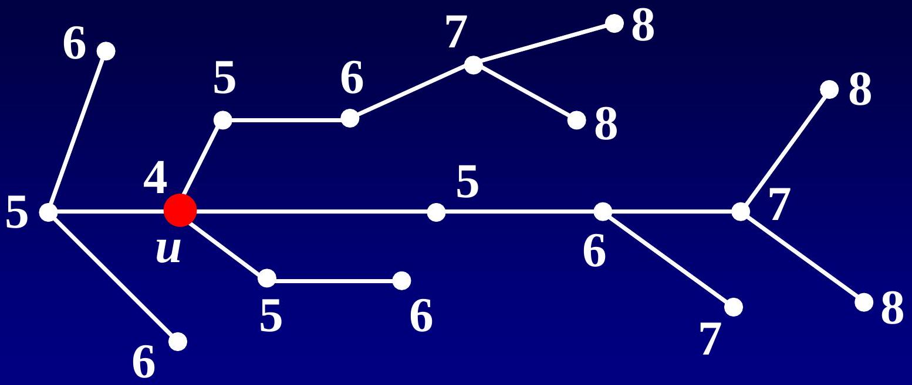

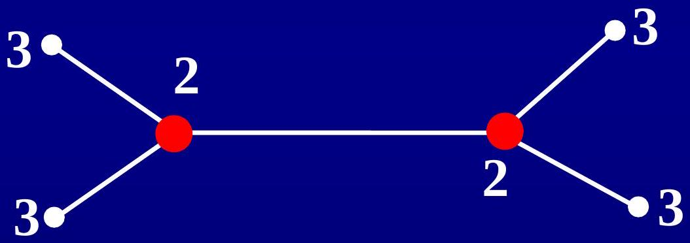

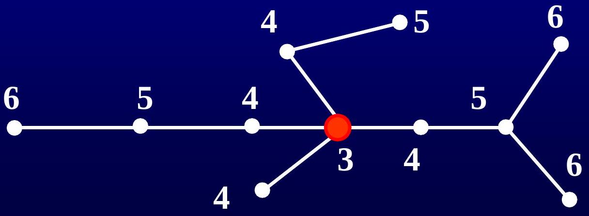

#### 二、树的形心

**定义** 

设 $T$ 是树，$u$ 是树 $T$ 的任意一个顶点，树 $T$ 在点 $u$ 处的一个分枝是指包含 $u$ 作为一个叶子点的极大子树，其分枝数为该顶点的度数；

树 $T$ 在点 $u$ 的分枝中边的最大数目称为点 $u$ 的权；

树 $T$ 中权值最小的点称为它的一个形心点，全体形心点的集合称为树 $T$ 的形心。

**例** 在右图树中，每个顶点处的数字表示该顶点的权值，权值为 4 的顶点为该树的形心。

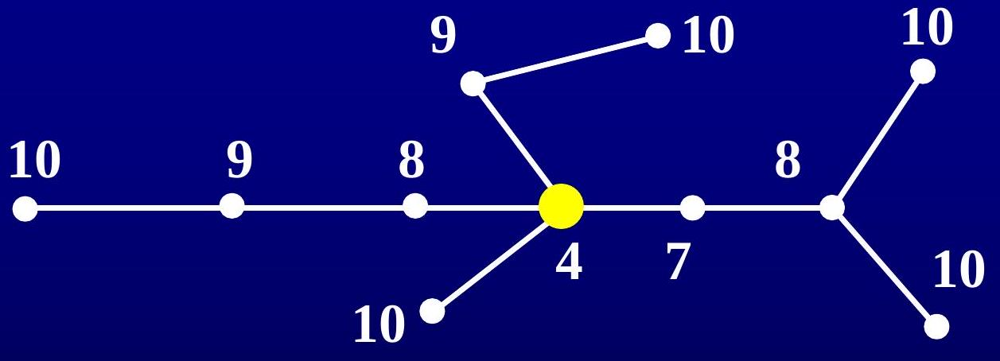

**注** 树的形心好比物体的重心。

**例** $T_{1}$ 只有一个形心点，$T_{2}$ 有两个形心点并且它们相邻。

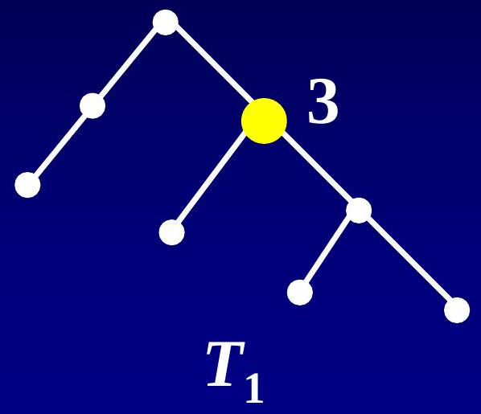

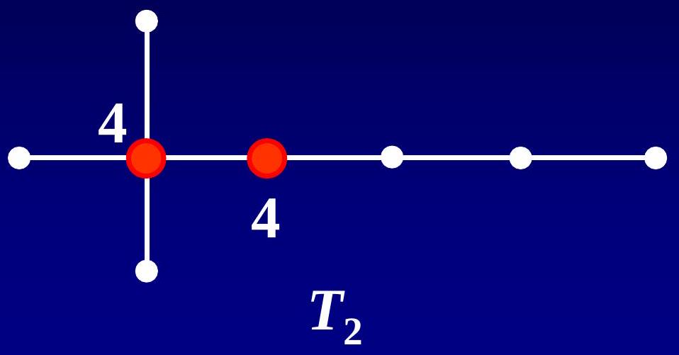

> **定理**
> 
> 1. 每棵 $n$ 阶树 $T$ 的形心由一个点或两个相邻点组成。
> 
> 2. 若 $T$ 只有一个形心点，则形心点的权小于 $n / 2$。
> 
> 3. 若 $T$ 有两个形心点，则形心点的权均为 $n / 2$。

**证明** 首先证明形心点的权必然小于等于 $n / 2$。

假定点 $u$ 的权大于 $n / 2$，则在 $T-u$ 的最大分支中原来与 $u$ 相邻的点的权必然小于点 $u$ 的权。因此 $u$ 不可能为形心点。

假定 $u$ 的权小于 $n / 2$，则在 $T-u$ 的每个分支中原来与 $u$ 相邻的点的权必然严格大于点 $u$ 的权。

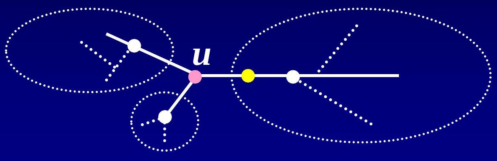

显然，$T-u$ 的每个分支中其他点的权也必然大于点 $u$ 的权。

因此，$u$ 是唯一的形心点。

若 $u$ 的权恰好等于 $n / 2$，则在 $T-u$ 的最大分支中原来与 $u$ 相邻的点的权也为 $n / 2$。

显然，其他点的权也必然严格大于 $n / 2$。

因此，$u$ 与其相邻的点为仅有的两个形心点。

### 2.3 生成树

#### 一、生成树的概念与性质

**定义** 若图 $G$ 的生成子图 $T$ 是树，则称 $T$ 为 $G$ 的生成树；若 $T$ 为森林，称它是 $G$ 的生成森林。

**例**

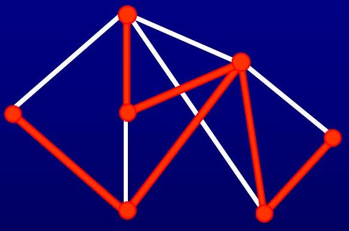

连通图和它的一棵生成树

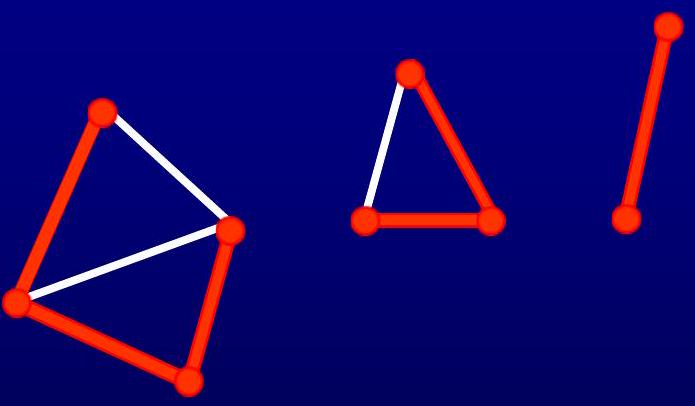

图和它的生成森林

> **定理** 每个连通图至少包含一棵生成树。

**证明** 如果连通图 $G$ 无圈，则其本身是一棵树；若连通图 $G$ 中有圈 $C$，则去掉 $C$ 中一条边后得到的图仍然是连通的。

这样不断去掉 $G$ 中圈，最后得到 $G$ 的一个无圈连通生成子图 $T$，它为 $G$ 的一棵生成树。

**注**

1. 定理的证明过程实际上给出了连通图 $G$ 的生成树的求法，该方法称为破圈法。

2. 利用破圈法也可以求出任意图的一个生成森林。

3. 连通图 $G$ 的生成树一般不唯一！

> **推论** 若 $G=(n, m)$ 是连通图，则 $m \geq n-1$。

#### 二、生成树的计数

**定义** $G$ 的边 $e$ 称为被收缩，是指删去边 $e$ 并使它的两个端点重合，如此得到的图记为 $G \cdot e$。

**例** 下图（b）表示图（a）收缩边 $e_{1}, e_{2}, e_{3}, e_{4}, e_{5}$ 后得到的图。

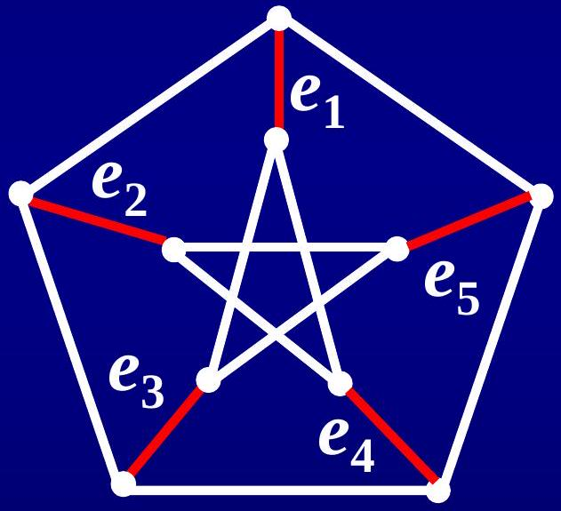

（a）

（b）

> **注** $|V(G \cdot e)|=|V(G)|-1$，$|E(G \cdot e)|=|E(G)|-1$，$\omega(G \cdot e)=\omega(G)$。
> 
> **注** 若 $T$ 是树，则 $T \cdot e$ 也是树。

用 $\tau(G)$ 表示标号图 $G$ 的生成树的个数。

> **定理**（Cayley）若 $e$ 是无环连通图 $G$ 的边，则
> 
> $$
> \tau(\boldsymbol{G})=\tau(\boldsymbol{G}-\boldsymbol{e})+\tau(\boldsymbol{G} \cdot \boldsymbol{e}) .
> $$

**证明** 由于 $G$ 的每一棵不包含 $e$ 的生成树也是 $G-e$ 的生成树。

由此推知，$\tau(G-e)$ 就是 $G$ 的不包含 $e$ 的生成树的个数。

类似地，$\tau(G \cdot e)$ 就是 $G$ 的包含 $e$ 的生成树的个数。

**例** 对右图 $G$，计算 $\tau(G)$。

**解** 部分递推计算过程如下：

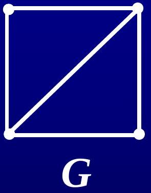

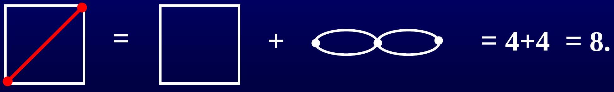

> **定理**（矩阵树定理） 设无环连通图 $G$ 的顶点集合为 $V=\left\{v_{1}, v_{2}, \ldots, v_{n}\right\}$，$v_{i}$ 与 $v_{j}$ 之间的边数为 $a_{i j}, L(G)=\left(l_{i j}\right)$ 是 $n$ 阶方阵，其中
> 
> $$
> l_{i j}= \begin{cases}d\left(v_{i}\right), & i=j, \\ -a_{i j}, & i \neq j,\end{cases}
> $$
> 
> 则 $G$ 的生成树的个数为 $L(G)$ 的任意代数余子式的值。

设 $A=(a_{ij})$ 是 $n$ 阶方阵。

**余子式**：划去 $A$ 的第 $i$ 行和第 $j$ 列，剩下的 $(n-1)$ 阶子矩阵的行列式，称为元素 $a_{ij}$ 的余子式，记作 $M_{ij}$。

**代数余子式**：在余子式前乘以符号 $(-1)^{i+j}$，即

> 
> 
> $$
> C_{ij}=(-1)^{i+j}M_{ij}
> $$

**例** 图 $G$ 如图所示，求 $\tau(G)$。

**解**

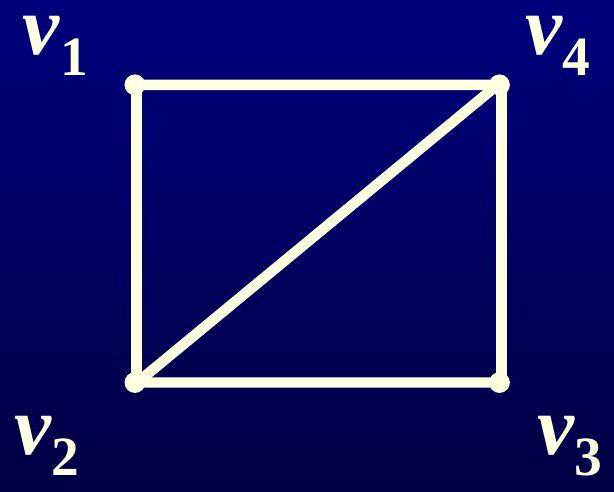

$$
L=\left[\begin{array}{cccc}
2 & -1 & 0 & -1 \\
-1 & 3 & -1 & -1 \\
0 & -1 & 2 & -1 \\
-1 & -1 & -1 & 3
\end{array}\right]
$$

记 $L$ 删去第 $i$ 行及第 $i$ 列后所得到的矩阵为 $L_{i}$，则

$$
L_{1}=\left[\begin{array}{ccc}
3 & -1 & -1 \\
-1 & 2 & -1 \\
-1 & -1 & 3
\end{array}\right] .
$$

所以，

$$
\begin{aligned}
\tau(G) & =(-1)^{1+1}\left|L_{1}\right|=\left|\begin{array}{ccc}
3 & -1 & -1 \\
-1 & 2 & -1 \\
-1 & -1 & 3
\end{array}\right| \\
& =18-1-1-2-3-3 \\
& =8 .
\end{aligned}
$$

**例** 图 $G$ 如图所示，求 $\tau(G)$，并给出 $G$ 的所有生成树。

**解**

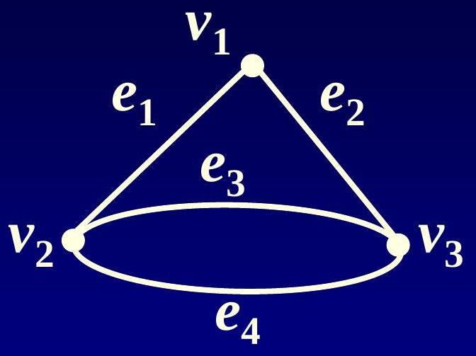

**因为**

$$
L=\left[\begin{array}{ccc}
2 & -1 & -1 \\
-1 & 3 & -2 \\
-1 & -2 & 3
\end{array}\right],
$$

**所以**

$$
\tau(G)=\left|\begin{array}{cc}
2 & -1 \\
-1 & 3
\end{array}\right|=5 .
$$

这 5 棵生成树如下：

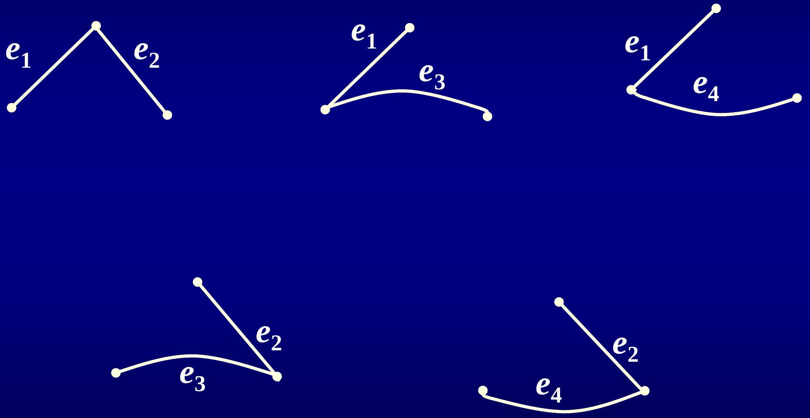

> **定理** $\tau\left(K_{n}\right)=n^{n-2}$，即 $n$ 阶标号树的个数为 $n^{n-2}$。

**证明（一）** 显然

$$
L=\left[\begin{array}{cccc}
n-1 & -1 & \cdots & -1 \\
-1 & n-1 & \cdots & -1 \\
\cdots & \cdots & \cdots & \cdots \\
-1 & -1 & \cdots & n-1
\end{array}\right],
$$

所以，

$$
\tau\left(K_{n}\right)=\left|\begin{array}{cccc}
n-1 & -1 & \cdots & -1 \\
-1 & n-1 & \cdots & -1 \\
\cdots & \cdots & \cdots & \cdots \\
-1 & -1 & \cdots & n-1
\end{array}\right|_{(n-1) \times(n-1)}=n^{n-2} .
$$

**证明（二）** 设树的点集是 $N=\{1,2, \ldots, n\}$。

由 $N$ 中的元素组成的长为 $n-2$ 的序列的个数为 $n^{n-2}$。

断言：$n$ 阶标号树构成的集合与这种序列构成的集合之间存在一一对应。

假定 $T$ 是一棵 $n$ 阶标号树，设 $s_{1}$ 是 $T$ 中标号最小的叶子点，把与 $s_{1}$ 相邻的顶点的标号记为 $t_{1}$。

现在从 $T$ 中删去 $s_{1}$，用 $s_{2}$ 表示 $T-s_{1}$ 中标号最小的叶子点，把与 $s_{2}$ 相邻的顶点的标号记为 $t_{2}$。

重复这一过程，直到得到 $t_{n-2}$。

很容易看出，最后剩下一条边。

**比如**

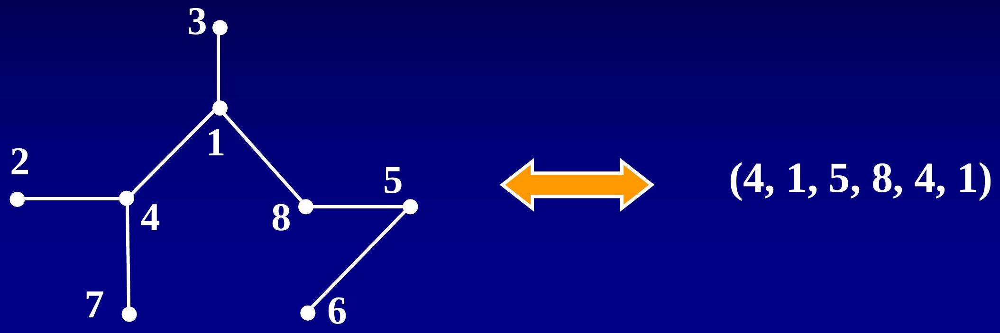

很容易验证上述过程可逆。

**注** 以上讨论的生成树的个数均指标定图而言。标定图的生成树的数量远大于非标定图生成树的数量。如标定图 $K_{6}$ 有 $6^{6-2}=1296$ 棵生成树，而不同构的 6 阶树仅 6 棵。

### 2.4 最小生成树

假设要在某地建造 5 个工厂，拟修筑道路连接这 5 处。经勘探，其道路可按下图的无向边铺设。现在每条边的长度已经测出并标记在图的对应边上，如果我们要求铺设的道路总长度最短，这样既能节省费用，又能缩短工期，应该如何铺设？

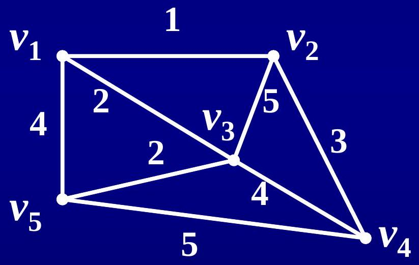

**分析** 设铺设的道路为 $H$，要保证将 5 个工厂连接起来，故 $H$ 应是图中的连通生成子图。同时因要保证造价最小，故 $H$ 中应无圈。所以 $H$ 应是生成树，并且还应是该图的所有生成树中边权之和最小的一个。

**定义** 在连通赋权图 $G$ 中，边权之和最小的生成树称为 $G$ 的最小生成树。

**注** 最小生成树不一定是唯一的。

#### 一、Kruskal算法

**步骤 1** 选择边 $e_{1}$ 使得其权值最小。

**步骤 2** 若已经选定边 $e_{1}, e_{2}, \ldots, e_{k}$，则从 $E-\left\{e_{1}, e_{2}, \ldots, e_{k}\right\}$ 中选择边 $e_{k+1}$，使得：（a） $G\left[e_{1}, e_{2}, \ldots, e_{k+1}\right]$ 为无圈图；（b） $e_{k+1}$ 的权值尽可能小。

**步骤 3** 当步骤 2 不能进行时，停止。

**例** 求 $G$ 的最小生成树。

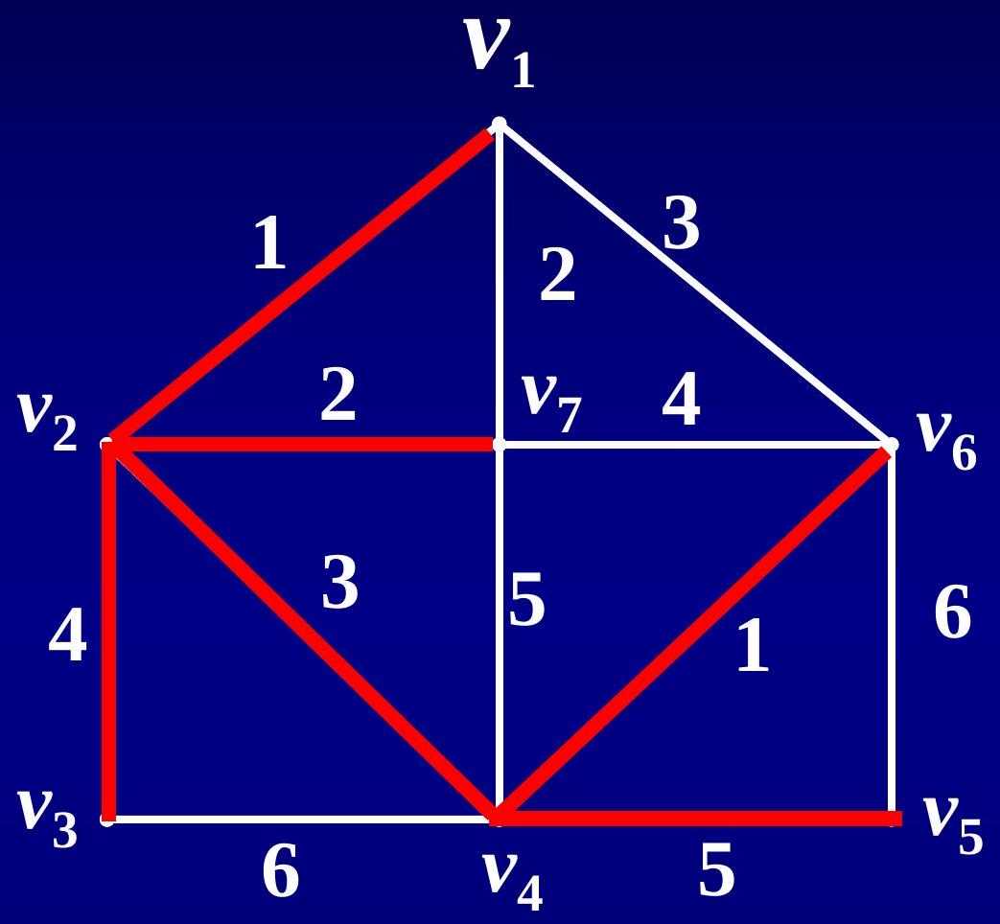

**解** 依据算法，红色的边为依次被选为生成树 $T$ 的边，且

$$
W(T)=1+1+2+3+4+5=16 .
$$

**注** Kruskal算法总共执行 $n-1$ 步（$n$ 为图的阶数）。

#### 二、破圈法

利用破圈法求解最小生成树的过程：从赋权图 $G$ 的任意圈开始，去掉该圈中权值最大的一条边，称之为破圈。不断破坏圈，直到 $G$ 中没有圈为止，最后剩下的 $G$ 的子图为 $G$ 的最小生成树。

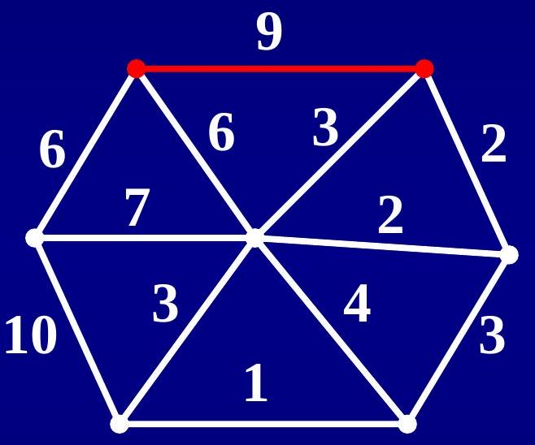

**例** 用破圈法求右图 $G$ 的最小生成树。

**解** 过程如下：

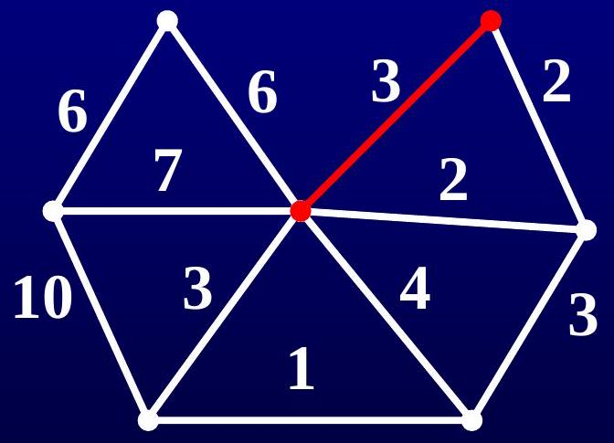

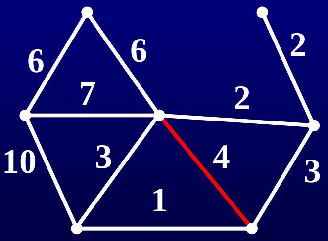

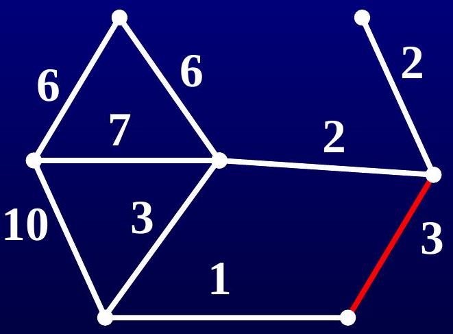

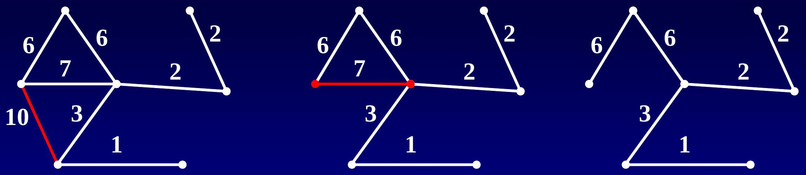

**注** 用破圈法求 $(n, m)$ 图的最小生成树，需执行 $m-n+1$ 次。

#### 三、Prim算法

**步骤 1** 对于连通赋权图 $G$ 的任意一个顶点 $u$，选择与点 $u$ 关联的且权值最小的边作为最小生成树的第一条边。

**步骤 2** 在与一条已经选取的边只有一个公共端点的所有边中，选取权值最小的边。

**步骤 3** 重复步骤 2 直至得到一棵生成树。

**例** 用Prim算法求右图的最小生成树。

**解** 过程如下：

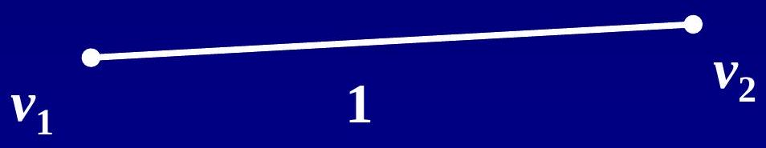

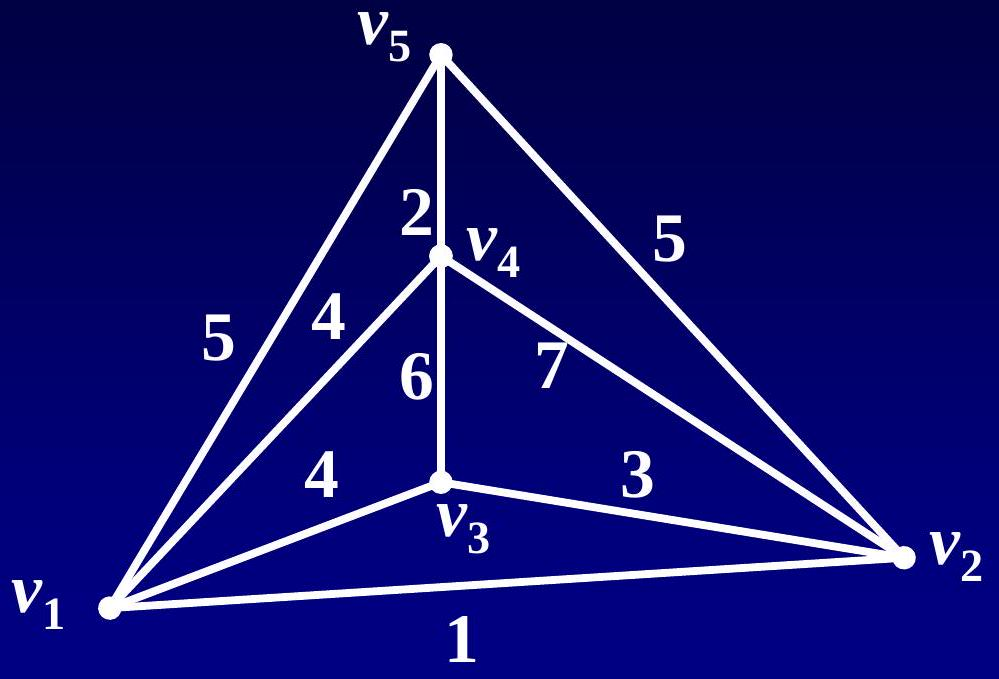

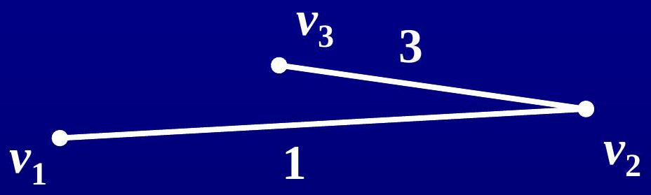

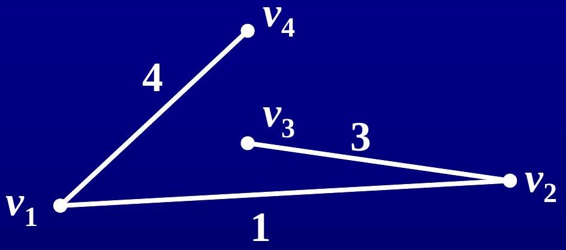

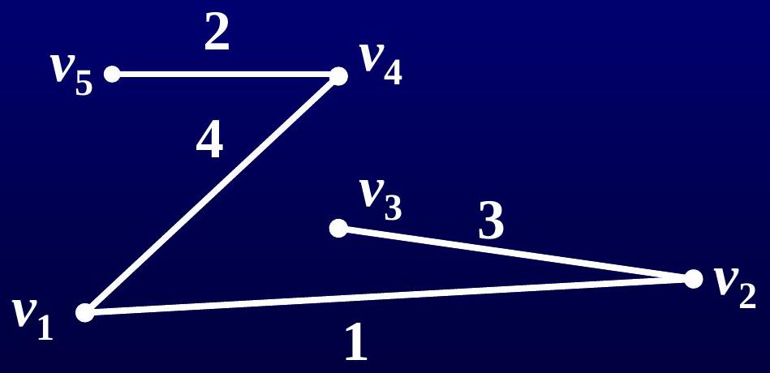
