# 第三章 图的连通度

> 专栏：图论 · Notion 最后编辑：2026-11-11T12:11:00.000Z
>
> 来源：https://www.notion.so/4059d7385883813a9d76ccc6f100f82a

> **本章内容**：割边、割点和块 · 连通度 · 应用

**考察**

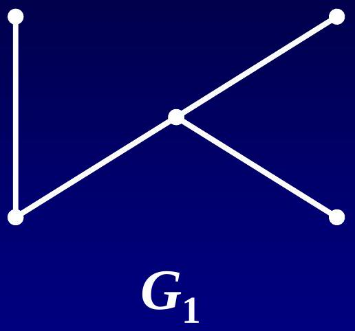

删去任意一条边后便不连通

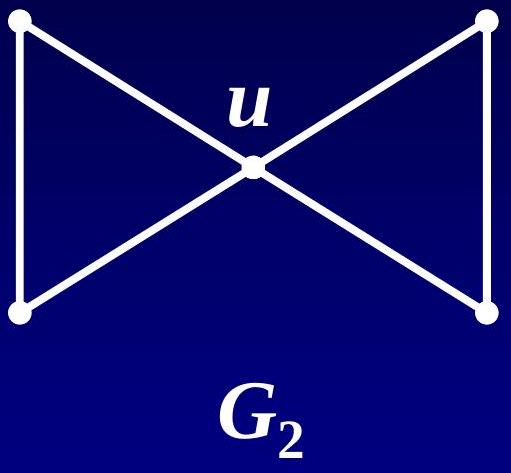

删去任意一条边后仍连通，但删去点 $u$ 后便不连通

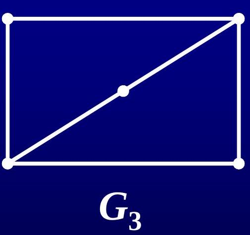

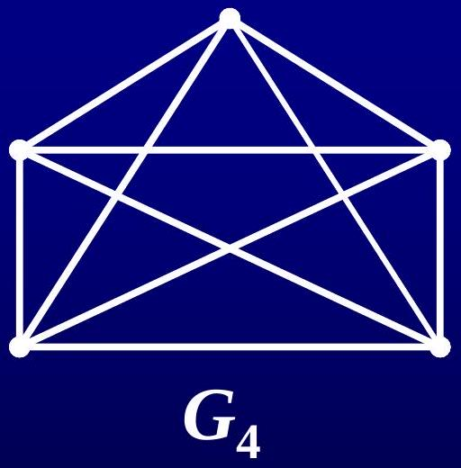

$G_{3}$ 和 $G_{4}$ 删去任意一条边或任意一个点后仍连通，但从直观上看，$G_{4}$ 的连通程度比 $G_{3}$ 高。

### 3.1 割边、割点和块

#### 一、割边及其性质

> **定义** 设 $e$ 是图 $G$ 的一条边，若 $\omega(G-e)>\omega(G)$，则称 $e$ 为 $G$ 的割边。

**注** 若 $G$ 连通，则割边是指删去后使 $G$ 不连通的边；若 $G$ 非连通，则割边是指删去后使 $G$ 的某个连通分支不连通的边。

**例** 下图中，边 $e_{1}$ 和 $e_{2}$ 为割边，而其余边均不为割边。

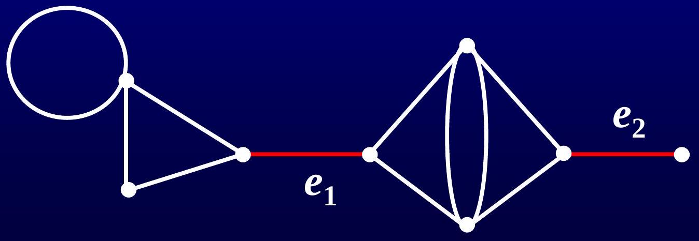

> **定理** $e$ 是图 $G$ 的割边当且仅当 $e$ 不在 $G$ 的任何圈中。

**证明** 若结论在 $G$ 的含 $e$ 的连通分支中成立，则必在 $G$ 中成立，所以我们不妨假定 $G$ 连通。

必要性 设 $e$ 是图 $G$ 的割边。若 $e$ 包含在圈中，则 $G-e$ 依然是连通图，矛盾。

充分性 设 $e=u v$。若 $e$ 不是 $G$ 的割边，则 $G-e$ 仍连通，从而在$G-e$ 中存在 $(u, v)$ 路 $P$，这样 $P+e$ 便是 $G$ 中含 $e$ 的圈，矛盾。

**思考** 若 $e$ 为 $G$ 的割边，则 $\omega(G-e)=\omega(G)+1$。

**例** 求证：

1. 若 $G$ 的每个顶点的度数均为偶数，则 $G$ 没有割边；

2. 若 $G$ 为 $k$ 正则二部图（$k \geq 2$），则 $G$ 无割边。

**证明** （1）若不然，设 $e=u v$ 为 $G$ 的割边。则 $G-e$ 的含有顶点 $u$（或 $v$）的那个分支中点 $u$（或 $v$）的度数必为奇数，而其余点的度数为偶数，与＂度数为奇数的顶点的个数为偶数＂相矛盾。

（2）若不然，设 $e=u v$ 为 $G$ 的割边。假设 $G_{1}$ 为 $G-e$ 的包含顶点 $u$ 的连通分支，显然 $G_{1}$ 中除了点 $u$ 的度数为 $k-1$ 外，其余点的度数均为 $k$。

显然 $G_{1}$ 仍为偶图，设其二部划分为 $S$ 和 $T$ 且 $|S|=s,|T|=t$。0

不妨假设 $S$ 包含顶点 $u$，则

$$
k s-1=\left|E\left(G_{1}\right)\right|=k t\\
\Rightarrow k(s-t)=1\\
\because k\ge2,s和t都是整数。\\
\therefore k(s-t)=1肯定不成立
$$

但是因 $k \geq 2$，所以等式不能成立！因此，$e$ 一定不是割边。

#### 二、割点及其性质

> **定义** 图 $G=(V, E)$ 的顶点 $v$ 称为割点，如果 $E$ 可划分为两个非空子集 $E_{1}$ 和 $E_{2}$，使得 $G\left[E_{1}\right]$ 和 $G\left[E_{2}\right]$ 恰有一个公共顶点 $v$。

**例** 图中点 $u_{1}, u_{2}, u_{3}$ 和 $u_{4}$ 是割点，其余点均不为割点。

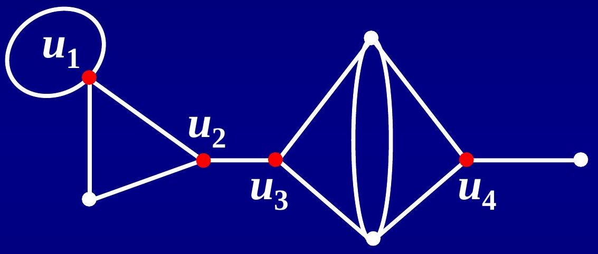

**注**

> 
> 
> 1. 若 $\omega(G-v)>\omega(G)$，则 $v$ 必为 $G$ 的割点。
> 
> 2. 若 $v$ 为 $G$ 的割点，则 $\omega(G-v)>\omega(G)$ 不一定成立，因为 $v$ 处可能有自环。
> 
> 3. 若 $G$ 无环，则 $v$ 是 $G$ 的割点当且仅当 $\omega(G-v)>\omega(G)$。
> 
> 4. 对于阶数至少为 3 的连通图，割边处一定有割点。

> **定理** 设 $v$ 是无环连通图 $G$ 的一个顶点，则 $v$ 是 $G$ 的割点当且仅当 $V(G-v)$ 可划分为两个非空顶点子集 $V_{1}$ 与 $V_{2}$，使得对任意的$x \in V_{1}, y \in V_{2}$，点 $v$ 都在每一条 $(x, y)$ 路上。

**证明** 充分性 若 $v$ 不是图 $G$ 的割点，那么 $G-v$ 连通。因此，在$G-v$ 中存在 $(x, y)$ 路，当然也是 $G$ 中一条没有经过点 $v$ 的 $(x, y)$ 路。与已知条件矛盾。

必要性 设 $v$ 是无环连通图 $G$ 的割点，则 $G-v$ 至少有两个连通分支。设 $V_{1}$ 是其中一个连通分支的顶点集，$V_{2}$ 为其余顶点构成的集合。对于任意的 $x \in V_{1}, y \in V_{2}$，因在 $G-v$ 中 $x$ 与 $y$ 不连通，而在 $G$ 中$x$ 与 $y$ 连通，所以点 $v$ 在图 $G$ 的每一条 $(x, y)$ 路上。

> **例** 设 $v$ 是树 $T$ 的顶点，则 $v$ 是 $T$ 的割点当且仅当 $d(v)>1$。

**证明** 必要性 若 $d(v)=1$，则 $v$ 是树 $T$ 的叶子点。显然，$v$ 不可能是树 $T$ 的割点，矛盾！

充分性 因为 $d(v)>1$，至少有两个点与 $v$ 相邻。设 $x$ 和 $y$ 是与 $v$ 相邻的两点，由树的性质知，只有唯一的路连接$x$ 与 $y$，所以 $T-v$ 分离 $x$ 与 $y$。因此，$v$ 是割点。

> **例** 求证：非平凡连通简单图 $G$ 至少有两个点不是割点。

**证明** 由于 $G$ 是非平凡简单连通图，所以存在非平凡生成树 $T$。非平凡生成树 $T$ 至少有两片树叶，它们不能为 $T$ 的割点。显然，它们也不能为 $G$ 的割点。

> **例** 求证：恰有两个非割点的连通简单图 $G$ 是一条路。

**证明** 设 $T$ 是 $n$ 阶连通简单图 $G$ 的任意一棵生成树。由于 $G$ 有 $n-2$ 个割点，所以 $T$ 有 $n-2$ 个割点。因此 $T$ 只有 2 个非割点，即 $T$ 只有两片树叶，所以 $T$ 是一条路。这说明，$G$ 的任意生成树为路。一个简单图的任意生成树为路，则该图为圈或路。若为圈，则 $G$ 没有割点，矛盾！所以 $G$ 为路。

> **例** 求证：若 $v$ 是简单图 $G$ 的割点，则 $v$ 不是 $G$ 的补图的割点。

**证明** 容易验证，

$$
\bar{G}-v=\overline{G-v}
$$

因为 $v$ 是 $G$ 的割点，所以 $G-v$ 一定不是连通图。从而 $G-v$ 的补图是连通图。因此，在 $G$ 的补图中删去顶点 $v$ 不会增加图的连通分支数。所以，$v$ 不是 $G$ 的补图的割点。

#### 三、块及其性质

> **定义** 没有割点的连通图称为块图，简称块。若图 $G$ 的子图 $B$ 是块，且 $G$ 中没有真包含 $B$ 的子图也是块，则称 $B$ 是 $G$ 的块。

> **注**
> 
> 1. 仅有一个点的块，要么是孤立点，要么是环；
> 
> 2. 仅有一条边的块，要么是割边，要么是环；
> 
> 3. 至少有两个点的块无环；
> 
> 4. 至少有三个点的块无环、无割边。

**例** 图 $G$ 如图（a）所示，$G$ 的所有块如图（b）所示。

（a）

（b）

> **定理** 设图 $G$ 的阶至少为3，则 $G$ 是块当且仅当 $G$ 无环并且任意两点都位于同一个圈上。

**证明** 充分性 此时 $G$ 显然连通。假设 $v$ 是任意一点，$x$ 与 $y$ 是 $v$ 之外的为任意两点。$x$ 与 $y$ 在一个圈上，说明 $x$ 与 $y$ 之间至少有两条不相交的路。删去 $v$ 至多破坏 $x$ 与 $y$ 之间的一条路，说明 $v$ 不是割点。又因为 $G$ 无环，所以 $G$ 是块。

必要性 图 $G$ 显然无环，否则 $G$ 中存在割点。下证 $G$ 中任意两点 $u$ 和 $v$ 位于同一圈上，对距离 $d(u, v)$ 作归纳。当 $d(u, v)=1$ 时，由于 $G$ 是至少有 3 个点的块，所以，边 $u v$ 不能为割边。由割边性质知，$uv$ 必然在某圈中。

设结论对距离小于 $k$ 的任意两点成立。假定 $u, v$ 为距离等于 $k$的任意两点。设 $P$ 是一条最短 $(u, v)$ 路，$w$ 是 $v$ 前面一点，则 $d(u, w)=k-1$。由归纳假设知，$u$ 与 $w$ 在同一圈 $C$ 上。若 $v$ 也在 $C$ 中，则已得到证明。下设 $v$ 不在 $C$ 中。

因为 $G$ 是块，无割点，故 $G-w$ 仍连通。于是存在一条 $(u, v)$ 路 $Q$。设点 $x$ 是 $Q$ 与 $C$ 的最后一个公共点。

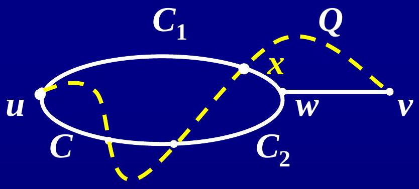

点 $x$ 将 $C$ 划分为两条 $(u, x)$ 路 $C_{1}$ 和 $C_{2}$，不妨设 $w$ 在 $C_{2}$ 上。于是 $C_{1}, Q$ 的 $x$ 到 $v$ 段，边 $v w$ 以及 $C_{2}$ 的 $w$ 到 $u$ 段共同构成一个圈 $C^{*}$，且 $u$ 与 $v$ 均在 $C^{*}$ 上。

> **推论** 设 $G$ 的阶至少为 3，则 $G$ 是块当且仅当 $G$ 无孤立点且任意两条边都在同一个圈上。

**证明** 设 $G$ 无孤立点且任意两条边都在同一个圈上。此时 $G$ 无环，因为环和任何一条边都不可能在一个圈上。此时，必然任意两个点也在同一个圈上，因此 $G$ 是块。

反之，设 $G$ 是块。显然 $G$ 无孤立点。任取 $G$ 中两条边 $e_{1}$ 和 $e_{2}$。在边 $\mathrm{e}_{1}$ 和 $\mathrm{e}_{2}$ 上各插入一个新的顶点 $\mathrm{v}_{1}$ 和 $\mathrm{v}_{2}$，使 $\mathrm{e}_{1}$ 和 $\mathrm{e}_{2}$ 均成为两条边，记这样得到的图为 $G^{*}$。

由于 $G$ 是至少有三个点的块，从而 $G$ 无割边，因此 $v_{1}$ 和 $v_{2}$ 必然不是 $G^{*}$ 的割点，所以 $G^{*}$ 是阶至少为 5 的块。因此，$v_{1}$ 和 $v_{2}$ 在 $G^{*}$ 的同一个圈上。于是，$e_{1}$ 和 $e_{2}$ 在 $G$ 中位于同一个圈上。

> **定理** 点 $v$ 是图 $G$ 的割点当且仅当 $v$ 至少属于 $G$ 的两个不同的块。

**证明** 必要性 设 $v$ 是 $G$ 的割点。由割点定义知 $E(G)$ 可以划分为两个边子集 $E_{1}$ 与 $E_{2}$ 使得 $G\left[E_{1}\right]$ 与$G\left[E_{2}\right]$ 有唯一公共顶点 $v$。设 $B_{1}$ 与 $B_{2}$ 分别是 $G\left[E_{1}\right]$ 和 $G\left[E_{2}\right]$ 中包含 $v$ 的块，显然它们也是 $G$的块。因此 $v$ 至少属于 $G$ 的两个不同块。

充分性 设点 $v$ 属于 $G$ 的两个不同块 $B_{1}$ 和 $B_{2}$。如果 $B_{1}$ 和 $B_{2}$ 其中一个是环，显然 $v$ 是割点。现在假设 $B_{1}$ 与 $B_{2}$ 都不是环。那么 $B_{1}$ 与 $B_{2}$ 分别至少有两个顶点。假如 $v$ 不是割点，在 $B_{1}$ 与 $B_{2}$ 中分别找异于 $v$ 的一个点 $x$ 与 $y$，则在 $G-v$ 中有连接 $x$ 与 $y$ 的路 $P$。显然，$B_{1} \cup B_{2} \cup P$ 无割点。这与 $B_{1}$ 与 $B_{2}$ 是块矛盾！

**注** 两个不同块的公共顶点只能是割点，即块与块只能由割点相联结，因此可以通过割点搜寻块。

**例：**

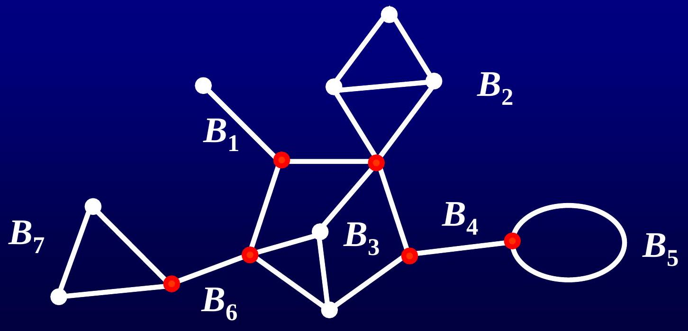

### 3.2 连通度

#### 一、连通度和边连通度

> **定义** 给定连通图 $G$，设 $V^{\prime}$ 是 $V(G)$ 的顶点子集，若 $G-V^{\prime}$ 不连通，则称 $V^{\prime}$ 为 $G$ 的顶点割，含有 $k$ 个顶点的顶点割称为 $G$ 的 $k$ 顶点割。
> **注：**割点对应的是只含一个顶点的顶点割；一般的顶点割则可以包含多个顶点，不要求每个顶点单独都是割点。

$G$ 中点数最少的顶点割称为最小点割。

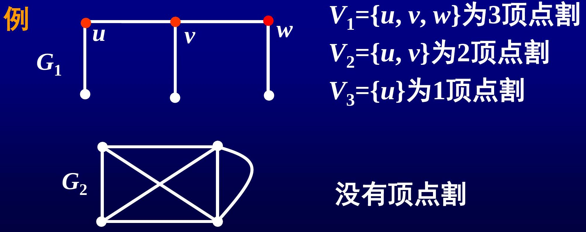

其中 $V_{1}=\{u, v, w\}$ 为 3 顶点割，$V_{2}=\{u, v\}$ 为 2 顶点割，$V_{3}=\{u\}$ 为 1 顶点割，$G_{2}$ 没有顶点割。

> **注**
> 
> 1. 若 $G$ 是非平凡连通图，则 $v$ 是 $G$ 的割点当且仅当 $\{v\}$ 是 $G$ 的 1 顶点割。
> 
> 2. **完全图没有顶点割，实际上也只有以完全图为生成子图的图没有顶点割。**

> **定义** 对 $n$ 阶非平凡连通图 $G$，若 $G$ 存在顶点割，则称 $G$** 的最小顶点割中的点数为 **$G$** 的连通度；否则称 **$n-1$** 为其连通度**。非连通图或平凡图的连通度定义为 0。
> 图 $G$ 的连通度表示为 $\kappa(G)$，简记为 $\kappa$。

连通度也可描述为＂使图不连通或成为平凡图，最少需要删去的点数＂。

**例**

> 
> 
> 1. $\kappa\left(K_{n}\right)=n-1$；
> 
> 2. $\kappa\left(C_{n}\right)=2$，其中 $C_{n}$ 为 $n$ 圈，$n \geq 3$。

**例** 求下列各图的连通度。

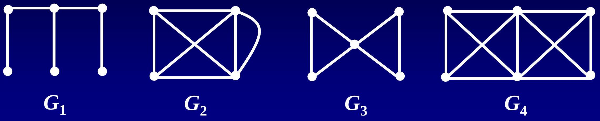

**解** $\kappa\left(G_{1}\right)=1, \kappa\left(G_{2}\right)=3, \kappa\left(G_{3}\right)=1, \kappa\left(G_{4}\right)=2$。

> **定义** 若一个图的连通度至少为 $k$，则称该图是 $k$ 连通的。$[\kappa\left(G\right)\ge k]$

**注**

1. 非平凡连通图均是 1 连通的。

2. 图 $G$ 是2连通的当且仅当 $G$ 连通、无割点且至少含有3个点。

3. $K_{2}$ 连通、无割点，但连通度为 1。$[\kappa\left(K_{n}\right)=n-1]$

> **定义** 设 $G$ 为连通图，称使 $G-E^{\prime}$ 不连通的 $G$ 的边子集 $E^{\prime}$ 为 $G$ 的边割，含有 $k$ 条边的边割称为 $k$ 边割。边数最少的边割称为最小边割。

**注** 对连通图 $G$，由定义易知，$e$ 是 $G$ 的割边当且仅当 $\{e\}$ 是$G$ 的 1 边割。

> **定义** 设 $G$ 是非平凡连通图，称 $G$** 的最小边割中的边数为 **$G$** 的边连通度；非连通图或平凡图的边连通度定义为 0**。图 $G$ 的边连通度记为 $\lambda(G)$，简记为 $\lambda$。

边连通度也可描述为＂使图不连通或成为平凡图，最少需要删去的边数＂。

**例**

1. $\lambda\left(K_{n}\right)=n-1$；

2. $\lambda\left(C_{n}\right)=2$，其中 $C_{n}$ 为 $n$ 圈，$n \geq 2$。

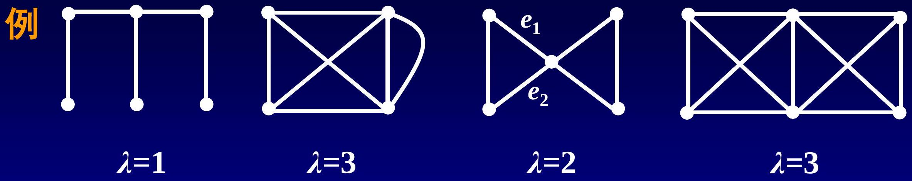

> **定义** 若一个图的边连通度至少为 $k$，称该图是 $k$ 边连通的。$[\lambda(G)\ge k ]$

**注**

1. 非平凡连通图均是 1 边连通的；

2. 图 $G$ 是2边连通的当且仅当 $G$ 连通、无割边且至少含有两个点。

**例** 计算 $\kappa(G), \lambda(G), \delta(G)$。

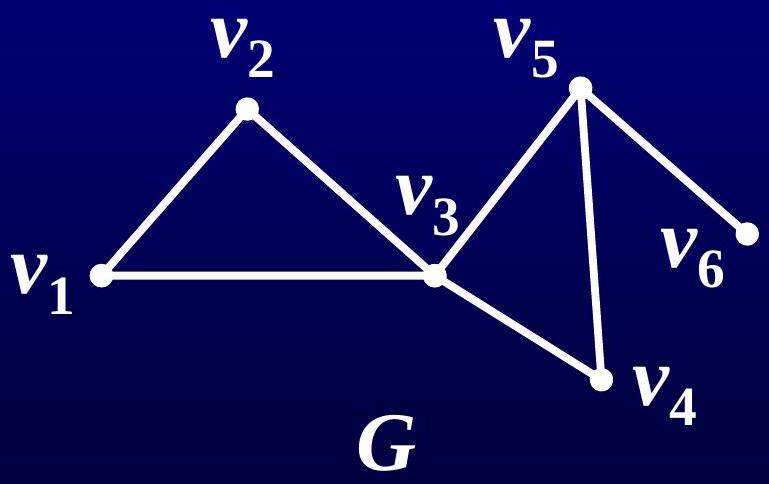

**解** $\kappa(G)=1, \quad \lambda(G)=1, \quad \delta(G)=1$。发现：$\kappa(G) \leq \lambda(G) \leq \delta(G)$。

#### 二、连通度的性质

> **定理** 对任意的图 $G$，有
> 
> $$
> \kappa(G) \leq \lambda(G) \leq \delta(G)\\
> 连通度\le 边连通度 \le 最小度
> $$

**证明** 若 $G$ 为平凡图或不连通，则 $\kappa(G)=\lambda(G)=0$，结论显然成立。下设 $G$ 为非平凡连通图。

对任意的 $u \in V(G)$，由于全体与 $u$ 相关联的边构成的集合是 $G$ 的一个边割集，从而推知 $\lambda(G) \leq \delta(G)$ 成立。

下面对 $\lambda(G)$ 用归纳法证明 $\kappa(G) \leq \lambda(G)$。

当 $\lambda(G)=1$ 时，$\kappa(G)=\lambda(G)=1$。

设对所有满足 $\lambda(G)<k(k \geq 2)$ 的图 $G, ~ \kappa(G) \leq \lambda(G)$ 成立。假设 $G$ 为边连通度等于 $k$ 的任意一个图。设 $E^{\prime}$ 是 $G$ 的一个 $k$ 边割，取 $e \in E^{\prime}$。令 $H=G-e$，则 $\lambda(H)=k-1$。由归纳假设知，$\kappa(H) \leq \lambda(H)=k-1$。

情况1 $H$ 含有完全图作为生成子图，则 $G$ 也如此。此时

$$
\kappa(G)=|V(G)|-1=|V(H)|-1=\kappa(H) \leq k-1<k=\lambda(G) \text { 。 }
$$

情况2 $H$ 的任意生成子图均不为完全图。

设 $S$ 是 $H$ 的一个 $\kappa(H)$ 顶点割，于是 $|S|=\kappa(H) \leq k-1$。若 $G-S$ 不连通，则 $\kappa(G) \leq|S| \leq k-1<k=\lambda(G)$。若 $G-S$ 连通，因 $H-S$ 不连通，故 $e$ 是 $G-S$ 的割边。此时，若 $G-S$ 恰含两个点，则 $|V(G)|=|S|+2$，于是

$$
\kappa(G) \leq|V(G)|-1=|S|+1 \leq k=\lambda(G) \text { 。 }
$$

若 $G-S$ 至少含 3 个点，则 $G-S$ 包含割点 $v$，于是 $S \cup\{v\}$ 是 $G$ 的顶点割，从而

$$
\kappa(G) \leq|S \cup\{v\}| \leq k=\lambda(G)
$$

所以总有

$$
\kappa(G) \leq \lambda(G)
$$

**例** 满足 $\kappa(G)<\lambda(G)<\delta(G)$ 的图：

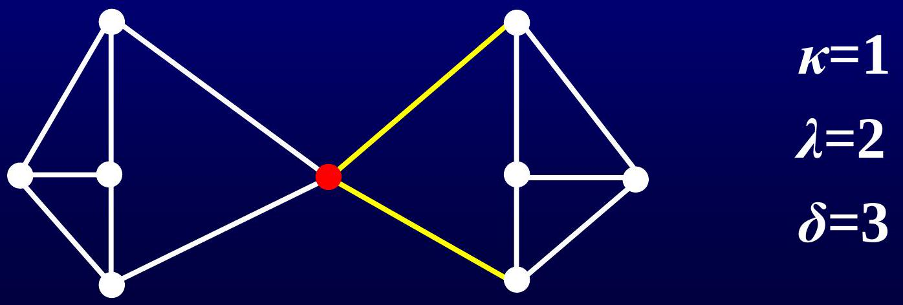

> **定理** 设 $G$ 是具有 $m$ 条边的 $n$ 阶连通图，则
> 
> $$
> \kappa(G) \leq\lfloor 2 m / n\rfloor
> $$

**证明** 由握手定理

$$
2 m=\sum d(v) \geq n \delta(G) \geq n \kappa(G),
$$

得

$$
\kappa(G) \leq\lfloor 2 m / n\rfloor .
$$

> **引理** 设 $G$ 是 $n$ 阶简单图，若 $\delta(G) \geq\lfloor n / 2\rfloor$，则 $G$ 必连通。

**证明** 若 $G$ 不连通，则 $G$ 至少有两个连通分支，从而必有一个分支 $H$ 满足 $|V(H)| \leq\lfloor n / 2\rfloor$。

因 $G$ 是简单图，从而

$$
\Delta(H) \leq\lfloor n / 2\rfloor-1<\lfloor n / 2\rfloor .
$$

于是

$$
\delta(G) \leq \delta(H) \leq \Delta(H)<\lfloor n / 2\rfloor
$$

这与已知矛盾，所以 $G$ 必连通。

> **定理** 设 $G$ 是 $n$ 阶简单图，若存在正整数 $k(k<n)$ 使得
> 
> $$
> \delta(G) \geq \frac{n+k-2}{2},
> $$
> 
> 则 $G$ 是 $k$ 连通的。

**证明** 

要证$G$ 是 $k$ 连通的，则需证$\kappa(G)\geq k$,即任意删去 $G$ 中 $k-1$ 个点，记所得之图为 $H$，需证$H$仍连通，有

$$
\delta(H) \geq \delta(G)-(k-1) \geq \frac{n+k-2}{2}-k+1=\frac{n-k}{2}
$$

因 $\delta(H)$ 是整数，故

$$
\delta(H) \geq\left\lceil\frac{n-k}{2}\right\rceil=\left\lfloor\frac{n-k+1}{2}\right\rfloor .
$$

而 $n-k+1$ 是 $H$ 的点数，由引理知 $H$ 是连通的。

所以，$G$ 是 $k$ 连通的。

> **定理** 设 $G$ 是 $n$ 阶简单图，若 $\delta(G) \geq\lfloor n / 2\rfloor$，则 $\lambda(G)=\delta(G)$。

**证明** 显然，$G$ 是连通图。

若 $\lambda(G) \neq \delta(G)$，则 $\lambda(G)<\delta(G)$。

设 $M$ 为 $G$ 的最小边割，则 $|M|=\lambda(G)<\delta(G)$，且 $G-M$ 是由两个不相交的子图 $G_{1}$ 和 $G_{2}$ 所构成。

设 $M$ 中的边和 $G_{1}$ 的 $p$ 个点相关联，显然 $p \leq \lambda(G)$。

由握手定理可得

$$
\left|E\left(G_{1}\right)\right| \geq \frac{1}{2}(p \delta(G)-\lambda(G)) \text { 。 }
$$

由于 $\delta(G)>\lambda(G)$，故

$$
\left|E\left(G_{1}\right)\right|>\frac{1}{2} \lambda(G)(p-1) \geq \frac{1}{2} p(p-1)=\left|E\left(K_{p}\right)\right| \text { 。 }
$$

上式表明 $\left|V\left(G_{1}\right)\right|>p$。

因此 $G_{1}$ 中存在只与 $G_{1}$ 中的点相邻的点，设此点为 $x$，于是

$$
d_{G_{1}}(x)=d_{G}(x) \geq \delta(G) .
$$

所以，$\left|V\left(G_{1}\right)\right| \geq \delta(G)+1$。

同理，$\left|V\left(G_{2}\right)\right| \geq \delta(G)+1$。

于是，$n=\left|V\left(G_{1}\right)\right|+\left|V\left(G_{2}\right)\right| \geq 2 \delta(G)+2$。

从而

$$
\delta(G) \leq \frac{n}{2}-1<\lfloor n / 2\rfloor,
$$

与已知条件矛盾，所以 $\lambda(G)=\delta(G)$。

#### 三、Menger定理

Menger定理是图的连通性问题的核心定理之一，它揭示了图的连通度与不同顶点对间的不相交路的数目之间的关系。

> **定义** 图中两条 $(x, y)$ 路称为内部不相交的或独立的，如果此两条路仅 $x$ 和 $y$ 是其公共点；如果此两条路没有公共边，两条 $(x, y)$ 路称为边不重的。

> **定义** 设 $x$ 与 $y$ 是图 $G$ 中两个不同点，称一组点（边）分离 $x$ 与 $y$，是指 $G$ 中删去这组点（边）后不再有 $(x, y)$ 路。

**例：**

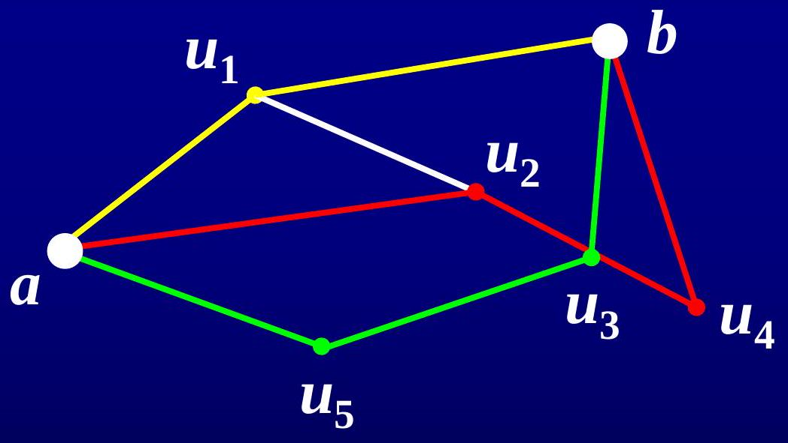

点集 $\left\{u_{1}, u_{3}\right\}$ 分离点 $a$ 与 $b$。

边集 $\left\{u_{1} b, u_{2} u_{3}, u_{3} u_{5}\right\}$ 分离点 $a$ 与 $b$。

**定理**

> 
> 
> 1. 设 $x$ 和 $y$ 是图 $G$ 中的两个不相邻点，则 $G$ 中分离 $x$ 和 $y$ 的最少点数等于独立的 $(x, y)$ 路的最大数目。
> 
> 2. 设 $x$ 和 $y$ 是图 $G$ 中的两个不同点，则 $G$ 中分离 $x$ 和 $y$ 的最少边数等于边不重的 $(x, y)$ 路的最大数目。

**例：**

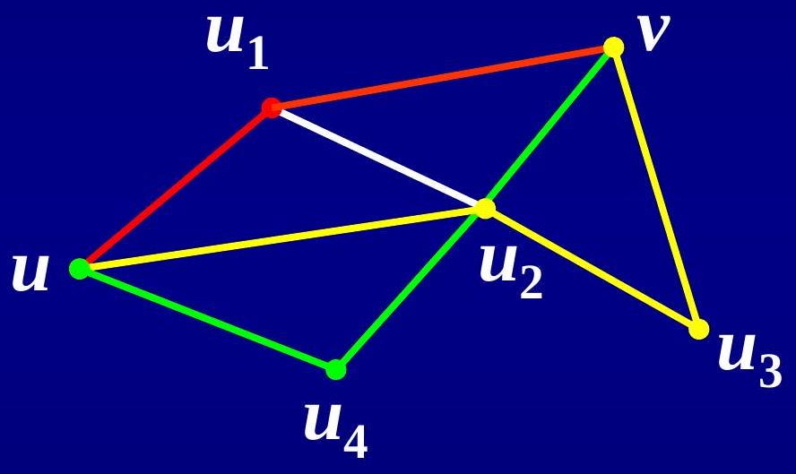

在该图中，独立的 $(u, v)$ 路的最大条数是 2，分离点 $u$ 与 $v$ 的最小点集是 $\left\{u_{1}, u_{2}\right\}$，包含 2 个顶点。

在该图中，边不重的 $(u, v)$ 路的最大条数是 3，分离点 $u$ 与 $v$ 的最小边集是 $\left\{u_{1} v, u_{2} v, u_{2} u_{3}\right\}$，包含 3 条边。

> **定理**
> 
> 1. 一个非平凡图 $G$ 是 $k(k \geq 2)$ 连通的当且仅当 $G$ 的任意两个不同顶点间至少存在 $k$ 条独立的路；
> 
> 2. 一个非平凡图 $G$ 是 $k(k \geq 2)$ 边连通的当且仅当 $G$ 的任意两个不同顶点间至少存在 $k$ 条边不重的路。
> 
> **注** 由＂任意两个不相邻的顶点之间存在 $k$ 条独立的路＂必能推出＂任意两个相邻的顶点之间也存在 $k$ 条独立的路＂。

**注** 上述定理是Whitney在1932年借助Menger定理给出的。这也是人们熟知的所谓的＂Menger定理＂。

### 3.3 应用

一个通讯网络可以模型化为一个图，图中的点代表通讯站，边代表通讯线。这样，图的点（边）连通度对应了网络中容许失灵的通讯站（线）数目的一个界限。即图的连通度对应系统的可靠性。

- 问题：如何构造出在给定可靠性的条件下使成本尽量低的系统？

- 图论模型：对一个赋权图 $G$，试确定 $G$ 的一个具有最小权的 $k$ 连通生成子图。

**注**

1. 对 $k=1$，此问题即为求最小生成树的问题；

2. 对 $k>1$，这是一个还未解决的困难问题。

当 $G$ 是完全图且各边的权均为1时，问题是有解的。此时，即求边数最少的具有 $n$ 个顶点的 $k$ 连通图。

> 由前面定理知，$m$ 条边的 $n$ 阶 $k$ 连通图满足
> 
> $$
> k \leq\left\lfloor\frac{2 m}{n}\right\rfloor .
> $$
> 
> 因此，
> 
> $$
> m \geq\left\lceil\frac{k n}{2}\right\rceil .
> $$
> 
> 所以若能构造出边数达到 $\lceil\mathrm{k} n / 2\rceil$ 的 $n$ 阶 $k$ 连通图，则边数已达到最少。

1962年，数学家Harary构造了这类图 $H_{k, n}$，称为Harary图。

> **Harary 图的构造**
> 
> 设 $V\left(H_{k, n}\right)=\{0,1,2, \ldots, n-1\}$。
> 
> 情况1．$k$ 为偶，设 $k=2 r$。此时 0 与 $1,2, \ldots, r$ 连线；1 与 $2,3, \ldots$,$r+1$ 连线；$\ldots ; n-1$ 与 $0,1, \ldots, r-1$ 连线。如下图中的 $H_{4,8}$ 所示。
> 
> 情况2．$k=2 r+1, n$ 为偶。先作 $H_{2 r, n}$，再在 $i$ 与 $(i+n / 2)$ 间添加边 $i(i+n / 2)(0 \leq i<n / 2)$。如下图中的 $H_{5,8}$ 所示。

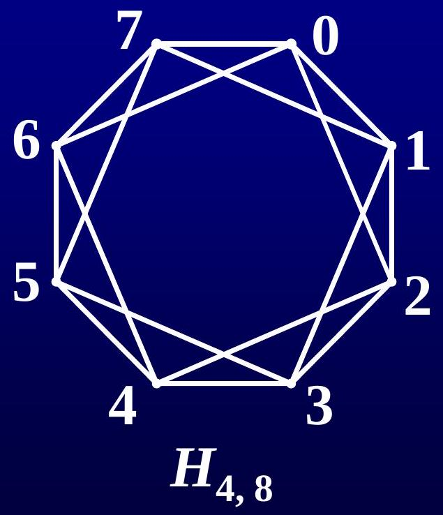

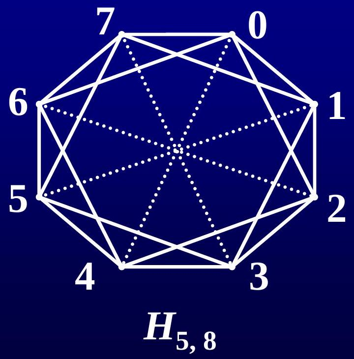

> 情况3．$k=2 r+1, ~ n$ 为奇。先作 $H_{2 r, n}$，再在 0 和 $(n-1) / 2,(n+1) / 2$，以及 $i$ 和 $i+(n+1) / 2(1 \leq i<(n-1) / 2)$ 间添加边。如下图中的 $H_{5,9}$ 所示。

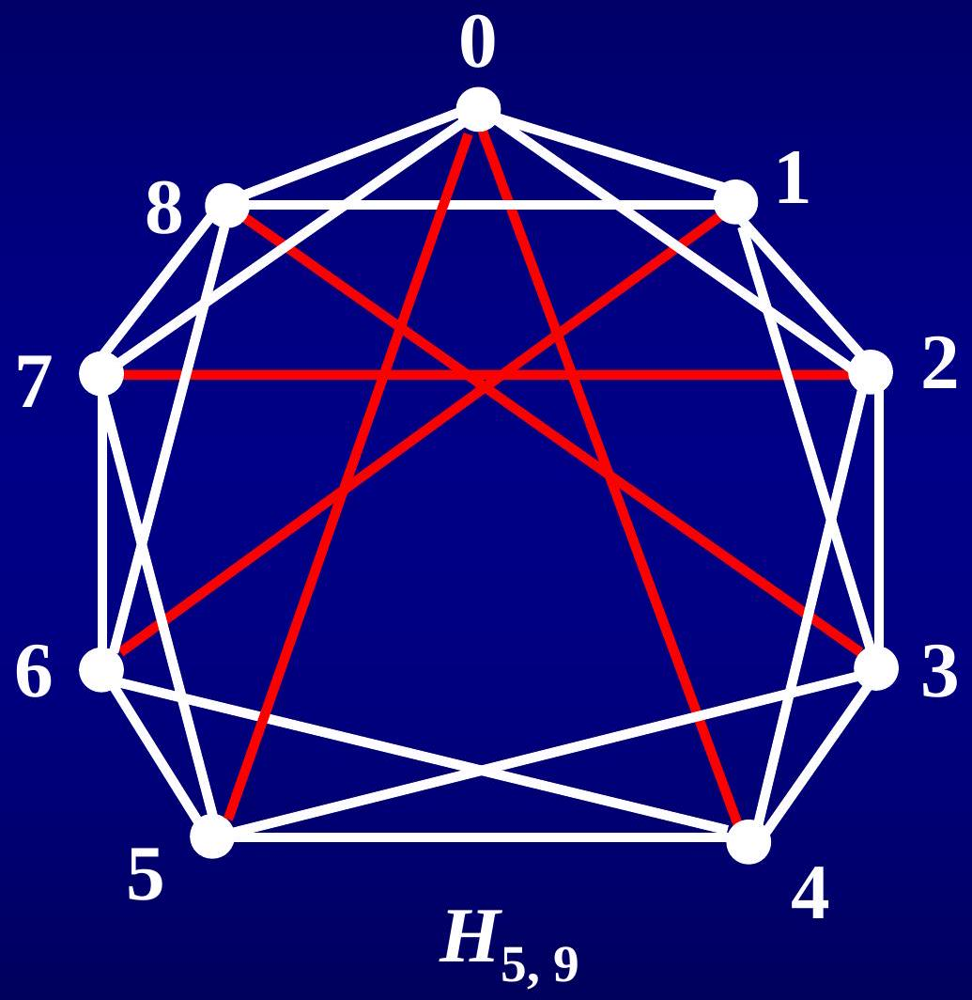

可以证明：$H_{k, n}$ 是 $k$ 连通的。
