# 第四章 Euler图与Hamilton图

> 专栏：图论 · Notion 最后编辑：2026-11-05T08:54:00.000Z
>
> 来源：https://www.notion.so/4059d738588381f2ba7ad3580c68b77e

> **本章内容**：Euler · 中国邮递员问题 · Hamilton图 · 度极大非Hamilton图 · 旅行售货员问题

### 4.1 欧拉图

#### 一、欧拉图的概念

哥尼斯堡七桥问题：当时东普鲁士哥尼斯堡（今俄罗斯加里宁格勒）城区跨越Pregel河两岸，河中心有两个小岛。小岛与河的两岸有七座桥连接。在所有桥都只能走一遍的前提下，如何才能把这个地方所有的桥都走遍？

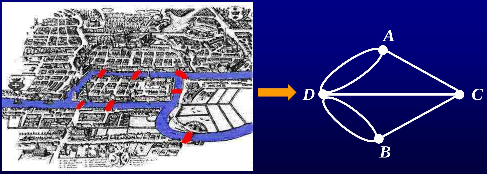

**定义** 经过 $G$ 的每条边的（闭）迹被称为Euler（闭）迹，存在Euler闭迹的图称为Euler图，简称 $E$ 图。Euler闭迹又称为Euler 回路。

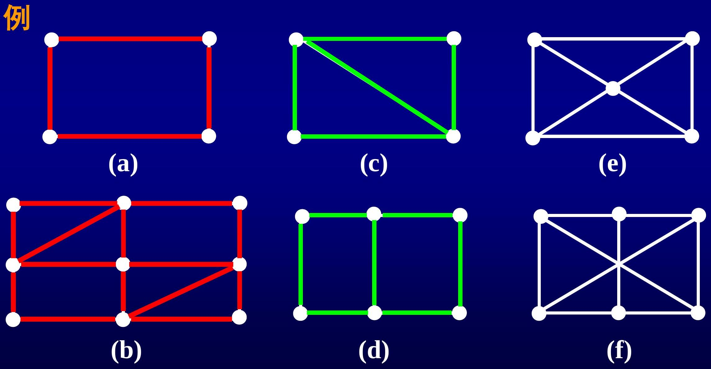

#### 二、欧拉图的性质

**定理** 假定 $G$ 是一个连通图，则下列命题等价：

> 
> 
> 1. $G$ 是欧拉图。
> 
> 2. $G$ 的每个点的度是偶数。
> 
> 3. $G$ 的边集能划分为边不重的圈的并。

**证明**

（1）⇒（2）令 $C$ 是 $G$ 的一条Euler闭迹。

$G$ 中任一个给定的点在 $C$ 中每出现一次恰好关联两条边，因为 $G$ 的每条边在 $C$ 中仅出现一次，所以该点的度应为该点在 $C$ 中出现的次数的两倍，所以是一个偶数。

（2）⇒（3）对 $G$ 的边数归纳证明。

当 $G$ 的边数为 0 时，此时 $G$ 是空图，结论显然成立。

假设当 $G$ 的边数小于 $k$ 时结论成立，下面设 $G$ 有 $k$ 条边。

由于每个点的度数均为偶数，因此 $\delta(G) \geq 2$。

从而，图 $G$ 中必然存在圈，不妨设为 $C$。

从 $G$ 中移去圈 $C$，所得图 $G-C$ 的每个连通分支是一个满足条件且边数更少的图。

由归纳假设知，$G-C$ 的边集可划分为边不重的圈的并。

从而，图 $G$ 的边集可划分为边不重的圈的并。

（3）⇒（1）令 $C_{1}$ 是这个划分的一个圈。

若 $G$ 仅由这个圈组成，则 $G$ 显然是欧拉图。

否则，有另外一个圈 $C_{2}$，且 $C_{2}$ 与 $C_{1}$ 有一个公共点 $v$。从 $v$ 开始并且由 $C_{1}$ 与 $C_{2}$ 相连组成的途径是含有这两个圈中各条边的一条闭迹。

继续这个过程，我们可以构成一条含有 $G$ 的所有边的闭迹，从而 $G$ 是欧拉图。

> **推论** 连通图 $G$ 有非封闭的Euler迹当且仅当 $G$ 恰有两个奇度顶点。

**证明** 设 $G$ 有非封闭的Euler迹 $P$，并设点 $u$ 和 $v$ 分别是 $P$ 的起点和终点。

在 $G$ 中添加一条连接 $u$ 和 $v$ 的边 $e$，所得到的图记为 $G+e$。

显然，$P+e$ 是 $G+e$ 的一条Euler闭迹。因此，$G+e$ 有零个奇度顶点，从而 $G$ 恰有两个奇度顶点。

反之，设 $G$ 是恰有两个奇度顶点 $u$ 和 $v$ 的连通图。

在 $u$ 和 $v$ 间添加新边 $e$ 得图 $G+e$，则 $G+e$ 没有奇度顶点。

因此，$G+e$ 有Euler闭迹 $C$。

从而，$C-e$ 为 $G$ 的非封闭的Euler迹。

一笔画问题：画一个图形，在笔不离纸，每条边只画一次而不允许重复的情况下，画完该图。

一笔画问题本质上就是一个图是否存在欧拉迹的问题。

**注**

> 
> 
> 1. 如果图 $G$ 为欧拉图，则能够一笔画完该图，并且又回到出发点；
> 
> 2. 如果图 $G$ 只存在非封闭的欧拉迹，则能够一笔画完该图，但回不到出发点。

**例** 在平面内，右图是否可以在三笔之内画成？

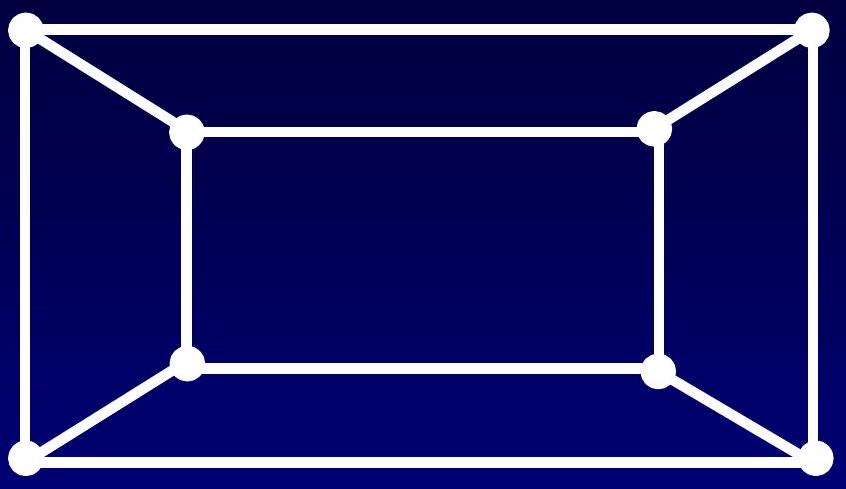

**解** 假设可以三笔画成，不妨用下图表示：

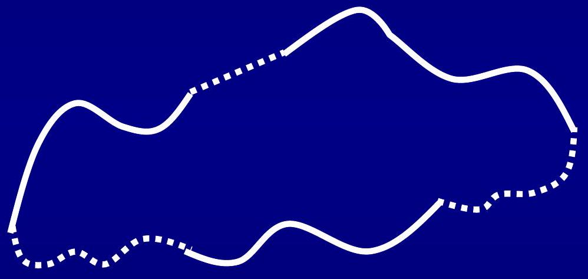

也就是说，在原图上添加三条边，可使其变为欧拉图。

但原图有 8 个度数为奇数的顶点，添加三条边最多可以使 6 个顶点的度数变为偶数，无法成为欧拉图。

因此，原图不能三笔画成。

> **例** 证明：若连通图 $G$ 有 $2 k$ 个奇度顶点，则存在 $k$ 条边不重的迹 $Q_{1}, Q_{2}, \ldots, Q_{k}$，使得：
> 
> $$
> E(G)=E\left(Q_{1}\right) \cup E\left(Q_{2}\right) \cup \cdots \cup E\left(Q_{k}\right) .
> $$

**证明** 令 $O=\{v_1,v_2,\dots,v_{2k}\}$ 为 $G$ 的所有奇度顶点，在 $v_i$ 与 $v_{i+k}$ 之间添加新边 $e_i$（$1\leq i\leq k$）：

$$
e_i=v_iv_{i+k},\qquad 1\leq i\leq k.
$$

所得图记为 $G^{*}$（允许出现平行边，即 $G^{*}$ 可能是多重图）。下面验证 $G^{*}$ 是欧拉图。

**(i) 连通性**

$G$ 连通且 $G\subseteq G^{*}$（$G^{*}$ 只比 $G$ 多了 $k$ 条边），故 $G^{*}$ 连通。

**(ii) 各顶点度数均为偶数**

二元组 $\{v_i,v_{i+k}\}$（$1\leq i\leq k$）构成 $O$ 的一个划分：$2k$ 个顶点互异，且 $i\neq j$ 时 $\{v_i,v_{i+k}\}\cap\{v_j,v_{j+k}\}=\varnothing$。

因此每个奇点 $v\in O$ 恰是某一条新边的端点，且仅是一条；而 $v\notin O$ 不与任何新边关联。于是

$$
d_{G^{*}}(v)=\begin{cases}d_{G}(v)+1, & v\in O,\\ d_{G}(v), & v\notin O.\end{cases}
$$

由 $O$ 的定义，$d_{G}(v)$ 为奇数当且仅当 $v\in O$。故上式两种情形中 $d_{G^{*}}(v)$ 分别是「奇数 $+1$」与「偶数 $+0$」，恒为偶数。

**(iii) 结论**

由欧拉图的判定定理（连通图是欧拉图当且仅当每个顶点的度数为偶数），$G^{*}$ 是欧拉图。

因此，图 $G^{*}$ 存在欧拉回路 $C$。

在 $C$ 中删去 $e_{i}(1 \leq i \leq k)$，得 $k$ 条边不重的迹 $Q_{i}(1 \leq i \leq k)$：

$$
E(G)=E\left(Q_{1}\right) \cup E\left(Q_{2}\right) \cup \cdots \cup E\left(Q_{k}\right) .
$$

由于 $C$ 中的每条边恰好出现一次，删去 $k$ 条新边 $e_{1},\dots,e_{k}$ 后所得的 $Q_{1},\dots,Q_{k}$ 边不重，且并为 $E(G)$。

多笔画问题：一个图形最少需要多少笔画成，取决于图中有多少对奇度顶点。

**例** 能否将一副多米诺骨牌围成一圈，使得对于任意相邻的两块牌，它们的接触面具有相同的点数？

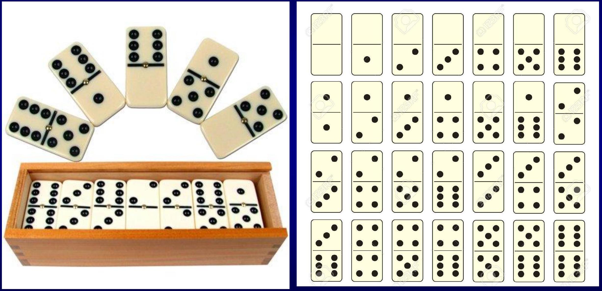

**解** 存在满足条件的排列方式。

每块骨牌可以用唯一的一对数字 $(\boldsymbol{a}, \boldsymbol{b})$ 来表示，其中

$$
0 \leq a \leq b \leq 6 .
$$

比如，$(3,4)$ 表示骨牌。

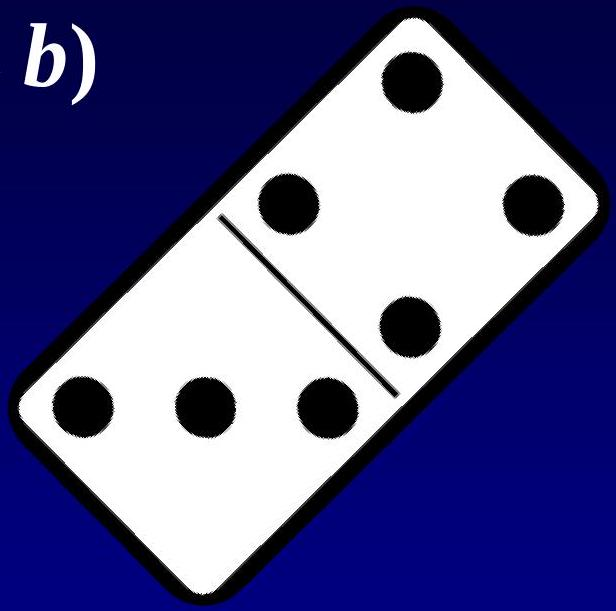

骨牌 (3,4)

以 $0,1,2, \ldots, 6$ 为顶点，先构造完全图 $K_{7}$，然后在每个顶点处再添加一个自环，所得图用 $G$ 来表示。

图 $G$ 的每条边对应一块骨牌，比如顶点 3 处的自环表示骨牌（3，3）。

问题转化为判断图 $G$ 是否为欧拉图。

图 $G$ 的每个顶点的度数为 8，因此 $G$ 是欧拉图。

#### 三、Fleury算法

算法思想：从任一点出发按以下方法来描画一条边不重复的迹，使在每一步中未描画的子图的割边仅当没有别的边可选择时才被描画。

**Fleury 算法**

1. 任意选取一个顶点 $v_{0}$，置 $w_{0}=v_{0}$。

2. 假设迹 $w_{i}=v_{0} e_{1} v_{1} \ldots e_{i} v_{i}$ 已经选定，那么按下述方法从 $E \backslash\left\{e_{1}, e_{2}, \ldots, e_{i}\right\}$ 中选取边 $e_{i+1}$，使（a）$e_{i+1}$ 和 $v_{i}$ 相关联；（b）除非没有别的边可选择，否则 $e_{i+1}$ 不是 $G-\left\{e_{1}, e_{2}, \ldots, e_{i}\right\}$ 的割边。

3. 当第 2 步不能再执行时，算法停止。

**例：**

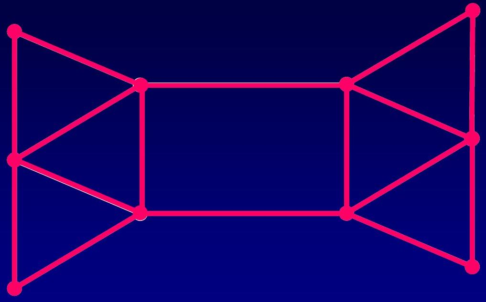

**例** 某博物馆的一层布置如下图，其中边代表走廊，结点 $e$ 是入口，结点 $g$ 是礼品店，通过 $g$ 我们可以离开博物馆。请找出从博物馆 e 进入，经过每个走廊恰好一次，最后从 g 处离开的路线。

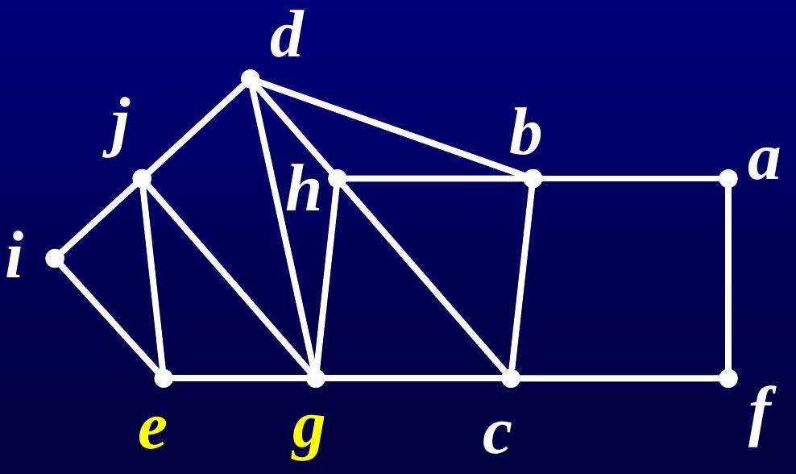

**解** 图中只有两个奇度顶点 $e$ 和 $g$，因此存在起点为 $e$，终点为 $g$ 的欧拉迹。

为了在 $G$ 中求出一条起点为 $e$、终点为 $g$ 的欧拉迹，在 $e$ 和 $g$ 间添加一条平行边 $m$，如图。

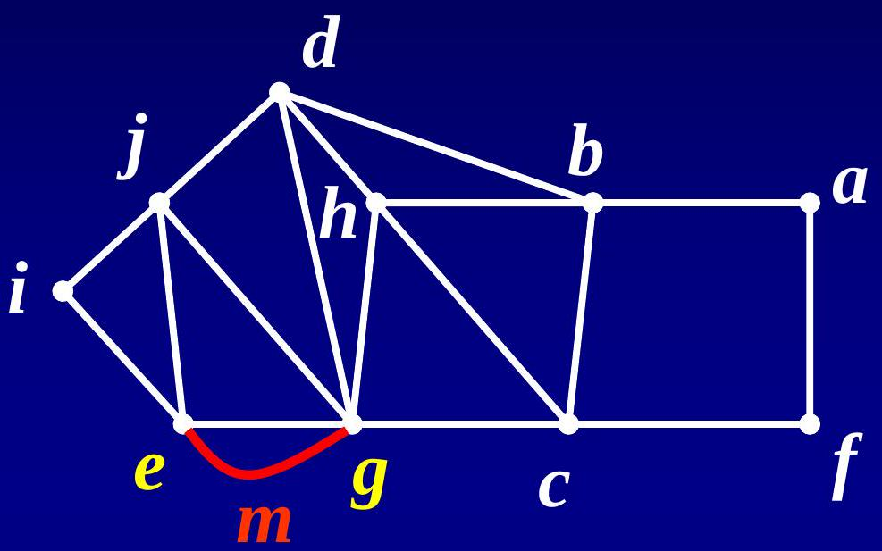

用 Fleury 算法求出欧拉回路：e g c f a b c h b d h g d j i e j g m e。

所以，要求的路线为 e g c f a b c h b d h g d j i e j g。

### 4.2 中国邮递员问题

问题描述：邮递员从邮局出发，递送邮件，然后返回邮局，要求辖区每条街至少走一遍且走过的总路程最短，应如何选择路线？

此问题由中国数学家管梅谷于一九六零年首先研究并给出算法。

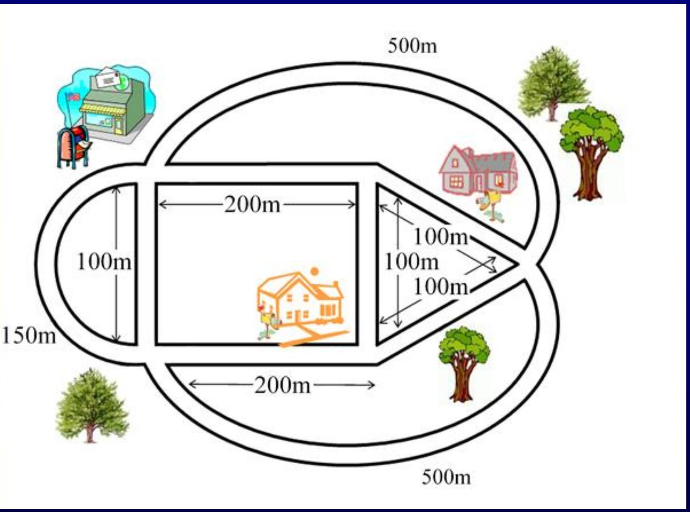

管梅谷给出了该问题的解决方法，刊登在

- 管梅谷，奇偶点图上作业法，数学学报，10（1960），263－266．

- Mei－Ko Kwan，Graphic programming using odd or even points，Chinese Mathematics， 1 （1962），273－277．

1965年，美国学者 Edmonds 注意到这一问题，将其称为＂中国邮递员问题＂。

图论模型：在一个连通的具有非负权的赋权图 $G$ 中找一条包含每条边（允许重复）且边权之和最小的闭途径，称之为最优环游。

**注**

1. 若图 $G$ 是一个欧拉图，则找出 $G$ 的欧拉回路即可。

2. 对一般图，其解法为：添加重复边以使 $G$ 成为欧拉图 $G^{*}$，并使添加的重复边的边权之和为最小，再求 $G^{*}$ 的欧拉回路。

> **定理** 假定 $G^{*}$ 是在图 $G$ 中添加一些重复边得到的欧拉图，则 $G^{*}$ 具有最小权值的充要条件是：
> 
> 1. $G$ 的每一条边最多被添加一次；
> 
> 2. 对于 $G^{*}$ 的每个圈来说，新添加的边的总权值不超过该圈总权值的一半。

**证明** 必要性

若 $G$ 中某条边在 $G^{*}$ 中被添加的次数超过 1，则去掉其中两条重复边，我们将得到一个总权值更小，且以 $G$ 为生成子图的欧拉图。

这与＂$G^{*}$ 总权值最小＂相矛盾。

因此，每条边最多被添加一次。

假定在 $G^{*}$ 中存在某个圈使得新添加的边的总权值大于该圈权值的一半，不妨设为 $C$。

那么在 $G^{*}$ 中，将 $C$ 上新添加的边全部去掉，然后将原来的每条边都添加一次。

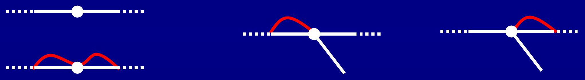

这样我们得到一个总权值更小，同样以 $G$ 为生成子图的欧拉图，这与＂$G^{*}$ 总权值最小＂相矛盾。

**充分性**

我们将证明：满足条件的任何两个图都具有相同的总权值。

设 $G_{1}$ 与 $G_{2}$ 是满足条件的两个欧拉图。

设 $Y_{1}$ 与 $Y_{2}$ 分别表示 $G_{1}$ 与 $G_{2}$ 中添加的边的集合。

要比较 $G_{1}$ 与 $G_{2}$ 总权值，我们只需考虑集合 $Y_{1} \backslash Y_{2}$ 与集合 $Y_{2} \backslash Y_{1}$ 的权值。

令：$Y=\left(Y_{1} \backslash Y_{2}\right) \cup\left(Y_{2} \backslash Y_{1}\right)$。

考察由边集 $Y$ 导出的子图 $G[Y]$。

断言 1：$G[Y]$ 的每个顶点的度数必然为偶数。

对于 $G$ 中任意点 $v$，如果 $d_{G}(v)$ 是奇数，那么 $Y_{1}$ 与 $Y_{2}$ 中与 $v$ 关联的边数均为奇数；如果 $d_{G}(v)$ 是偶数，则 $Y_{1}$ 与 $Y_{2}$ 中与 $v$ 关联的边数均为偶数。

其次，设 $Y_{1}$ 与 $Y_{2}$ 中与 $v$ 关联的边数分别为 $y_{1}$ 与 $y_{2}$，其中相同的边数为 $y_{0}$，那么，$Y$ 中与 $v$ 关联的边数为：

$$
\left(y_{1}-y_{0}\right)+\left(y_{2}-y_{0}\right)=y_{1}+y_{2}-2 y_{0}
$$

所以，$Y$ 中与 $v$ 关联的边数为偶数，说明 $G[Y]$ 的每个顶点的度数必然为偶数。

由于 $G[Y]$ 的每个顶点的度数为偶数，所以它的每个分支是欧拉图。因此，$G[Y]$ 可以作圈分解。

设

$$
Y=E\left(C_{1}\right) \cup E\left(C_{2}\right) \cup \cdots \cup E\left(C_{k}\right) .
$$

断言 2：对每个 $i$，均成立

$$
\sum_{e \in Y_{1} \cap E\left(C_{i}\right)} w(e)=\sum_{e \in Y_{2} \cap E\left(C_{i}\right)} w(e) .
$$

事实上，因为：

$$
\begin{aligned}
& \sum_{e \in Y_{1} \cap E\left(C_{i}\right)} w(e) \leq \sum_{e \in E\left(C_{i}\right) \backslash Y_{1}} w(e), \quad(i=1,2, \ldots, k) \\
& \sum_{e \in Y_{2} \cap E\left(C_{i}\right)} w(e) \leq \sum_{e \in E\left(C_{i}\right) \backslash Y_{2}} w(e), \quad(i=1,2, \cdots, k)
\end{aligned}
$$

又因为：

$$
E\left(C_{i}\right) \backslash Y_{1}=Y_{2} \cap E\left(C_{i}\right) \quad E\left(C_{i}\right) \backslash Y_{2}=Y_{1} \cap E\left(C_{i}\right)
$$

所以，对每个 $i$，成立

$$
\sum_{e \in Y_{1} \cap E\left(C_{i}\right)} w(e) \leq \sum_{e \in E\left(C_{i}\right) \backslash Y_{1}} w(e)=\sum_{e \in E\left(C_{i}\right) \cap Y_{2}} w(e),
$$

$$
\sum_{e \in Y_{2} \cap E\left(C_{i}\right)} w(e) \leq \sum_{e \in E\left(C_{i}\right) \backslash Y_{2}} w(e)=\sum_{e \in E\left(C_{i}\right) \cap Y_{1}} w(e) .
$$

因此，

$$
\sum_{e \in Y_{1} \cap E\left(C_{i}\right)} w(e)=\sum_{e \in Y_{2} \cap E\left(C_{i}\right)} w(e) .
$$

由断言 2 知，$G_{1}$ 和 $G_{2}$ 具有相同的权值。

> **非Euler图求最优环游的方法**
> 
> 1. 用每条边最多添一次的方法任意添一些重复边使图 $G$ 成为一个欧拉多重图 $G^{\prime}$。
> 
> 2. 考查 $G^{\prime}$ 的圈，若存在圈 $C$，其中重复边的总权值大于该圈权值的一半，则在圈 $C$ 上交换重复边和不重复边得到一个新的欧拉多重图。重复这个过程，直到得到一个图 $G^{*}$，使得图 $G^{*}$ 中每个圈上重复边的总权值不大于该圈权值的一半。
> 
> 3. 用 Fleury 算法求 $G^{*}$ 的 Euler 回路。

J．Edmonds and E．L．Johnson，Matching，Euler tour and the Chinese postman problem，Math．Programming， 5 （1973）， 88－124．

**例** 图 $G$ 如图（a）所示（各边权为 1），它有 10 个奇度点。任意添一些边得到一个欧拉多重图（b）。

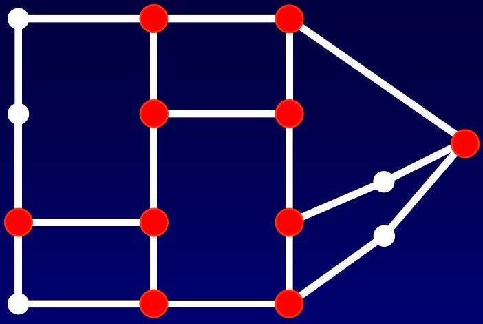

（a）

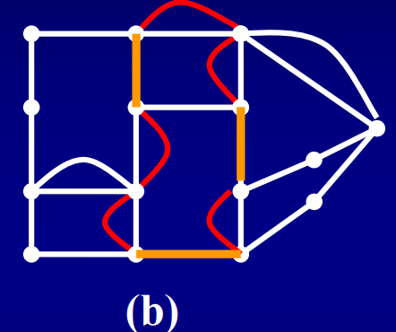

b

（b）中彩色圈中重复边的数目为 5，大于圈长 8 的一半，在这个圈上交换重复边和不重复边，得到（c）。

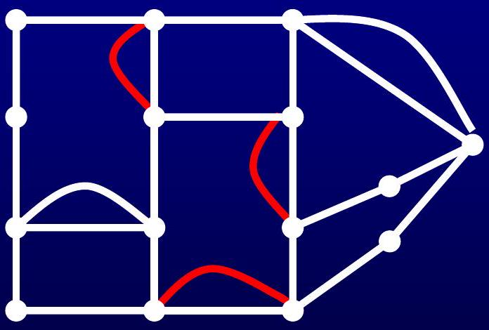

（c）

（c）中每一个圈中重复边的数目均不大于圈长的一半。从而，由（c）中每条欧拉回路对应原图一条闭途径，它含有所有的边且具有最短的长度。

**例** 求图 $G$ 的一个最优环游。

**解**：

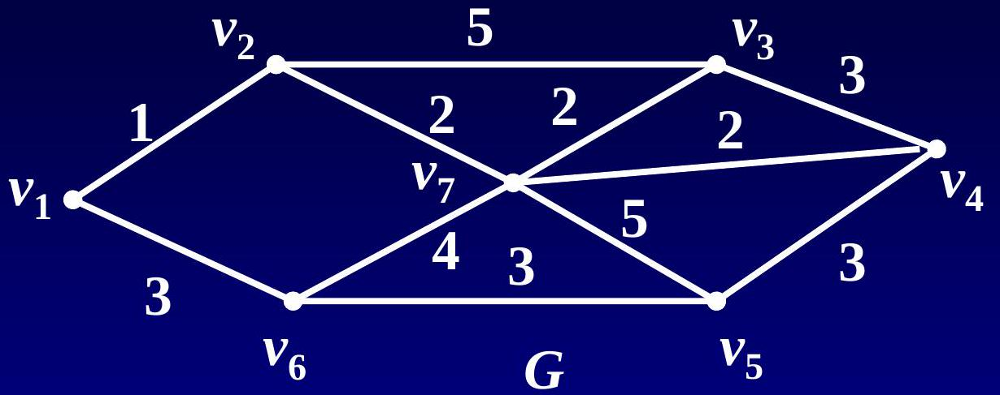

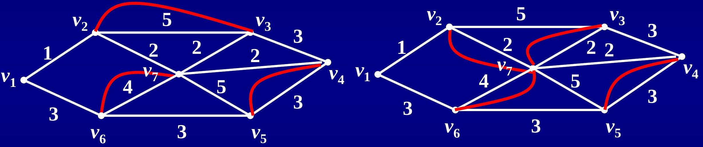

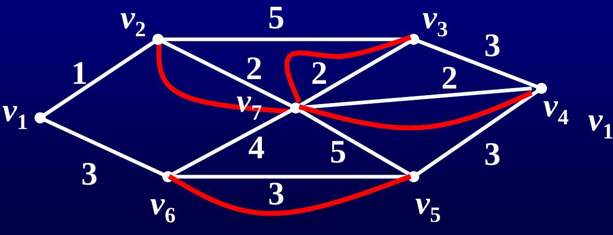

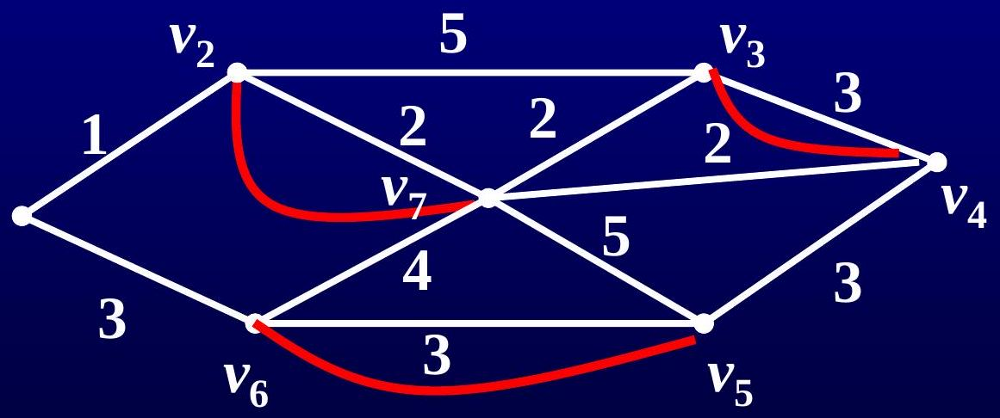

> **例** 如果一个赋权图 $G$ 中只有两个奇度顶点 $u$ 与 $v$，设计一个求其最优环游的算法。
> 
> **解** 算法如下：
> 
> 1. 在 $u$ 与 $v$ 间求出一条最短路 $P$；（最短路算法）
> 
> 2. 在最短路 $P$ 上，给每条边添加一条平行边得到 $G$ 的欧拉多重图 $G^{*}$；
> 
> 3. 在欧拉多重图 $G^{*}$ 中用 Fleury 算法求出一条欧拉回路。

**证明** 算法的合理性

设 $u$ 与 $v$ 是 $G$ 的两个奇度点，$G^{*}$ 是 $G$ 的任意一个欧拉多重图。

考虑 $G^{*}\left[E^{*}-E\right]$，显然它只有两个奇度顶点 $u$ 与 $v$，当然它们必须在 $G^{*}\left[E^{*}-E\right]$ 的同一个分支中，因此，存在 $(u, v)$ 路 $P^{*}$。

所以，

$$
\sum_{e \in E^{*}-E} w(e) \geq w\left(P^{*}\right) \geq w(P)
$$

**例** 求出下图的一条最优环游。

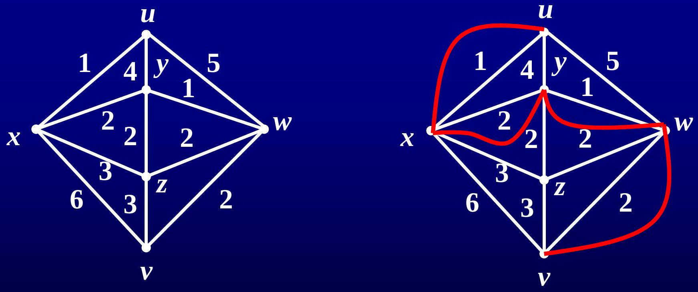

最优欧拉环游：$x u y w v z w y x u w v x z y x$。

### 4.3 哈密尔顿图

#### 一、哈密尔顿图的概念

1857年，哈密尔顿发明了一个游戏（Icosian Game）。它是由一个木制的正十二面体构成，在它的每个棱角处标有当时很有名的城市。游戏目的是＂环球旅行＂。为了容易记住被旅游过的城市，在每个棱角上放上一个钉子，再用一根线绕在那些旅游过的城市上（钉子），由此可以获得旅程的直观表示。

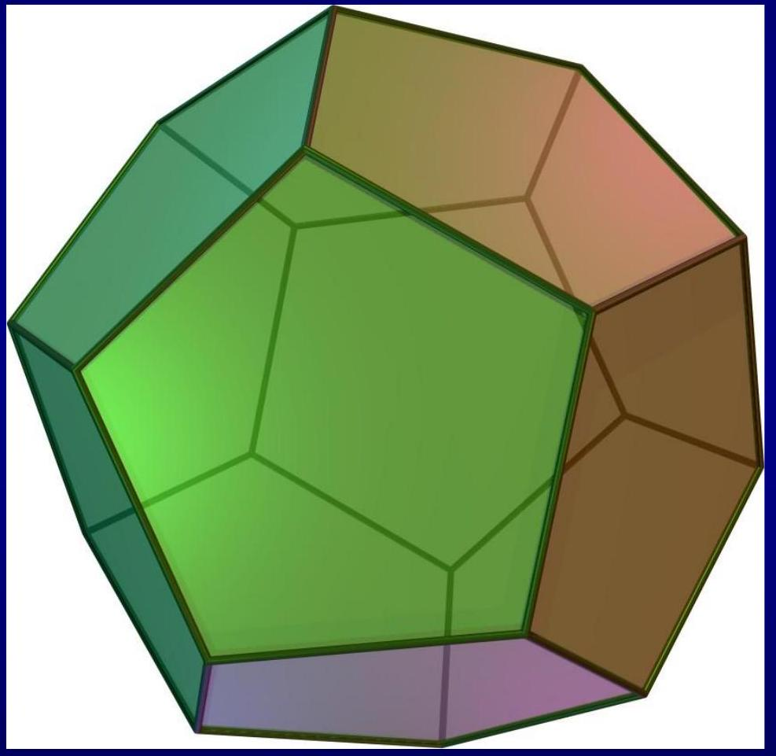

该游戏促使人们思考点线连接的图的结构特征。这就是图论历史上著名的哈密尔顿问题。

> **定义** 经过图中每个点的路称为Hamilton路，简称 $H$ 路。经过图中每个点的圈称为Hamilton圈，简称 $H$ 圈。存在Hamilton圈的图称为Hamilton图，简称 $H$ 图。

**例** 下图为Hamilton图

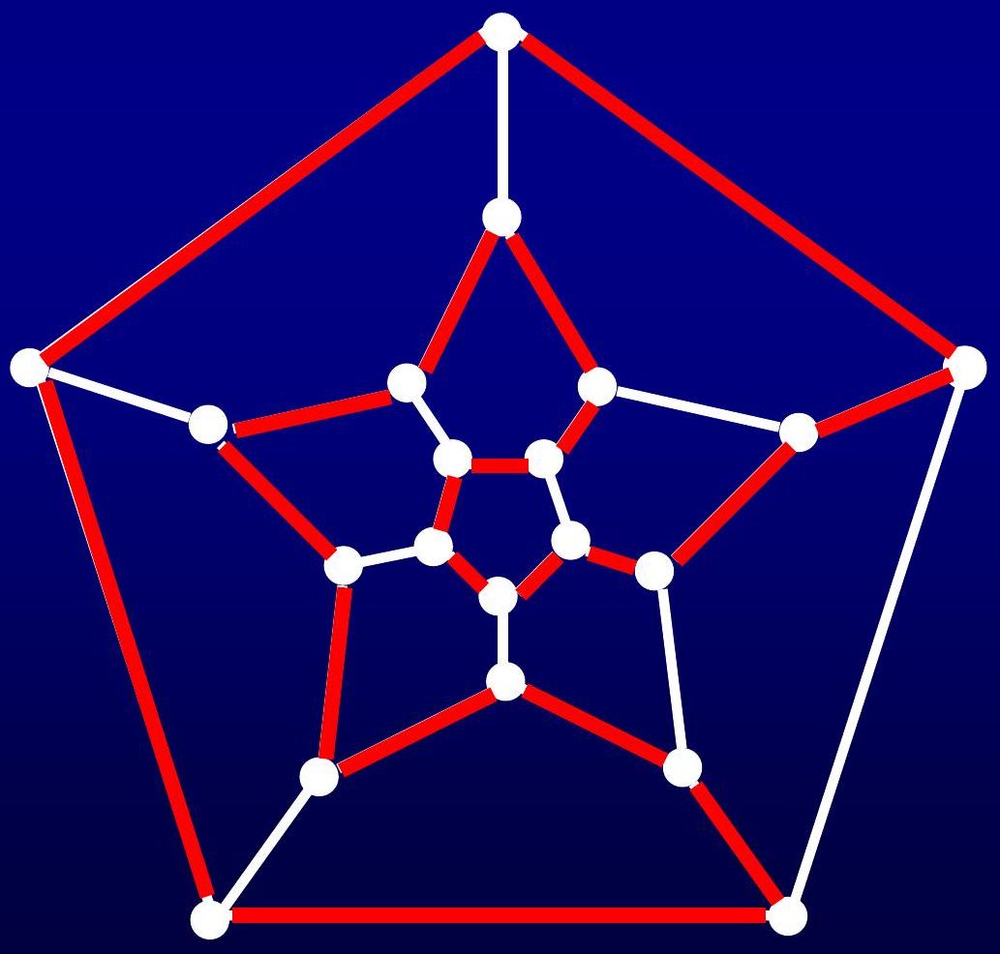

#### 二、性质与判定

> **定理** 若 $G$ 是 $H$ 图，则对于 $V$ 的每个非空真子集 $S$，均有
> 
> $$
> \omega(G-S) \leq|S|
> $$
> 
> $$
> G是 H 图\Rightarrow \omega(G-S) \leq|S| ,其中S是V(G)的非空真子集
> $$

**证明** 设 $C$ 是 $G$ 的 $H$ 圈。

对 $V$ 的任意非空子集 $S$，容易知道

$$
\omega(C-S) \leq|S| .
$$

所以，

$$
\omega(G-S) \leq \omega(C-S) \leq|S| .
$$

> **注：为什么**$\omega(G-S) \leq \omega(C-S)$
> $C $是$ G$ 的 $Hamilton$ 圈，所以 $C$ 包含 $G$ 的所有顶点。从 $G$ 和 $C$ 中都删去同一组顶点 $S$ 后：$G − S $和 $C − S $的顶点完全相同，但 $G − S$ 可能有更多的边。
> 在顶点不变的情况下增加边，只可能把原来的几个连通分支连接起来，不会让连通分支变多。因此：
> 
> $$
> \omega(G-S) \leq \omega(C-S) \leq|S| .
> $$

**注** 上述定理只是必要条件，而非充分条件。

**例** 证明：彼得森图不是 $H$ 图，但满足定理中的条件。

**证明** 可以直接验证彼得森图满足定理中的条件。

接下来证明彼得森图不是 $H$ 图。

假定彼得森图是 $H$ 图，对其顶点进行标号，如右图所示。

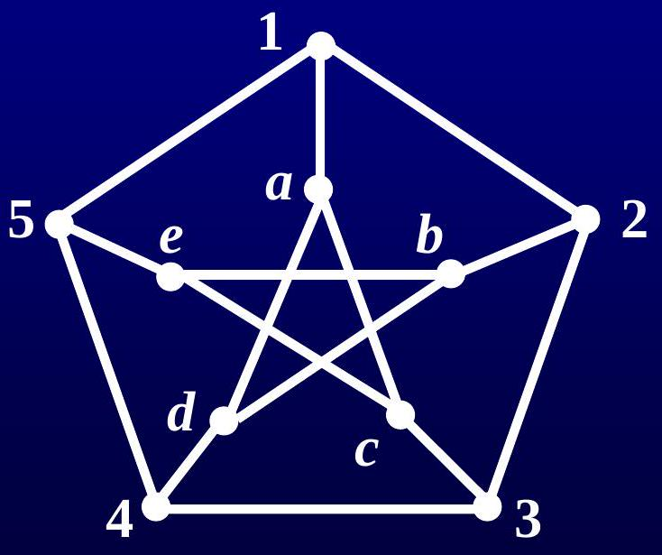

哈密尔顿圈 $C$ 必然从外面的圈 123451 沿着一条辐轴边 $1 a, 2 b, 3 c, 4 d$ 或 $5 e$ 进入里面的圈 acebda，然后再沿着另一条辐轴边回到外面的圈 123451。

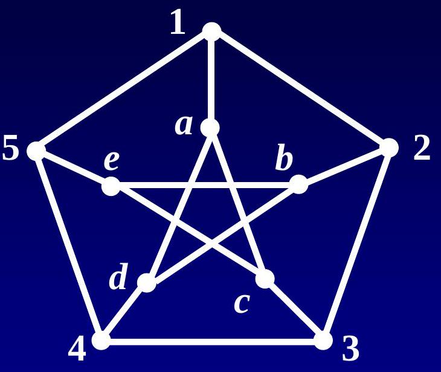

因此，$C$ 必然经过 2 条或者 4 条辐轴边。

情况 1：经过 2 条辐轴边。

不妨假设经过了辐轴边 $1 a$。

对于边 $a c$ 和 $a d$，有且仅有 1 条在圈 $C$ 上，不妨假设为 $a d$。

因为边 $a c$ 不在圈 $C$ 上，则辐轴边 $3 c$ 一定在圈 $C$ 上。

从而，辐轴边 $2 b, 4 d, 5 e$ 一定不在圈 $C$ 上。

此时，顶点 2 和顶点 4 的度数均为 2。因此，边 23 和 43 一定在圈 $C$ 上。

我们推出：顶点 3 关联的 3 条边都在圈 $C$ 上，矛盾！

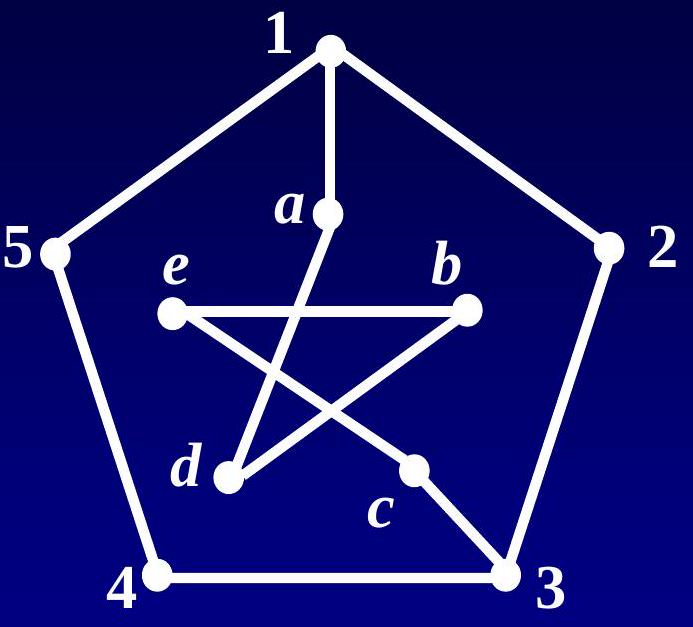

情况 2：经过 4 条辐轴边。

不妨假设未经过辐轴边 $5 e$。

因为边 15 和 $1 a$ 都在圈 $C$ 上，所以边 12 一定不在圈 $C$ 上，从而边 23 一定在圈 $C$ 上。

显然，边 $e b$ 和 $e c$ 一定在圈 $C$ 上。

此时，边 $23,3 c, c e, e b$ 和 $b 2$ 已经构成一个圈，矛盾。

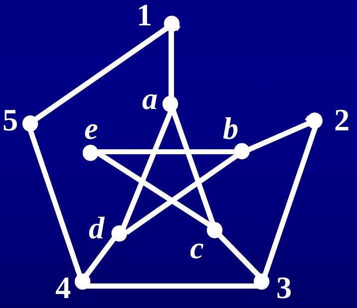

**注** 利用该定理可以说明某些图不是哈密尔顿图。

**例** 判断图 $G$ 是否为哈密尔顿图？

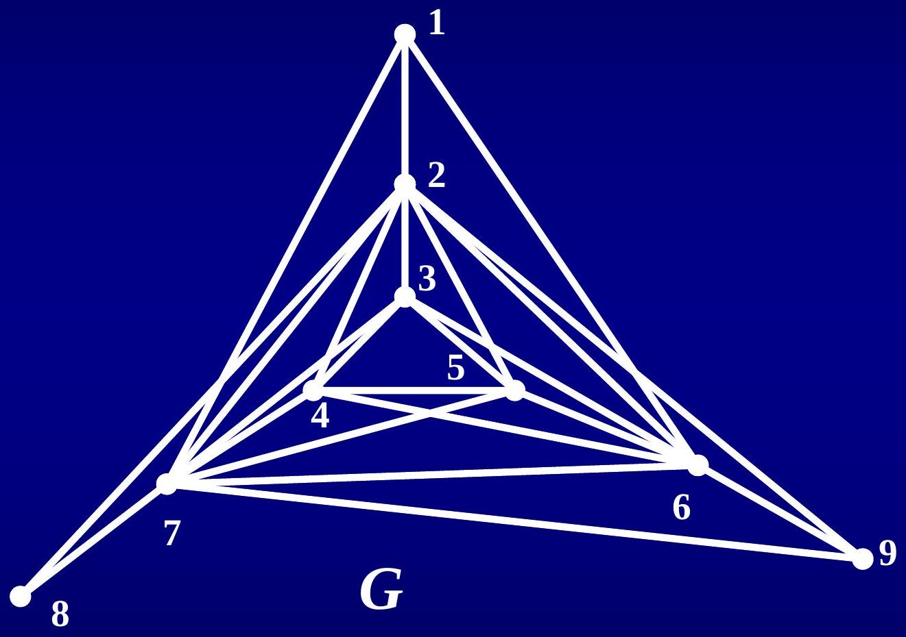

**解** 取 $S=\{2,6,7\}$，则 $\omega(G-S)=4>3=|S|$。

因此，$G$ 不是哈密尔顿图。

**例** 若简单图 $G$ 是非平凡的连通图，但不是 2 连通的，则 $G$ 不是哈密尔顿图。

**证明** 因为图 $G$ 不是 2 连通的，则 $G$ 存在割点 $v$。

显然，$\omega(G-v) \geq 2>1=|\{v\}|$。

因此，$G$ 不是哈密尔顿图。

> **哈密尔顿简单图中一定不存在割点**

> **例** 若图 $G$ 包含**哈密尔顿路**，则对 $V(G)$ 的每个真子集 $S$，
> 
> $$
> \omega(G-S) \leq|S|+1 .
> $$
> 
> **证明** 设 $P$ 为图 $G$ 的哈密尔顿路。
> 
> 显然，$\omega(G-S) \leq \omega(P-S) \leq|S|+1$。

**例** 能否通过＂↑，↓，←，→＂四种操作连续经过右图中的 8 个点？

**解** 不存在满足条件的操作。

将位于第 $i$ 行第 $j$ 列的点记作 $v_{i, j}$。

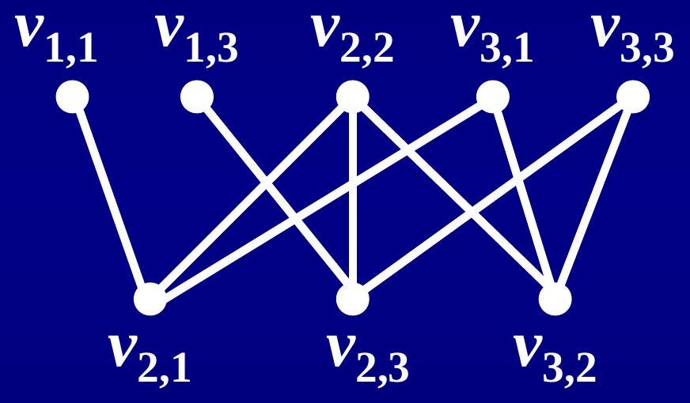

以 $\left\{v_{i, j}\right\}$ 作为顶点集合，两点之间连一条边当且仅当该两点可以直接到达，所得图记为 $G$，如右图。若存在满足条件的操作，则图 $G$ 中包含 $H$ 路。

删去点 $v_{2,1}, v_{2,3}, v_{3,2}$ 得到 5 个连通分支，矛盾！

当 $k$ 为奇数时，删去 $k \times k$ 点列中第一行第二列的点后，无法通过操作＂↑，↓，←，→＂遍历完所有的点。

> **定理** （Dirac 1952）对于 $n$ 阶 $(n \geq 3)$ 简单图 $G$，如果
> 
> $$
> \delta(G) \geq \frac{n}{2},
> $$
> 
> 那么 $G$ 是 $H$ 图。

**证明** 若不然，设 $G$ 是一个满足定理条件的极大的 $n$ 阶非 $H$ 图。

显然 $G$ 不能是完全图，否则 $G$ 是 $H$ 图。

于是，可以在 $G$ 中任意取两个不相邻顶点 $u$ 与 $v$。

考虑图 $G+u v$，由 $G$ 的极大性知：$G+u v$ 是 $H$ 图。

由于 $G$ 是非 $H$ 图，$G+u v$ 的每一个 $H$ 圈必然包含边 $u v$。

所以，在 $G$ 中存在起点为 $u$ 而终点为 $v$ 的 $H$ 路 $P$。

不失一般性，设起点为 $u$ 而终点为 $v$ 的 $H$ 路 $P$ 为：

$$
P=v_{1} v_{2} \cdots v_{n}, v_{1}=u, v_{n}=v .
$$

令

$$
S=\left\{v_{i} \mid u v_{i+1} \in E(G)\right\} \quad T=\left\{v_{j} \mid v_{j} v \in E(G)\right\}
$$

对于 $S$ 与 $T$，显然

$$
v_{n} \notin S \cup T \text { 。 }
$$

所以：$|S \cup T|<n$。

另一方面，必有 $S \cap T=\Phi$。

否则，设 $v_{i} \in S \cap T$。

那么，由 $v_{i} \in S$ 可以推出 $v_{1} v_{i+1} \in E(G)$。

由 $v_{i} \in T$ 可以推出 $v_{n} v_{i} \in E(G)$。

因此，可以得到

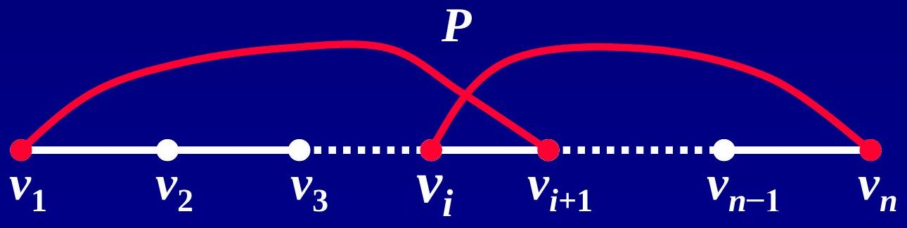

这样在 $G$ 中有 $H$ 圈，与假设矛盾！

于是，

$$
d(u)+d(v)=|S|+|T|=|S \cup T|+|S \cap T|<n .
$$

这与已知条件＂$\delta(G) \geq n / 2$＂矛盾！

> **定理** （Ore 1960）对于 $n$ 阶 $(n \geq 3)$ 简单图 $G$，如果 $G$ 中任意两个不相邻顶点 $u$ 与 $v$ 满足：
> 
> $$
> d(u)+d(v) \geq n,
> $$
> 
> 那么 $G$ 是 $H$ 图。

**注**

1. 该定理证明和Dirac定理完全类似；

2. 该定理中的条件仅为充分条件；

3. 该定理的条件是紧的。

**例** 设 $G$ 是由 $K_{l+1}$ 的一个顶点和另一个 $K_{l+1}$ 的一个顶点重合得到的图，那么对于 $G$ 的任意两个不相邻顶点 $u$ 与 $v$，显然有 $d(u)+d(v)=2 l=n-1$，但 $G$ 不是Hamilton图。

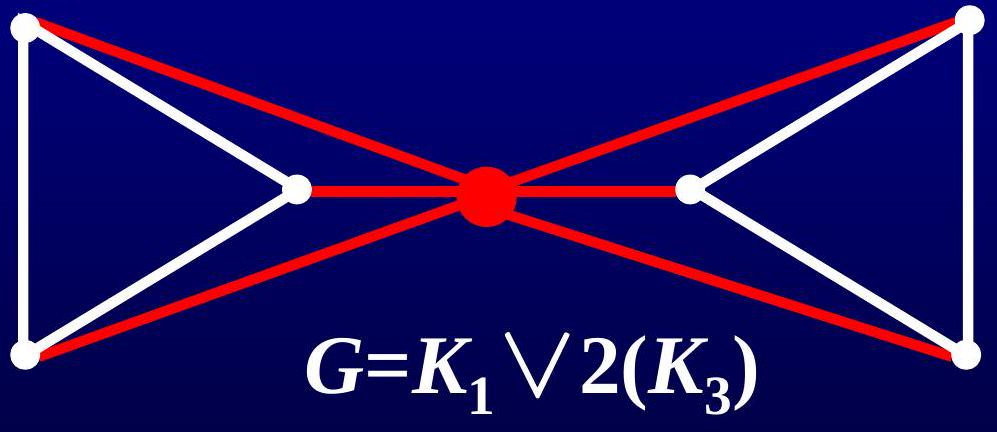

> **定理** （Chvátal 1972）设简单图 $G$ 的度序列是 $\left(d_{1}, d_{2}, \ldots, d_{n}\right)$，其中 $d_{1} \leq d_{2} \leq \cdots \leq d_{n}$ 且 $n \geq 3$。若对任意的 $k<n / 2$，或有 $d_{k}>k$，或有 $d_{n-k} \geq n-k$，则 $G$ 是 $H$ 图。

**证明** 若不然，设 $G$ 是一个满足定理条件的 $n$ 阶极大非 $H$ 图。显然，$G$ 不能是完全图，否则 $G$ 是 $H$ 图。

断言：$G$ 中任意两个不相邻的点 $u$ 与 $v$ 均满足 $d(u)+d(v)<n$。

令 $G_{1}=G+u v$，显然 $G_{1}$ 的度序列也满足定理的条件。

由 $G$ 的极大性知：$G_{1}$ 是 $H$ 图。

因此，$G$ 中存在 $u$ 为起点而 $v$ 为终点的 $H$ 路。

类似于Dirac定理的证明，我们可推出

$$
d(u)+d(v)<n .
$$

令 $u$ 与 $v$ 是 $G$ 中不相邻且度数之和最大的一对顶点。

不妨假设 $k=d(u) \leq d(v)$。

因为 $d(u)+d(v)<n$，所以 $k<n / 2$。

由于 $d(v)<n-d(u)=n-k$，所以在 $G$ 中至少有 $k$ 个点与 $v$ 不相邻。

由 $u$ 与 $v$ 的取法知：在与 $v$ 不相邻的点中，$u$ 的度数最大。

因此，在 $G$ 中至少有 $k$ 个点的度不大于 $k$，从而 $d_{k} \leq k$。

另一方面，由 $k$ 的定义知，在 $G$ 中有 $n-1-k$ 个点与 $u$ 不相邻。

在这些点中，$v$ 的度数最大。

这意味着：所有与 $u$ 不相邻的 $n-1-k$ 个点的度数均小于等于 $v$ 的度数。

由于 $d(v)<n-d(u)=n-k$，以及 $u$ 的度数不超过 $v$ 的度数知，$G$ 中至少有 $n-k$ 个点的度数严格小于 $n-k$，从而 $d_{n-k}<n-k$。

这与已知条件矛盾，从而 $G$ 是 $H$ 图。

**例** 求证图 $G$ 是 $H$ 图。

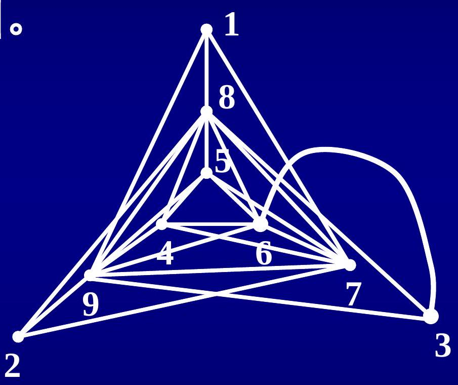

**证明** 在 $G$ 中有

$$
d_{1}=d_{2}=d_{3}=3, d_{4}=d_{5}=5, d_{6}=6, d_{7}=7, d_{8}=d_{9}=8 \text { 。 }
$$

因 $d_{1}>1, d_{2}>2, d_{6} \geq 6, d_{4}>4$，$G$ 满足Chvátal定理的条件，因此 $G$ 是 $H$ 图。

**例** 设 $G$ 是度序列为 $\left(d_{1}, d_{2}, \ldots, d_{n}\right)$ 的非平凡简单图，且满足 $d_{1} \leq d_{2} \leq \cdots \leq d_{n}$。证明：若不存在小于 $(n+1) / 2$ 的正整数 $m$，使得：$d_{m}<m$ 且 $d_{n-m+1}<n-m$，（注意：这里题目条件是和前面Chvátal定理反着说。）则 $G$ 有 $H$ 路。

**证明** 在 $G$ 之外加上一个新点 $v$，把它和 $G$ 的所有顶点连接得图 $G_{1}$。

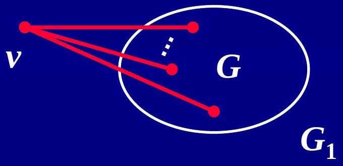

显然，$G_{1}$ 的度序列为：$\left(d_{1}+1, d_{2}+1, \ldots, d_{n}+1, n\right)$。

由条件知：对于任意小于 $(n+1) / 2$ 的正整数 $m$，满足

$$
d_{m}+1 \geq m+1>m \text { 或 } d_{(n+1)-m}+1 \geq(n+1)-m \text { 。 }
$$

于是由Chvátal定理知：$G_{1}$ 是 $H$ 图，得 $G$ 有 $H$ 路。

#### 三、应用

**例** 一只老鼠吃 $3 \times 3 \times 3$ 立方体乳酪，其方法是借助于打洞通过所有的 27 个 $1 \times 1 \times 1$ 的子立方体。如果它从一角上开始，然后依次走向未吃的立方体，问吃完时是否可以到达中心点？

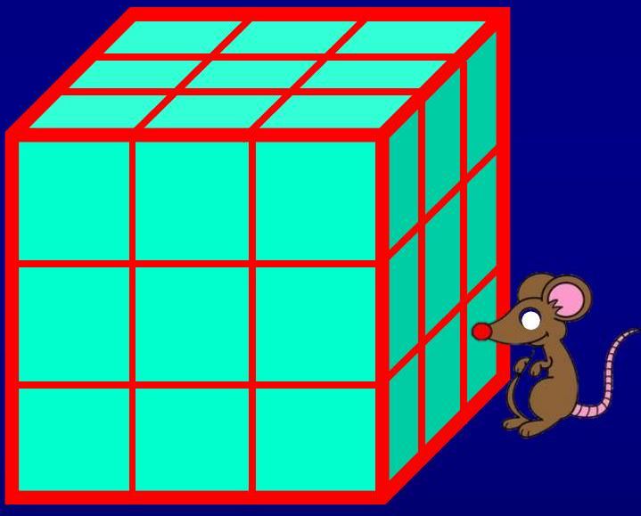

**解** 如果把每个子立方体模型为图的顶点，且两个顶点连线当且仅当两个子立方体有共同面。那么，问题转化为问该图中是否存在一条由角点到中心点的 $H$ 路。

如果起点作为坐标原点，那么 27 个子立方体可以编码为：（1，1，1），（1，1，2），（1，1，3），（1，2，1），（1，2，2），（1，2，3），…，（3，3，3）。容易知道：$G$ 是偶图，且如果 $(1,1,1)$ 在 $X$ 中，则中心点 $(2,2,2)$ 必在 $Y$ 中。

$G$ 中必不存在由点 $(1,1,1)$ 到点 $(2,2,2)$ 的 $H$ 路。

否则，将 $(1,1,1)$ 和 $(2,2,2)$ 连线后得到的图 $G_{1}$ 有 $H$ 圈。

显然，$G_{1}$ 仍然是一个偶图。

由于 $G_{1}$ 含有27个顶点，则 $G_{1}$ 的 $H$ 圈是一个奇圈，这与＂$G_{1}$ 是偶图，无奇圈＂相矛盾！

故，老鼠最后不能到达中心点。

**例** 今有 $a, b, c, d, e, f, g$ 七个人围圆桌开会，已知：$a$ 会讲英语，$b$ 会讲英语和汉语，$c$ 会讲英语、意大利语和俄语，$d$ 会讲日语和汉语，$e$ 会讲德语和意大利语，$f$ 会讲法语、日语和俄语，$g$ 会讲法语与德语。是否存在一种排座方法，使每个人能够和他身边的人交流？并说明理由。

**解** 以每个人作为图的顶点，且两个顶点连线当且仅当两个人会讲同一种语言，得到图 $G$ 如下。

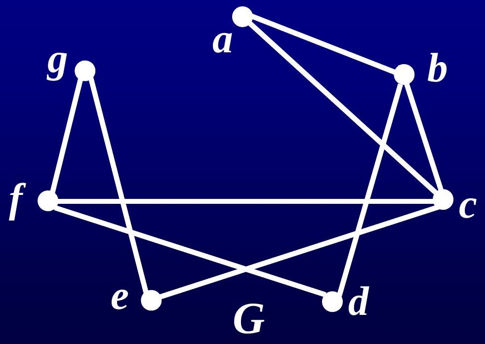

那么，问题转化为判断图 $G$ 是否为哈密尔顿图。

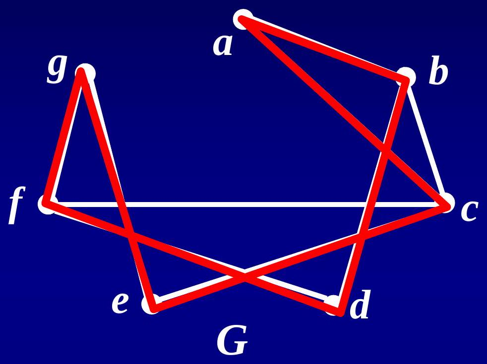

显然，在 $G$ 中可以找到一个 $H$ 圈：

$$
a \rightarrow b \rightarrow d \rightarrow f \rightarrow g \rightarrow e \rightarrow c \rightarrow a \text { 。 }
$$

因此，按照 $a b d f g e c$ 的方式就座可以使每个人都可以和身边的人相互交流。

### 4.4 度极大的非Hamilton图

#### 一、概念

**定义** 图 $G$ 称为度极大非 $H$ 图，若它的度不弱于其它非 $H$ 图。

> 设 G 和 H 都是 n 阶图。如果能把 G 的每个顶点与 H 的顶点一一对应起来，使得 G 中每个顶点的度都不大于它在 H 中对应顶点的度，就称 G 度弱于 H。
> 
> 记这个对应关系为 μ，那么条件是：对 G 中每个顶点 v，都有$d_G(v) ≤ d_H(μ(v))$。
> 
> 换成度序列怎么理解？
> 把两个图的度序列都从小到大排列：
> $G：g₁ ≤ g₂ ≤ … ≤ gₙ$
> 
> $H：h₁ ≤ h₂ ≤ … ≤ hₙ$
> 那么，$G $度弱于$ H$，等价于每个位置都满足 $gᵢ ≤ hᵢ$。也就是可以直接把排好序的两个度序列逐项比较。

**定义** 对于 $1 \leq m<n / 2$，$C_{m, n}$ 图定义为：

$$
C_{m, n}=K_{m} \vee\left(\bar{K}_{m}+K_{n-2 m}\right)
$$

> **知识点：**“$+$”只是把两个图放在一起，保留它们各自的边，不会自动在两组之间加边
> “$\vee$”表示两个图的联结：保留各自原来的边，再把左边图的每个顶点，与右边图的每个顶点全部连起来。

其度序列为：

$$
(\overbrace{m, m, \ldots, m}^{m}, \overbrace{n-m-1, n-m-1, \ldots, n-m-1}^{n-2 m}, \overbrace{n-1, n-1, \ldots, n-1}^{m})
$$

**例** $C_{1,5}$ 与 $C_{2,5}$ 如图。

其中 $C_{m, n}=K_{m} \vee\left(\overline{K_{m}}+K_{n-2 m}\right)$：$C_{1,5}=K_{1} \vee\left(\overline{K_{1}}+K_{3}\right)$，即 1 个顶点与其余 4 个顶点全部相邻，其余点为 $K_{3}$ 与 1 个孤立点，度序列为 $(1,3,3,3,4)$；$C_{2,5}=K_{2} \vee\left(\overline{K_{2}}+K_{1}\right)$，即 $K_{2}$ 与另外 3 个互不相邻的顶点全部相邻，度序列为 $(2,2,2,4,4)$。

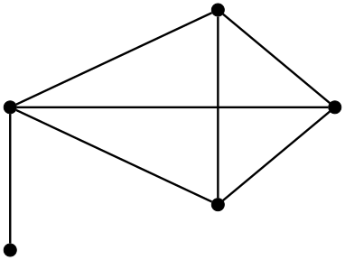

C₁,₅ 的结构（据定义补绘）

> **引理** 对于 $1 \leq m<n / 2$ 的图 $C_{m, n}$ 不是 $H$ 图。

**证明** 取 $S=V\left(K_{m}\right)$，则 $\omega(G-S)=m+1>|S|=m$。所以，由 $H$ 图的性质知，$G$ 不是 $H$ 图。

#### 二、度极大非 $H$ 图的特征

> **定理** 若 $G$ 是 $n$ 阶 $(n \geq 3)$ 非 $H$ 简单图，则 $G$ 度弱于某个 $C_{m, n}$ 图。

**证明** 设 $G$ 是度序列为 $\left(d_{1}, d_{2}, \ldots, d_{n}\right)$ 的非 $H$ 简单图，且

$$
d_{1} \leq d_{2} \leq \cdots \leq d_{n} .
$$

由Chvátal定理知：存在 $m<n / 2$，使得 $d_{m} \leq m$，且 $d_{n-m}<n-m$。

于是，$G$ 的度序列必弱于如下序列：

$$
(\overbrace{m, m, \ldots, m}^{m}, \overbrace{n-m-1, n-m-1, \ldots, n-m-1}^{n-2 m}, \overbrace{n-1, n-1, \ldots, n-1}^{m})
$$

而上面序列正好是图 $C_{m, n}$ 的度序列。

**注**

1. 定理刻画了非 $H$ 简单图的特征：$C_{m, n}$ 图族中每个图都是某个 $n$ 阶非 $H$ 简单图的极图。

2. 如果 $n$ 阶简单图 $G$ 度优于所有的 $C_{m, n}$ 图族，则 $G$ 一定是 $H$ 图。

3. 上述条件只是充分条件而非必要条件。

**例** 长度为 5 的圈 $C_{5}$ 显然是 $H$ 图，它的度序列为（2，2，2，2，2）。$C_{1,5}$ 的度序列为（1，3，3，3，4）；$C_{2,5}$ 的度序列为（2，2，2，4，4）。$C_{5}$ 的度序列弱于 $C_{2,5}$ 的度序列。

> **推论** 设 $G$ 是 $n$ 阶 $(n \geq 3)$ 简单图，若
> 
> $$
> |E(G)|>\binom{n-1}{2}+1,
> $$
> 
> 则 $G$ 是 $H$ 图；并且具有 $n$ 个顶点、$\binom{n-1}{2}+1$ 条边的非 $H$ 图只有 $C_{1, n}$ 以及 $C_{2,5}$。
> 
> 
> $$
> 设 G 是 n 阶(n\ge3)简单图\\
> |E(G)|>\binom{n-1}{2}+1\Rightarrow G是H图
> $$

**证明**

（1）若不然，则 $G$ 度弱于某个 $C_{m, n}$，于是

$$
\begin{aligned}
& |E(G)| \leq\left|E\left(C_{m, n}\right)\right|=\frac{1}{2}\left[m^{2}+(n-2 m)(n-m-1)+m(n-1)\right] (2m=\sum d(v_i))\\
& =\binom{n-1}{2}+1-\frac{1}{2}(m-1)(m-2)-(m-1)(n-2 m-1) \\
& \leq\binom{ n-1}{2}+1 \text {. }
\end{aligned}
$$

这与条件矛盾！所以 $G$ 是 $H$ 图。

（2）对于 $C_{1, n}$，有：

$$
|E(G)|=\left|E\left(C_{1, n}\right)\right|=\binom{n-1}{2}+1
$$

除此之外，只有当 $m=2$ 且 $n=5$ 时有：

$$
|E(G)|=\left|E\left(C_{m, n}\right)\right|=\binom{n-1}{2}+1 .
$$

> **注** 若简单图 $G=(n, m)$ 是 $H$ 图，则
> 
> $$
> m>\binom{n-1}{2}+1
> $$
> 
> 不一定成立。

比如，长度为 5 的圈。

### 4.5 旅行售货员问题

#### 一、旅行售货员问题

问题描述：一个旅行售货员想访问若干城镇（假定各城镇之间均有路可通），然后返回。问如何安排路线使其能恰好访问每个城镇一次且走过的总路程最短？这个问题称为旅行售货员问题，简称TSP。

图论模型：在赋权完全图 $G$ 中求具有最小权的哈密尔顿圈，这个圈称为最优圈。

求最优圈，目前还没有一个理想的算法。已经使用过的近似算法很多，如遗传算法、最邻近算法、最近插值法、贪婪算法和边交换技术等。

#### 二、边交换技术

1. 任取 $G$ 的一个哈密尔顿圈 $C$。

2. 修改 $C$ 为 $C_{i j}$ 使 $C_{i j}$ 比 $C$ 优，其方法为：设 $C=v_{1} v_{2} \ldots v_{n} v_{1}$，若存在整数 $i$ 和 $j$，满足 $1<i+1<j<n$，且

$$
w\left(v_{i} v_{j}\right)+w\left(v_{i+1} v_{j+1}\right)<w\left(v_{i} v_{i+1}\right)+w\left(v_{j} v_{j+1}\right)
$$

则 $C_{i j}=v_{1} v_{2} \ldots v_{i} v_{j} v_{j-1} \ldots v_{i+1} v_{j+1} v_{j+2} \ldots v_{n} v_{1}$ 比 $C$ 优。

> 注：边交换就是从原来的圈中删去两条边，再用两条更短的边重新连接，让路线仍然经过每个顶点一次，但总路程更短。

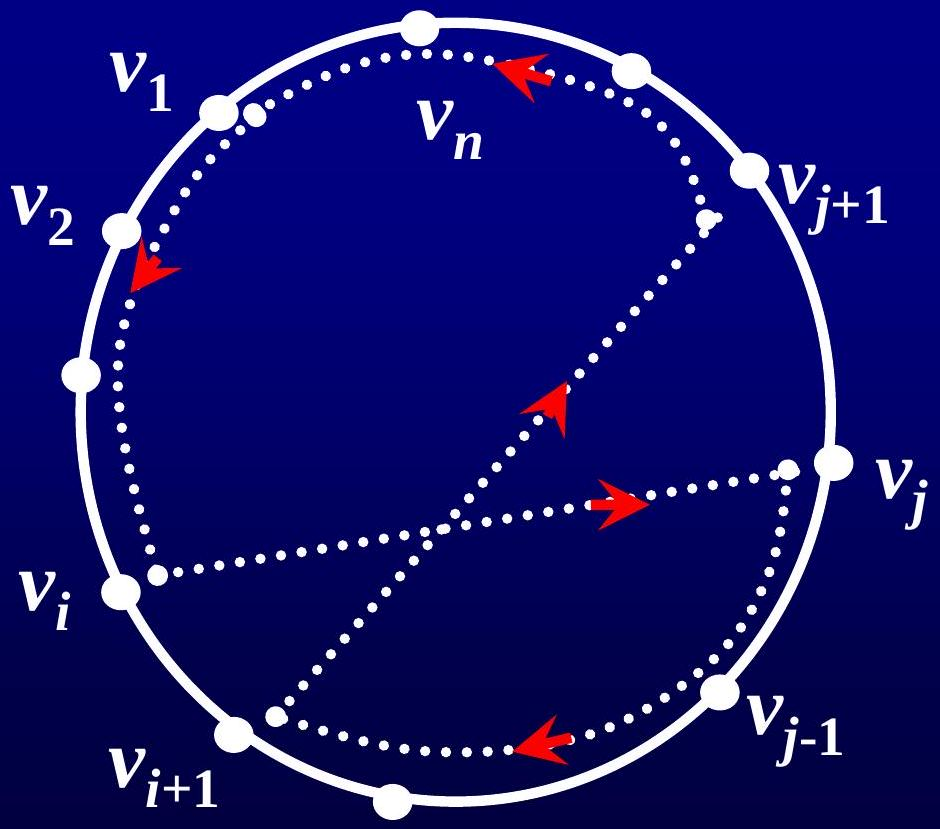

**例** 采用边交换技术求赋权完全图的一个最优 $H$ 圈。

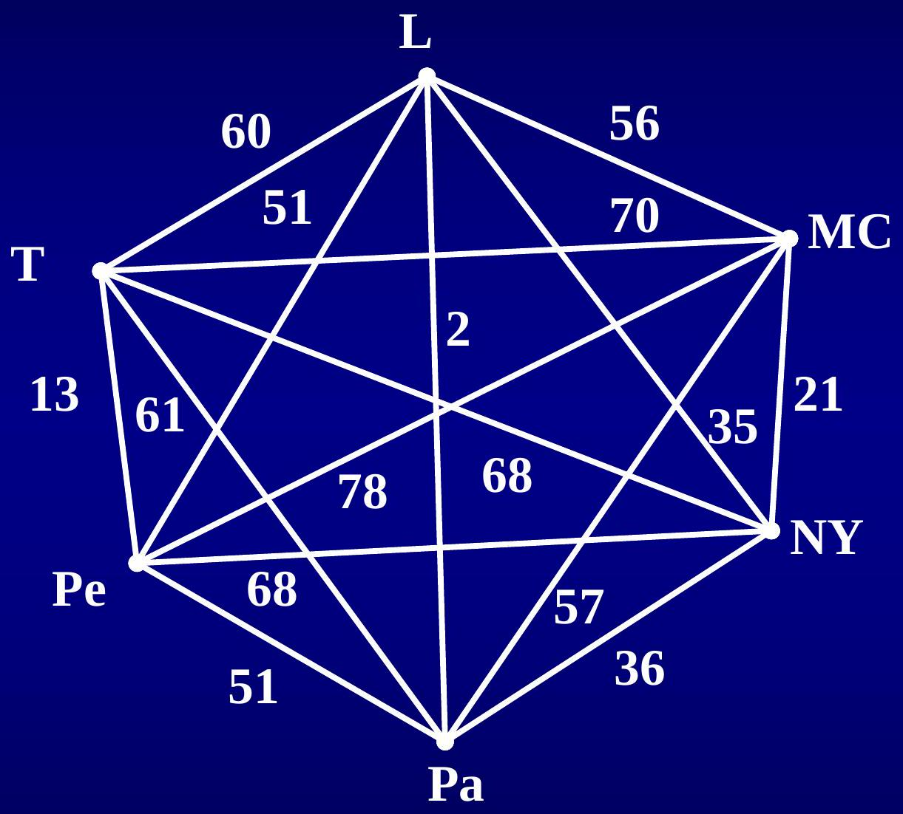

**解** 取 L T Pe Pa NY MC L 为初始圈。

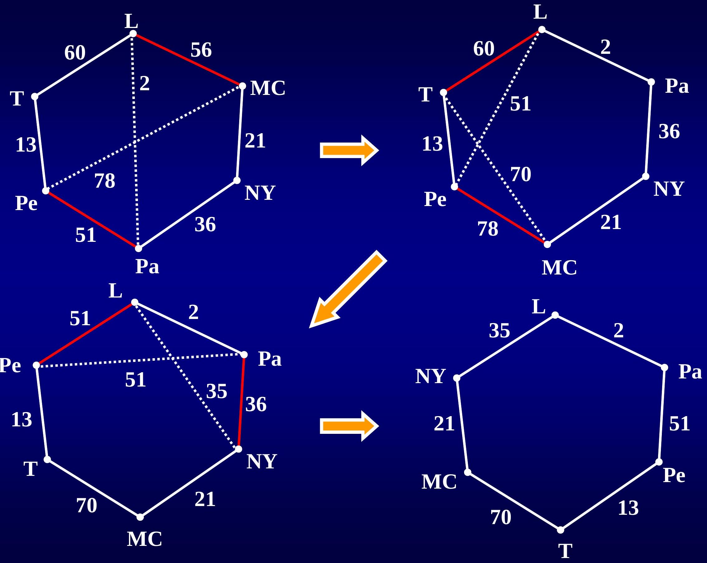

于是，求出一个近似最优解为：$W(H)=192$。

**注** 为了得到进一步的最优解，可以从几个不同的初始圈开始，通过边交换技术得到几个近似最优解，然后从中选取一个近似解。

#### 三、最优圈的界

可以通过如下方法求出最优圈的一个下界：

1. 在 $G$ 中任意删掉一点 $v$ 得图 $G_{1}$；

2. 在图 $G_{1}$ 中求出一棵最小生成树 $T$；

3. 在 $v$ 的关联边中选出两条权值最小者 $e_{1}$ 与 $e_{2}$。

若 $C$ 是 $G$ 的最优圈，则

$$
W(C) \geq W(T)+W\left(e_{1}\right)+W\left(e_{2}\right) .
$$

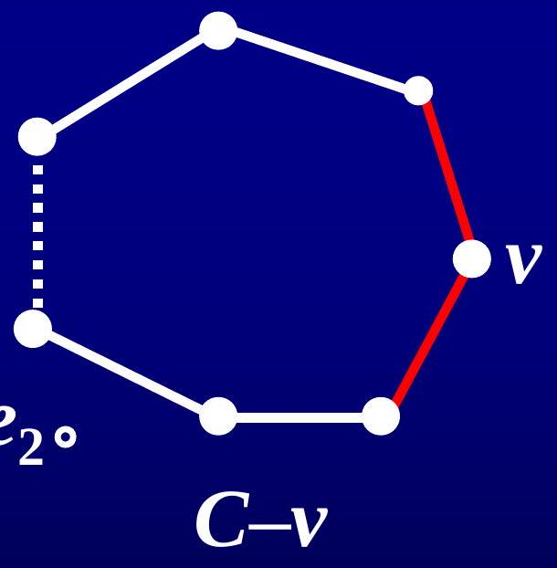

**例** 估计右图中最优圈的下界。

**解** 在 $G$ 中删掉点 $N Y$，求得 $G-N Y$ 的一棵最小生成树为

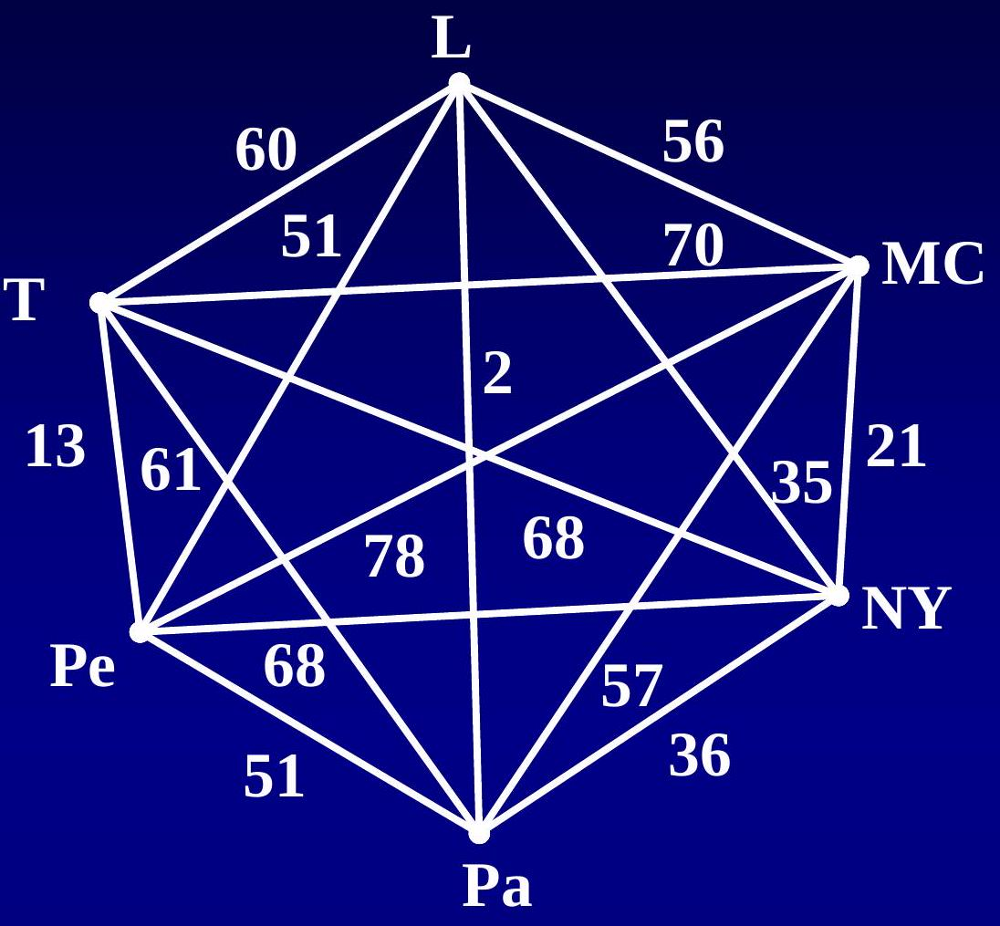

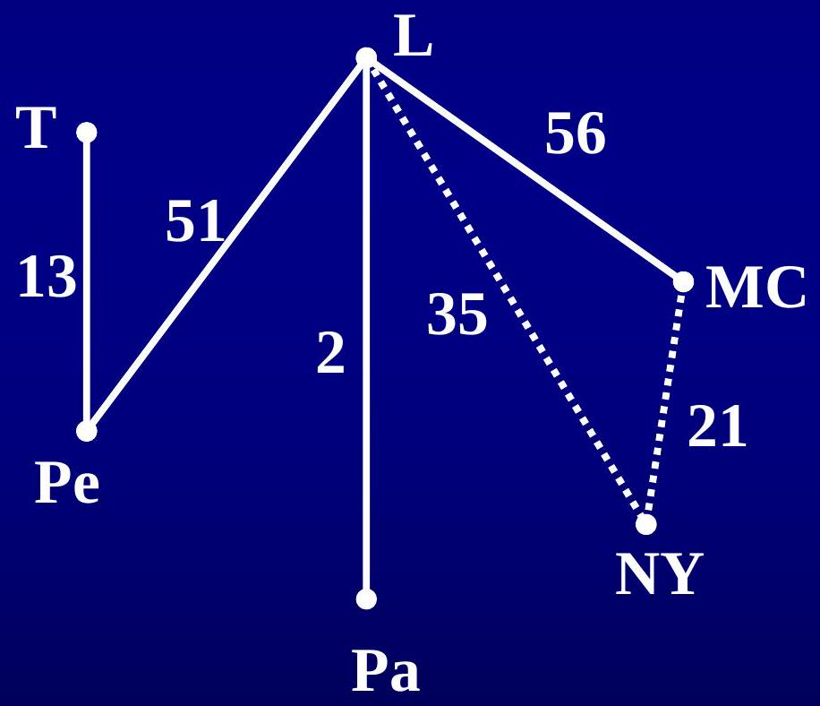

所以，$W(H) \geq 122+35+21=178$。

**例** 设 $G$ 是赋权完全图，且对所有的 $x, y, z \in V(G)$，满足三角不等式：$W(x, y)+W(y, z) \geq W(x, z)$。证明：$G$ 中最优圈的权值最多是 $2 W(T)$，其中 $T$ 是 $G$ 的一棵最小生成树。

**证明** 设 $T$ 是 $G$ 的一棵最小生成树，将 $T$ 的每条边添上一条平行边得图 $T_{1}$，显然 $T_{1}$ 是欧拉图。

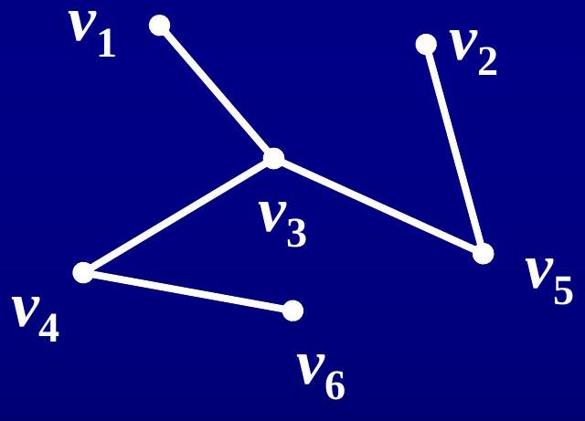

T

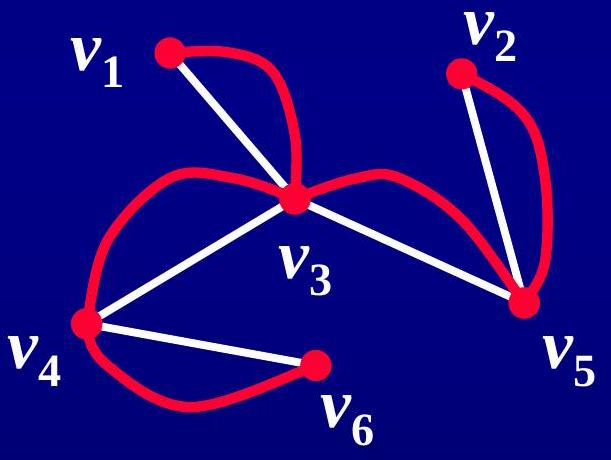

T\_1

设 $Q$ 是 $T_{1}$ 的一个欧拉回路：$Q=v_{1} v_{2} \ldots v_{k} v_{1}$。

则：$W(Q)=W\left(T_{1}\right)=2 W(T)$。

现在，从 $Q$ 的第三点开始，删掉与前面的重复顶点，得到 $G$ 的顶点的一个排列 $\pi$。

由于 $G$ 是完全图，所以该排列对应 $G$ 的一个 $H$ 圈。

在 $\pi$ 中任意一条边 $(u, v)$，在 $T$ 中有一条唯一的 $(u, v)$ 路 $P$，而该路正好是在 $Q$ 中的 $u$ 与 $v$ 间的部分。

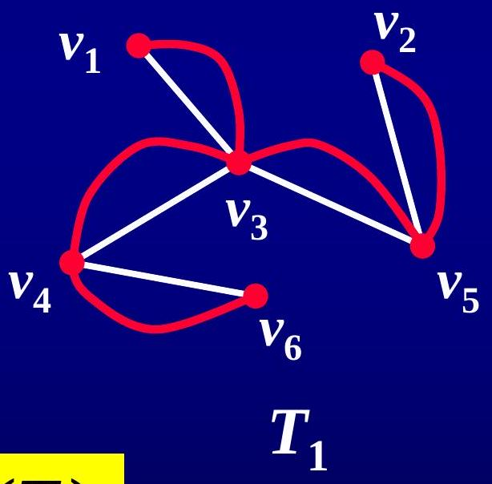

由三角不等式知：$W(u v) \leq W(P)$。

所以，

$$
W(\pi) \leq \sum_{e \in Q} W(e)=W(Q)=2 W(T),
$$

即最优圈 $C$ 的权值满足：$W(C) \leq W(\pi) \leq W(Q)=2 W(T)$。
