# 第五章 匹配与因子分解

> 专栏：图论 · Notion 最后编辑：2026-11-10T11:46:00.000Z
>
> 来源：https://www.notion.so/4059d738588381898f32c355b4f9017f

> **本章内容**：匹配 · Tutte定理与完美匹配 · 偶图的匹配与覆盖 · 最优匹配与匈牙利算法 · 因子分解

### 5.1 匹配

#### 一、图的匹配

> **定义** 设 $M$ 是图 $G$ 的边子集，若任意的 $e \in M, e$ 都不是环，且属于 $M$ 的边互不相邻，则称 $M$ 为 $G$ 的一个匹配。

> **定义** 设 $M$ 为 $G$ 的一个匹配，对 $v \in V(G)$，若 $v$ 是 $M$ 中某边的一个端点，则称 $v$ 为 $M$ 饱和点，否则称为 $M$ 非饱和点。

> **定义** 如果 $G$ 的每个顶点均为 $M$ 饱和点，则称 $M$ 为 $G$ 的完美匹配。

> **定义** 如果 $M$ 是图 $G$ 的包含边数最多的匹配，则称 $M$ 为 $G$ 的最大匹配。

**例** 设图 $G$ 如右图所示，$G$ 的匹配有：

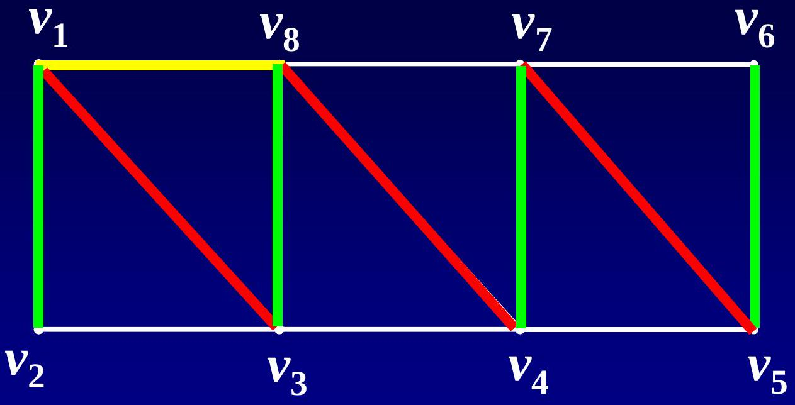

$$
\begin{aligned}
& M_{1}=\left\{v_{1} v_{8}\right\} \\
& M_{2}=\left\{v_{1} v_{3}, v_{8} v_{4}, v_{7} v_{5}\right\} \\
& M_{3}=\left\{v_{1} v_{2}, v_{8} v_{3}, v_{7} v_{4}, v_{6} v_{5}\right\}
\end{aligned}
$$

对 $M_{2}$，点 $v_{1}$ 是饱和点，点 $v_{2}$ 是非饱和点；对 $M_{3}$，点 $v_{1}$ 与 $v_{2}$ 均是饱和点。

$M_{1}$ 和 $M_{2}$ 既不是完美匹配，也不是最大匹配；$M_{3}$ 是最大匹配，也是完美匹配。

> **注**
> 
> 1. 完美匹配必是最大匹配，而最大匹配不一定是完美匹配；
> 
> 2. 最大匹配必存在，但完美匹配不一定存在；
> 
> 3. 图 $G$ 存在完美匹配的一个必要条件是 $G$ 的点数必然为偶数。

> **定义** 设 $M$ 为图 $G$ 的一个匹配，$G$ 的 $M$ 交错路是指 $G$ 中由 $M$ 中的边与非 $M$ 中的边交替组成的路。$M$** 可扩路**是指其**起点与终点均为 **$M$** 非饱和点的 **$M$** 交错路**。

**例** 设匹配 $M=\left\{v_{1} v_{2}, v_{3} v_{4}, v_{7} v_{8}\right\}$，则 $v_{6} v_{3} v_{4} v_{1} v_{2}$ 是 $M$ 交错路；$v_{1} v_{3} v_{4} v_{7} v_{8} v_{5}$ 是 $M$ 交错路；$v_{6} v_{3} v_{4} v_{7} v_{8} v_{5}$ 是 $M$ 交错路，也是 $M$ 可扩路。

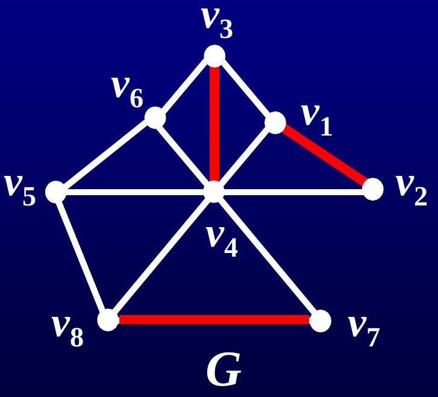

#### 二、Berge定理

> **定理** （Berge 1957）图 $G$ 的匹配 $M$ 是最大匹配当且仅当 $G$ 不含 $M$ 可扩路。

**证明** 设 $M$ 是 $G$ 的最大匹配，并假设 $G$ 包含 $M$ 可扩路：

$$
v_{0} v_{1} v_{2} \ldots v_{2 k-1} v_{2 k} v_{2 k+1}
$$

**定义** $M^{*} \subseteq E$ 为：

$$
M^{*}=M \backslash\left\{v_{1} v_{2}, v_{3} v_{4}, \ldots, v_{2 k-1} v_{2 k}\right\} \cup\left\{v_{0} v_{1}, v_{2} v_{3}, \ldots, v_{2 k} v_{2 k+1}\right\} .
$$

则 $M^{*}$ 是 $G$ 的匹配，且 $\left|M^{*}\right|=|M|+1$，因而 $M$ 就不是最大匹配。

反之，假设 $M$ 不是最大匹配，且令 $M^{*}$ 是 $G$ 的最大匹配，则

$$
\left|M^{*}\right|>|M|
$$

置 $H=G\left[M \triangle M^{*}\right]$，这里 $M \triangle M^{*}$ 表示 $M$ 和 $M^{*}$ 的对称差。

$H$ 的每个顶点在 $H$ 中的度要么是1，要么是2，因为它最多只能和 $M$ 的一条边以及 $M^{*}$ 的一条边相关联。

因此，$H$ 的每个连通分支或是由 $M$ 和 $M^{*}$ 中的边交错组成的路，或是由 $M$ 和 $M^{*}$ 中的边交错组成的偶圈。

由于 $M^{*}$ 包含的边多于 $M$ 的边，因而 $H$ 中必定有一条路 $P$，其边始于 $M^{*}$ 且终止于 $M^{*}$。

因此，$P$ 的起点和终点在 $H$ 中被 $M^{*}$ 所饱和，在图 $G$ 中就是 $M$ 非饱和的。

于是，$P$ 是 $G$ 的一条 $M$ 可扩路。

与“$G$ 不包含 $M$ 可扩路”相矛盾。

#### 三、应用

**例：用匹配判断能否剪成矩形**

下图由 14 个单位正方形组成，数字是每个方格的编号；左上角和右下角没有方格。能否沿方格边线，将整个图形剪成 7 个长为 2、宽为 1 的矩形？

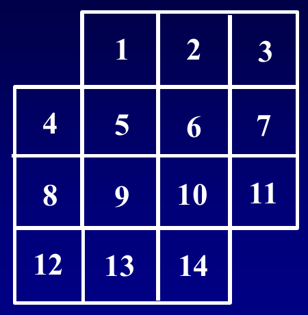

课程 PDF 第 7 页中的原图

**解** 不能。可以先用棋盘染色理解，再用匹配解释。

**第一步：棋盘染色。** 将方格交替染成两种颜色，使有公共边的方格颜色不同。按图中编号，两种颜色的方格分别是：

- 第一种颜色：$\{1,3,4,6,9,11,12,14\}$，共 8 格；

- 第二种颜色：$\{2,5,7,8,10,13\}$，共 6 格。

每个 $2\times1$ 矩形由两个有公共边的方格组成，因此必然包含两种颜色各一格。要剪出 7 个矩形，就需要两种颜色各 7 格；但第二种颜色只有 6 格，所以不可能。

**第二步：联系图的匹配。** 把每个正方形看成一个顶点；两个方格有公共边时，在相应顶点之间连一条边。所得的二部图记为 $G$：

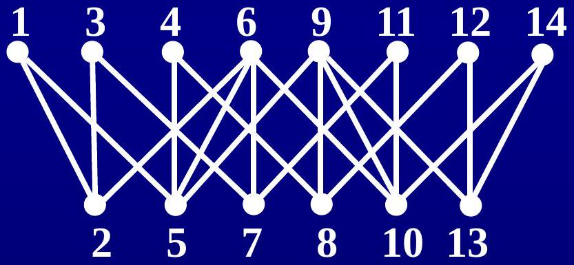

两种颜色分别对应二部图的两侧，顶点数为 8 和 6。每个 $2\times1$ 矩形对应一条边；互不重叠的矩形对应互不相邻的边，也就是一个匹配。

每条匹配边都要占用数量较少一侧的一个顶点，所以匹配最多有 6 条边，不可能有 7 条边。因此，原图形无法剪成 7 个所需的矩形。

> **例** 设 $G$ 是一个连通图，Andy 和 Bob 两人交替地选取 $G$ 的不同顶点：Andy 先选，Bob 后选，下一个选取的点要与上一个选取的点相邻；当一方无点可选时，另一方获胜。求证：Andy 有必胜策略的充要条件是 $G$ 无完美匹配。

**证明** 当 $G$ 有完美匹配 $M$ 时，$G$ 的所有顶点在 $M$ 下两两配对。当 Andy 选取顶点 $u$ 时，Bob 选取点 $v$，使得 $u v \in M$。由于 Andy 先选，Bob 按照上述策略可以击败 Andy。

当 $G$ 无完美匹配时，假设 $M$ 是最大匹配。

令 $S$ 表示 $G$ 的所有 $M$ 饱和点构成的集合，$T$ 表示 $G$ 的所有 $M$ 非饱和点构成的集合。

由于 $G$ 无完美匹配，因此 $T$ 一定不是空集。

首先，Andy从 $T$ 中任意选取一点 $v_{0}$。

接下来，Bob选取的点 $v_{1}$ 必然属于 $S$。

否则，将边 $v_{0} v_{1}$ 添加到 $M$ 中，可得一个更大的匹配，矛盾！

由于 $v_{1}$ 属于 $S$，是 $M$ 饱和点，必存在一点 $v_{2}$，使得 $v_{1} v_{2} \in M$。此时，Andy选取 $v_{2}$。

接下来，Bob选取的点 $v_{3}$ 必然属于 $S$。

否则，$v_{0} v_{1} v_{2} v_{3}$ 是一条 $M$ 可扩路，与 $M$ 是最大匹配矛盾。由于 $v_{3}$ 属于 $S$，是 $M$ 饱和点，必存在一点 $v_{4}$，使得 $v_{3} v_{4} \in M$。此时，Andy可选取 $v_{4}$。

假设Andy和Bob依次选取的点为 $v_{0}, v_{1}, v_{2}, v_{3}, v_{4}, v_{5} \ldots$，则对每一个 $v_{2 k-1}$，均存在一点 $v_{2 k}$ 使得 $v_{2 k-1} v_{2 k} \in M$。否则，

$$
v_{0} v_{1} v_{2} v_{3} \ldots v_{2 k-2} v_{2 k-1}
$$

是一条 $M$ 可扩路，矛盾！

因此，每当Bob选取一点 $v_{2 k-1}$ 时，均存在一个点 $v_{2 k}$ 与 $v_{2 k-1}$ 相邻且 $v_{2 k-1} v_{2 k} \in M$。

所以，Andy有必胜的策略。

### 5.2 Tutte定理与完美匹配

> 图的分支根据它有奇数或偶数个顶点而分别称为奇分支或偶分支，我们用 $o(G)$ 表示图 $G$ 的奇分支的个数。

#### 一、Tutte定理

> **定理** （Tutte）偶数阶图 $G$ 有完美匹配当且仅当
> 
> $$
> o(G-S) \leq|S|,\forall S \subset V
> $$
> 
> 对所有 $S \subset V$ 成立。

> **推论** （Peterson）每个没有割边的3正则图都有完美匹配。

**证明** 设 $G$ 是没有割边的 3 正则图，$S$ 是 $V$ 的任意真子集。

用 $G_{1}, G_{2}, \ldots, G_{k}$ 表示 $G-S$ 的所有奇分支，并设 $m_{i}(1 \leq i \leq k)$ 是一个端点在 $G_{i}$，另一个端点在 $S$ 中的那些边的条数。

由于 $G$ 是 3 正则图，所以，对于 $1 \leq i \leq k$，

$$
\sum_{v \in V\left(G_{i}\right)} d_{G}(v)=3\left|V\left(G_{i}\right)\right|
$$

又因为

$$
\sum_{v \in V\left(G_{i}\right)} d_{G}(v)=m_{i}+2\left|E\left(G_{i}\right)\right|,
$$

所以，$m_{i}$ 是奇数。

由于 $G$ 没有割边，所以 $m_{i} \neq 1$。因此，$m_{i} \geq 3$。

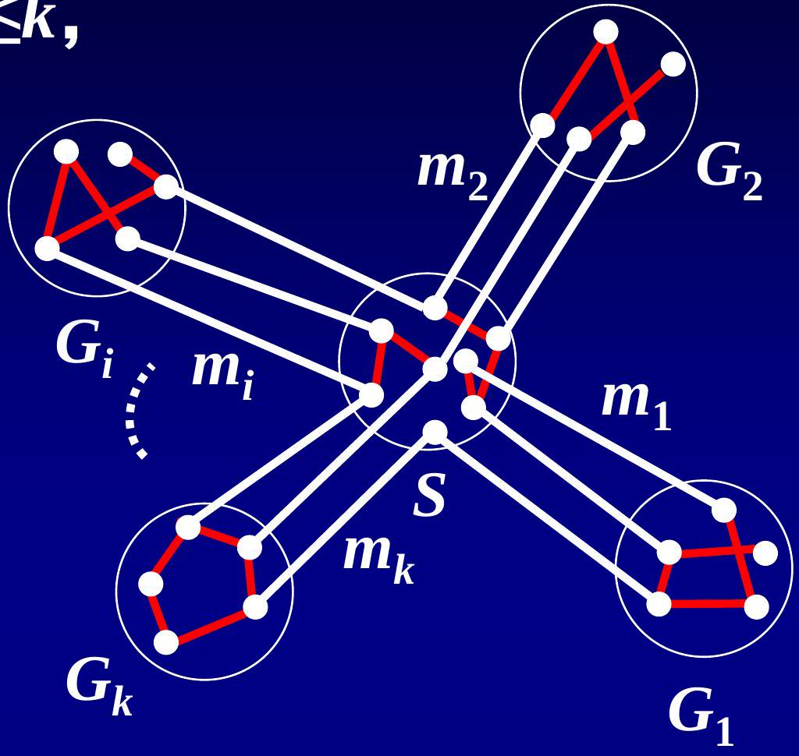

因此

$$
o(G-S)=k \leq \frac{1}{3} \sum_{i=1}^{k} m_{i} \leq \frac{1}{3} \sum_{v \in S} d_{G}(v)=\frac{1}{3} \cdot 3|S|=|S| .
$$

所以，$G$ 有完美匹配。

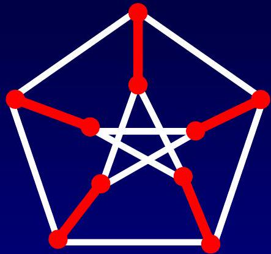

**例** 彼得森图满足推论的条件（即没有割边的 3 正则图），故它有完美匹配。

**注** 有割边的 3 正则图既可能包含完美匹配，也可能不包含完美匹配。

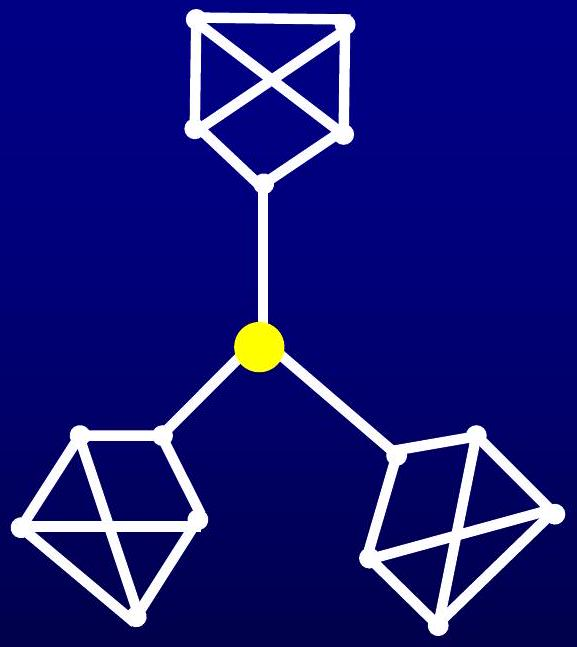

没有完美匹配

有完美匹配

#### 二、三正则图与完美匹配

考察下列三正则图：

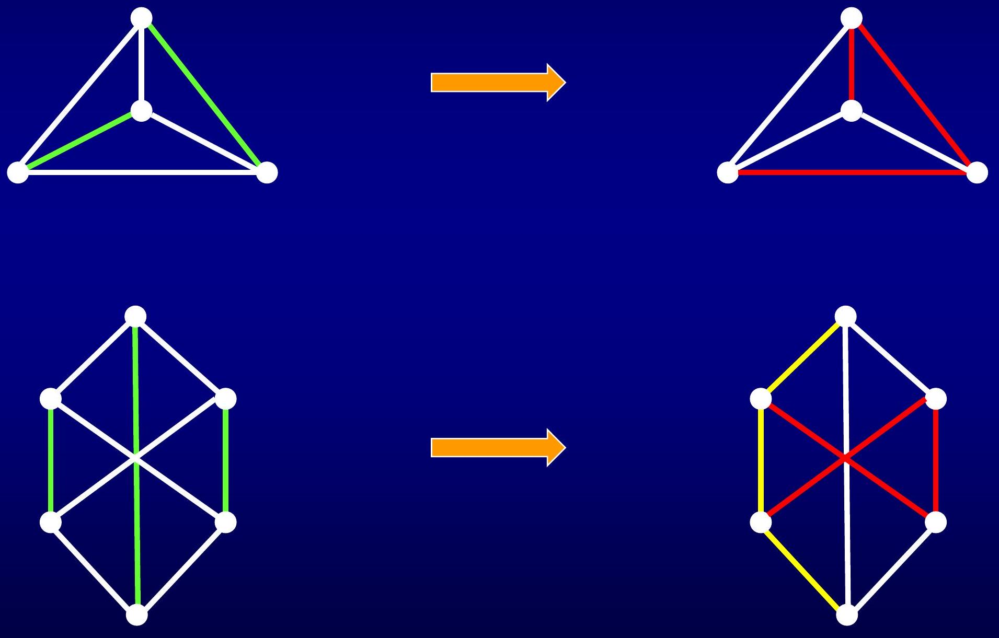

> **定理** 设 $G$ 是 $2 n$ 阶 3 正则图，则 $G$ 包含完美匹配当且仅当 $E(G)$ 是 $n$ 条边不重的 3 长路的并。

**证明** 充分性 设 $E(G)=P_{1} \cup P_{2} \cup \cdots \cup P_{n}$，其中每个 $P_{i}$ 是一条3长路，且任意的 $P_{i}$ 与 $P_{j}$ 没有公共边。

对每一个 $P_{i}$，令 $e_{i}$ 是 $P_{i}$ 的中间的那条边。

断言：$M=\left\{e_{1}, e_{2}, \ldots, e_{n}\right\}$ 是 $G$ 的一个完美匹配。

显然，$M$ 中的边互不相同。

对于 $M$ 中的任意两条边 $e_{i}$ 与 $e_{j}$，它们必不相邻。否则，若 $e_{i}$ 与 $e_{j}$ 有公共顶点 $v$，则 $d(v) \geq 4$，矛盾！

又因为 $|M|=n$，所以 $M$ 是 $G$ 的完美匹配。

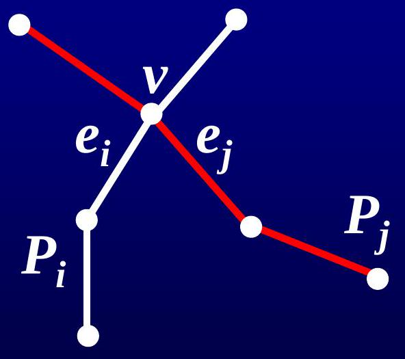

必要性 设 $M$ 是图 $G$ 的一个完美匹配，因为 $G$ 是 3 正则图，所以 $G-M$ 是 $G$ 的一个 2 正则生成子图。

因此，$G-M$ 的每个连通分支是一个圈。

对 $G-M$ 的每个圈指定方向，此时 $G$ 的每个顶点 $v$ 均有唯一的离开它的边 $e$。

对 $M$ 的任意一条边 $u v$，在 $G-M$ 中唯一的离开 $u$ 的边 $e_{u}$，唯一的离开 $v$ 的边 $e_{v}$ 以及边 $u v$ 构成一条长度为 3 的路。

因为 $M$ 中的边互不相邻，且 $G$ 的任意一点在 $G-M$ 中有唯一的离开它的边，所以按照上面的方式可以将 $M$ 中的每条边扩展成一条长度为 3 的路。

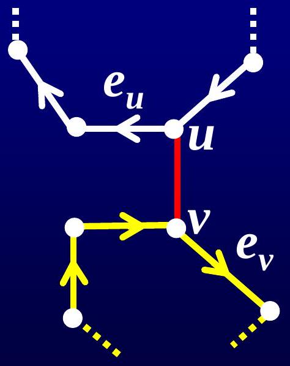

所以，$E(G)$ 是 $n$ 条边不重的 3 长路的并。

#### 三、若干结论

> **例** 求 $K_{2 n}$ 中不同完美匹配的个数。

**解** 归纳证明：$K_{2 n}$ 的不同完美匹配的个数为：$(2 n-1)!!$。完全图 $K_{2 n}$ 的任意一个顶点有 $2 n-1$ 种不同的方法被匹配。所以，$K_{2 n}$ 的不同完美匹配的个数等于 $(2 n-1) K_{2 n-2}$。因此，$K_{2 n}$ 的不同完美匹配的个数为：$(2 n-1)!!$。

> **例** 证明：非平凡树 $T$ 至多包含一个完美匹配。

> **证明** 若不然，设 $M_{1}$ 与 $M_{2}$ 是树 $T$ 的两个不同的完美匹配，那么 $M_{1} \triangle M_{2} \neq \Phi$。
> 
> 容易知道：$T\left[M_{1} \triangle M_{2}\right]$ 的每个顶点度数为2，即它存在圈。于是推出 $T$ 中有圈，矛盾。

> **例** 证明：树 $T$ 有完美匹配当且仅当（充要条件）对所有顶点 $v \in T$，
> 
> $$
> o(T-v)=1 \text { 。 }
> $$

**证明** 必要性 因为 $T$ 有完美匹配，由 Tutte 定理知 $o(T-v) \leq 1$。显然，$T$ 是偶数阶的图，于是 $o(T-v) \geq 1$。

因此，$o(T-v)=1$。

充分性 令 $M=\{e \mid e \in E(T) \text { 且 } o(T-e)=2\}$。

对于 $T$ 的任意顶点 $v$，假设 $T_{v}$ 是 $T-v$ 的仅有的奇分支，且 $T_{v}$ 与 $v$ 之间的边为 $u v$。

显然，$u \in T_{v}$。

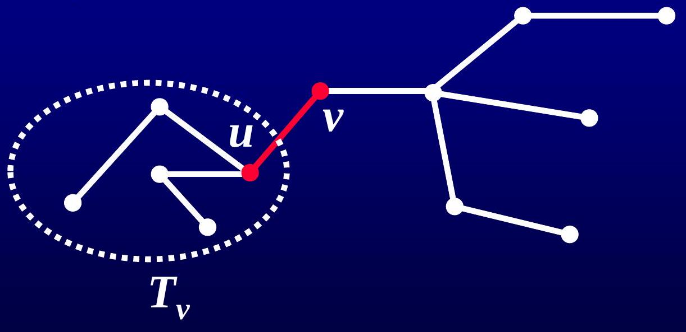

对于顶点 $u$，连接 $u$ 与 $T_{u}$ 的边也是 $u v$。

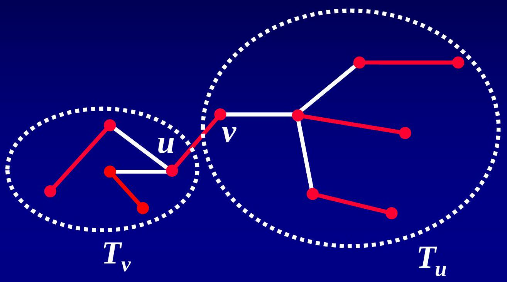

因此，$o(T-u v)=2$。所以，$u v \in M$。

其次，对于 $M$ 中的任意两条边 $e_{1}$ 和 $e_{2}$，它们必不相邻；否则删去 $e_{1}$ 和 $e_{2}$ 的公共顶点将得到至少两个奇分支，矛盾！

从而，$M$ 是一个包含了 $T$ 的所有顶点的匹配，即 $M$ 是 $T$ 的完美匹配。

> **例** 设 $G$ 是偶数阶的连通简单图，且任意点导出子图均不是 $K_{1,3}$，则 $G$ 包含完美匹配。

**证明** 若 $G$ 没有完美匹配，则由 Tutte 定理知：存在一个点子集 $S$ 使得 $o(G-S) \geq|S|+1$。

假设 $S$ 是极小的使得 $o(G-S) \geq|S|+1$ 的点子集。

令 $|S|=s$ 且 $G_{1}, G_{2}, \ldots, G_{t}$ 是 $G-S$ 的所有奇分支，其中 $t \geq s+1$。

断言：$S$ 中一定存在一点至少与三个奇分支连通。

假设 $S$ 中每个点最多与两个奇分支连通。

由于 $t \geq s+1$，$S$ 中一定存在一个点 $u$，它在 $G$ 中恰好与两个奇分支 $G_{i}$ 和 $G_{j}$ 连通。

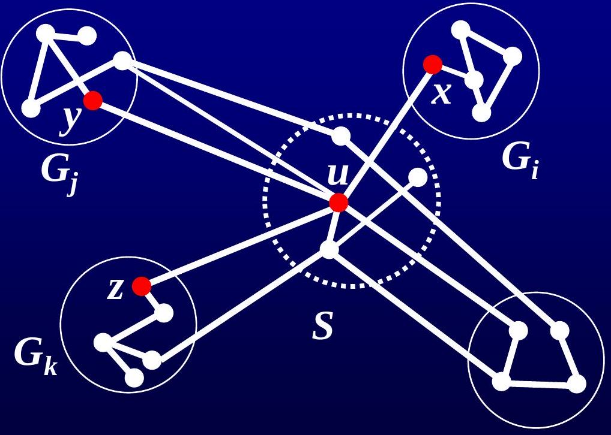

因为由 $G_{i}, G_{j}$、点 $u$ 以及与 $u$ 连通的其他偶分支构成的子图是一个奇数阶的子图，必有

$$
o(G-S \backslash\{u\})=t-1 \geq s=|S \backslash\{u\}|+1
$$

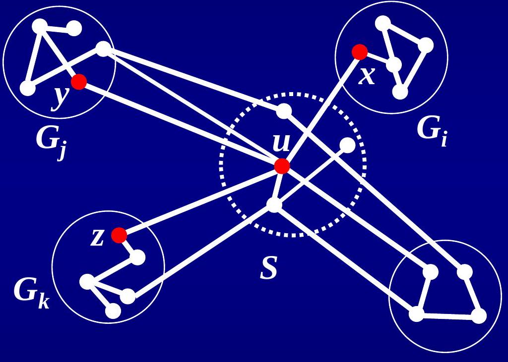

这与“$S$ 是使得 $o(G-S) \geq|S|+1$ 的极小点子集”矛盾。

假设 $u \in S$ 与三个奇分支 $G_{i}, G_{j}, G_{k}$ 的点 $x, y, z$ 相邻。点 $u, x, y, z$ 导出的子图为 $K_{1,3}$，矛盾！

### 5.3 偶图的匹配与覆盖

#### 一、问题的提出

在日常生活、工程技术中，常常遇到求偶图的匹配问题。例如：有 7 名研究生 A，B，C，D，E，F，G 毕业寻找工作。就业处提供的公开职位是：会计师（a），咨询师（b），编辑（c），程序员（d），记者（e），秘书（f）和教师（g）。每名学生申请的职位如下：

- A：b，c；

- B：a，b，d，f，g；

- C：b，e；

- D：b，c，e；

- E：a，c，d，f；

- F：c，e；

- G：d，e，f，g；

问：学生能找到理想工作吗？

如果令 $X=\{\mathrm{A}, \mathrm{B}, \mathrm{C}, \mathrm{D}, \mathrm{E}, \mathrm{F}, \mathrm{G}\}, \quad Y=\{\mathrm{a}, \mathrm{b}, \mathrm{c}, \mathrm{d}, \mathrm{e}, \mathrm{f}, \mathrm{g}\}$，$X$ 中的顶点与 $Y$ 中的顶点连线当且仅当学生申请了该工作。

于是，得到反映学生和职位之间的状态图：

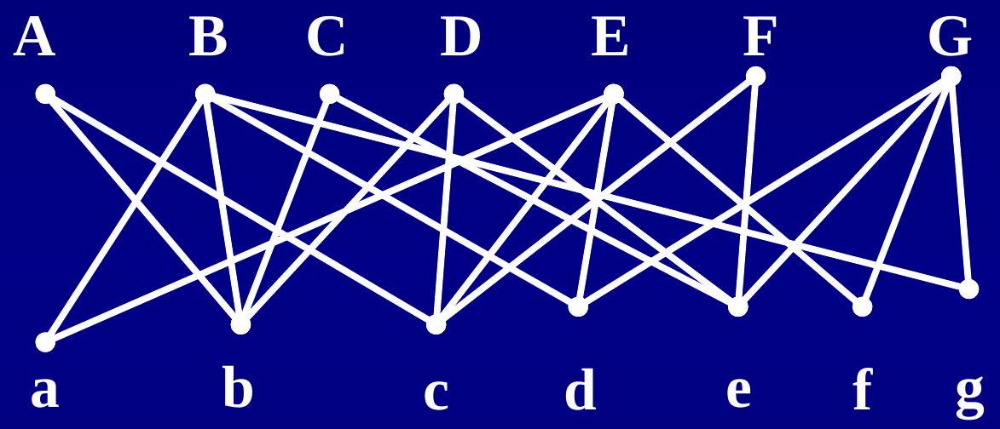

问题转化为求饱和 $X$ 中每个顶点的一个匹配！

需要解决的问题：

1. 满足要求的匹配是否存在？

2. 如何求出一个相应的匹配？

#### 二、偶图匹配存在性判定定理

> **定义** 取图 $G$ 的一个顶点子集 $S$，令
> 
> $$
> N(S)=\{v \mid \text { 存在 } u \in S \text {, 使得 } u \text { 与 } v \text { 相邻 }\} \text {, }
> $$
> 
> 称 $N(S)$ 为 $S$ 的邻集。

**例** 在下图中，取 $S=\left\{v_{1}, v_{2}\right\}$，则 $N(S)=\left\{v_{8}, v_{3}, v_{2}, v_{1}\right\}$。

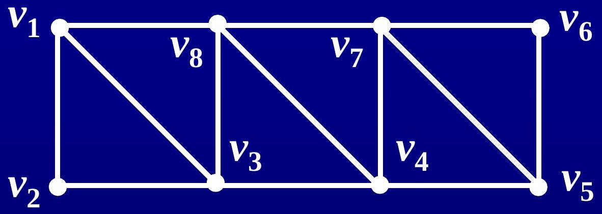

> **定理** （Hall 1935）设 $G$ 为具有二分类 $(X, Y)$ 的偶图，则 $G$ 包含饱和 $X$ 的每个顶点的匹配当且仅当
> 
> $$
> |N(S)| \geq|S|
> $$
> 
> 对所有 $S \subseteq X$ 成立。

**证明** 假设 $G$ 包含匹配 $M$，它饱和 $X$ 的每个顶点，并设 $S$ 是 $X$ 的子集。

由于 $S$ 的顶点在 $M$ 下和 $N(S)$ 中的相异顶点配对，显然有

$$
|N(S)| \geq|S| .
$$

反之，假设 $G$ 是满足条件的偶图，但不包含可以饱和 $X$ 的所有顶点的匹配。

设 $M^{*}$ 是 $G$ 的最大匹配，根据假设，$M^{*}$ 不饱和 $X$ 的所有点。

设 $u$ 是 $X$ 的一个 $M^{*}$ 非饱和点，并设

$$
Z=\left\{v \mid v \in V \text { 且 } v \text { 通过 } M^{*} \text { 交错路与 } u \text { 连接 }\right\} 。
$$

由于 $M^{*}$ 是最大匹配，由 Berge 定理可知：$u$ 为 $Z$ 中唯一的 $M^{*}$ 非饱和点，否则将含 $M^{*}$ 可扩路。

置 $S=Z \cap X$ 和 $T=Z \cap Y$。

显然，$S \backslash\{u\}$ 中的顶点，在 $M^{*}$ 下与 $T$ 中的顶点配对。

因此，$|T|=|S|-1$ 而且 $T \subseteq N(S)$。

又因为 $N(S)$ 中的每个顶点 $v$ 均由一条 $M^{*}$ 交错路连接于 $u$，故 $v \in Z$，从而 $v \in T$，这表明 $N(S) \subseteq T$。

于是有 $T=N(S)$。

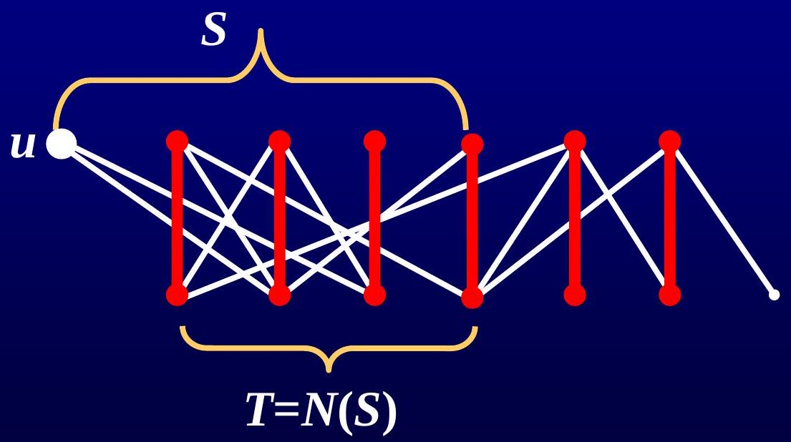

由 $|T|=|S|-1$ 和 $T=N(S)$ 推出

$$
|N(S)|=|T|=|S|-1<|S|,
$$

这与假定条件矛盾。

所以，图 $G$ 包含可以饱和 $X$ 的所有顶点的匹配。

> **注**
> 
> 1. $G=(X, Y)$ 存在饱和 $X$ 每个顶点的匹配也常说成存在由 $X$ 到 $Y$ 的匹配或者由 $X$ 到 $Y$ 的单射，必为最大匹配。
> 
> 2. Hall 定理也称为“婚姻定理”：在一个由 $r$ 个女生和 $s$ 个男生构成的人群中（$1 \leq r \leq s$），熟识的男女之间可能出现 $r$ 对婚姻的充分必要条件是：对每个整数 $k(1 \leq k \leq r)$，任意 $k$ 个女生共认识至少 $k$ 个男生。
> 
> 3. Hall定理是在偶图中求最大匹配算法的理论基础，即匈牙利算法基础。

> **推论** 若 $G$ 是 $k$ 正则偶图，且 $k>0$，则 $G$ 有完美匹配。

**证明** 设 $G$ 是具有二分类 $(X, Y)$ 的 $k$ 正则偶图。

由于 $G$ 是 $k$ 正则的，所以 $k|X|=|E(G)|=k|Y|$，所以 $|X|=|Y|$。任取 $X$ 的一个子集 $S$，令

$$
\begin{aligned}
& E_{1}=\{e \mid e \in E, \text { 并且 } e \text { 与 } S \text { 中的顶点关联 }\}, \\
& E_{2}=\{e \mid e \in E, \text { 并且 } e \text { 与 } N(S) \text { 中的顶点关联 }\} \text { 。 }
\end{aligned}
$$

因与 $S$ 中的顶点关联的边必与 $N(S)$ 中的顶点关联，所以我们可以推出 $E_{1} \subseteq E_{2}$。

因此，$k|N(S)|=\left|E_{2}\right| \geq\left|E_{1}\right|=k|S|$，由此可知 $|N(S)| \geq|S|$。

根据 Hall 定理知：$G$ 有一个饱和 $X$ 的每个顶点的匹配 $M$。

由于 $|X|=|Y|$，所以 $M$ 是完美匹配。

> **例**
> 
> 1. 证明：每个 $n$ 方体都有完美匹配。
> 
> 2. 求 $K_{n, n}$ 中不同的完美匹配的个数。

> **证明**
> 
> （1）由 $n$ 方体的构造知：$n$ 方体有 $2^{n}$ 个顶点，每个顶点可以用长度为 $n$ 的二进制码来表示，两个顶点连线当且仅当代表两个顶点的二进制码只有一位坐标不同。
> 
> 如果我们划分 $n$ 方体的 $2^{n}$ 个顶点，把坐标之和为偶数的顶点归入 $X$，否则归入 $Y$。
> 
> $X$ 中顶点互不邻接，$Y$ 中顶点也如此。所以 $n$ 方体是偶图。
> 
> 很容易验证 $n$ 方体的每个顶点度数为 $n$，所以 $n$ 方体是 $n$ 正则偶图。
> 
> 因此，$n$ 方体存在完美匹配。
> 
> （2）可归纳证明：$K_{n, n}$ 的不同完美匹配的个数为 $n!$。

> **例** 将一副不含大王和小王的扑克牌随机地分成 13 份，每份包含 4 张牌。能否从每一份中选取一张牌使得 A，2，…，Q，K 均出现？

**解** 一定可以做到。

用 $1,2, \ldots, 13$ 表示每张牌的点数。

构造一个具有二分类 $(X, Y)$ 的偶图 $G$，其中

$$
X=\left\{x_{1}, x_{2}, \ldots, x_{13}\right\}, \quad Y=\left\{y_{1}, y_{2}, \ldots, y_{13}\right\},
$$

$x_{i}$ 与 $y_{j}$ 相邻当且仅当第 $i$ 份包含点数为 $j$ 的牌（若点数相同的牌出现在同一份，则构造重边）。

显然，$G$ 中各点的度数均为 4。

不难验证 $G$ 满足 Hall 定理的条件，故存在完美匹配。

根据 $G$ 的完美匹配可得到满足条件的取法。

> **例** 证明：$n$ 阶方阵 $A=\left(a_{i j}\right)$ 的行列式展开式中每一项均为零$⟺$存在 $k \leq n$，使 $A$ 有一个 $k \times(n-k+1)$ 阶的子矩阵，它的所有的元素均为零。

**证明** 作一个具有二分类 $(X, Y)$ 的偶图 $G$，其中

$$
X=\left\{x_{1}, x_{2}, \ldots, x_{n}\right\}, \quad Y=\left\{y_{1}, y_{2}, \ldots, y_{n}\right\},
$$

$x_{i}$ 与 $y_{j}$ 邻接当且仅当在 $A$ 中 $a_{i j} \neq 0$。

若在行列式 $\operatorname{det} A$ 中有一项 $\pm a_{1 j_{1}} a_{2 j_{2}} \ldots a_{n j_{n}} \neq 0$，则

$$
E_{1}=\left\{x_{1} y_{j_{1}}, x_{2} y_{j_{2}}, \ldots, x_{n} y_{j_{n}}\right\} \subset E(G) .
$$

因 $\left(j_{1}, j_{2}, \ldots, j_{n}\right)$ 是 $(1,2, \ldots, n)$ 的一个排列，故 $E_{1}$ 是完美匹配。

Hall定理表明不存在这样的完美匹配当且仅当存在 $X$ 的一个子集 $S$，使得 $|N(S)| \leq|S|-1$。

设 $|S|=k$，这就是说，$A$ 中有 $k$ 行，这 $k$ 行中至多有 $k-1$ 列中存在非零元，而在其余的 $(n-k+1)$ 列中每个元均为零。

于是，$A$ 有一个 $k \times(n-k+1)$ 阶的零子矩阵。

**例** 在 5 阶方阵中，第 $2,3,5$ 行和第 $1,2,5$ 列导出了一个 3 阶零矩阵。取 $k=3, n-k+1=3$，故由上述定理知 $\operatorname{det} A$ 的每一项均为零。

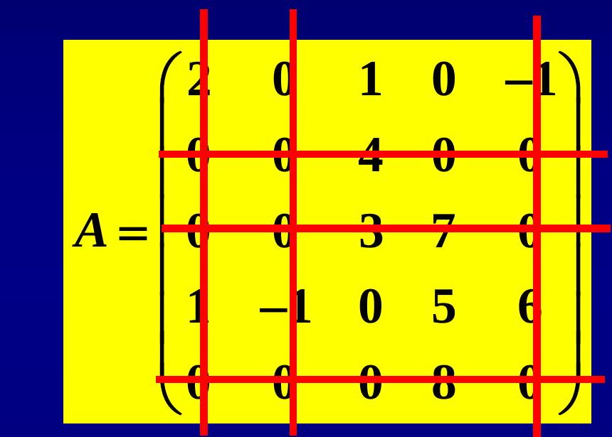

矩阵 $A$

$A$ 对应的偶图 $G$ 中，若取 $S=\left\{x_{2}, x_{3}, x_{5}\right\}$，则 $N(S)=\left\{y_{3}, y_{4}\right\}$。因 $|S|>|N(S)|$，故 $G$ 没有完美匹配，从而 $\operatorname{det} A$ 的展开式中每项均为 0。

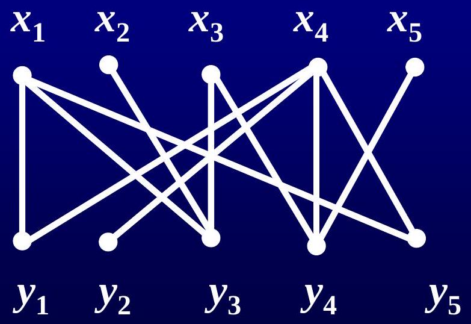

#### 三、点覆盖与König定理

> **定义** 图 $G$ 的一个覆盖是指 $V(G)$ 的一个子集 $K$，使得 $G$ 的每条边都至少有一个端点在 $K$ 中。
> 
> **定义** $G$ 中点数最少的覆盖称为 $G$ 的最小覆盖。

**例** 覆盖与最小覆盖的示例如下图。

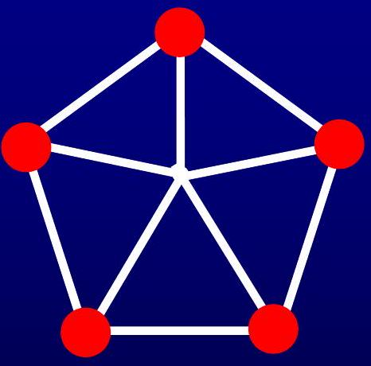

覆盖

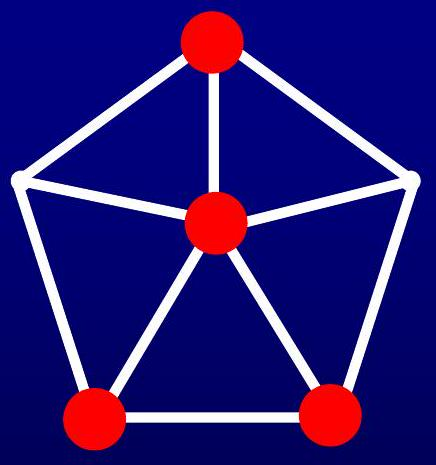

最小覆盖

设 $K$ 是 $G$ 的覆盖，$M$ 是 $G$ 的匹配，由于 $M$ 中的边互不相邻，若要覆盖 $M$ 中的边，至少需要 $|M|$ 个顶点，所以

> 
> 
> $$
> |M| \leq|K|
> $$

特别地，若 $M^{*}$ 是最大匹配，且 $\tilde{K}$ 是最小覆盖，则

> 
> 
> $$
> \left|\boldsymbol{M}^{*}\right| \leq|\tilde{\boldsymbol{K}}| 。
> $$

> **定理** 设 $M$ 是匹配，$K$ 是覆盖，若 $|M|=|K|$，则 $M$ 是最大匹配且 $K$ 是最小覆盖。

**证明** 设 $M^{*}$ 是最大匹配，$\tilde{K}$ 是最小覆盖，则

$$
|M| \leq\left|M^{*}\right| \leq|\tilde{K}| \leq|K| 。
$$

由于 $|M|=|K|$，所以 $|M|=\left|M^{*}\right|, \quad|\tilde{K}|=|K|$。

> **定理** （König 1931）在偶图中，最大匹配中的边数等于最小覆盖中的点数。

**证明** 设 $G$ 是具有二分类 $(X, Y)$ 的偶图，$M^{*}$ 是 $G$ 的最大匹配，用 $U$ 表示 $X$ 中的 $M^{*}$ 非饱和顶点的集合，用 $Z$ 表示由 $M^{*}$ 交错路连接到 $U$ 中顶点的所有顶点的集合。

置 $S=Z \cap X, T=Z \cap Y$。

类似于 Hall 定理的证明，可知 $T$ 中的每个顶点都是 $M^{*}$ 饱和点，$|S|-|U|=|T|$ 并且 $N(S)=T$。

**定义**

$$
\tilde{K}=(X \backslash S) \cup T \text { 。 }
$$

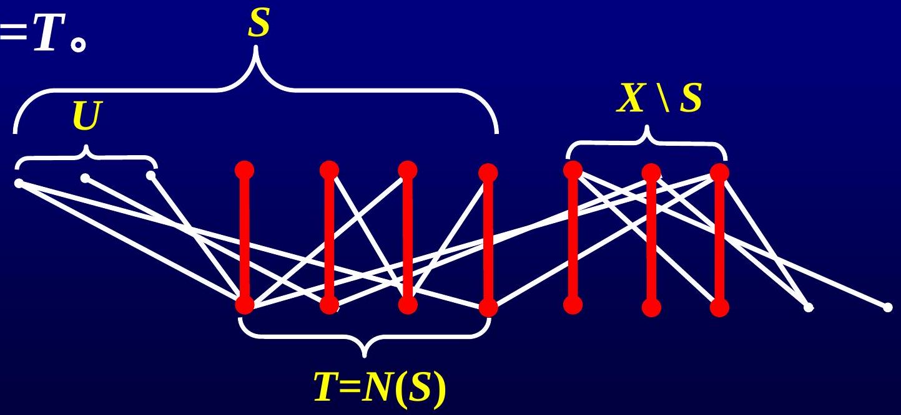

则 $G$ 的每条边必然至少有一个端点在 $\tilde{K}$ 中，否则就存在一条边，其一个端点在 $S$ 中，而另一个端点在 $Y \backslash T$ 中，这与“$N(S)=T$”相矛盾。

于是，$\tilde{K}$ 是 $G$ 的覆盖，并且

$$
\begin{aligned}
\left|M^{*}\right| & =|X|-|U| \\
& =|X|-(|S|-|T|) \\
& =(|X|-|S|)+|T| .
\end{aligned}
$$

因为 $\tilde{K}=(X \backslash S) \cup T$，所以 $\left|\boldsymbol{M}^{*}\right|=|\tilde{\boldsymbol{K}}|$。

因此，$\tilde{K}$ 是最小覆盖。

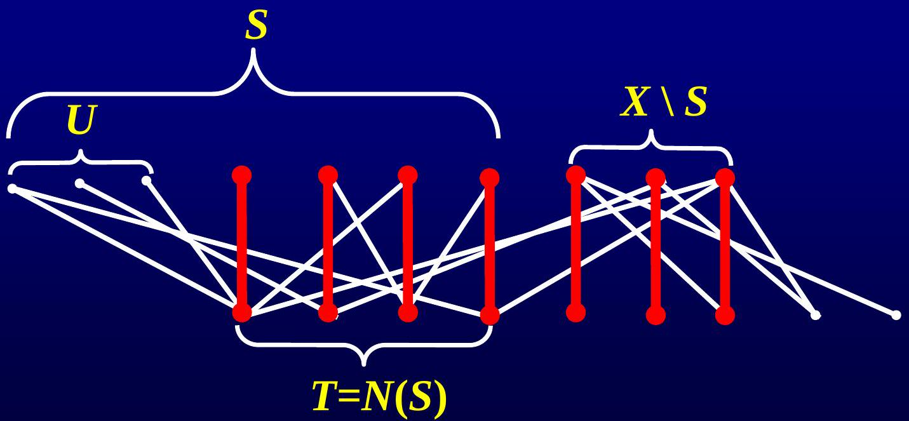

> **例** 矩阵的一行或一列统称为一条线。证明：包含了一个 $(0,1)$ 矩阵中所有“1”的线的最小条数，等于具有性质“任意两个 1 都不在同一条线上”的“1”的最大个数。
> 

**证明** 将 $(0,1)$ 矩阵 $Q=\left(q_{i j}\right)$ 对应一个具有二分类 $(X, Y)$ 的偶图 $G$，使其行代表 $X$ 中的元素，列代表 $Y$ 中的元素且满足

$$
q_{i j}= \begin{cases}1, & \text { 若 } x_{i} \text { adj } y_{j}, \\ 0, & \text { 其他. }\end{cases}
$$

这样矩阵 $Q$ 中的 1 恰好与图 $G$ 的边一一对应。

> 矩阵 $Q$ 的第 $i$ 行包含的 1 的个数就是 $G$ 中点 $x_{i}$ 关联的边数。矩阵 $Q$ 的第 $i$ 行就相当于$X$中的一个点$x_i$
> 
> 第 $j$ 列包含的 1 的个数就是 $G$ 中点 $y_{j}$ 关联的边数。矩阵 $Q$ 的第 $j$ 列就相当于$Y$中的一个点$y_i$

故包含了 $(0,1)$ 矩阵中所有“1”的线的最小条数就是偶图 $G$ 中的最小覆盖的点数。这个线就相当于选择一个点

而 $(0,1)$ 矩阵中任意两个都不在相同线上的若干个 1，就是偶图 $G$ 中的一个匹配。这个选1就相当于选一条边

而具有上述性质的 1 的最大个数，就是偶图 $G$ 中最大匹配的边数。由 König 定理，问题得证。

**例** 矩阵 $Q$ 及其对应的偶图如右图。其最小覆盖是 $\left\{x_{1}, y_{2}, y_{4}\right\}$，故包含 $Q$ 中所有 1 的线是 $Q$ 的第 1 行、第 $2 、 4$ 列，共 3 条。

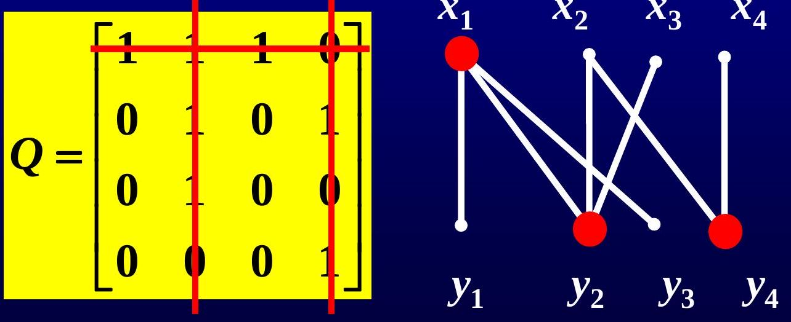

### 5.4 最优匹配与匈牙利算法

#### 一、问题的提出

人员分派问题：$n$ 个工人 $x_{1}, x_{2}, \ldots, x_{n}, n$ 件工作 $y_{1}, y_{2}, \ldots, y_{n}$。已知 $x_{i}$ 能胜任某 $k_{i}$ 件工作 $(i=1,2, \ldots, n)$。问是否存在一种工作安排方案，使每个人都能分配到他所能胜任的一件工作（假定每件工作只能交给一人完成）。若存在，该如何安排？

图论模型：以工人和工作为点，当且仅当 $x_{i}$ 能胜任工作 $y_{j}$ 时则连线，得偶图 $G$。于是一种符合要求的安排对应 $G$ 中一个完美匹配。此问题实际上是求偶图的完美匹配问题。

若不要求人数与工作数相等，则问题是求偶图的饱和 $X$ 的每个点的匹配问题，其中 $X$ 是工人的集合。

进一步，若问：是否存在一种安排使尽可能多的人能分到他能胜任的工作或使尽可能多的工作被分配，则问题为求偶图的最大匹配问题。

#### 二、匈牙利算法

算法思想：先任取一个匹配 $M$，然后寻找 $M$ 可扩路。若不存在 $M$ 可扩路，则 $M$ 为最大匹配；若存在，则将可扩路中 $M$ 与非 $M$ 的边互换，得到一个比 $M$ 多一条边的匹配 $M^{\prime}$，再对 $M^{\prime}$ 重复上面过程。

算法是从 $X$ 的每个非饱和点出发寻找 $M$ 可扩路的。若从 $X$ 的每个非饱和点出发都无 $M$ 可扩路，则必无 $M$ 可扩路，从而 $M$ 是最大匹配。这是因为偶图中不可能存在两个端点均在 $Y$ 中的 $M$ 可扩路。

1965 年，Edmonds 首先提出：用扎根于 $M$ 非饱和点 $u$ 的 $M$ 交错树的生长来求 $M$ 可扩路。

> **定义** 设 $M$ 是 $G$ 中的匹配，$u$ 是 $X$ 的 $M$ 非饱和点，若树 $H \subseteq G$ 满足：（1）$u \in V(H)$；（2）对 $H$ 的每个顶点 $v$，$H$ 中唯一的 $(u, v)$ 路是一条 $M$ 交错路，则称**树 **$H$** 是一棵扎根于 **$u$** 的 **$M$** 交错树**。

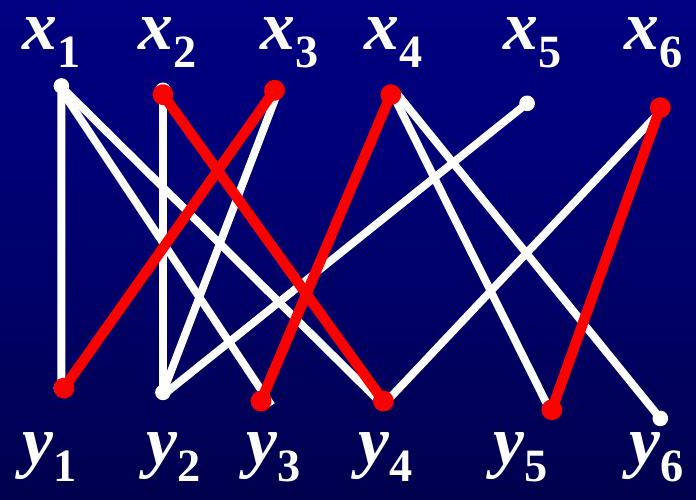

$G$ 的一个匹配 $M$

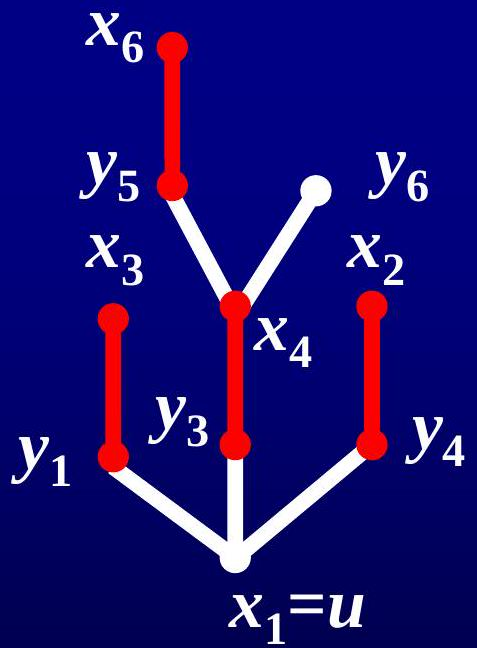

$G$ 的一棵 $M$ 交错树

算法中，寻找以 $u$ 为起点的一条 $M$ 可扩路，其过程包含生长一棵扎根于 $u$ 的 $M$ 交错树 $H$。

开始时，$H$ 仅由单一顶点 $u$ 组成，而在以后的步骤中它都按以下两种方式生长：

1. $H$ 包含不同于 $u$ 的 $M$ 非饱和点，如图（a）；

2. 除 $u$ 以外的所有其他顶点都是两两配对的 $M$ 饱和点，如图（b）。

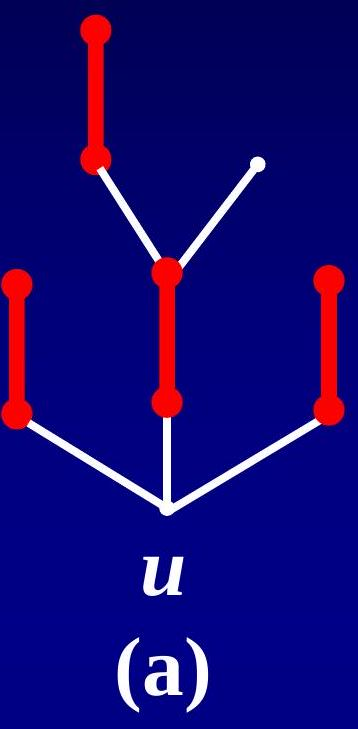

若出现图（a）的情况，则找到了 $M$ 可扩路。

若出现图（b）的情况，令 $S=V(H) \cap X, T=V(H) \cap Y$。显然，$S \backslash\{u\}$ 中的点与 $T$ 中的点配对。

因此，$|T|=|S|-1$ 且 $T \subseteq N(S)$。

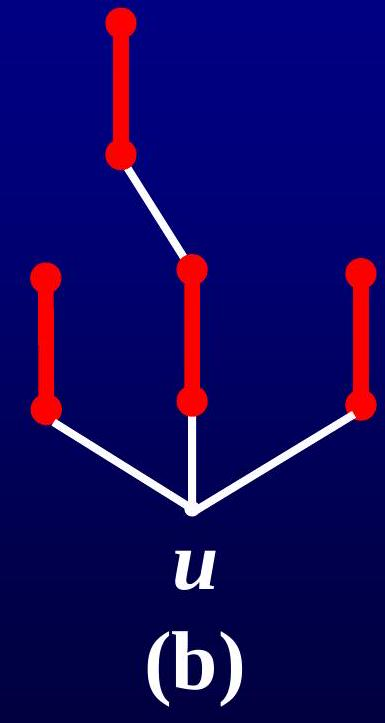

（2.1）若 $T=N(S)$，则

$$
|N(S)|=|T|=|S|-1<|S| \text { 。 }
$$

由 Hall 定理知，$G$ 中不存在可以饱和 $X$ 中所有顶点的匹配（不存在以 $u$ 为起点的 $M$ 可扩路）。

（2.2）若 $T \subset N(S)$，则在 $N(S) \backslash T$ 中存在点 $y$ 与 $S$ 中点 $x$ 相邻。

若 $x=u$，由于 $u$ 是 $M$ 非饱和点，所以 $x y \notin M$。若 $x \neq u$，由于 $H$ 中除 $u$ 之外的点均是 $M$ 饱和点，所以 $x y \notin M$。

如果 $y$ 是 $M$ 非饱和的，则添加点 $y$ 和边 $x y$ 来生长 $H$，结果得到情形1。

如果 $y$ 是 $M$ 饱和的，假定 $y z \in M$，则添加点 $y$ 和 $z$ 以及边 $x y$ 和 $y z$ 来生长 $H$，然后回到情形2。

匈牙利算法：给定具有二分类 $(X, Y)$ 的偶图。

1. 任取一个匹配 $M$，将当前所有 $X$ 中的非饱和点标记为尚未检查。

2. 若 $X$ 中每个点均被 $M$ 饱和，则输出 $M$ 并停止。若当前所有非饱和点都已检查且均找不到可扩路，则输出最大匹配 $M$ 并停止。

3. 取一个尚未检查的 $X$ 中非饱和点 $u$，令 $S=\{u\}, T=\varnothing$，从 $u$ 开始生长交错树。

4. 若 $T=N(S)$，则 $|N(S)|=|S|-1<|S|$。若只需寻找饱和 $X$ 的匹配，则可判定无解；若要求最大匹配，则标记 $u$ 已检查，返回第 2 步。否则，取 $y \in N(S)\backslash T$，并记录交错树中的相应边。

5. 若 $y$ 为饱和点，转第 6 步；否则转第 7 步。

6. 设 $yz\in M$，令 $S=S\cup\{z\}$、$T=T\cup\{y\}$，将相应的点和边加入交错树，然后返回第 4 步。

7. 根据交错树找到从 $u$ 到 $y$ 的 $M$ 可扩路 $\Gamma$，令 $M=M\triangle E(\Gamma)$。由于匹配已改变，将当前所有 $X$ 中的非饱和点重新标记为尚未检查，然后返回第 2 步。

**例** 求图 $G$（图（a））的最大匹配，其中 $X=\left\{v_{1}, v_{2}, v_{3}, v_{4}, v_{5}\right\}$。

1. 任取一个匹配 $M=\left\{v_{1} u_{1}, v_{3} u_{3}, v_{5} u_{5}\right\}$，如图（a）的红边所示；

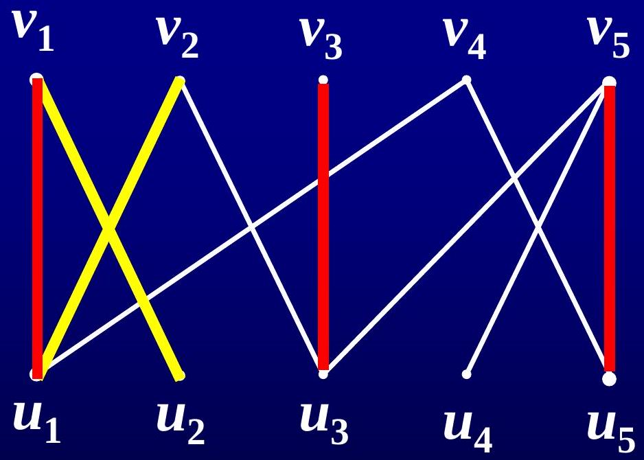

（a）

1. $X$ 中存在非饱和点，取其中一个 $v_{2}$，置 $S=\left\{v_{2}\right\}, T=\Phi$；

2. 因 $N(S)=\left\{u_{1}, u_{3}\right\} \neq T$，故取 $u_{1} \in N(S) \backslash T=\left\{u_{1}, u_{3}\right\}$。

3. $u_{1}$ 为饱和点，且 $v_{1} u_{1} \in M$，令 $S=S \cup\left\{v_{1}\right\}=\left\{v_{1}, v_{2}\right\}$，$T=T \cup\left\{u_{1}\right\}=\left\{u_{1}\right\}$。

4. 因 $N(S)=\left\{u_{1}, u_{2}, u_{3}\right\} \neq T$，故取 $u_{2} \in N(S) \backslash T=\left\{u_{2}, u_{3}\right\}$。

5. $u_{2}$ 为非饱和点，得 $M$ 可扩路 $\Gamma=v_{2} u_{1} v_{1} u_{2}$。

6. 取 $M=(M \cup E(\Gamma)) \backslash(M \cap E(\Gamma))=\left\{v_{2} u_{1}, v_{1} u_{2}, v_{3} u_{3}, v_{5} u_{5}\right\}$，如图（b）中的红边。

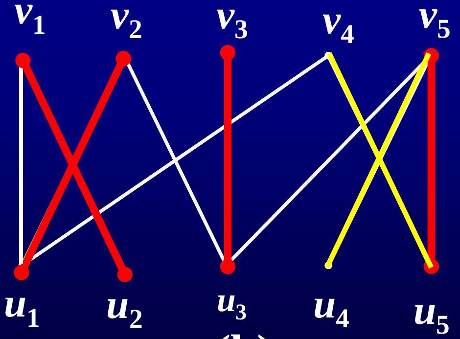

（b）

1. 取 $X$ 的非饱和点 $v_{4}$。从 $v_{4}$ 出发重复（2）的过程得 $M$ 可扩路

$$
\Gamma=v_{4} u_{5} v_{5} u_{4} .
$$

取 $M=\left\{v_{1} u_{2}, v_{2} u_{1}, v_{3} u_{3}, v_{4} u_{5}, v_{5} u_{4}\right\}$，如图（c）中红边。

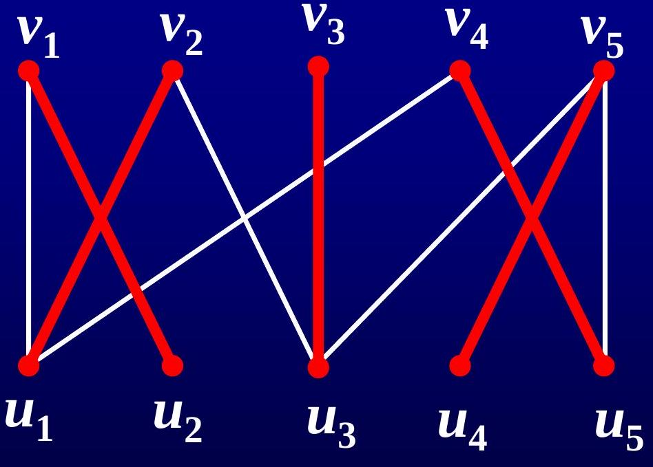

（c）

1. $X$ 已无非饱和点，故结束。

#### 三、最优匹配

设 $G=(X, Y)$ 是一个边赋权完全偶图，其中 $X=\left\{x_{1}, x_{2}, \ldots, x_{n}\right\}$， $Y=\left\{y_{1}, y_{2}, \ldots, y_{n}\right\}$，边 $x_{i} y_{j}$ 的权 $w_{i j}=w\left(x_{i} y_{j}\right)$ 表示工人 $x_{i}$ 做工作 $y_{j}$ 时的效率。最优分派问题指的是在赋权完全偶图 $K_{n, n}$ 中寻找一个具有最大权值的完美匹配，称为最优匹配。

在匈牙利算法的基础上，Kuhn（1955）与 Munkres（1957）提出了解决最优分派问题的好算法。

**定义** 设 $G=(X, Y)$ 是赋权完全偶图，若在顶点集上的实值函数 $l$ 满足：对任意的 $x \in X, y \in Y$，均有：

$$
l(x)+l(y) \geq w(x y),
$$

称 $l$ 是 $G$ 的可行顶点标号。

对于任意的赋权完全偶图 $G$，均存在 $G$ 的可行顶点标号。

事实上，设：

$$
l=\left\{\begin{array}{l}
l(x)=\max _{y \in Y} w(x y), \text { 若 } x \in X, \\
l(y)=0, \text { 若 } y \in Y .
\end{array}\right.
$$

则 $l$ 是 $G$ 的一个可行顶点标号。

**定义** 设 $l$ 是赋权完全偶图 $G=(X, Y)$ 的可行顶点标号，令：

$$
E_{l}=\{x y \in E(G) \mid l(x)+l(y)=w(x y)\},
$$

称以 $E_{l}$ 为边集的 $G$ 的生成子图为 $G$ 的对应于 $l$ 的相等子图，记为 $G_{l}$。

**例** 设如下矩阵是赋权完全偶图 $G$ 的权值矩阵。一种可行顶点标号为：$X$ 侧依次为 $(5,2,4,1,3)$，$Y$ 侧依次为 $(0,0,0,0,0)$。

$$
W=\left(\begin{array}{ccccc}
3 & 5 & 5 & 4 & 1 \\
2 & 2 & 0 & 2 & 2 \\
2 & 4 & 4 & 1 & 0 \\
0 & 1 & 1 & 0 & 0 \\
1 & 2 & 1 & 3 & 3
\end{array}\right)
$$

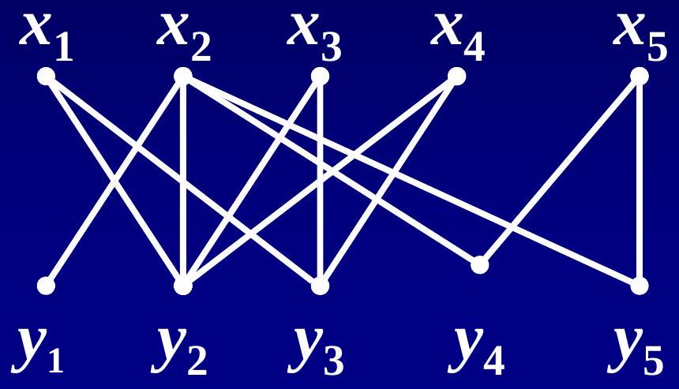

$G_{I}=(X, Y)$

**定理** 设 $l$ 是赋权完全偶图 $G=(X, Y)$ 的可行顶点标号，若相等子图 $G_{l}$ 有完美匹配 $M^{*}$，则 $M^{*}$ 是 $G$ 的最优匹配。

**证明** 设 $M^{*}$ 是 $G_{l}$ 的完美匹配，则：

$$
w\left(M^{*}\right)=\sum_{e \in M^{*}} w(e)=\sum_{v \in V(G)} l(v) .
$$

又设 $M$ 是 $G$ 的任一完美匹配，则：

$$
w(M)=\sum_{e \in M} w(e) \leq \sum_{v \in V(G)} l(v) .
$$

所以，$w\left(M^{*}\right) \geq w(M)$，即 $M^{*}$ 是 $G$ 的最优匹配。

根据上面定理，如果找到一种恰当可行顶点标号，使得对应的相等子图有完美匹配 $M^{*}$，则求出了 $G$ 的最优匹配。

算法基本思想：首先给出任一可行顶点标号 $l$，然后确定 $G_{l}$；再利用匈牙利算法寻找 $G_{l}$ 的最大匹配。若在 $G_{l}$ 中已找到一个完美匹配，则该匹配就是最优匹配；否则修改可行顶点标号，直到完美匹配在某个相等子图中找到为止。

Kuhn－Munkres 算法：给定一初始顶点标号 $l$，在 $G_{l}$ 中任选一个匹配 $M$。

1. 若 $X$ 是 $M$ 饱和的，则 $M$ 是最优匹配。否则，令 $u$ 是 $X$ 中的一个 $M$ 非饱和点，置 $S=\{u\}, T=\Phi$。

2. 若 $T \subset N_{G_{l}}(S)$，转（3）。否则，计算：$\alpha_{l}=\min _{\substack{x \in S \\ y \notin T}}\{l(x)+l(y)-w(x y)\}$，并根据 $\hat{l}(v)= \begin{cases}l(v)-\alpha_{l}, v \in S \\ l(v)+\alpha_{l}, v \in T \\ l(v), \text { 其他 }\end{cases}$ 给出新的可行顶点标号，在新标号下重新开始。

3. 在 $N_{G_{l}}(S) \backslash T$ 中选择点 $y$。若 $y$ 是 $M$ 饱和的，且 $y z \in M$，则置 $S=S \cup\{z\}, T=T \cup\{y\}$，转（2）。否则，设 $P$ 是相等子图 $G_{l}$ 中的 $M$ 可扩 $(u, y)$ 路，置 $M=M \triangle E(P)$，转（1）。

**例** 给定赋权完全偶图 $G$ 的权值矩阵，求其最优匹配。

**解** 给出初始可行顶点标号 $l$：$X$ 侧依次为 $(5,2,4,1,3)$，$Y$ 侧依次为 $(0,0,0,0,0)$。对应的权值矩阵为：

$$
W=\left(\begin{array}{lllll}
3 & 5 & 5 & 4 & 1 \\
2 & 2 & 0 & 2 & 2 \\
2 & 4 & 4 & 1 & 0 \\
0 & 1 & 1 & 0 & 0 \\
1 & 2 & 1 & 3 & 3
\end{array}\right)
$$

对应的相等子图 $G_{l}$ 为：

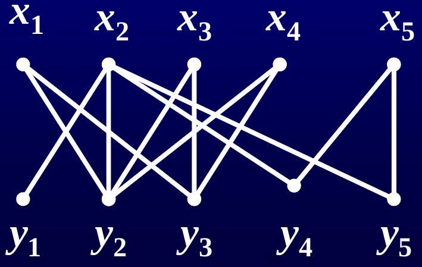

给出初始匹配 $M$ 为：

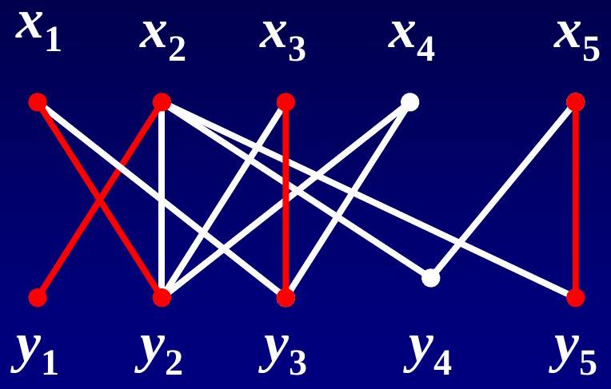

存在 $M$ 非饱和顶点 $u=x_{4}$。

1. 令 $S=\left\{x_{4}\right\}, T=\Phi$。

2. $N_{G_{l}}(S)=\left\{y_{2}, y_{3}\right\} \supset T$。

3. 取 $y_{2} \in N_{G_{l}}(S) \backslash T$，$y_{2}$ 为饱和顶点，$y_{2} x_{1} \in M$。

4. $S=\left\{x_{4}, x_{1}\right\}, T=\left\{y_{2}\right\}$。

5. $N_{G_{l}}(S)=\left\{y_{2}, y_{3}\right\} \supset T$。

6. 取 $y_{3} \in N_{G_{l}}(S) \backslash T$，$y_{3}$ 为饱和顶点，$y_{3} x_{3} \in M$。

7. $S=\left\{x_{4}, x_{1}, x_{3}\right\}, T=\left\{y_{2}, y_{3}\right\}$。

8. $N_{G_{l}}(S)=\left\{y_{2}, y_{3}\right\}=T$，需要修改标号。

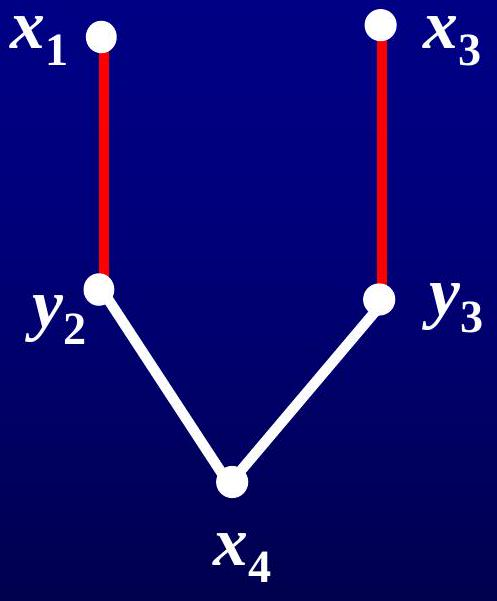

因为 $S=\left\{x_{1}, x_{3}, x_{4}\right\}, T=\left\{y_{2}, y_{3}\right\}$，为计算 $\alpha_{l}$，需考察边

$$
x_{1} y_{1}, x_{1} y_{4}, x_{1} y_{5}, x_{3} y_{1}, x_{3} y_{4}, x_{3} y_{5}, x_{4} y_{1}, x_{4} y_{4}, x_{4} y_{5} .
$$

所以，

$$
\alpha_{l}=\min _{\substack{x \in S \\ y \notin T}}\{l(x)+l(y)-w(x y)\}=1
$$

由

$$
\hat{l}(v)=\left\{\begin{array}{l}
l(v)-\alpha_{l}, v \in S \\
l(v)+\alpha_{l}, v \in T \\
l(v), \text { 其他 }
\end{array}\right.
$$

得新标号为：

$$
\begin{aligned}
& l\left(x_{1}\right)=4,\ l\left(x_{2}\right)=2,\ l\left(x_{3}\right)=3,\ l\left(x_{4}\right)=0,\ l\left(x_{5}\right)=3 ; \\
& l\left(y_{1}\right)=0,\ l\left(y_{2}\right)=1,\ l\left(y_{3}\right)=1,\ l\left(y_{4}\right)=0,\ l\left(y_{5}\right)=0 .
\end{aligned}
$$

相等子图为：

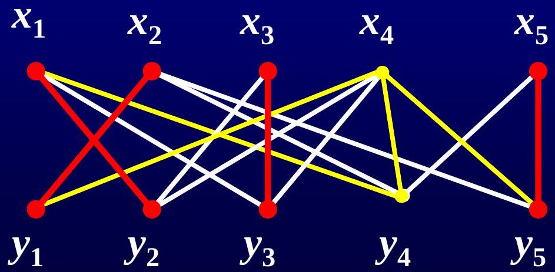

此时，$S=\left\{x_{1}, x_{3}, x_{4}\right\}, ~ T=\left\{y_{2}, y_{3}\right\}$，

$$
N_{G_{l}}(S)=\left\{y_{1}, y_{2}, y_{3}, y_{4}, y_{5}\right\} \supset T .
$$

1. 取 $y_{4} \in N_{G_{l}}(S) \backslash T$，$y_{4}$ 为非饱和顶点，于是得到可扩路

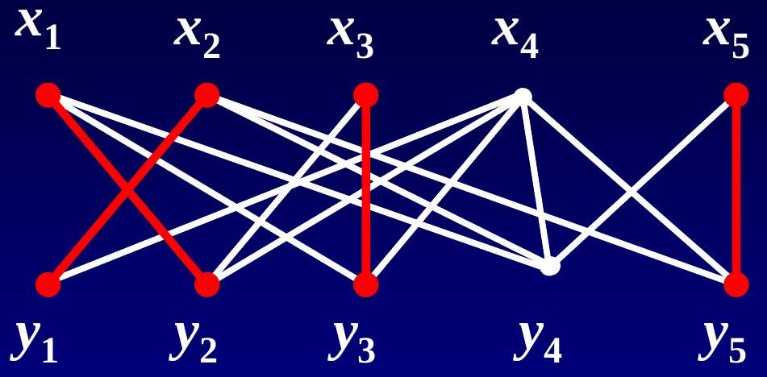

$$
x_{4} y_{2} x_{1} y_{4} .
$$

1. 从匹配 $M$ 中去掉边 $x_{1} y_{2}$，添加 $x_{1} y_{4}, x_{4} y_{2}$，得到完美匹配。

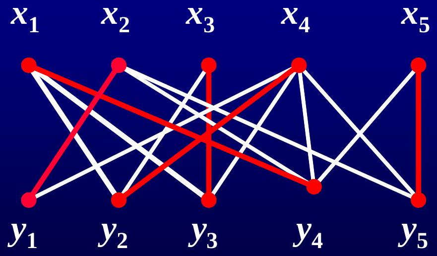

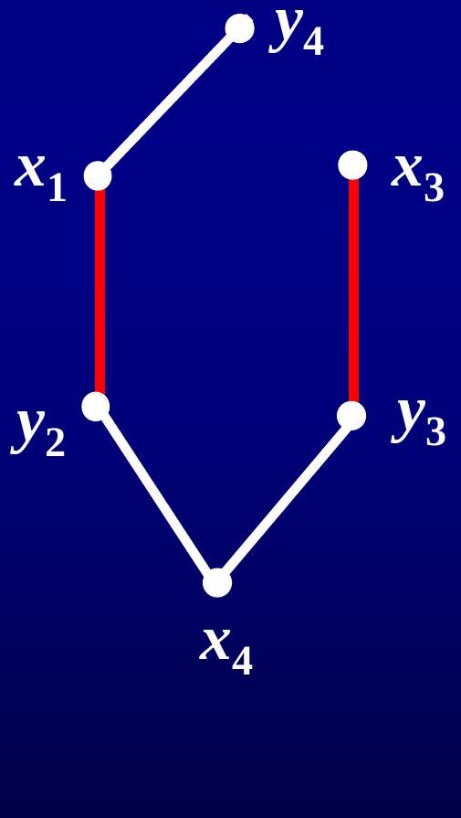

最优匹配权值为 14。

### 5.5 因子分解

#### 一、相关概念

把一个图按照某种方式分解成若干边不重的子图之并有着重要意义。在理论上，通过分解，可以深刻地揭示图的结构特征；在应用上，网络通信中，当有多个信息传输时，往往限制单个信息在某一子网中传递，这就涉及网络分解问题。

一个图分解方式是多种多样的。作为图分解的典型例子，我们介绍图的因子分解。

> **定义** 图 $G$ 的一个因子是指至少包含 $G$ 的一条边的生成子图，即非空的生成子图就是一个因子。
> 
> **定义** $G$ 的一个因子分解是指将 $G$ 分解为若干个边不重的因子之并。

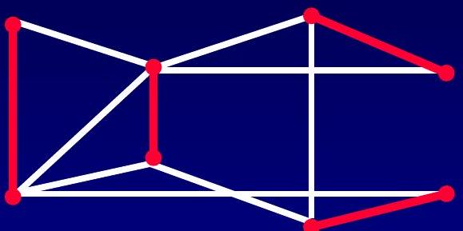

> **定义** $k$-因子指 $k$ 正则的因子。

**例** 1-因子的边集构成一个完美匹配；2-因子的连通分支为一个圈。

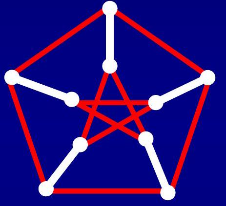

> **定义** $k$－因子分解：每个因子均为 $k$－因子的因子分解，此时称 $G$ 本身是** **$k$**－可因子化**的。

研究图的因子分解主要有两个方面：一是能否进行分解（因子分解的存在性）；二是如何分解（分解算法）。

#### 二、1-因子分解

若 $G$ 有一个 1-因子（其边集为完美匹配），则显然 $G$ 的阶数是偶数。所以，奇数阶图不能 1-因子分解。

> **定理** 完全图 $K_{2 n}$ 是 1－可因子化的。

**证明** 可由下法来确定 $K_{2 n}$ 的 1-因子分解。

把 $K_{2 n}$ 的 $2 n$ 个顶点编号为 $1,2, \ldots, 2 n$。按照右图进行排列。

除 $2 n$ 外，它们中的每一个数，按箭头方向移动一个位置；在每个位置中，同一行的两点邻接就得到一个 1－因子，共有 $2 n-1$ 个不同的位置，就产生了 $2 n-1$ 个不同的 1-因子，从而完成了 $K_{2 n}$ 的 1-因子分解。

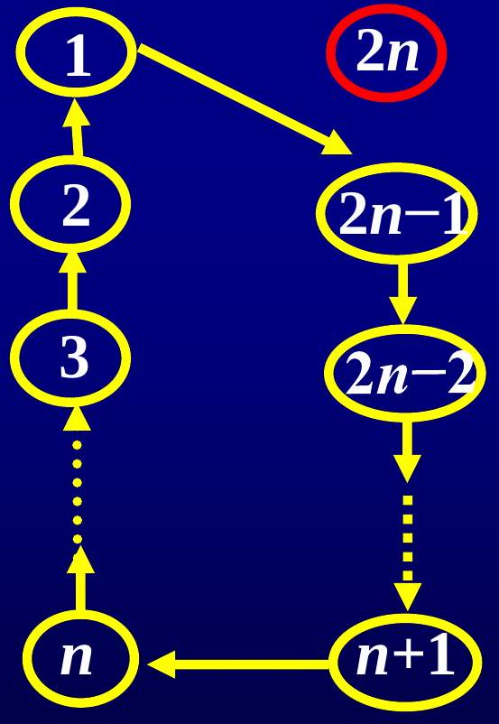

**例** 求 $K_{6}$ 的 1-因子分解。

**解** $K_{6}$ 的 1-因子分解为：

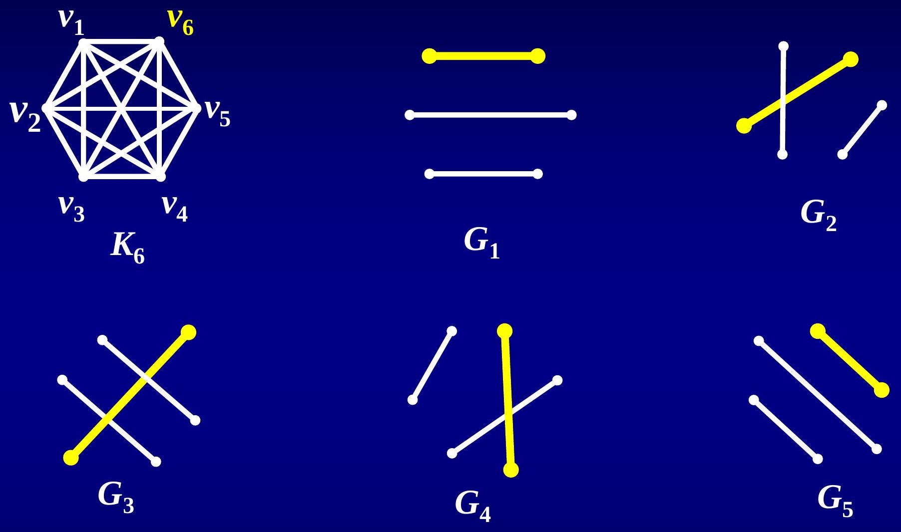

> **定理** $k$ 正则偶图 $(k>0)$ 是 1－可因子化的。

**证明** 因正则偶图存在完美匹配，即 1-因子，通过不断减去完美匹配的方式就可得到正则偶图的 1-因子分解。

**例** 将 $K_{3,3}$ 作1-因子分解。

**解** 将 $X$ 中的点用数字 $1,2,3$ 标记，而 $Y$ 中的点用 $1^{\prime}, 2^{\prime}, 3^{\prime}$ 来标记，用排列 $G$ 来表示 $K_{3,3}$ 中 $X$ 的点与 $Y$ 的点之间的匹配关系，即

$$
G_{1}=\left(\begin{array}{ccc}
1 & 2 & 3 \\
1^{\prime} & 2^{\prime} & 3^{\prime}
\end{array}\right)
$$

$$
G_{2}=\left(\begin{array}{ccc}
1 & 2 & 3 \\
2^{\prime} & 3^{\prime} & 1^{\prime}
\end{array}\right)
$$

$$
G_{3}=\left(\begin{array}{ccc}
1 & 2 & 3 \\
3^{\prime} & 1^{\prime} & 2^{\prime}
\end{array}\right)
$$

则 $K_{3,3}$ 的 1-因子分解为：

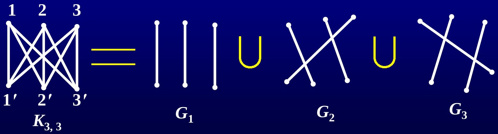

> **定理** 具有Hamilton圈的3正则图是1－可因子化的。

**证明** 因为 $G$ 是 3 正则图，故 $G$ 的阶数是偶数。

具有偶数个顶点的圈可以分解为两个1-因子的并，得证。

> **证明：**
> 
> 设 $G$ 是具有 Hamilton 圈 $C$ 的 $3$ 正则图。由握手定理，
> 
> $$
> 3|V(G)|=\sum_{v\in V(G)}d_G(v)=2|E(G)|,
> $$
> 
> 故 $|V(G)|$ 为偶数，记为 $2m$。由于 $C$ 经过 $G$ 的全部顶点，可将其写为
> 
> $$
> C=v_1v_2\cdots v_{2m}v_1.
> $$
> 
> 沿圈 $C$ 交替选取边，构造两个生成子图 $F_1,F_2$：
> 
> $$
> V(F_1)=V(F_2)=V(G),
> $$
> 
> $$
> E(F_1)=\{v_{2j-1}v_{2j}:j=1,\ldots,m\},
> $$
> 
> $$
> E(F_2)=\{v_{2j}v_{2j+1}:j=1,\ldots,m\},
> $$
> 
> 其中约定 $v_{2m+1}=v_1$。
> 
> 每个顶点在 $F_1,F_2$ 中的度均为 $1$，故二者都是 $G$ 的 $1$-因子，且它们的边互不重复，恰好组成圈 $C$ 的全部边，即
> 
> $$
> E(C)=E(F_1)\,\dot\cup\,E(F_2).
> $$
> 
> 再将圈外剩余的全部边组成生成子图 $F_3$，即
> 
> $$
> V(F_3)=V(G),\qquad E(F_3)=E(G)\setminus E(C).
> $$
> 
> 因为 $G$ 是 $3$ 正则图，而每个顶点在圈 $C$ 中的度均为 $2$，所以对任意 $v\in V(G)$，有
> 
> $$
> d_{F_3}(v)=d_G(v)-d_C(v)=3-2=1.
> $$
> 
> 因此，$F_3$ 也是 $G$ 的 $1$-因子。
> 
> 综上，
> 
> $$
> E(G)=E(F_1)\,\dot\cup\,E(F_2)\,\dot\cup\,E(F_3),
> $$
> 
> 其中 $\dot\cup$ 表示不交并。三个 $1$-因子的边两两不重，且合起来包含 $G$ 的全部边，故构成 $G$ 的一个 $1$-因子分解。因此，$G$ 是 $1$-可因子化的。证毕。

> **注** 1－可因子分解的3正则图不一定有Hamilton圈。

**例** 下图是 3 正则图且可以 1-因子分解，但不存在 Hamilton 圈。

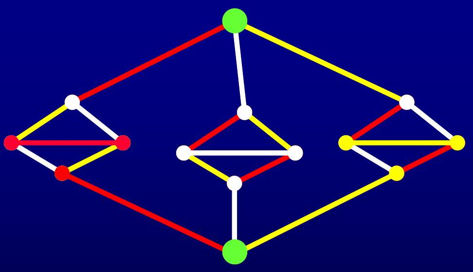

> **定理** 若3正则图有割边，则不可1-因子分解。

**证明** 若3正则图 $G$ 可以1-因子分解，因去掉 $G$ 的不含割边的1-因子后，图中每个点均为2度，从而每条边均在圈中，特别地割边也在圈中，矛盾。

> **注** 无割边的3正则图一定有1-因子，但不一定可以1-因子分解。

> **例** 证明：彼得森图不能1-因子分解。

> **证明** 假设彼得森图可以分解为三个1-因子 $M_{1}, M_{2}, M_{3}$ 的并。
> 
> $M_{1}, M_{2}$ 和 $M_{3}$ 一定均包含圈 123451 上的边，否则存在两条相邻的边出现在同一个 1-因子中。
> 
> 假设边 $12 \in M_{1}$，则 $1 a$ 和 $2 b$ 一定不属于 $M_{1}$。
> 
> 因为 $1 a$ 不属于 $M_{1}$，则 $a c$ 和 $a d$ 中的某一条必然属于 $M_{1}$。同理，$b e$ 和 $b d$ 中的某一条必然属于 $M_{1}$。因此，$M_{1}$ 恰好包含圈 $a c e b d a$ 上的两条边。类似地，$M_{2}$ 和 $M_{3}$ 也恰好包含圈 $a c e b d a$ 上的两条边。矛盾！

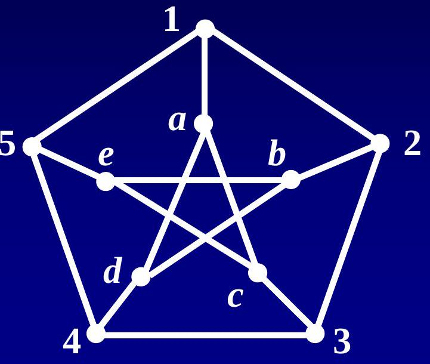

**例** 证明：$K_{4}$ 有唯一的1-因子分解。

**证明** 因为 $K_{4}$ 只有 3 个不同的完美匹配，而 $K_{4}$ 的每个 1 －因子分解包含 3 个不同的完美匹配，所以，其 1-因子分解唯一。

<table>
<tr><th>$\boldsymbol{K}_{\mathbf{2}}$</th><th>$\boldsymbol{K}_{\mathbf{4}}$</th><th>$\boldsymbol{K}_{\mathbf{6}}$</th><th>$\boldsymbol{K}_{\mathbf{8}}$</th><th>$\boldsymbol{K}_{\mathbf{1 0}}$</th><th>$\boldsymbol{K}_{\mathbf{1 2}}$</th></tr>
<tr><td>1</td><td>1</td><td>6</td><td>6240</td><td>1225566720</td><td>252282619805368320</td></tr>
</table>

$K_{14}$ 的1-因子分解的数目为 98758655816833727741338583040。

设图 $G$ 是 $2 n$ 阶的 $k$－正则图，则当 $k$ 充分大时，$G$ 一定可以 1-因子分解。比如：

- 当 $k=2 n-1$ 时，图 $G$ 必为 $K_{2 n}$，显然可以 1－因子分解；

- 当 $k=2 n-2$ 时，图 $G$ 为从 $K_{2 n}$ 中去掉 1 个 1－因子之后所得的图，显然可以 1-因子分解；

- 当 $k \geq 12 n / 7$ 时，Chetwynd 和 Hilton 1985 年证明：图 $G$ 可以 1-因子分解。

1-因子分解猜想（Chetwynd＆Hilton，1985）当 $n$ 为奇数时，若 $k \geq n$，则图 $G$ 可以 1 －因子分解；当 $n$ 为偶数时，若 $k \geq n-1$，则图 $G$ 可以 1-因子分解。

A．G．Chetwynd and A．J．W．Hilton，Regular graphs of high degree are 1－factorizable，Proc．Lond．Math．Soc．， 50 （1985）， 193－206．

#### 三、2-因子分解

> 由定义有：
> 
> 1. 每个2-因子是边不重的圈的并。
> 
> 2. 若一个2-因子是连通的，则它是一个 $H$ 圈。
> 
> 3. 2－可因子化的图的所有点的度一定是偶数，所以完全图 $K_{2 n}$ 不是 2－可因子化的。

> **定理** 图 $K_{2 n+1}$ 是2－可因子化的，且为 $n$ 个 $H$ 圈的并。

**证明** 为了得到 $K_{2 n+1}$ 的2-因子分解，先标定它的点为 $v_{1}, v_{2}, \ldots, v_{2 n+1}$。

然后，在点 $v_{1}, v_{2}, \ldots, v_{2 n}$ 上构成 $n$ 条路 $P_{i}$ 如下：

$$
P_{i}=v_{i} v_{i+1} v_{i-1} v_{i+2} v_{i-2} \ldots v_{i+(n-1)} v_{i-(n-1)} v_{i+n},
$$

并且所有下标取为整数 $1,2, \ldots, 2 n(\bmod 2 n)$。

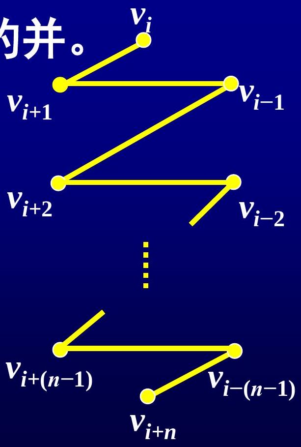

联接 $v_{2 n+1}$ 与 $P_{i}$ 的两个端点构成 Hamilton 圈 $H_{i}$。

**例** 将 $K_{7}$ 分解成 3 个 $H$ 圈的并。

**解** 将 $K_{7}$ 的顶点用数字表示，而 1，2，3，4，5，6 为正六边形的顶点，7 是中心。

图（a）中，实线部分就是一个 2-因子，它是一个 $H$ 圈：$H_{1}=v_{7} v_{1} v_{2} v_{6} v_{3} v_{5} v_{4} v_{7}$。

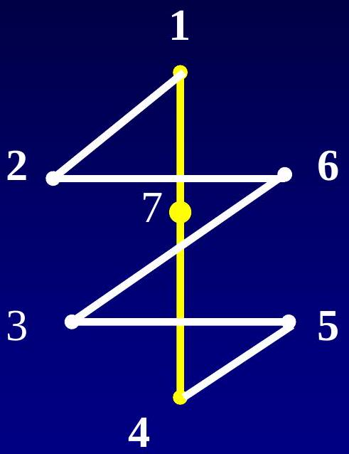

（a）

$$
P_{1}=1(1+1)(1-1)(1+2)(1-2)(1+3)=126354(\bmod 6)
$$

若将 $1,2,3,4,5,6$ 绕中心按顺时针方向移动一个位置，见图（b），则得另一个 $H$ 圈：

$$
\begin{aligned}
& H_{2}=v_{7} v_{2} v_{3} v_{1} v_{4} v_{6} v_{5} v_{7} \\
& P_{2}=2(2+1)(2-1)(2+2)(2-2)(2+3)=231465(\bmod 6)
\end{aligned}
$$

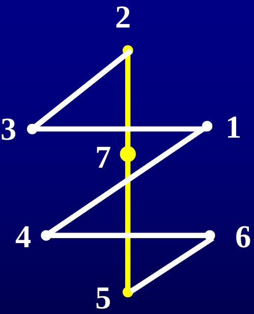

（b）

$$
P_{3}=3(3+1)(3-1)(3+2)(3-2)(3+3)=342516(\bmod 6)
$$

第三个 $H$ 圈显然是 $H_{3}=v_{7} v_{3} v_{4} v_{2} v_{5} v_{1} v_{6} v_{7}$。

则 $K_{7}=H_{1} \cup H_{2} \cup H_{3}$。

> **定理** 完全图 $K_{2 n}$ 是 1 个完美匹配和 $n-1$ 个 $H$ 圈的并。

**证明** 设 $V\left(K_{2 n}\right)=\left\{v_{1}, v_{2}, \ldots, v_{2 n}\right\}$。

作 $n-1$ 条路：

$$
P_{i}=v_{i} v_{i+1} v_{i-1} v_{i+2} v_{i-2} \ldots v_{i+(n-1)} v_{i-(n-1)},
$$

并且所有下标取为整数 $1,2, \ldots, 2 n-1(\bmod 2 n-1)$。

然后把 $v_{2 n}$ 和 $P_{i}$ 的两个端点连接，得到 $n-1$ 个 $H$ 圈。去掉 $n-1$ 个 $H$ 圈之后，剩下的边构成 1 个完美匹配。

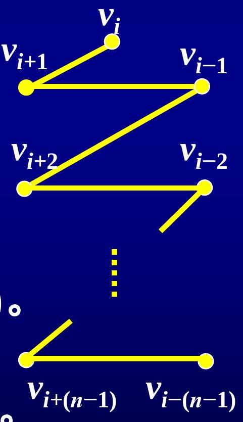

**例** 将 $K_{6}$ 分解为 1 个完美匹配和 2 个 $H$ 圈的并。

**解**

$$
\begin{array}{ll}
P_{1}=v_{1} v_{2} v_{5} v_{3} v_{4}, & H_{1}=v_{6} v_{1} v_{2} v_{5} v_{3} v_{4} v_{6}, \\
P_{2}=v_{2} v_{3} v_{1} v_{4} v_{5}, & H_{2}=v_{6} v_{2} v_{3} v_{1} v_{4} v_{5} v_{6} .
\end{array}
$$

则 $K_{6}$ 可分解为

> **定理** 每一个没有割边的3－正则图是一个1-因子和一个2-因子的并。

**证明** 因每个没有割边的 3－正则图存在完美匹配 $M$，显然，$G-M$ 是一个 2-因子。

> **例** 彼得森图是一个 1-因子和一个 2-因子的并。

**注** 若没有割边的3－正则图中的2-因子是一些偶圈，则该图也是1－可因子化的。

> **定理** 一个连通图是2－可因子化的当且仅当它是偶数度正则图。

**证明** 必要性显然。

接下来证明充分性。

设 $G$ 是 $2 k$－正则连通图，$V(G)=\left\{v_{1}, v_{2}, \ldots, v_{n}\right\}$。

显然，$G$ 存在欧拉回路 $C$。

由 $C$ 构造二部图 $H=(X, Y)$ 如下：

$$
X=\left\{x_{1}, x_{2}, \ldots, x_{n}\right\}, \quad Y=\left\{y_{1}, y_{2}, \ldots, y_{n}\right\},
$$

$x_{i}$ 与 $y_{j}$ 在 $H=(X, Y)$ 中连线当且仅当 $v_{i}$ 与 $v_{j}$ 在 $C$ 中顺次相连接。

显然，二部图 $H=(X, Y)$ 是一个 $k$－正则偶图。

所以，图 $H$ 可以 1-因子分解。

二部图 $H$ 的一个1-因子对应于 $G$ 中一个2-因子，且图 $H$ 的边不重的 1-因子对应图 $G$ 的边不重的 2-因子。

所以，$G$ 可以2-因子分解。

**例** 给出图 $G$ 的一种 2-因子分解。

**解** 图 $G$ 是 4 度正则连通图，是欧拉图，包含欧拉回路 $C$：

$$
v_{1} v_{2} v_{8} v_{6} v_{4} v_{3} v_{2} v_{4} v_{5} v_{7} v_{1} v_{3} v_{5} v_{6} v_{7} v_{8} v_{1} .
$$

根据欧拉回路 $C$ 构造二部图 $H$：

$H$ 是 2 正则二部图，可以分解为 2 个 1-因子的并：

$H$ 的每个 1-因子对应图 $G$ 的一个 2-因子：

#### 四、森林分解

> **定义** 把一个图分解为若干个边不重的森林因子的并，称为图的森林因子分解，简称森林分解。
> 
> **定义** 将图 $G$ 分解为若干个边不重的生成森林所需的最少数目，称为图 $G$ 的荫度，记为 $\sigma(G)$。

**例** $\sigma\left(K_{4}\right)=2$，$\sigma\left(K_{5}\right)=3$

> **定理** 令 $G$ 是一个非平凡图，设 $m_{s}$ 是 $G$ 的最大的 $s$ 阶子图所包含的边数，则
> 
> $$
> \sigma(G)=\max _{s}\left\lceil\frac{m_{s}}{s-1}\right\rceil
> $$
> 
> 对于 $K_{n}, ~ m_{s} /(s-1)$ 的最大值显然在 $s=n$ 时出现，所以
> 
> $$
> \sigma\left(K_{n}\right)=\lceil n / 2\rceil \text { 。 }
> $$
> 
> 对完全偶图 $K_{a, b}, m_{s} /(s-1)$ 的最大值在 $s=n=a+b$ 时取到。

> **推论** 完全图和完全偶图的荫度为
> 
> $$
> \sigma\left(K_{n}\right)=\left\lceil\frac{n}{2}\right\rceil, \sigma\left(K_{a, b}\right)=\left\lceil\frac{a b}{a+b-1}\right\rceil .
> $$
> 
> 完全图 $K_{n}$ 的森林分解方法：
> 
> （1）当 $n=2 s$ 时，将 $K_{2 s}$ 分解为 $s$ 条生成路
> 
> $$
> P_{i}=v_{i} v_{i+1} v_{i-1} v_{i+2} v_{i-2} \ldots v_{i+(s-1)} v_{i-(s-1)} v_{i+s}
> $$
> 
> （2）当 $n=2 s+1$ 时，在 $K_{2 s}$ 分解得到的每条生成路上附加一个标号为 $v_{2 s+1}$ 的孤立点，然后连接 $v_{2 s+1}$ 与另外 $2 s$ 个点构成一个星形图。

**例** 将 $K_{7}$ 分解为生成森林的最小分解如下图所示。

> **例** 证明：若 $n$ 为偶数且 $\delta(G) \geq n / 2+1$，则 $n$ 阶图 $G$ 有 3－因子。
> 
> **证明** 因 $\delta(G) \geq n / 2+1$，由 Dirac 定理得：$n$ 阶图 $G$ 有 $H$ 圈 $C$。又因 $n$ 为偶数，所以 $C$ 为偶圈。
> 
> 于是由 $C$ 可得到 $G$ 的两个 1-因子，设其中一个为 $F_{1}$。考虑 $G_{1}=G-F_{1}$，则 $\delta\left(G_{1}\right) \geq n / 2$。于是 $G_{1}$ 中有 $H$ 圈 $C_{1}$。作 $H=C_{1} \cup F_{1}$。显然 $H$ 是 $G$ 的一个 3－因子。

**思考** 若 $G$ 为 $n$ 阶简单图（$n$ 为偶数）且 $\delta(G) \geq n / 2+3$，则 $G$ 中存在 5－因子。

**思考** 当 $n \geq 1$ 时，完全图 $K_{4 n+1}$ 可以 4－因子分解。
