# 第六章 平面图

> 专栏：图论 · Notion 最后编辑：2026-11-10T07:49:00.000Z
>
> 来源：https://www.notion.so/4059d7385883815eb909ed56b4ad607a

> **本章内容**：平面图 · 平面图的判定 · 平面性算法

### 6.1 平面图

#### 一、平面图的概念

图的平面性问题是图论典型问题之一。生活中许多问题都与该问题有关。

**例** 电路板设计问题

在电路板设计时，需要考虑的问题之一是连接电路元件间的导线间不能交叉。否则，当绝缘层破损时，会出现短路故障。

电路板可以模型为一个图，＂要求电路元件间连接导线互不交叉＂对应于＂要求图中的边不能相互交叉＂。

> **定义** 若图 $G$ 可画在一个平面上使除顶点外边不交叉，则称$G$ 可嵌入平面，或称 $G$ 为可平面图。可平面图 $G$ 的边不交叉的一种画法称为 $G$ 的一个**平面嵌入**，$G$ 的平面嵌入表示的图称为**平面图**。

**例：**

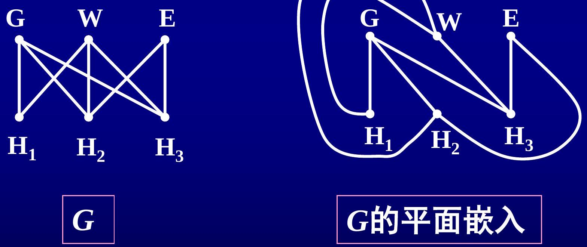

**注** 可平面图概念和平面图概念有时可以等同看待。

#### 二、平面图的性质

> **定义** 设 $G$ 是一个平面图，$G$ 将所嵌入的平面划分为若干个区域，每个区域的内部连同边界称为 $G$ 的面，无界的区域称为外部面或无限面。 $G$ 的面组成的集合用 $\Phi$ 表示。

> **注** 每个平面图有且仅有一个外部面。

**例：**

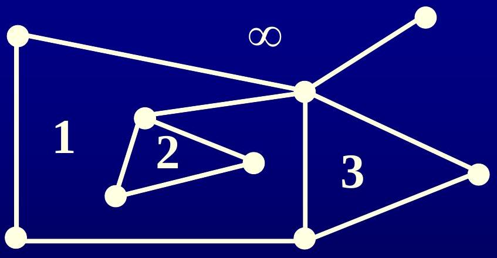

对于平面图来说，割边就是只属于一个面的边。

> **定义** 设 $f$ 是平面图 $G$ 的一个面，构成 $f$ 的边界的边数（割边计算 2 次）称为面 $f$ 的次数，记为 $\operatorname{deg} f$。
> **注：**面的次数数的是“沿着面边界走一圈，经过了多少次边”，而不是边界上有多少条不同的边。割边会被经过两次。

**例：**

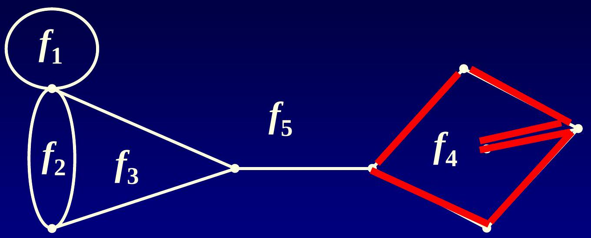

有5个面：$f_{1}, f_{2}, f_{3}, f_{4}, f_{5}$（外部面），各面的次数为：

$$
\begin{aligned}
& \operatorname{deg}\left(f_{1}\right)=1 \\
& \operatorname{deg}\left(f_{2}\right)=2 \\
& \operatorname{deg}\left(f_{3}\right)=3 \\
& \operatorname{deg}\left(f_{4}\right)=6 \\
& \operatorname{deg}\left(f_{5}\right)=10
\end{aligned}
$$

**例：**

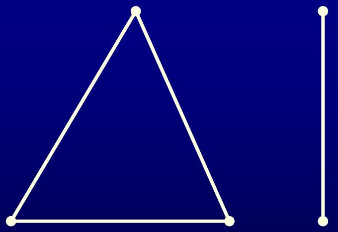

图不连通，其外部面的次数为5。

> **定理** 设 $G$ 是具有 $m$ 条边的**平面图**，则
> 
> $$
> \sum_{f \in \Phi} \operatorname{deg} f=2 m .
> $$

**证明** 对 $G$ 的任意一条边 $e$，如果 $e$ 是割边，那么由定义知，该边对面的总次数贡献2次。

如果 $e$ 不是割边，那么它必然是某两个面的公共边，它也对面的总次数贡献 2 次。

于是结论成立。

> **定理** （Euler公式）设 $G$ 是具有 $n$ 个点，$m$ 条边，$\varphi$ 个面的连通平面图，则有
> 
> $$
> n-m+\varphi=2 \text { 。 }
> $$

**证明** 对 $\varphi$ 用归纳法。

当 $\varphi=1$ 时，$G$ 无圈又连通，从而是树，有 $n=m+1$。

于是，$n-m+\varphi=(m+1)-m+1=2$。

设 $\varphi=k$ 时，结论成立。

当 $\varphi=k+1$ 时，此时 $G$ 至少两个面，从而有封闭的面 $f$。

删去 $f$ 与另一个面的一条公共边，记所得之图为 $G^{\prime}$。易知$G^{\prime}$ 为连通的平面图，但只有 $k$ 个面。

设 $G^{\prime}$ 的点数、边数和面数依次为 $n^{\prime}$，$m^{\prime}$ 和 $\varphi^{\prime}$。

由归纳假设知，$n^{\prime}-m^{\prime}+\varphi^{\prime}=2$。

同时，$n^{\prime}=n, m^{\prime}=m-1, \varphi^{\prime}=\varphi-1$。

由关系式 $n^{\prime}-m^{\prime}+\varphi^{\prime}=2$ 可得，$n-m+\varphi=2$。

> **推论** 设 $G$ 是具有 $n$ 个点，$m$ 条边，$\varphi$ 个面，$k$ 个连通分支的**平面图**，则
> 
> $$
> n-m+\varphi=k+1 .
> $$

**证明** 设 $G$ 的 $k$ 个连通分支分别为 $G_{1}, G_{2}, \ldots, G_{k}$，对每个 $G_{i}$ 用欧拉公式可得：

$$
n_{i}-m_{i}+\varphi_{i}=2, \quad(i=1,2, \ldots, k)
$$

其中 $n_{i}, m_{i}, \varphi_{i}$ 分别为 $G_{i}$ 的点数、边数和面数。

将 $k$ 个等式两边相加得

$$
\sum_{i=1}^{k} n_{i}-\sum_{i=1}^{k} m_{i}+\sum_{i=1}^{k} \varphi_{i}=2 k .
$$

而

$$
\sum_{i=1}^{k} n_{i}=n, \sum_{i=1}^{k} m_{i}=m, \sum_{i=1}^{k} \varphi_{i}=\varphi+(k-1)
$$

所以

$$
n-m+\varphi=k+1 .
$$

> **推论** 设 $G$ 是具有 $n$ 个点，$m$ 条边，$\varphi$ 个面的**连通平面图**，如果对 $G$ 的每个面 $f$，有 $\operatorname{deg}(f) \geq l \geq 3$，则
> 
> $$
> m \leq \frac{l}{l-2}(n-2) .
> $$

**证明** 一方面，

$$
2 m=\sum_{f \in \Phi} \operatorname{deg}(f) \geq l \varphi \Rightarrow \varphi \leq \frac{2 m}{l} .
$$

另一方面，由欧拉公式得：

$$
\varphi=2-n+m .
$$

所以 $2-n+m \leq \frac{2 m}{l}$。 整理得 $m \leq \frac{l}{l-2}(n-2)$。

**注** 该推论常被用来说明某个图不是可平面图。

> **例** 求证：$K_{3,3}$ 是非可平面图。

**证明** 注意到，$K_{3,3}$ 是偶图，不存在奇圈。所以，若 $K_{3,3}$ 是可平面图，则每个面的次数至少是 4，即 $l=4$。

所以

$$
\frac{l}{l-2}(n-2)=\frac{4}{2}(6-2)=8 .
$$

而 $m=9$，因此与

$$
m \leq \frac{l}{l-2}(n-2)
$$

矛盾！所以，$K_{3,3}$ 是非可平面图。

> **推论** 设 $G$ 是具有 $n$ 个点，$m$ 条边的**简单平面图**且 $n \geq 3$，则
> 
> $$
> m \leq 3 n-6 \text {. }
> $$

**证明** 情形1：$G$ 连通。

因为 $G$ 是简单图，所以每个面的次数至少为 3。于是，

$$
m \leq \frac{3}{3-2}(n-2)=3 n-6
$$

**情形2**：$G$ 不连通。

若 $G$ 存在至少有三个点的连通分支，则对 $G$ 的这些连通分支，结论成立。

将各不等式相加也得类似不等式，设为 $m_{1} \leq 3 n_{1}-6$。

再设 $G$ 的所有少于 3 个点的连通分支的总边数为 $m_{2}$，总点数为 $n_{2}$。

此时有 $m_{2} \leq n_{2} \leq 3 n_{2}$，于是

$$
m_{1}+m_{2} \leq 3\left(n_{1}+n_{2}\right)-6 .
$$

从而有，$m \leq 3 n-6$。

若 $G$ 没有多于两个点的连通分支，则 $m \leq n$。

当 $n \geq 3$ 时，显然 $n \leq 3 n-6$。

所以，$m \leq 3 n-6$。

> **例** 证明：$K_{5}$ 是非可平面图。

**证明** $K_{5}$ 是简单图，且 $m=10$，$n=5$。因此 $3 n-6=9$，与结论＂$m \leq 3 n-6$＂相矛盾！所以，$K_{5}$ 是非可平面图。

> **定理** 若 $G$ 是**简单平面图**，则 $\delta(G) \leq 5$。

**证明** 对点数 $n=1,2$ 的情况，直接验证可知结论成立。

设 $n \geq 3$，若 $\delta \geq 6$，则

$$
2 m=\sum_{v \in V(G)} d(v) \geq 6 n \Rightarrow m \geq 3 n
$$

这与＂$m \leq 3 n-6$＂矛盾。

**注** 这是五色定理证明的出发点。

> **定理** 设 $G$ 是一个连通的简单平面图，则 $G$ 是 2 连通图当且仅当 $G$ 的每个面的边界是圈。

**证明** 充分性。设平面图 $G$ 的每个面的边界均为圈。删去 $G$ 中任意一个点不破坏 $G$ 的连通性，表明 $G$ 是 2 连通的。

必要性。由于 $G$ 是 2 连通图，故 $G$ 是 2 边连通图，从而 $G$ 不含割边。所以，$G$ 的每个面的边界一定是一条闭迹。

设 $C$ 是 $G$ 的任意一个面的边界，我们证明，它一定为圈。若不然，设 $C$ 是 $G$ 的某个面的边界，但它不是圈。

因 $C$ 是一条闭迹且不是圈，所以 $C$ 中存在子圈 $W_{1}$。

因 $C$ 是某个面的边界，所以 $W_{1}$ 与 $C$ 的关系可以表示为如图的形式：

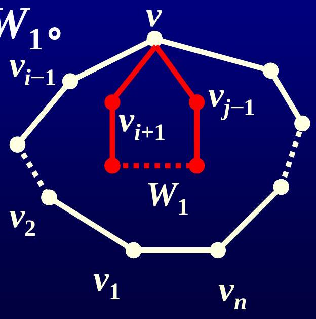

易知：$v$ 为 $G$ 的割点，与 $G$ 是 2 连通图矛盾！

#### 三、平面嵌入概念的推广

> **定义** 若图 $G$ 能画在曲面 $S$ 上使它的边仅在端点相交，则称图 $G$ 可嵌入曲面 $S$；图 $G$ 的这样一种画法（若存在的话）称为$G$ 的一个 $S$ 嵌入。

**例** 下图表示 $K_{5}$ 的环面嵌入与 $K_{3,3}$ 的莫比乌斯带嵌入。

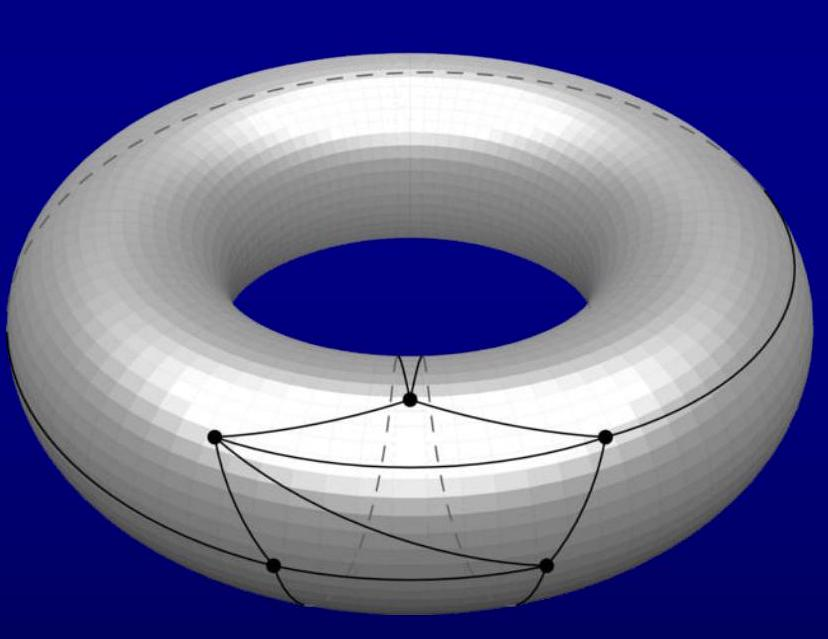

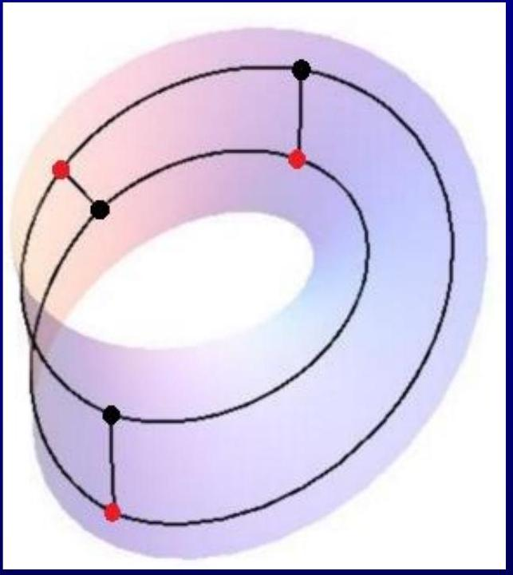

> **注** 对每个图，总存在可将其嵌入的曲面 $S$。另一方面，对每个曲面 $S$，总存在不可嵌入 $S$ 的图。

> **定理** 一个图可嵌入平面当且仅当它可嵌入球面。

**证明** 将球面 $S$ 放在一个平面 $P$ 上，设切点为 $O$，过 $O$ 点作垂直于 $P$ 的直线，此直线与 $S$ 的交点设为 $z$。

作球极平面射影

$$
f: S-\{z\} \rightarrow P,
$$

其中 $f(x)=y$ 当且仅当点 $z, x, y$ 共线。

通过球极平面射影可将嵌入球面的图映射为嵌入平面的图，反之亦然。

**注** 这是世界地图可印刷在纸上的原因。

**注** 通过球极射影可将平面图的内部面转换为外部面。

#### 四、凸多面体与平面图

如果将一个有 $n$ 个顶点，$m$ 条棱和 $\varphi$ 个面的凸多面体的顶点作为顶点，棱作为边，则这个多面体可视为一个图 $G$，很明显 $G$ 可嵌入球面，从而可嵌入平面而得到一个连通的平面图。因而凸多面体的顶点数，棱数与面数也满足

$$
n-m+\varphi=2 \text { 。 }
$$

这个公式也称为欧拉公式。

> **定理** （Platonic）存在且只存在 5 种正多面体：正四面体、正六面体、正八面体、正十二面体和正二十面体。

**证明** 任取一个正 $\varphi$ 面体 $A$，设 $A$ 有 $n$ 个顶点，$m$ 条棱。

将 $A$ 嵌入平面，记所得的平面图为 $G$。易知 $G$ 是一个每个面的次数均相同（设为 $l$）的 $r$ 度正则图。

从而有

$$
n r=2 m, \varphi l=2 m, l \geq 3, r \geq 3 .
$$

因此

$$
m=\frac{n r}{2}, \quad \varphi=\frac{2 m}{l}=\frac{n r}{l} .
$$

将上两式代入欧拉公式 $n-m+\varphi=2$ 得

$$
n-\frac{n r}{2}+\frac{n r}{l}=2 .
$$

整理得，$2 l n-l n r+2 n r=4 l$，即 $n(2 l-l r+2 r)=4 l$。

所以，$n=4 l(2 l-l r+2 r)^{-1}$。

因 $n$ 和 $l$ 均为正，所以 $2 l-l r+2 r>0$。因此 $2(l+r)>l r$。

这样我们得到不等式组

$$
\left\{\begin{array}{l}
2(l+r)>l r \\
l \geq 3 \\
r \geq 3
\end{array}\right.
$$

此不等式组的整数解恰为 5 组。根据这 5 组解可求得相应的$\varphi$ 值，其结果见下表。

<table>
<tr><th>序号</th><th>$\boldsymbol{r}$</th><th>$\boldsymbol{l}$</th><th>$\boldsymbol{n}$</th><th>$\boldsymbol{m}$</th><th>$\varphi$</th><th>相应的正多面体</th></tr>
<tr><td>1</td><td>3</td><td>3</td><td>4</td><td>6</td><td>4</td><td>正四面体</td></tr>
<tr><td>2</td><td>3</td><td>4</td><td>8</td><td>12</td><td>6</td><td>正六面体</td></tr>
<tr><td>3</td><td>3</td><td>5</td><td>20</td><td>30</td><td>12</td><td>正十二面体</td></tr>
<tr><td>4</td><td>4</td><td>3</td><td>6</td><td>12</td><td>8</td><td>正八面体</td></tr>
<tr><td>5</td><td>5</td><td>3</td><td>12</td><td>30</td><td>20</td><td>正二十面体</td></tr>
</table>

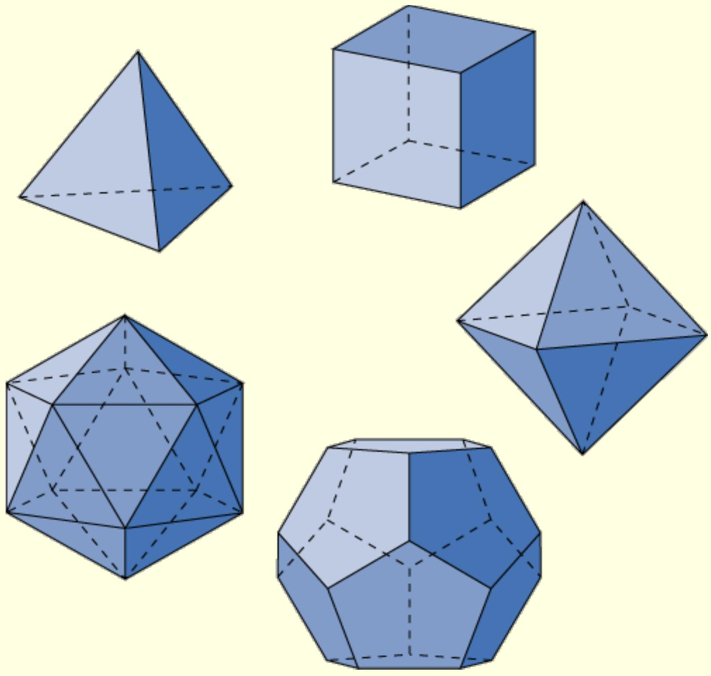

> **例** 证明：每个5连通的**简单可平面图**至少有12个顶点。

**证明** 设 $G$ 是一个满足条件的 5 连通图，则 $\delta \geq \kappa \geq 5$。

由握手定理知， $2 m=\sum d(v) \geq 5 n$。又因为 $G$ 是简单可平面图，故 $m \leq 3 n-6$。

因此， $2.5 n \leq m \leq 3 n-6$。从而，$n \geq 12$。

> **例** 若 $G$ 是一个连通平面图且满足 $\delta \geq 3$，则 $G$ 至少有一个面 $f$ 使得 $\operatorname{deg} f \leq 5$。

**证明** 若不然，则 $2 m=\sum \operatorname{deg} f \geq 6 \varphi$。

由欧拉公式得，$\varphi=2-n+m \leq \frac{m}{3}$。

因此， $2 m \leq 3 n-6$。又由 $\delta \geq 3$ 知： $2 m \geq 3 n>3 n-6$。矛盾！

### 6.2 平面图的判定

#### 一、对偶图

> **定义** 给定平面图 $G$，$G$ 的对偶图 $G^{*}$ 是如下构造的图：
> 
> （i）在 $G$ 的每个面 $f_{i}$ 内任取一点 $v_{i}^{*}$ 作为 $G^{*}$ 的顶点；
> 
> （ii）对 $G$ 的每条边 $e$，若 $e$ 是面 $f_{i}$ 与 $f_{j}$ 的公共边时，则连接 $v_{i}^{*}$ 与 $v_{j}^{*}$，得 $G^{*}$ 的边 $v_{i}^{*} v_{j}^{*}$，并使 $v_{i}^{*} v_{j}^{*}$ 与 $e$ 相交；若 $e$ 只在一个面 $f_{i}$ 上时，则以 $v_{i}^{*}$ 为顶点作环，得 $G^{*}$ 的边 $v_{i}^{*} v_{i}^{*}$，并使 $v_{i}^{*} v_{i}^{*}$ 与 $e$ 相交。

**例：**

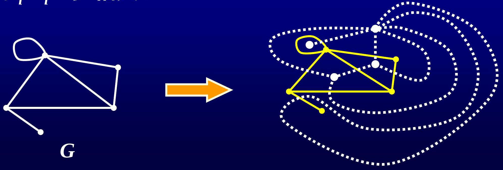

**例** 在下图中，平面图如（a）所示，其对偶图如（c）所示，其构造过程如（b）所示。

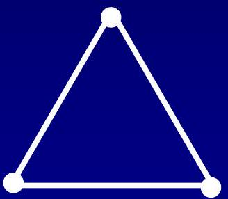

（a）

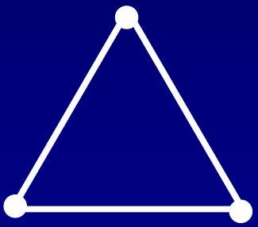

（a）

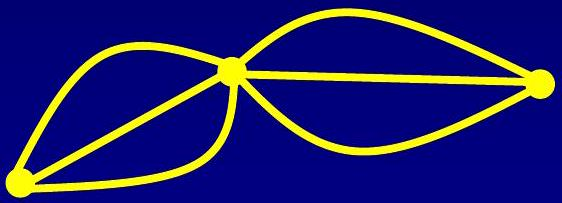

（c）

（b）

> **定理** 平面图 $G$ 的对偶图 $G^{*}$ 是**连通**的平面图，并且
> 
> 1. $G^{*}$ 的点数 $=G$ 的面数；
> 
> 2. $G^{*}$ 的边数 $=G$ 的边数；
> 
> 3. $G^{*}$ 的面数 $=G$ 的点数（$G$ 连通）；
> 
> 4. $d\left(v_{i}^{*}\right)=\operatorname{deg}\left(f_{i}\right)$。

**注** 无论 $G$ 是否连通，$G^{*}$ 总是连通的，因此 $\left(G^{*}\right)^{*}$ 不一定等于 $G$。

> **定理** 假定 $G$ 是**平面图**，则 $\left(G^{*}\right)^{*}=G$ 当且仅当 $G$ 是**连通图**。

**证明** 必要性。因为 $G^{*}$ 是平面图，所以 $\left(G^{*}\right)^{*}$ 是连通的，从而 $G$ 是连通图。

充分性。由定义知，平面图 $G$ 与其对偶图 $G^{*}$ 可嵌入在同一平面上。当 $G$ 连通时，$G^{*}$ 的每个面 $f^{*}$ 包含 $G$ 的唯一顶点 $v$。点 $u$ 和 $v$ 在 $G$ 中的邻接关系与 $u$ 和 $v$ 在 $G^{*}$ 中所在的面的邻接关系保持一致。因此，$\left(G^{*}\right)^{*}=G$。

**注** 同构的平面图可以有不同构的对偶图。

**例** 下图中的两个图是同构的，但它们的对偶图却不同构：$G_{2}$ 中有次数是 1 的面，而 $G_{1}$ 没有次数是 1 的面。

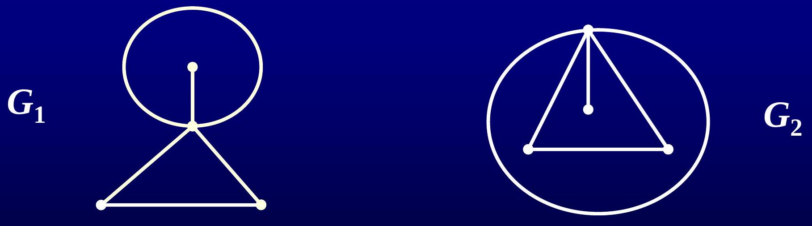

#### 二、平面图的判定

> **定义** 在图 $G$ 的边上插入一个新的2度顶点，使一条边分成两条边，则称将图 $G$ 在 2 度顶点内扩充；去掉图 $G$ 的一个2度顶点，使这个2度顶点关联的两条边合成一条边，则称将 $G$ 在 2 度顶点内收缩。

**例：**

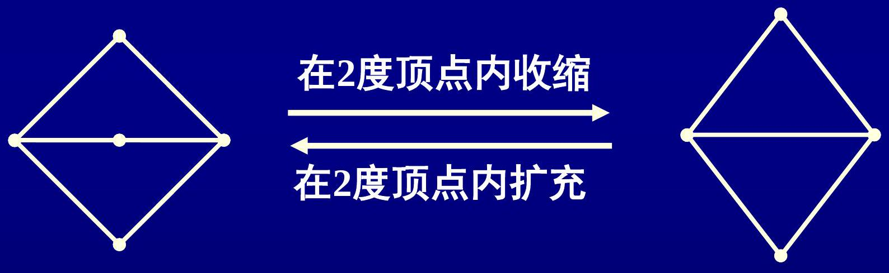

> **定义** 两个图 $G_{1}$ 和 $G_{2}$，如果 $G_{1} \cong G_{2}$，或者通过反复在 2 度顶点内扩充和收缩它们能变成同构的，则称 $G_{1}$ 和 $G_{2}$ 是**同胚**的或 $G_{1}$ 和 $G_{2}$ 在 2 度顶点内是**同构**的。

**例** 下面三个图是两两同胚的。

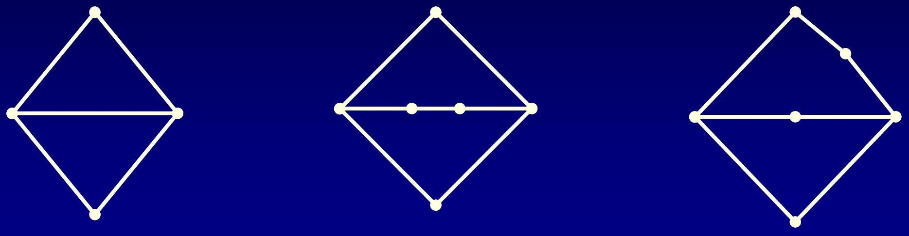

> **注** 图的可平面性在同胚意义下不变。

> **定理** （库拉托夫斯基定理）图 $G$ 是可平面图当且仅当 $G$ 不含与 $K_{5}$ 或 $K_{3,3}$ 同胚的子图。

**注** Kazimierz Kuratowski曾问著名图论专家Frank Harary有关 $K_{5}$ 和 $K_{3,3}$ 记号起源的问题。Harary说：＂$K_{5}$ 中的 $K$ 代表Kazimierz，$K_{3,3}$ 中的 $K$ 代表 Kuratowski＂。

**例** 证明下图给出的两个图 $G_{1}$ 和 $G_{2}$ 为非可平面图。

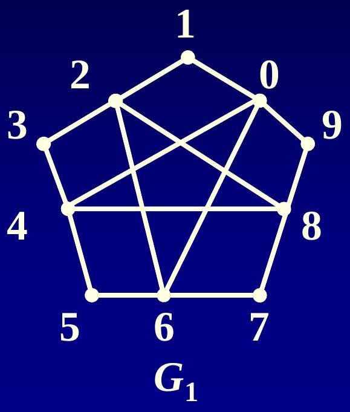

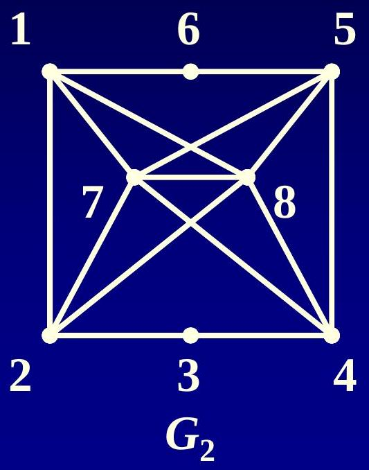

**证明** 对 $G_{1}$，在 2 度顶点内收缩点 1，3，5，7，9 得 $K_{5}$，即 $G_{1}$ 本身同胚于 $K_{5}$，所以 $G_{1}$ 是非可平面图。

取 $G_{2}$ 的一个子图：

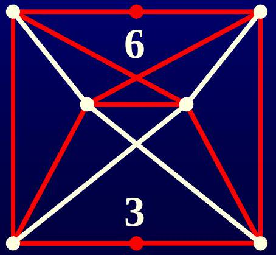

收缩点 6，3，得 $K_{3,3}$。所以 $G_{2}$ 是非可平面图。

**例** 判断右图是否为可平面图。

**解** 取红色的边导出的子图得到该图的一个子图：

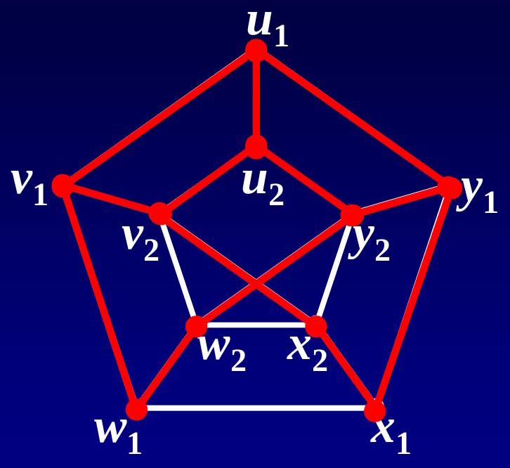

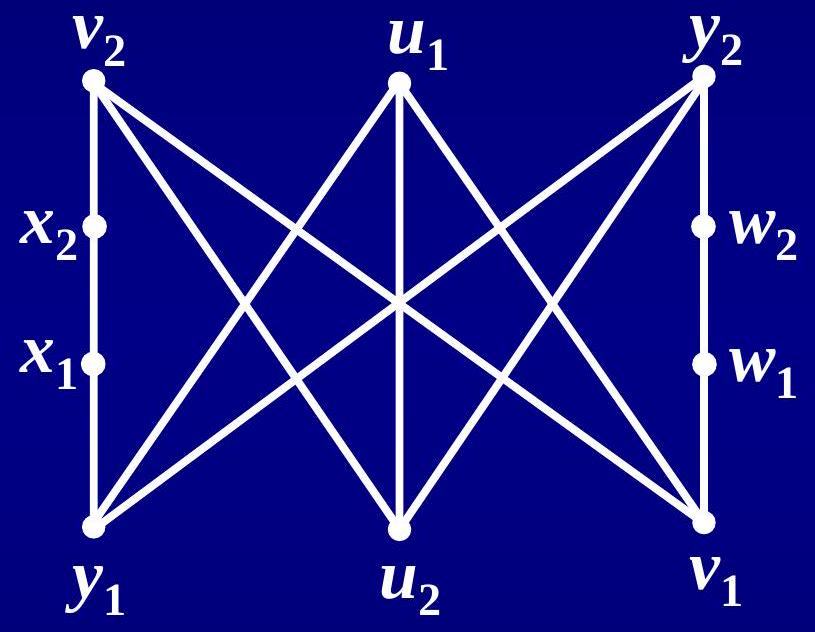

上图显然和 $K_{3,3}$ 同胚。因此，原图不是可平面图。

> **思考** 若图 $G$ 与 $K_{5}$ 同胚，则从 $G$ 中最少删去多少条边才可能使其成为可平面图？1条

> **定义** 图 $G$ 的初等收缩子图是对 $G$ 进行一系列的删点、删边或者边收缩运算得到的图。

**例** 图 $H$ 是图 $G$ 的初等收缩子图。

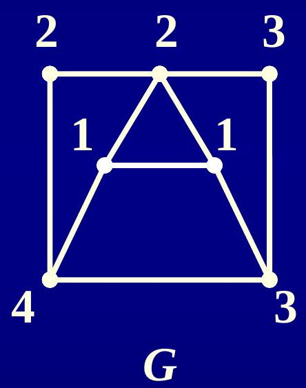

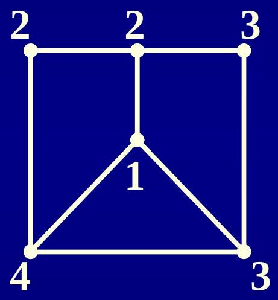

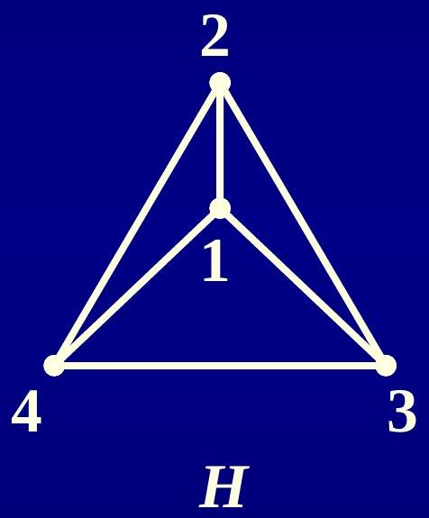

> **定理** （瓦格纳定理）简单图 $G$ 是可平面图当且仅当 $G$ 不含与 $K_{5}$ 或 $K_{3,3}$ 同构的初等收缩子图。

**注** 库拉托夫斯基定理与瓦格纳定理是等价的。

**例** 彼得森图通过收缩图中＂红边＂而得到图 $K_{5}$，故彼得森图是非可平面图。

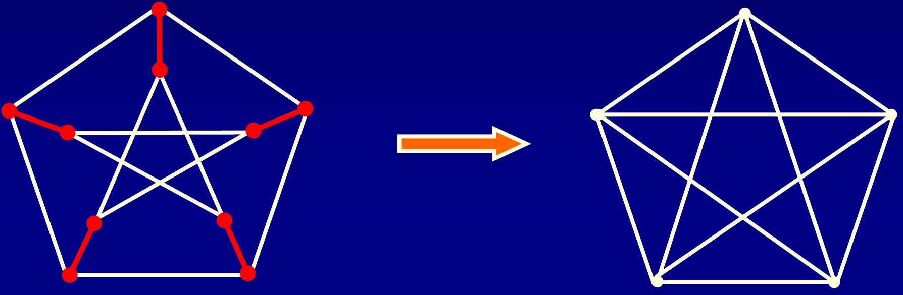

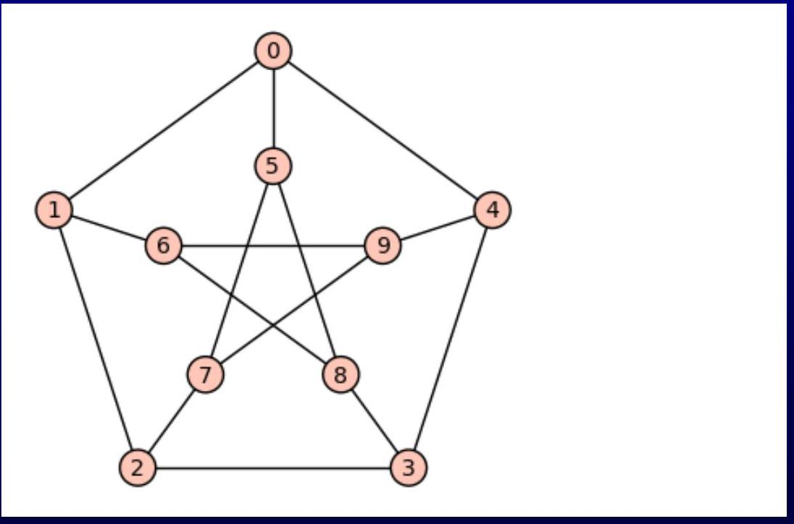

**例** 设 $G$ 是一个 $n(n \geq 11)$ 阶简单可平面图，则 $G$ 的补图一定不是可平面图。

**解** 因为 $G$ 是可平面图，所以 $m(G) \leq 3 n-6$。

由补图的定义知，

$$
m(\bar{G})=m\left(K_{n}\right)-m(G) \geq \frac{n(n-1)}{2}-(3 n-6) .
$$

因此，

$$
m(\bar{G})-(3 n-6) \geq \frac{n(n-1)}{2}-2(3 n-6)=\frac{1}{2}\left(n^{2}-13 n+24\right) .
$$

令 $f(n)=n^{2}-13 n+24$，显然，当 $n \geq 11$ 时，$f(n)>0$。

因此，当 $n \geq 11$ 时，$m(\bar{G})>(3 n-6)$。所以，$G$ 的补图不是可平面图。

> **例** 若平面图 $G$ 是自对偶的（即 $\left.G \cong G^{*}\right)$，则 $m=2 n-2$。

> **证明** 假设 $G^{*}$ 的阶数为 $n^{*}$，则 $n^{*}=\varphi$。

又因为 $G \cong G^{*}$，所以 $n^{*}=n$，从而 $\varphi=n$。

易知，自对偶图一定是连通图。因此，对于图 $G$，欧拉公式成立。

故，$n-m+\varphi=n-m+n=2$。因此，$m=2 n-2$。

> **例** 证明：不存在有 5 个面，且任意两个面之间至少有一条公共边的平面图。

**证明** 假设 $G$ 是满足条件的图，则 $G^{*}$ 恰有 5 个点且 $G^{*}$ 中任意两点之间均有边存在，故 $K_{5} \subseteq G^{*}$。

因此，$G^{*}$ 不是平面图，矛盾。

> **例** 设 $n \geq 3, S=\left\{x_{1}, x_{2}, \ldots, x_{n}\right\}$ 是平面上的一个任意两点间的距离至少为 1 的点集。证明：$S$ 中最多有 $3 n-6$ 个点对，它们之间的距离恰好为1。

**证明** 以 $S$ 为顶点集构造一个简单图 $G$，$x_{i}$ 与 $x_{j}$ 连一条线段当且仅当 $x_{i}$ 与 $x_{j}$ 的距离为1。

下证：$G$ 是每条边均为直线的简单平面图。

假设在 $G$ 中存在 $A B, C D$ 两条边相交于点 $O$，如图所示。

不妨假设 $|O A| \leq 1 / 2,|O C| \leq 1 / 2, O A$ 与 $O C$ 的夹角为 $\theta$。由余弦定理知，

$$
|A C|=\sqrt{|O A|^{2}+|O C|^{2}-2|O A| \cdot|O C| \cos \theta} \leq 1 .
$$

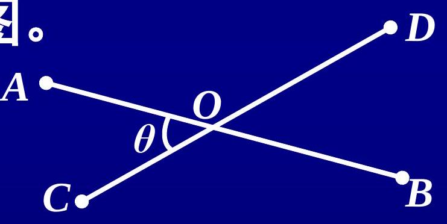

当 $\theta=\pi$ 时，$|O A|=1 / 2$ 与 $|O C|=1 / 2$ 不能够同时成立，否则，$A$ 与 $D$，$B$ 与 $C$ 重合，这与＂$A B, C D$ 是两条不同的边＂矛盾。

因此，$|A C|<1$。

这与＂$S$ 中任意两点的距离至少为 1 ＂矛盾。

故 $G$ 是简单平面图，所以，$m \leq 3 n-6$。

按 $G$ 的边的定义方式知，结论成立。

### 6.3 平面性算法

关于图的平面性问题，我们建立了一些可平面性判定方法：

> 
> 
> 1. 对于连通图 $G=(n, m)$，假设 $G$ 为可平面图，如果每个面次数至少为 $l \geq 3$ 且 $m>l(n-2) /(l-2)$，则 $G$ 是非可平面的；
> 
> 2. 对于简单图 $G=(n, m)$，如果 $m>3 n-6$，则 $G$ 是非可平面的；
> 
> 3. 库拉托夫斯基定理：$G$ 是可平面图当且仅当 $G$ 不含与 $K_{5}$ 或 $K_{3,3}$ 同胚的子图；
> 
> 4. 瓦格纳定理：$G$ 是可平面图当且仅当 $G$ 不含与 $K_{5}$ 或 $K_{3,3}$ 同构的初等收缩子图。

#### 一、相关概念

> **定义** 设 $H$ 是图 $G$ 的一个子图，在 $E(G) \backslash E(H)$ 上定义关系＂$\sim$＂如下：$e_{1} \sim e_{2}$ 当且仅当存在一条途径 $W$，使得
> 
> （i）$W$ 的第一条边与最后一条边分别是 $e_{1}$ 与 $e_{2}$，并且（ii）$W$ 的内部顶点与 $H$ 不相交。

易证关系～具有自反性，对称性和传递性，从而是 $E(G) \backslash E(H)$ 上的一个等价关系。

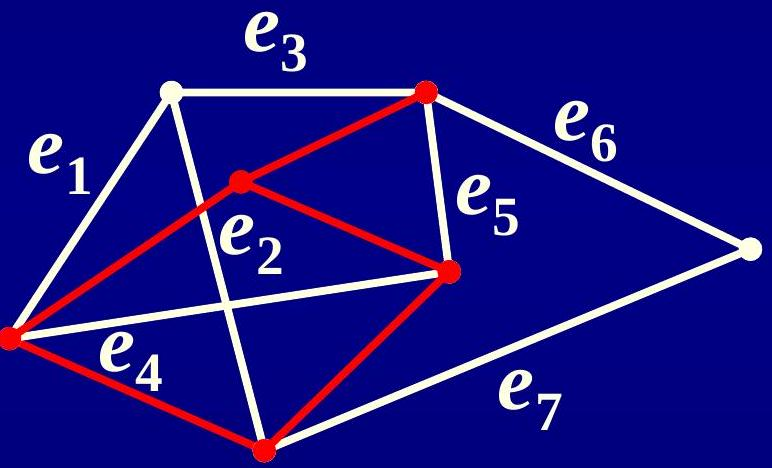

此等价关系的等价类导出的 $G-E(H)$ 的子图称为 $H$**－片段**。片段与 $H$ 的公共顶点称为**附着顶点**。

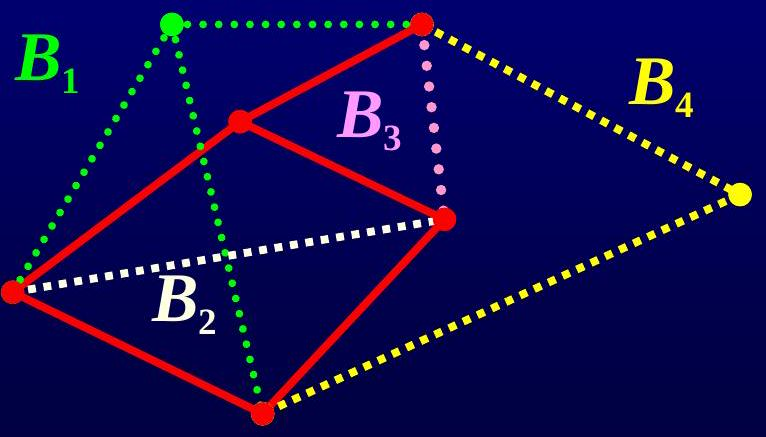

由片段的定义可直接推出：

> 
> 
> 1. 若 $B$ 是 $H$－片段，则 $B$ 是连通图；
> 
> 2. 片段 $B$ 的任何两个点都有和 $H$ 的内部不相交的路相连接；
> 
> 3. 不计 $H$ 的顶点，任意两 $H$－片段没有公共顶点。

**例** 在下图中取其子图，如实线所示。其余不同种类的线段表示该子图的四个不同的片段：$B_{1}, B_{2}, B_{3}, B_{4}$。

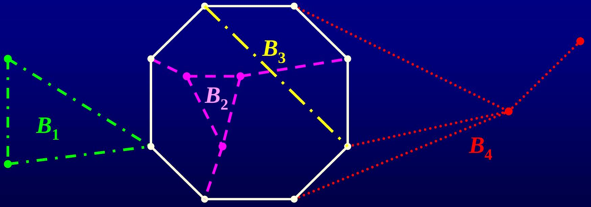

> **定义** 设 $H$ 是图 $G$ 的一个**可平面子图**，$H^{\prime}$ 是 $H$ 的一个**平面嵌入**。假定 $B$ 是子图 $H$ 的任一片段，若 $B$ 对 $H$ 的所有附着顶点都位于 $H^{\prime}$ 中某个面 $f$ 的边界上，则称 $B$ 在 $H^{\prime}$ 的面 $f$ 中是可画入的，否则，称为不可画入的。令
> 
> $$
> F\left(B, H^{\prime}\right)=\left\{f \mid f \text { 是 } H^{\prime} \text { 的面且 } B \text { 在 } f \text { 中可画入 }\right\} \text { 。 }
> $$

**例** 假定 $H^{\prime}$ 如实线所示，则片段 $B_{3}$ 在外部面上是可画入的，而 $B_{2}$ 对面 $f_{2}$ 和 $f_{3}$ 均为不可画入的，且 $F\left(B_{1}, H^{\prime}\right)=\left\{f_{1}, f_{3}\right\}$。

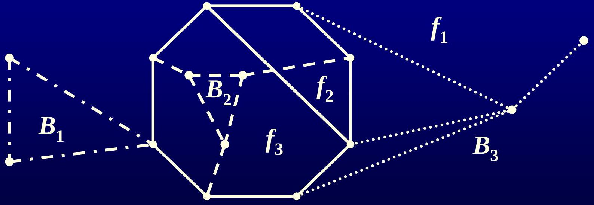

> **定义** 设 $C$ 是图 $G$ 的一个圈，图 $G$ 的两个 $C$－片段 $B_{1}$ 和 $B_{2}$ 是冲突的，如果
> 
> 1. $B_{1}$ 和 $B_{2}$ 在 $C$ 上有三个公共的附着顶点；或
> 
> 2. 在 $C$ 上存在四个顺序排列的顶点 $v_{1}, v_{2}, v_{3}, v_{4}$ 使得 $v_{1}, v_{3}$ 是$B_{1}$ 的附着顶点并且 $v_{2}, v_{4}$ 是 $B_{2}$ 的附着顶点。

**例：**

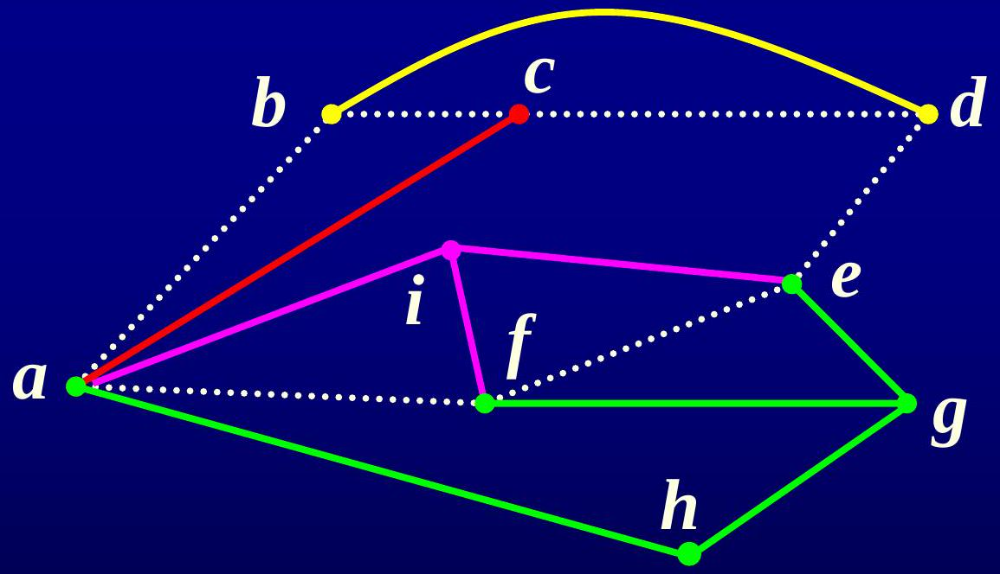

**注** 冲突的两个片段无法同时平面嵌入到同一个面中。

> **定义** 设 $C$ 是图 $G$ 的一个圈，以图 $G$ 的 $C$－片段为顶点，顶点间连一条边当且仅当对应的 $C$－片段是冲突的，把这样得到的图称为 $C$ 的冲突图。

**例** 画出 $K_{5}$ 的哈密尔顿圈的冲突图。

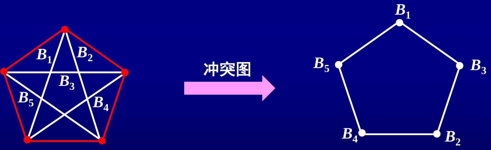

**练习** 画出 $K_{3,3}$ 的哈密尔顿圈的冲突图。

> **定理** 图 $G$ 是可平面的当且仅当对 $G$ 的每个圈 $C$，其冲突图是二部图。

**证明** 必要性。由于 $G$ 是可平面图，$G$ 的平面嵌入的任意一个圈 $C$ 都把平面划分为两个区域，即圈 $C$ 的内部和外部。同时嵌入在圈 $C$ 内部或外部的 $C$－片段必不冲突，形成冲突图的顶点集的二部划分。

充分性。设 $C$ 是 $G$ 的任意一个圈，令 $X$ 和 $Y$ 为 $C$ 的冲突图的顶点集合的二部划分。因 $X$ 中的点对应的任意两个片段都不冲突，故可将它们在圈 $C$ 的内部画出。

同理，可将 $Y$ 中的点对应的 $C$－片段画入 $C$ 的外部。

#### 二、平面性算法

> 设 $G$ 是至少有三个顶点的简单块（简单图 + 连通 + 无割点）。
> 
> 取 $G$ 的任意一个圈 $H_{1}$，求出 $H_{1}$ 的一个平面嵌入。
> 
> 假设 $H_{i}$ 已确定，下面确定 $H_{i+1}$。
> 
> 1. 若 $E(G) \backslash E\left(H_{i}\right)=\Phi$，则停（返回 $G$ 可平面）；否则，确定 $H_{i}$ 的所有片段；
> 
> 2. 对每个片段 $B$，求集合 $F\left(B, H_{i}\right)$；
> 
> 3. 若存在片段 $B$，使 $F\left(B, H_{i}\right)=\Phi$，则停（返回 $G$ 不可平面）；否则在 $H_{i}$ 的所有片段中确定一个使 $\left|F\left(B, H_{i}\right)\right|$ 最小的片段 $B$，并取 $f \in F\left(B, H_{i}\right)$；
> 
> 4. 在片段 $B$ 上取一条连接 $H_{i}$ 上两个附着顶点的路 $P_{i}$，把 $P_{i}$ 画在 $H_{i}$ 的面 $f$ 内，置 $H_{i+1}=H_{i} \cup P_{i}$；
> 
> 5. 令 $i=i+1$，转第 1 步。

**例** 用平面性算法判断下图 $G$ 的平面性。

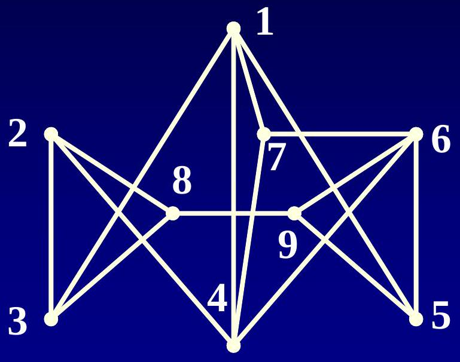

**解** （1）取圈 $H_{1}=2315642$，其平面嵌入如下。求出 $H_{1}$ 的所有片段，分别用边集表示。

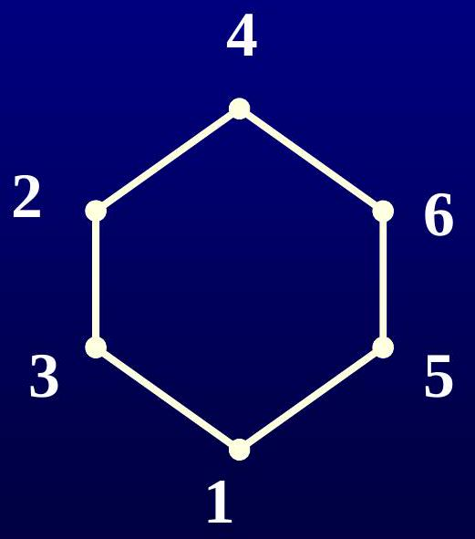

$H_{1}$

$H_{1}$ 的片段为：

$$
\begin{aligned}
& B_{1}=\{14\} \\
& B_{2}=\{17,47,76\} \\
& B_{3}=\{28,38,89,96,95\}
\end{aligned}
$$

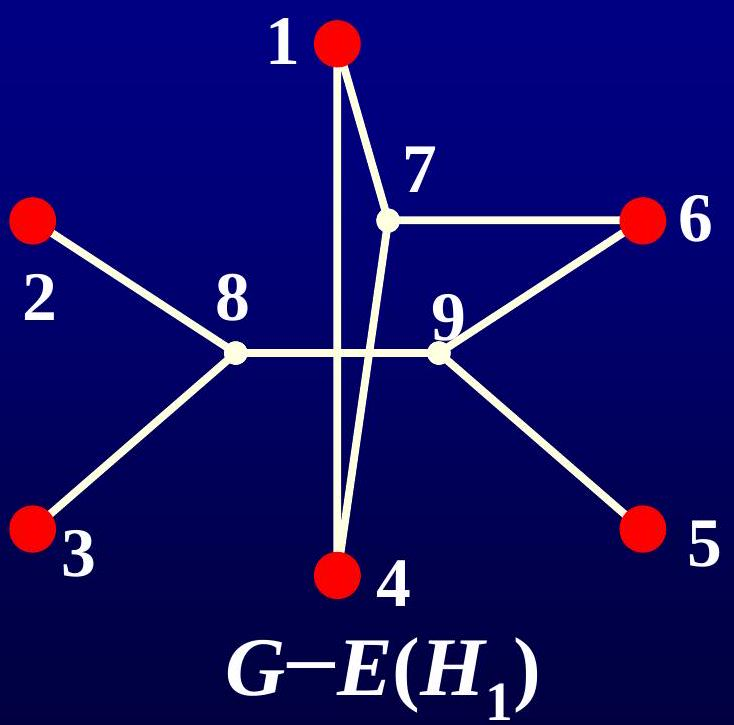

（2）对每个 $B_{i}$，$F\left(B_{i}, H_{1}\right)$ 均含有两个 $B_{i}$ 可画入的面，即圈 $H_{1}$ 的内部面和外部面。

（3）取 $B_{1}$ 及 $H_{1}$ 的内部面作为 $f$。$B_{1}$ 中连接 $H_{1}$ 上两个附着顶点的路 $P_{1}$ 仅一条，即 $P_{1}=41$。将 $P_{1}$ 画入 $f$ 内得 $H_{2}$，如图：

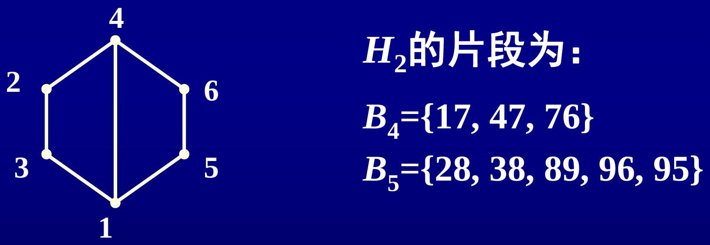

（4）对每个 $B_{i}$，$F\left(B_{i}, H_{2}\right) \neq \Phi$，其中 $F\left(B_{5}, H_{2}\right)$ 最小，只含一个面，即 $H_{2}$ 的外部面。

（5）取 $B_{5}$ 及 $H_{2}$ 的外部面作为 $f$，再取 $B_{5}$ 中的路 $P_{2}=2896$。将 $P_{2}$ 画入 $f$ 内得 $H_{3}$，如下图：

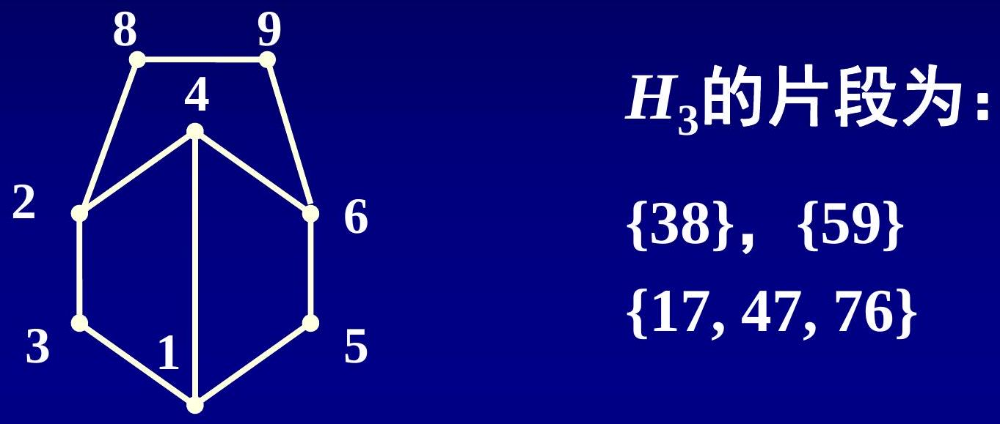

$H_{3}$ 的片段为：{38}，{59}；{17, 47, 76}。

（6）以下的过程依次由图所示，其后步骤的每一片段的可画入面均只有一个，可任取。

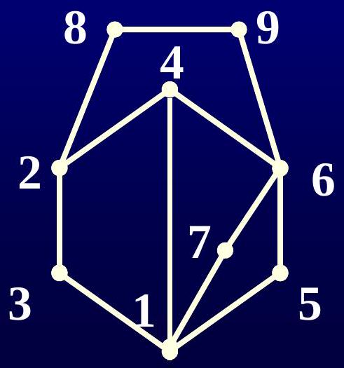

片段：{47}，{38}，{59}

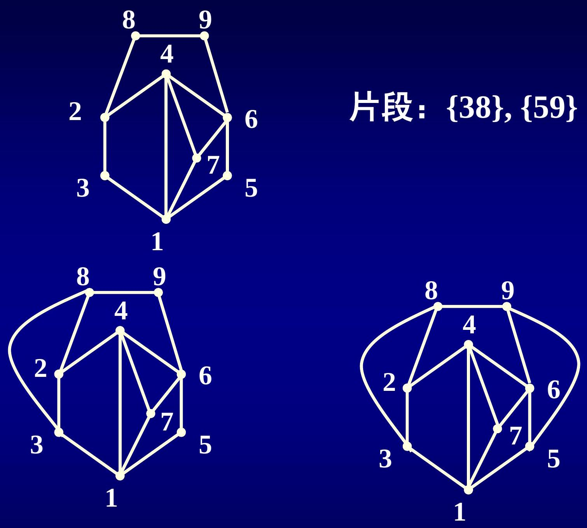

片段：{38}，{59}（该步骤示意图在导入时缺失，可对照 PDF 第 346 页）。

片段：{59}

因算法终止于 $G$ 的一个平面嵌入，所以 $G$ 是可平面图。

#### 三、哈密尔顿图的平面性算法

基本思想：若图 $G$ 既是哈密尔顿图又是可平面图，则在图 $G$ 的平面嵌入中，不属于哈密尔顿圈 $C$ 的边要么落在圈 $C$ 的内部，要么落在圈 $C$ 的外部。

**算法描述**

> 
> 
> 1. 找出图 $G$ 的一个哈密尔顿圈 $C$；
> 
> 2. 列出不属于圈 $C$ 的所有边：$e_{1}, e_{2}, \ldots, e_{r}$；
> 
> 3. 构造图 $H$，其顶点集为 $\left\{e_{1}, e_{2}, \ldots, e_{r}\right\}$，$e_{i}$ 与 $e_{j}$ 之间连一条边当且仅当 $e_{i}$ 与 $e_{j}$ 不能够同时平面嵌入到哈密尔顿圈 $C$ 的内部或者外部（冲突的片段）；
> 
> 4. 图 $G$ 是可平面图当且仅当图 $H$ 是二部图。

**例** 判断图 $G$ 是否为可平面图？

**解** 显然，圈 $abcdefa$ 是图 $G$ 的一个哈密尔顿圈 $C$。

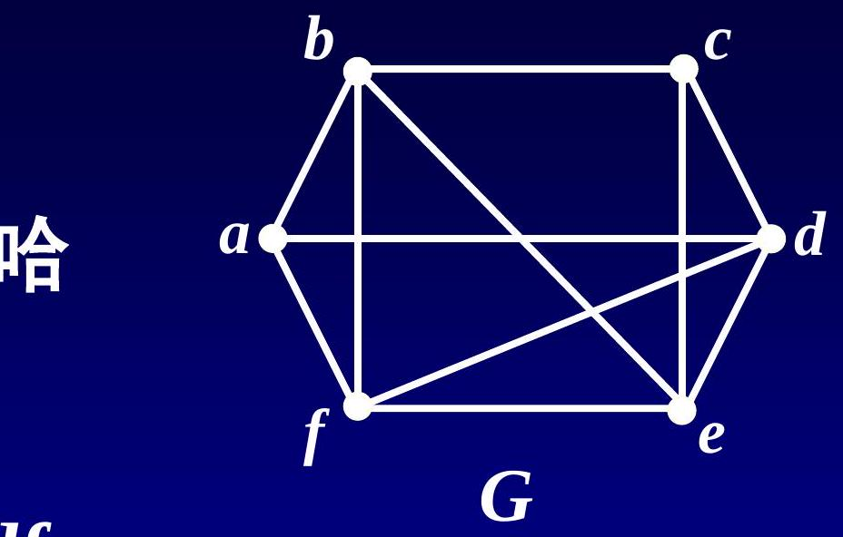

不属于圈 $C$ 的边为：$a d, b f, b e, c e, d f$。边 $a d$ 与 $b f, b e, c e$ 冲突；边 $b f$ 只与 $a d$ 冲突；边 $b e$ 还与 $d f$ 冲突；边 $c e$ 还与 $d f$ 冲突。

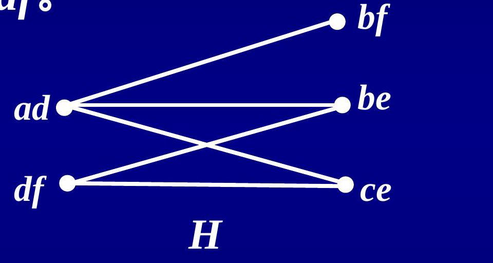

因 $H$ 是二部图，故 $G$ 是平面图。其平面嵌入如右图所示。

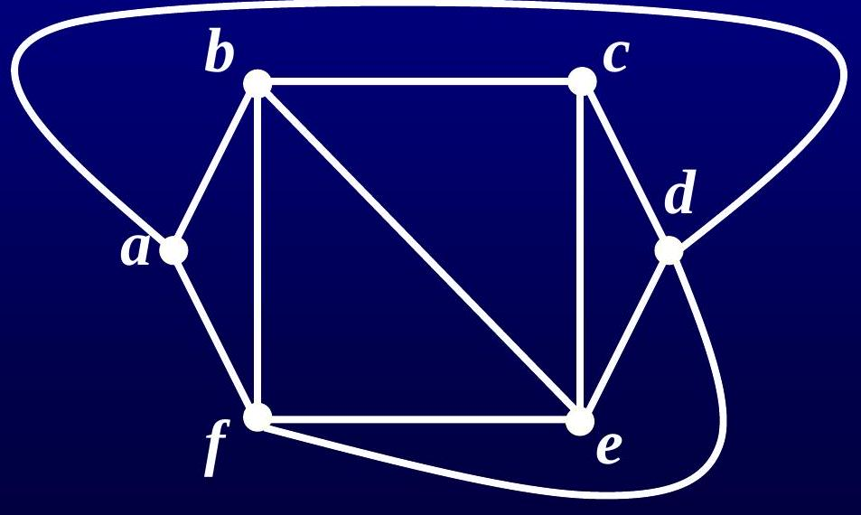

**例** 判断图 $G$ 是否为可平面图？

**解** 显然，圈 $abfegcda$ 是图 $G$ 的一个哈密尔顿圈 $C$。

不属于圈 $C$ 的边为：$a e, a f, b c, b g, c f, d f$。边 $a e$ 与 $b c, b g, c f, d f$ 冲突；边 $a f$ 与 $b c, b g$ 冲突；边 $b c$ 还与 $d f$ 冲突；边 $b g$ 还与 $c f, d f$ 冲突；途径 $a e \rightarrow b c \rightarrow d f \rightarrow a e$ 构成图 $H$ 的奇圈。因图 $H$ 不是二部图，故图 $G$ 不是可平面图。

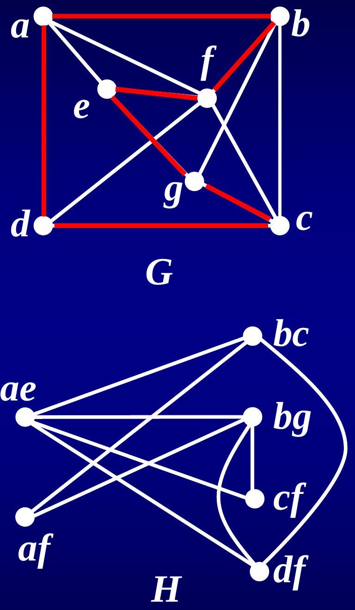

因图 $G$ 是非可平面图，由库拉托夫斯基定理知：$G$ 包含与$K_{5}$ 或 $K_{3,3}$ 同胚的子图。

考虑图中红色的边导出的子图 $K$。在子图 $K$ 中，收缩 2 度顶点 $g$，则 $K$ 同胚于

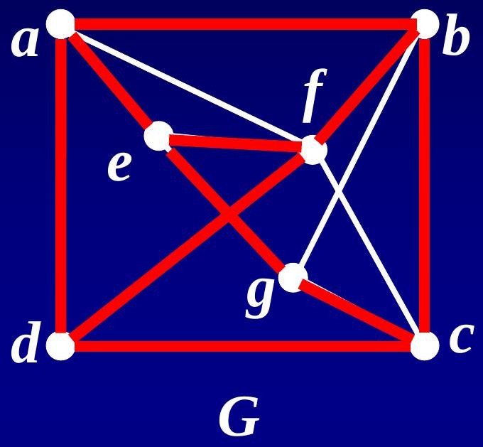

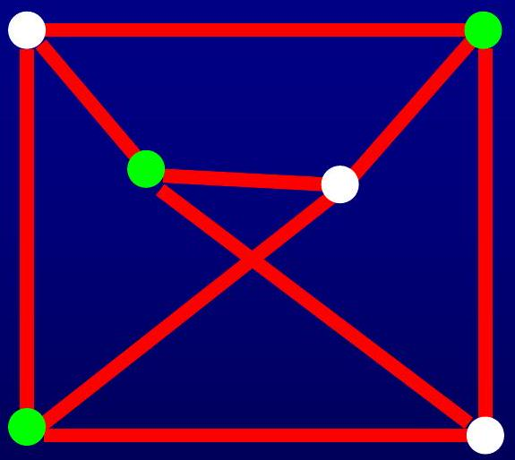

上图显然为 $K_{3,3}$，即 $K$ 与 $K_{3,3}$ 同胚。

#### 四、平面图的应用

**定义** 富勒烯图（Fullerene）是所有面为五边形或者六边形的3－正则连通平面图。

富勒烯图产生于化学中只包含碳原子的分子。

最典型的结构是足球烯 $C_{60}$，它是碳的第三种同素异形体。

**例** 一些特殊的富勒烯图。

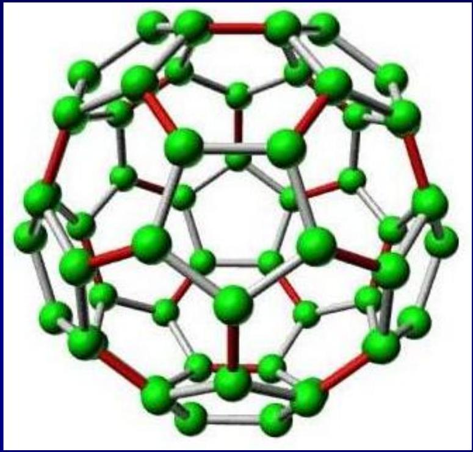

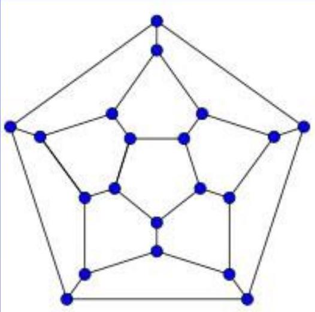

20－fullerene dodecahedron graph

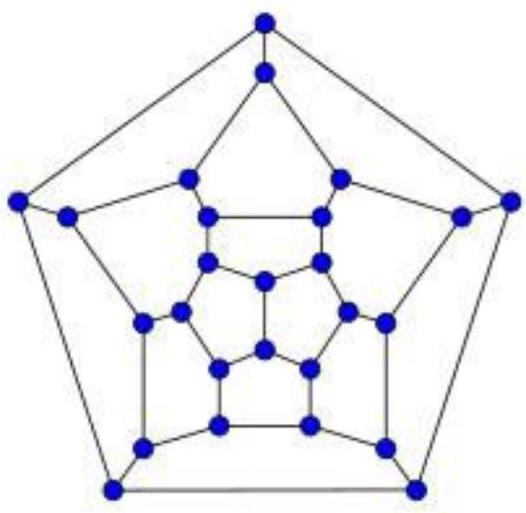

26－fullerene

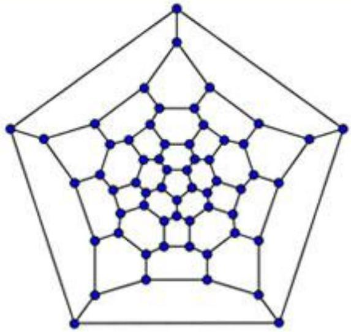

60－fullerene

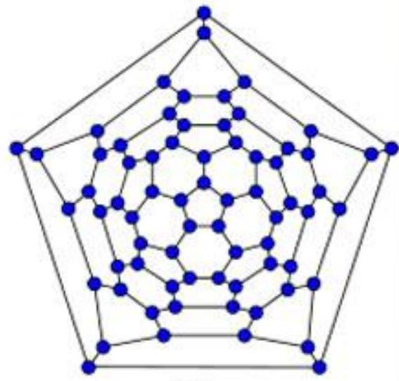

70－fullerene

**例** 证明：富勒烯图恰好包含 12 个五边形面。

**证明** 设 $G$ 是一个包含 $n$ 个点、 $m$ 条边的富勒烯图，其五边形面和六边形面的个数分别为 $f_{5}$ 和 $f_{6}$。

由面的次数公式知： $2 m=5 f_{5}+6 f_{6}$。

因为 $G$ 是 3 正则图，由握手定理知： $3 n=2 m$。

因为 $G$ 是连通的平面图，故满足欧拉公式。

所以，我们有

$$
\frac{5 f_{5}+6 f_{6}}{3}-\frac{5 f_{5}+6 f_{6}}{2}+\left(f_{5}+f_{6}\right)=2 .
$$

解之得：$f_{5}=12$。
