# 第七章 图的着色

> 专栏：图论 · Notion 最后编辑：2026-11-11T08:22:00.000Z
>
> 来源：https://www.notion.so/4059d738588381e388d6f6b4b34ebbfc

> **本章内容**：图的边着色 · 图的点着色 · 色多项式

### 7.1 图的边着色

现实生活中很多问题，可以模型为所谓的边着色问题来处理，例如排课表问题。

排课表问题：设有 $m$ 位教师，$n$ 个班级，其中教师 $x_{i}$ 要给班级 $y_{j}$ 上 $p_{i j}$ 节课。求如何在最少节次排完所有课。

图论模型：令 $X=\left\{x_{1}, x_{2}, \ldots, x_{m}\right\}, \quad Y=\left\{y_{1}, y_{2}, \ldots, y_{n}\right\}, x_{i}$ 与 $y_{j}$ 间连 $p_{i j}$ 条边，得偶图 $G=(X, Y)$。于是，问题转化为如何将 $G$ 的边集 $E$ 划分为 $p$ 个边不重的匹配，且使得 $p$ 最小。

如果每个匹配中的边用同一种颜色着色，不同匹配中的边用不同颜色着色，则问题转化为在 $G$ 中给每条边着色，相邻边着不同色，最少需要的颜色数。

#### 一、相关概念

> **定义** 设 $G$ 是图，对 $G$ 的边进行着色，若相邻边着不同颜色，则称对 $G$ 进行正常边着色；如果能用 $k$ 种颜色对图 $G$进行正常边着色，称 $G$ 是 $k$ 边可着色的。
> 
> **定义** 设 $G$ 是图，对 $G$ 进行正常边着色需要的最少颜色数称为 $G$ 的边色数，记为：$\chi^{\prime}(G)$。

**例** 一个正常边着色：

$$
\chi^{\prime}=3
$$

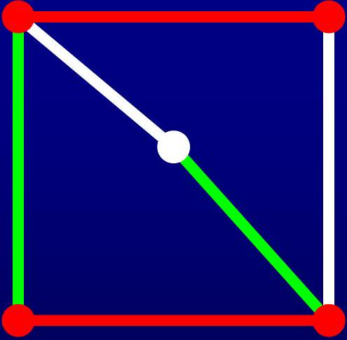

**定义** 在对G正常边着色时，着相同颜色的边集称为该正常边着色的一个色组。

#### 二、偶图的边色数

在任何正常边着色中，与任一顶点关联的各边必须着不同色，由此推知：对无环图

> 
> 
> $$
> \chi^{\prime} \geq \Delta .
> $$

> **例** 给出 $K_{m, n}$ 的一个正常 $\Delta$ 边着色，由此证明
> 
> $$
> \chi^{\prime}\left(K_{m, n}\right)=\Delta \text { 。 }
> $$

**证明** 设 $K_{m, n}$ 的顶点集的二部划分为

$$
X=\left\{x_{0}, x_{1}, \ldots, x_{m-1}\right\} \text { 和 } Y=\left\{y_{0}, y_{1}, \ldots, y_{n-1}\right\} 。
$$

假定 $m \leq n$，此时 $\Delta=n$。

设颜色集合为 $\{0,1,2, \ldots, n-1\}$。

假定 $\pi$ 是 $K_{m, n}$ 的一种 $n$ 着色方案，满足：

$$
\forall x_{i} y_{j} \in E\left(K_{m, n}\right), \pi\left(x_{i} y_{j}\right) \equiv(i+j)(\bmod n) .
$$

对 $K_{m, n}$ 中任意的两条邻接边 $x_{i} y_{j}$ 和 $x_{i} y_{k}$，若

$$
\pi\left(x_{i} y_{j}\right)=\pi\left(x_{i} y_{k}\right)
$$

则：$i+j \equiv i+k(\bmod n)$，得到 $j=k$，矛盾！

同理，任意两条邻接边 $x_{i} y_{k}$ 和 $x_{j} y_{k}$ 着色必不同。

所以，上面着色是正常着色。

因此，$\chi^{\prime}\left(K_{m, n}\right) \leq \Delta$。

又因为 $\chi^{\prime}\left(K_{m, n}\right) \geq \Delta$，所以 $\chi^{\prime}\left(K_{m, n}\right)=\Delta$。

**例** 用最少的颜色对 $K_{3,4}$ 正常边着色。

**解：**

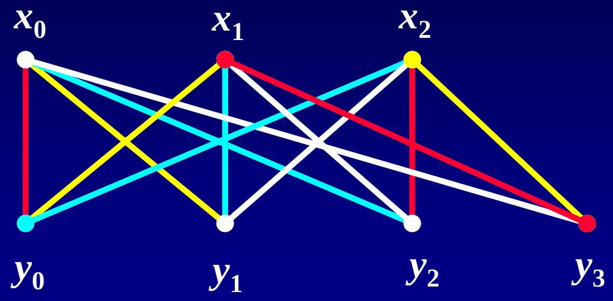

> **定义** 设 $\pi$ 是 $G$ 的一种正常边着色，若点 $u$ 关联的边的着色没有用到色 $i$，则称点 $u$ 缺 $i$ 色。

> **定理** （König）若 $G$ 是**偶图**，则 $\chi^{\prime}=\Delta$。

**证明** 对边数 $m$ 用归纳法。

当 $m=1$ 时，$\Delta=1$，有 $\chi^{\prime}=1=\Delta$。

设 $G$ 是至少有两条边的偶图。

取 $u v \in E(G)$，令 $G^{\prime}=G-u v$。

由归纳假设知，$\chi^{\prime}\left(G^{\prime}\right)=\Delta\left(G^{\prime}\right)$。

因 $\Delta\left(G^{\prime}\right) \leq \Delta(G)$，故 $G^{\prime}$ 存在一个 $\Delta(G)$ 边着色 $\pi$。

在 $G^{\prime}$ 中，$u$ 和 $v$ 的度数一定小于 $\Delta(G)$，故 $u$ 和 $v$ 均至少缺少一种色。

设 $u$ 缺 $i$ 色。

若 $v$ 也缺 $i$ 色，则可给 $u v$ 着 $i$ 色，从而得到 $G$ 的一个正常的 $\Delta(G)$边着色。

设 $v$ 不缺 $i$ 色，而缺 $j$ 色 $(j \neq i)$。此时，可假设 $u$ 不缺 $j$ 色。

令 $H(i, j)$ 是由着 $i$ 色的边和着 $j$ 色的边导出的子图。

因 $H(i, j)$ 的点在 $H(i, j)$ 中最多关联两条边，故 $H(i, j)$ 的分支是路或圈。

因 $u$ 缺 $i$ 色而不缺 $j$ 色，故在 $H(i, j)$ 中 $u$ 的度为1。这表明 $H(i, j)$ 的含 $u$ 的分支是以 $u$ 为起点的路 $P$。

接下来我们证明点 $v$ 不在 $P$ 中。

这是因为，一方面 $P$ 是由着 $i$ 色与着 $j$ 色的边交替组成，另一方面 $v$ 缺 $j$ 色。

所以，若 $v$ 在 $P$ 中，则 $v$ 只可能是 $P$ 的终点。

这样，$P$ 的长度为偶数。从而 $P+u v$ 是 $G$ 中的一个奇圈，这与＂$G$ 是偶图，无奇圈＂相矛盾。

在 $P$ 中交换 $i$ 色与 $j$ 色，再对边 $u v$ 着 $j$ 色便得 $G$ 的一个 $\Delta(G)$ 边着色。

这表明 $\chi^{\prime}(G) \leq \Delta(G)$，因此 $\chi^{\prime}(G)=\Delta(G)$。

#### 三、一般简单图的边色数

> **引理** 设 $G$ 是简单图，$x$ 与 $y$ 是 $G$ 中两个不相邻的顶点，$\pi$ 是 $G$ 的一个正常 $k$ 边着色。若对该着色，$x, y$ 以及与 $x$ 相邻的点均至少缺少一种颜色，则 $G+x y$ 也是 $k$ 边可着色的。

> **定理** （Vizing）若 $G$ 是简单图，则 $\chi^{\prime}=\Delta$ 或 $\chi^{\prime}=\Delta+1$。

**证明** 我们只须证 $\chi^{\prime} \leq \Delta+1$ 即可。

设 $G$ 是具有 $m$ 条边的简单图，对 $m$ 用归纳法。

当 $m=1$ 时，$\Delta=1, ~ \chi^{\prime}=1$，有 $\chi^{\prime} \leq \Delta+1$。

设 $m \geq 2$，取 $G$ 中一条边 $x y$，令 $G^{\prime}=G-x y$。

由归纳假设知，$\chi^{\prime}\left(G^{\prime}\right) \leq \Delta\left(G^{\prime}\right)+1$。

因 $\Delta\left(G^{\prime}\right) \leq \Delta(G)$，故 $\chi^{\prime}\left(G^{\prime}\right) \leq \Delta(G)+1$。

故存在 $G^{\prime}$ 的正常 $\Delta(G)+1$ 边着色 $\pi$。

在 $G^{\prime}$ 中，对着色 $\pi$，显然每个点至少缺少一种颜色。

于是，由引理知：$G^{\prime}+x y=G$ 是 $\Delta(G)+1$ 边可着色的，从而

$$
\chi^{\prime}(G) \leq \Delta(G)+1 .
$$

**注** 根据维津定理，简单图可以按边色数分成两类图，一是边色数等于 $\Delta$ 的简单图，二是边色数等于 $\Delta+1$ 的图。

维津认为：一名数学家应该不断研究与发现新结果，然后让时间来检验其重要性。

#### 四、几类特殊简单图的边色数

> **定理** 设 $G$ 是非空的简单图。若 $G$ 中**恰有一个度为 **$\Delta(G)$ 的点，或 $G$ 中**恰有两个度为 **$\Delta(G)$** 的点并且这两个点相邻**，则
> 
> $$
> \chi^{\prime}(G)=\Delta(G) 。
> $$

**证明** 若简单图 $G$ 恰有一个最大度点 $u$，取 $u$ 的一个邻点 $v$，作 $\boldsymbol{G}^{\prime}=\boldsymbol{G}-\boldsymbol{u} \boldsymbol{v}$。

那么，$\Delta\left(G^{\prime}\right)=\Delta(G)-1$。

由维津定理，知

$$
\chi^{\prime}\left(G^{\prime}\right) \leq \Delta(G)-1+1=\Delta(G) .
$$

于是 $G^{\prime}$ 是可 $\Delta(G)$ 正常边着色的，因为 $G^{\prime}$ 的每个顶点都至少缺少一种颜色，所以由引理：$G^{\prime}+u v=G$ 是可 $\Delta(G)$ 正常边着色的，即：

$$
\chi^{\prime}(G)=\Delta(G) .
$$

若图 $G$ 恰有 2 个邻接的最大度点 $u$ 与 $v$，设 $G^{\prime}=G-u v$。

那么，$\Delta\left(G^{\prime}\right)=\Delta(G)-1$。

由维津定理，知

$$
\chi^{\prime}\left(G^{\prime}\right) \leq \Delta(G)-1+1=\Delta(G) .
$$

于是，$G^{\prime}$ 是可 $\Delta(G)$ 正常边着色的，因为 $G^{\prime}$ 的每个顶点都至少缺少一种颜色，所以由引理：$G^{\prime}+u v=G$ 是可 $\Delta(G)$ 正常边着色的，即：

$$
\chi^{\prime}(G)=\Delta(G) .
$$

> **定理** 设简单图 $G$ 具有 $n$ 个点、 $m$ 条边，若 $n=2 k+1$** **且** **$m>k \Delta$，则** **$\chi^{\prime}=\Delta+1$。

**证明** 因 $G$ 是简单图，由边着色的定义可知，对 $G$ 的任一正常边着色，着同色的边数最多为

$$
\frac{n-1}{2}=\frac{(2 k+1)-1}{2}=k .
$$

所以，若 $\chi^{\prime}=\Delta$，则 $G$ 的边数最多 $k \Delta$。

于是，$m \leq k \Delta$，这与＂$m>k \Delta$＂矛盾，故 $\chi^{\prime}>\Delta$。

**例** 试确定图中所给出的 4 个 5 阶图的边色数。

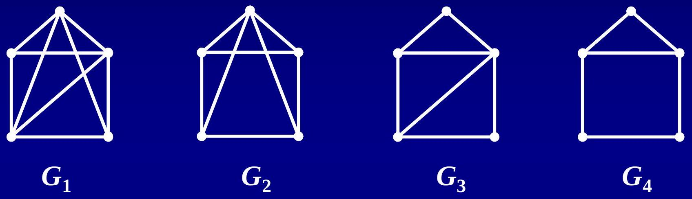

**解** 对 $G_{1}$，点数 $n=5=2 \times 2+1$，边数 $m=9, ~ \Delta=4$，满足 $m=9>8=2 \times 4$，从而 $\chi^{\prime}\left(G_{1}\right)=\Delta+1=5$。

对 $G_{2}, G_{3}$ 和 $G_{4}$，它们都不满足＂$m>k \Delta$＂，但均满足定理，故 $\chi^{\prime}\left(G_{2}\right)=\Delta=4, \quad \chi^{\prime}\left(G_{3}\right)=4, \quad \chi^{\prime}\left(G_{4}\right)=3$。

> **推论** 设 $G$ 是奇阶 $\Delta$ 正则简单图。若 $\Delta>0$，则 $\chi^{\prime}=\Delta+1$。

**证明** 因 $G$ 是奇阶图，故可设 $G$ 的点数 $n=2 k+1$，边数为 $m$。

又因 $G$ 是 $\Delta$ 正则图，每个点的度均为 $\Delta$，从而由度数之和等于2倍边数得

$$
n \Delta=2 m \Rightarrow(2 k+1) \Delta=2 m \Rightarrow 2 m>2 k \Delta \Rightarrow m>k \Delta,
$$

由推论得，$\chi^{\prime}=\Delta+1$。

**例** 设 $n=2 k+1, k>0$。求 $\chi^{\prime}\left(C_{n}\right)$ 和 $\chi^{\prime}\left(K_{n}\right)$，其中 $C_{n}$ 为 $n$ 圈。

**解** 因 $C_{n}$ 是2正则简单图，$K_{n}$ 是 $(n-1)$ 正则简单图，所以，

$$
\chi^{\prime}\left(C_{n}\right)=2+1=3, \quad \chi^{\prime}\left(K_{n}\right)=(n-1)+1=n 。
$$

**例** 求彼得森图的边色数。

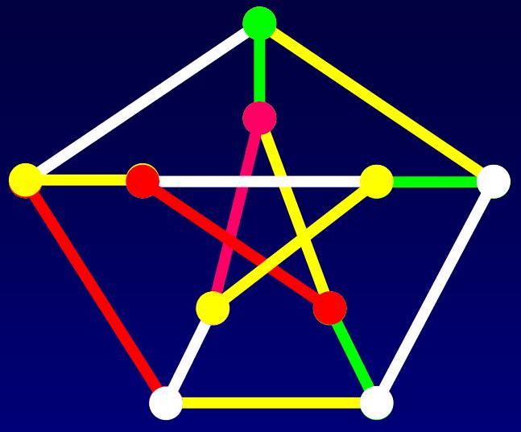

> **解** 彼得森图不能进行1因子分解，所以，$\chi^{\prime} \geq 4$。
> 
> 所以，彼得森图的边色数为4。

> **定理** 设**无环多重图 **$G$ 的边的最大重数为 $\mu$，则
> 
> $$
> \chi^{\prime} \leq \Delta+\mu \text { 。 }\\
> \chi^{\prime} \leq \frac{3 \Delta} { 2} \text { 。 }
> $$

**例** 下图是一个边色数达到 $\Delta+\mu$ 的图，其中 $\Delta=4, \mu=2$。

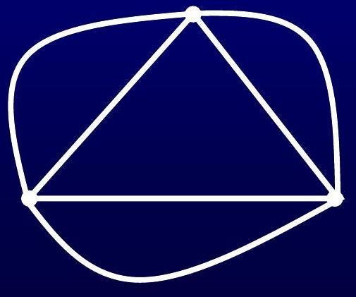

设 $G$ 为无环多重图，则

$$
\chi^{\prime} \leq 3 \Delta / 2 \text { 。 }
$$

#### 五、边着色的应用

排课表问题：在一个学校中，有7个教师，12个班级。在每周5天教学日条件下，授课的要求由如下矩阵给出：

$$
P=\left(\begin{array}{cccccccccccc}
y_{1} & y_{2} & y_{3} & y_{4} & y_{5} & y_{6} & y_{7} & y_{8} & y_{9} & y_{10} & y_{11} & y_{12} \\
3 & 2 & 3 & 3 & 3 & 3 & 3 & 3 & 3 & 3 & 3 & 3 \\
1 & 3 & 6 & 0 & 4 & 2 & 5 & 1 & 3 & 3 & 0 & 4 \\
5 & 0 & 5 & 5 & 0 & 0 & 5 & 0 & 5 & 0 & 5 & 5 \\
2 & 4 & 2 & 4 & 2 & 4 & 2 & 4 & 2 & 4 & 2 & 3 \\
3 & 5 & 2 & 2 & 0 & 3 & 1 & 4 & 4 & 3 & 2 & 5 \\
5 & 5 & 0 & 0 & 5 & 5 & 0 & 5 & 0 & 5 & 5 & 0 \\
0 & 3 & 4 & 3 & 4 & 3 & 4 & 3 & 4 & 3 & 3 & 0
\end{array}\right) \begin{gathered}
x_{1} \\
x_{2} \\
x_{3} \\
x_{4} \\
x_{5} \\
x_{6} \\
x_{7}
\end{gathered}
$$

其中，$p_{i j}$ 表示 $x_{i}$ 必须教 $y_{j}$ 班的节数。

求：（1）一天分成几节课，才能满足所提出的要求？

（2） 若安排出每天8节课的时间表，需要多少间教室？

**解** 该问题可模型为一个偶图G。

一节课对应边正常着色的一个色组。由于 $G$ 是偶图，所以边色数为 $G$ 的最大度35。这样，最少总课时为35节课。平均每天要安排7节课。

如果每天安排 8 节课，因为 $G$ 的总边数为 240，所以需要的教室数为 $240 /(5 \times 8)=6$。

比赛安排问题：Alvin计划邀请3对夫妇到他的避暑别墅住一个星期。他们是：Bob和Carrie，David和Edith，Frank和 Gena。由于这6人都喜欢网球运动，所以他们决定进行网球比赛。 6 位客人的每一位都要和其配偶之外的每位客人比赛。另外，Alvin将分别和David，Edith，Frank，Gena进行一场比赛。若没有人希望在同一天进行2场比赛，又希望比赛的天数最少，如何安排？

**解** 用点表示参赛人，两点连线当且仅当两人有比赛。这样得到比赛状态图。

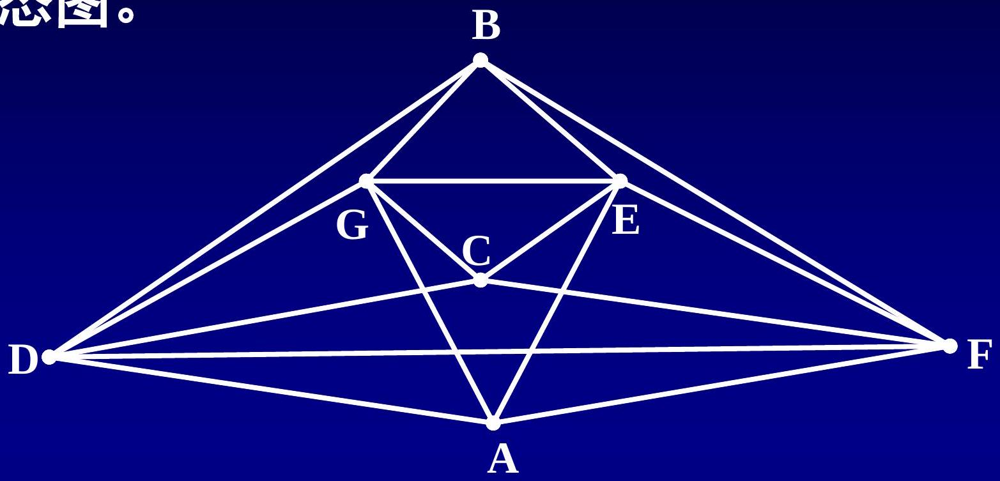

问题对应于求状态图的一种最优边着色（用最少色数进行正常边着色）。

由于 $n=2 \times 3+1$，所以 $k=3$。而 $\Delta=5, m=16>3 \times 5=k \Delta$，所以

$$
\chi^{\prime}(G)=6 .
$$

比赛安排为：{AF, BD, EG}，{AE, BF, CG}，{AG, BE, CD}，{BG, CE, DF}，{DG, EF}，{AD, CF}。

### 7.2 顶点着色

#### 一、相关概念

> **定义** 设 $G$ 是一个图，对 $G$ 的每个顶点着色，使得相邻顶点着不同颜色，称为对 $G$ 的正常顶点着色；如果用 $k$ 种颜色可以对 $G$ 进行正常顶点着色，称 $G$ 是 $k$ 可着色的。
> 
> **定义** 对图G正常顶点着色需要的最少颜色数，称为图 $G$ 的点色数，简称色数。图 $G$ 的色数用 $\chi(G)$ 表示。
> 
> **定义** 色数为 $k$ 的图称为 $k$ 色图。

**例** 证明下图的色数是4。

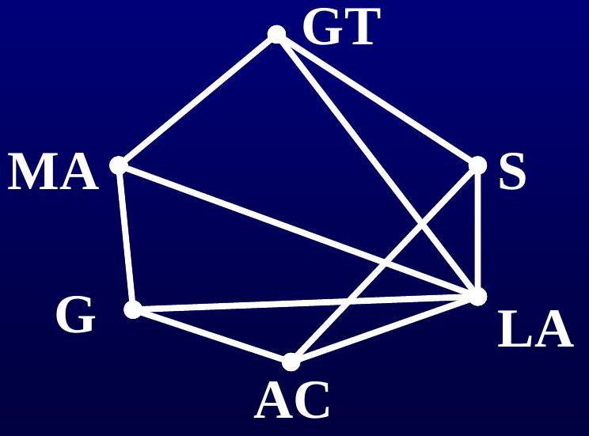

**证明** 一方面，因图中含有奇圈（红色边），所以，色数至少为 3。

又因为点LA与该圈上每一个点均邻接，所以，色数至少为 4。

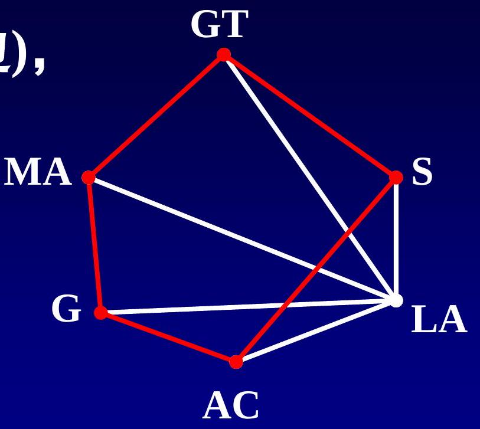

另一方面，我们用4种颜色实现了正常点着色，所以，图的色数为4。

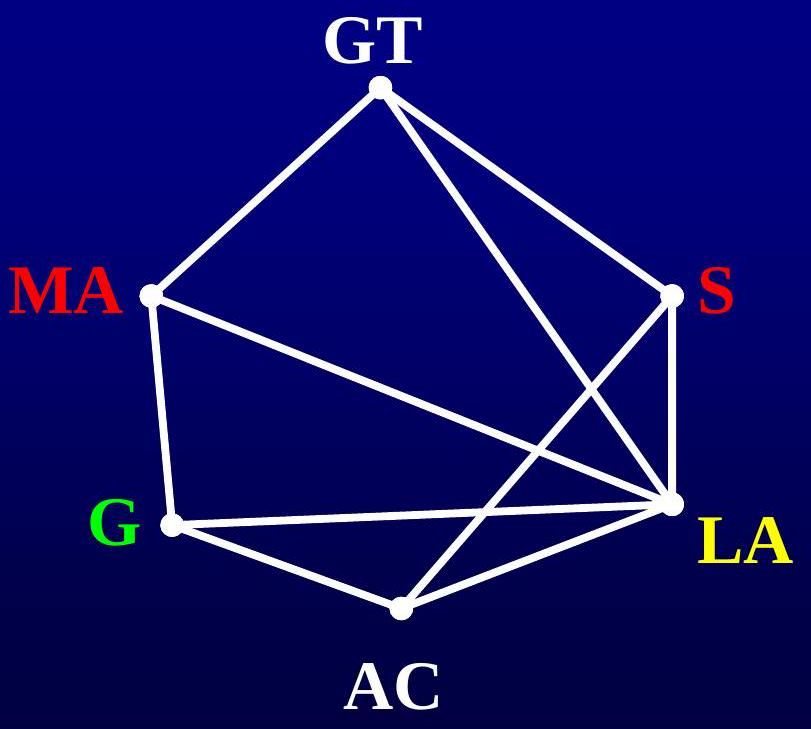

**注** 对图的正常顶点着色，带来的是图的顶点集合的一种划分方式。着同一种颜色的顶点集合称为一个色组，它们彼此互不相邻，所以又称为点独立集。

#### 二、关于色数的若干结论

> **定理** 对任意的简单图 $G$，均有
> 
> $$
> \chi \leq \Delta+1 \text { 。 }
> $$

**证明** 对图 $G$ 的点数 $n$ 作归纳证明。

当 $n=1$ 时，$\chi=1, \Delta=0$，满足 $\chi \leq \Delta+1$。

对 $n \geq 2$ 的图 $G$，取 $u \in V(G)$，设 $G^{\prime}=G-u$。

由归纳假设知，

$$
\chi\left(G^{\prime}\right) \leq \Delta\left(G^{\prime}\right)+1 .
$$

又因为 $\Delta\left(G^{\prime}\right) \leq \Delta(G)$，所以，$G^{\prime}$ 存在 $(\Delta(G)+1)$ 正常着色 $\pi$。

因为 $u$ 的邻点在 $\pi$ 下至多用去 $\Delta(G)$ 种色，所以给 $u$ 着其邻点没有用过的色，就把 $\pi$ 扩充成了 $G$ 的 $\Delta(G)+1$ 着色方案。

> **着色算法**
> 
> 给定图 $G=(V, E)$，设 $V=\left\{v_{1}, v_{2}, \ldots, v_{n}\right\}$，着色函数为 $\pi$，色集 $C=\{1,2, \ldots, \Delta+1\}$。
> 
> 1. 令 $\pi\left(v_{1}\right)=1, i=1$；
> 
> 2. 若 $i=n$，则停；否则令 $C\left(v_{i+1}\right)=\left\{\pi\left(v_{j}\right) \mid j \leq i\right.$，并且 $v_{j}$ 与 $v_{i+1}$ 相邻 $\}$。设 $k$ 为 $C \backslash C\left(v_{i+1}\right)$ 中的最小正整数，令 $\pi\left(v_{i+1}\right)=k$；
> 
> 3. 令 $i=i+1$，转（2）。

**例** 试用着色算法给下图顶点着色。

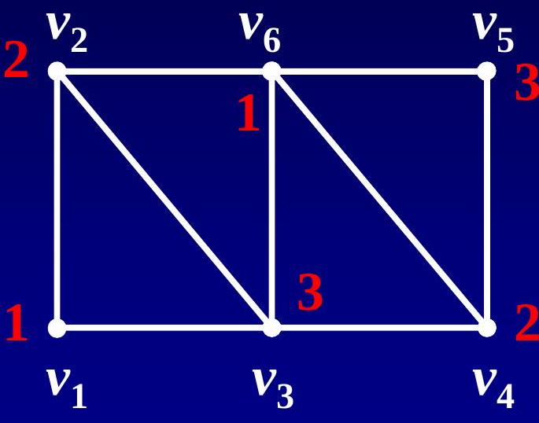

**解** 设 $\pi$ 为着色函数，色集 $C=\{1,2, \ldots, 5\}$，着色过程如下：

1. $\pi\left(v_{1}\right)=1, C\left(v_{2}\right)=\{1\}, C \backslash C\left(v_{2}\right)=\{2, \ldots, 5\}$；

2. $\pi\left(v_{2}\right)=2, C\left(v_{3}\right)=\{1,2\}, C \backslash C\left(v_{3}\right)=\{3, \ldots, 5\}$；

3. $\pi\left(v_{3}\right)=3, C\left(v_{4}\right)=\{3\}, C \backslash C\left(v_{4}\right)=\{1,2,4,5\}$；

4. $\pi\left(v_{4}\right)=1, C\left(v_{5}\right)=\{1\}, C \backslash C\left(v_{5}\right)=\{2, \ldots, 5\}$；

5. $\pi\left(v_{5}\right)=2, C\left(v_{6}\right)=\{1,2,3\}, C \backslash C\left(v_{6}\right)=\{4,5\}$；

6. $\pi\left(v_{6}\right)=4$。

> **定理** （Brooks）设 $G$ 是简单连通图。假定 $G$ 既不是完全图又不是奇圈，则 $\chi \leq \Delta$。

令 $V_{2}(G)=\{v \mid v \in V(G), N(v)$ 中存在点 $u$，满足 $d(u) \geq d(v)\}$。

**定义**

$$
\Delta_{2}(G)=\max \left\{d(v) \mid v \in V_{2}(G)\right\},
$$

简记为 $\Delta_{2}$。

**注** 显然，$\Delta_{2}(G) \leq \Delta(G)$；称 $\Delta_{2}(G)$ 为 $G$ 的次大度。

**例** 对于下图所示的图 $G$，有

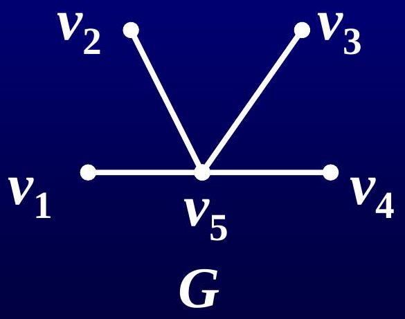

$$
\begin{aligned}
& V_{2}(G)=\left\{v_{1}, v_{2}, v_{3}, v_{4}\right\} \\
& \Delta_{2}(G)=\max \left\{d(v) \mid v \in V_{2}(G)\right\}=1
\end{aligned}
$$

**定理** 设 $G$ 是非空简单图，则

$$
\chi(G) \leq \Delta_{2}(G)+1 .
$$

**注** 此定理是对＂$\chi \leq \Delta+1$＂的一个改进！

**例** 考察下图所示的简单图。

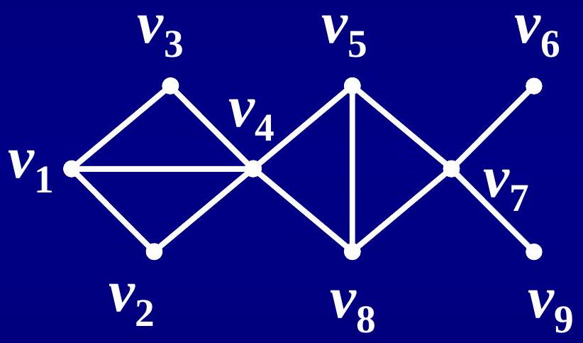

由布鲁克斯定理得

$$
\chi \leq \Delta=5 .
$$

根据次大度得 $\chi \leq \Delta_{2}+1=4$。事实上，$\chi=3$。

> **推论** 设 $G$ 是非空简单图，若 $G$ 中度数最大的点互不相邻，则
> 
> $$
> \chi \leq \Delta .
> $$

#### 三、四色定理与五色定理

> **定理** （Heawood）对任意的简单平面图，均有 $\chi \leq 5$。

**证明** 设 $G$ 是平面图，对顶点数 $n$ 用归纳法。

当 $n=1$ 时，显然 $\chi \leq 5$。

设当 $n=k$ 时，结论成立。

设 $G$ 是 $n=k+1$ 的平面图。

由平面图的知识知，$G$ 中存在度小于等于 5 的顶点 $u$。

令 $H=G-u$，由归纳假设知：$\chi(H) \leq 5$，从而存在图 $H$ 的 5 着色 $\pi$。

若 $d_{G}(u)<5$，则与 $u$ 相邻的点的着色最多用到 4 种色，从而可将 $\pi$ 扩充为 $G$ 的 5 着色。

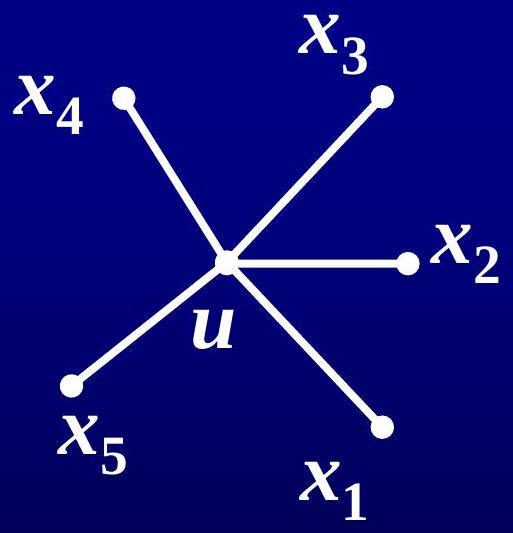

下设 $d_{G}(u)=5$，邻集 $N(u)=\left\{x_{1}, x_{2}, \ldots, x_{5}\right\}$。$u$ 与 $N(u)$ 的一个平面表示如图所示。

情况1 $N(u)$ 中存在两个点 $x_{i}$ 与 $x_{j}$ 有 $\pi\left(x_{i}\right)=\pi\left(x_{j}\right)$，此时 $\pi$ 显然可扩充为 $G$ 的 5 着色。

情况2 $N(u)$ 中的点均着不同色，不妨设 $\pi\left(x_{i}\right)=i(i=1, \ldots, 5)$。

令 $H(i, j)$ 为 $H$ 中着 $i$ 色和着 $j$ 色的点导出的子图。

若 $x_{1}$ 与 $x_{3}$ 分属于 $H(1,3)$ 的不同分支，则可通过在含 $x_{3}$ 的分支中交换颜色1和3，而得到 $H$ 的另一个5着色。此时 $x_{1}$ 与 $x_{3}$ 均着1色，情况2转变为情况1。

下设 $x_{1}$ 与 $x_{3}$ 属于 $H(1,3)$ 的同一分支。

此时 $H$ 中存在以 $x_{1}$ 为起点，$x_{3}$ 为终点的路 $P(1,3)$（如图中虚线所示），从而＂$u x_{1}-P(1,3)-x_{3} u$＂是 $H$ 中的一个圈。

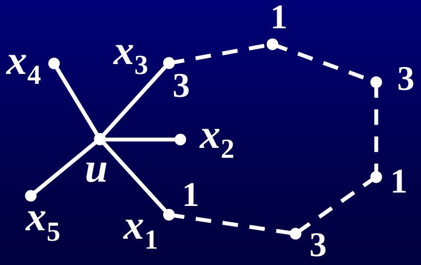

设此圈为 $C$，此时若 $x_{2}$ 与 $x_{4}$ 属于 $H(2,4)$ 的同一分支，则 $H$ 中也应存在以 $x_{2}$ 为起点 $x_{4}$ 为终点的路 $P(2,4)$。

但因 $x_{2}$ 在 $C$ 内，$x_{4}$ 在 $C$ 外，故 $P(2,4)$ 必与 $C$ 相交。

所以，$x_{2}$ 与 $x_{4}$ 必属于 $H(2,4)$ 的不同分支。

这与 $x_{1}$ 和 $x_{3}$ 属于 $H(1,3)$ 的不同分支情况类似，我们也可得到 $H$ 的另一个5着色。

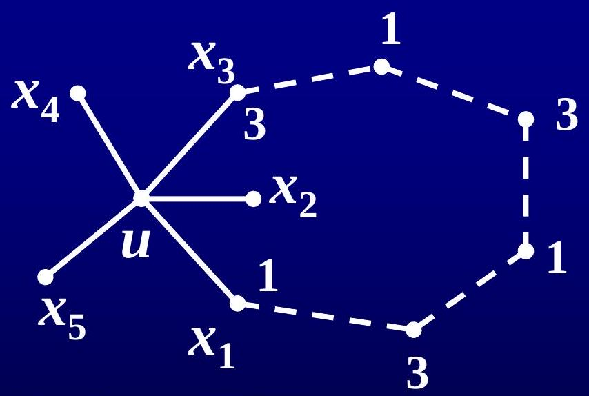

综上，我们已证得 $\chi \leq 5$。

#### 四、顶点着色的应用

跟图的边着色问题一样，生活中的很多问题，也可以模型为所谓的图的顶点着色问题来处理。

课程安排问题：某大学数学系要为这个夏季安排课程表。所要开设的课程为：图论（GT），统计学（S），线性代数（LA），高等微积分（AC），几何学（G）和近世代数（MA）。现有 10 名学生需要选修这些课程（如下所示）。根据这些信息，确定开设这些课程所需要的最少时间段数，使得学生选课不会发生冲突。学生用 $\mathrm{A}_{\mathrm{i}}$ 表示。

$$
\begin{array}{llll}
A_{1}: L A, S ; & A_{2}: M A, \mathrm{LA}, \mathrm{G} ; & A_{3}: M A, G, L A ; \\
A_{4}: G, L A, A C ; & A_{5}: A C, L A, S ; & A_{6}: G, A C ; \\
A_{7}: G T, M A, L A ; & A_{8}: L A, G T, S ; & A_{9}: A C, S, L A ; \\
A_{10}: G T, S
\end{array}
$$

**解** 把课程模型为图 $G$ 的顶点，两顶点连线当且仅当有某个学生同时选了这两门课程。

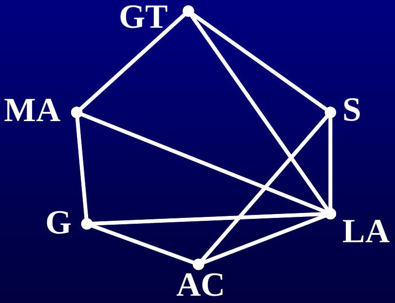

如果我们用同一颜色给同一时段的课程顶点着色，那么问题转化为在图 $G$ 中求对应于点色数的着色。

一方面，因图中含有奇圈（红色边），所以点色数至少为 3。又因为点LA与该圈上每一个点均邻接，所以，点色数至少为4。

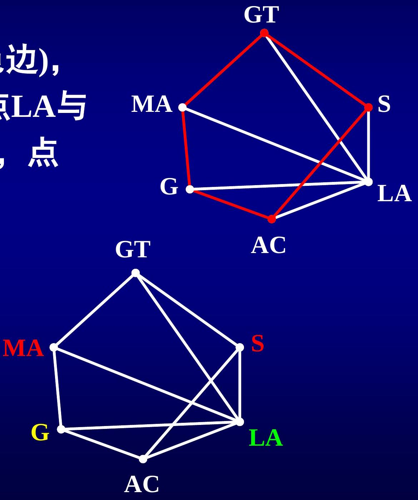

另一方面，我们用 4 种色实现了 $G$ 的正常点着色，所以，图的点色数为4。

交通灯的相位设置问题：下图列出了繁华街道路口处的交通车道 $\mathrm{L}_{1}, \mathrm{~L}_{2}, \ldots, \mathrm{~L}_{9}$。在此路口处安置了交通灯。当交通灯处于某个相位时，亮绿灯的车道上的车辆就可以安全通过路口。为了让所有的车辆最终都能够安全通过路口，对于交通灯来说，所需要的相位的最小数是多少？

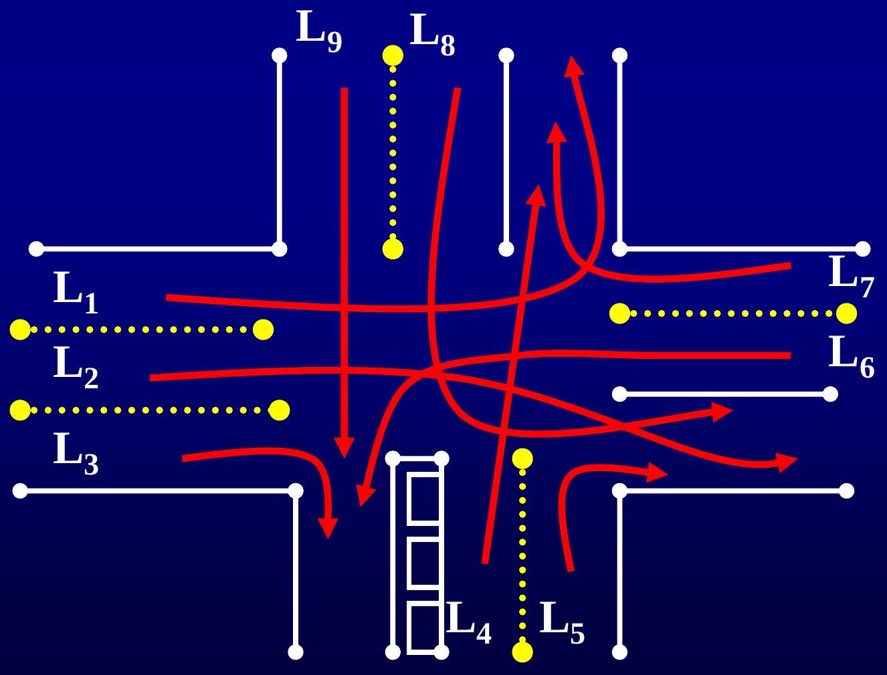

**解** 车道模型为顶点，两点连线当且仅当两个车道上的车不能同时安全地进入路口。

问题转化为求 $G$ 的点色数。

一方面，$G$ 中含有 $K_{4}$，所以点色数至少为4；

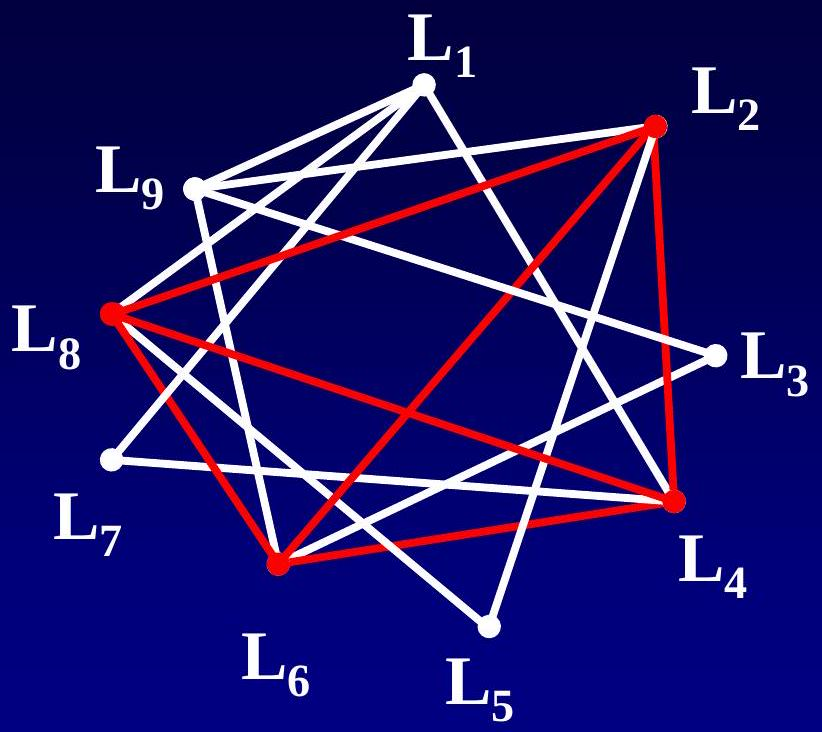

图 G（其中红边构成 K₄）

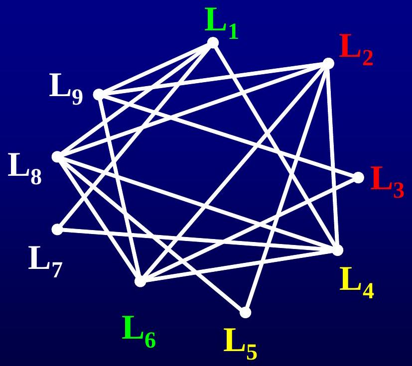

图 G 的一个 4-着色

另一方面，用4种色实现了正常点着色，所以，最小相位为4。

### 7.3 着色的计数与色多项式

#### 一、色多项式的概念

**假定与记号**

1. 假定着色是正常的点着色；

2. 假定所给图是标号图，即图中若某特定点着不同色，则视为不同的着色法；

3. 用 $P_{k}(G)$ 表示图 $G$ 的 $k$ 着色数目。

所谓着色的计数，就是给定标定图 $G$ 和颜色数 $k$，求出正常顶点着色的方式数，并用 $P_{k}(G)$ 表示。

可以证明：$P_{k}(G)$ 是 $k$ 的多项式，称为图 $G$ 的色多项式。

> 由 $\chi(G)$ 及 $P_{k}(G)$ 的定义，有：
> 
> 1. 若 $k<\chi(G)$，则 $P_{k}(G)=0$；$\chi(G)=\min \left\{k \mid P_{k}(G) \geq 1\right\}$。
> 
> 2. 若 $G$ 为 $n$ 阶空图，则 $P_{k}(G)=k^{n}$。
> 
> 3. $P_{k}\left(K_{n}\right)=k(k-1) \cdots(k-n+1)$。
> 
> 4. 若图 $G$ 含有 $n$ 个孤立点，则 $P_{k}(G)=k^{n} P_{k}\left(G^{\prime}\right)$，其中 $G^{\prime}$ 是 $G$ 去掉 $n$ 个孤立点后所得的图。
> 
> 5. 若图 $G$ 有环或有重边，则去掉环并将重边用单边代替之后所得图的 $k$ 着色数目与原图一样。

#### 二、递推计数法

记号 $G \cdot e$ 表示 $G$ 中删去边 $e$ 再重合 $e$ 的端点后所得的图。

> **定理** 若 $G$ 是简单图，则对 $G$ 的任意边 $e$，有
> 
> $$
> P_{k}(G)=P_{k}(G-e)-P_{k}(G \cdot e) 。
> $$

**证明** 设 $e=u v$。图 $G-e$ 的所有 $k$ 着色可分为两类。

一类为 $u$ 与 $v$ 着不同色的 $k$ 着色，此类着色相当于 $G$ 的着色，其数目有 $P_{k}(G)$ 个；另一类为 $u$ 与 $v$ 着同色的 $k$ 着色，此类着色相当于 $G \cdot e$ 的着色，其数目有 $P_{k}(G \cdot e)$ 个。

所以，$P_{k}(G-e)=P_{k}(G)+P_{k}(G \cdot e)$。

因此，$P_{k}(G)=P_{k}(G-e)-P_{k}(G \cdot e)$。

> **推论** 设 $e=u v$ 是图 $G$ 的一条边，并且 $d(u)=1$，则
> 
> $$
> P_{k}(G)=(k-1) P_{k}(G-u) \text { 。 }
> $$

**证明** 不失一般性，可假设 $G$ 是简单图。

因 $u$ 是边 $e$ 的端点且 $d(u)=1$，所以 $G \cdot e=G-u$。

另一方面，$u$ 是 $G-e$ 的孤立点，故 $P_{k}(G-e)=k P_{k}(G-u)$。

因此，

$$
\begin{aligned}
P_{k}(G) & =P_{k}(G-e)-P_{k}(G \cdot e) \\
& =k P_{k}(G-u)-P_{k}(G-u) \\
& =(k-1) P_{k}(G-u) 。
\end{aligned}
$$

**注**

1. 当图的边数较少时，使用减边递推法；

2. 当图的边数较多时，使用加边递推法。

**例** 图 $G_{1}, G_{2}, G_{3}$ 如下所示，分别求其色多项式。

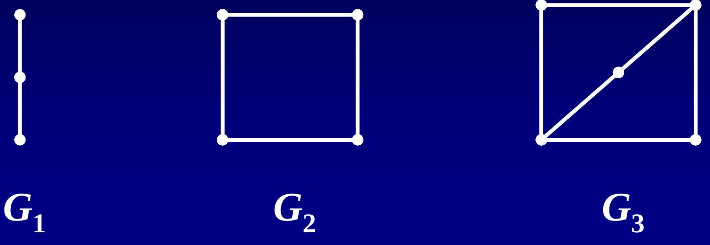

**解** 为简便起见，递推的中间过程直接由图表示。

$$
\begin{aligned}
P_{k}\left(G_{1}\right) & =\square-\square=\left(\begin{array}{l}
\cdot \\
\cdot \\
\cdot
\end{array}\right)-\binom{\cdot}{\cdot}-\binom{\cdot}{\cdot}+(\cdot) \\
& =k^{3}-2 k^{2}+k .
\end{aligned}
$$

> **注** 若 $T$ 是 $n$ 阶树，则 $P_{k}(T)=k(k-1)^{n-1}$。

$$
P_{k}\left(G_{2}\right)=\square+\square
$$

$$
\begin{aligned}
& =(\square+\square)+( \\
& =\square+\square+(\square+\square)+\square)+(\square+1) \\
& =k(k-1)(k-2)(k-3)+2 k(k-1)(k-2)+k(k-1) \\
& =k(k-1)[(k-2)(k-3)+2(k-2)+1] \\
& =k^{4}-4 k^{3}+6 k^{2}-3 k .
\end{aligned}
$$

> **注** 若 $C_{n}$ 是 $n$ 长圈，则
> 
> $$
> P_{k}\left(C_{n}\right)=(k-1)^{n}+(-1)^{n}(k-1) 。
> $$

$$
\begin{aligned}
P_{k}\left(G_{3}\right) & =\square-\square \\
& =(k-1)(\square)-k(k-1)(k-2)^{2} \\
& =(k-1) k(k-1)\left(k^{2}-3 k+3\right)-k(k-1)(k-2)^{2} \\
& =k^{5}-6 k^{4}+15 k^{3}-17 k^{2}+7 k .
\end{aligned}
$$

**注** 递推计数法的计算复杂度是指数型的。

#### 三、理想子图法

> **定义** 设 $H$ 是图 $G$ 的生成子图。若 $H$ 的每个分支均为完全图，则称 $H$ 是 $G$ 的一个理想子图。用 $N_{r}(G)$ 表示 $G$ 的具有 $r$ 个分支的理想子图的个数。

**例** 求图 $G$ 的全部理想子图。

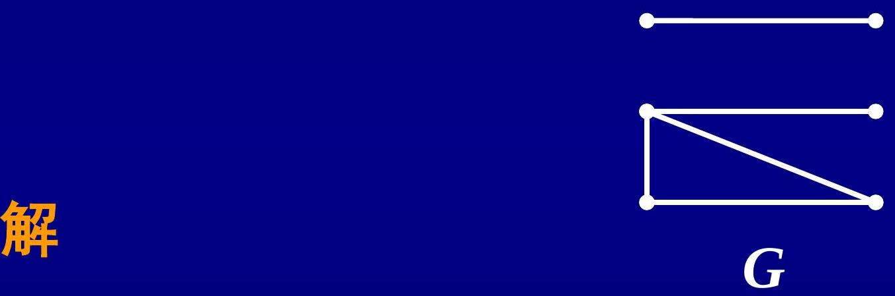

$$
N_{3}(G)=2
$$

$$
N_{4}(G)=6
$$

$$
N_{5}(G)=5
$$

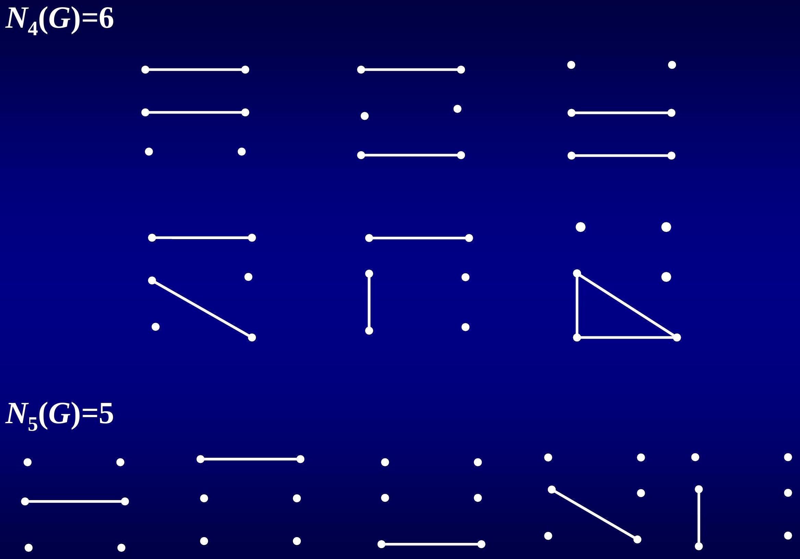

$$
N_{6}(G)=1
$$

> **定理** 设 $G$ 是具有 $n$ 个点 $m$ 条边的简单图，则有
> 
> 1. $N_{n}(G)=1$；
> 
> 2. $N_{n-1}(G)=m$；
> 
> 3. 若 $k<a(G)$，则 $N_{k}(G)=0$。

> **定理** 设 $q_{r}(G)$ 表示将简单图 $G$ 的顶点集合 $V$ 划分为 $r$ 个不同色组的色划分个数，则：
> 
> $$
> q_{r}(G)=N_{r}(\bar{G}), \quad r=1,2, \ldots,|V| .
> $$

**证明** $G$ 的任一 $r$ 色划分必然对应其补图的一个理想子图。

另一方面，对于 $G$ 的补图的任一具有 $r$ 个分支的理想子图，显然它唯一对应 $G$ 的 $r$ 个色组。

因此，结论成立。

**注** 上述定理实际上给出了色多项式的求法：用 $k$ 种颜色对简单图G正常着色，可以这样来计算着色方式数：色组为 1 的方式数 + 色组为 2 的方式数 $+\cdots+$ 色组为 $n$ 的方式数

> **推论** 对 $n$ 阶简单图 $G$，有
> 
> $$
> P_{k}(G)=\sum_{i=1}^{n} N_{i}(\bar{G})[k]_{i},
> $$
> 
> 其中 $[k]_{i}=k(k-1) \cdots(k-i+1)$。

> **定义** 设 $G$ 是简单图，令 $N_{i}(G)=r_{i}$，称多项式
> 
> $$
> h(G, x)=\sum_{i=1}^{n} r_{i} x^{i}
> $$

为图 $G$ 的伴随多项式。

理想子图法：先求出 $G$ 的补图的伴随多项式，再将多项式中的 $x^{i}$ 换为 $[k]_{i}$ 便能得到简单图 $G$ 的色多项式 $P_{k}(G)$。

**例** 求图 $G$ 的色多项式 $P_{k}(G)$。

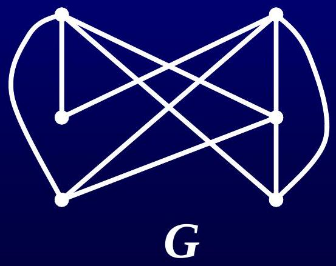

**解** $G$ 的补图为

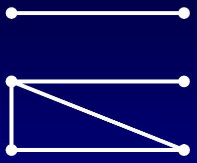

补图的伴随多项式为

$$
h(\bar{G}, x)=\sum_{i=1}^{n} r_{i} x^{i}=2 x^{3}+6 x^{4}+5 x^{5}+x^{6} .
$$

将 $x^{i}=[k]_{i}$ 代入伴随多项式中得到 $P_{k}(G)$：

$$
\begin{aligned}
P_{k}(G)= & 2[k]_{3}+6[k]_{4}+5[k]_{5}+[k]_{6} \\
= & 2 k(k-1)(k-2)+6 k(k-1)(k-2)(k-3) \\
& +5 k(k-1)(k-2)(k-3)(k-4) \\
& +k(k-1)(k-2)(k-3)(k-4)(k-5) \\
= & k^{6}-10 k^{5}+41 k^{4}-84 k^{3}+84 k^{2}-32 k .
\end{aligned}
$$

使用理想子图法时，还可以通过如下定理进行改进。

> **定理** 若 $G$ 有 $t$ 个分支 $H_{1}, H_{2}, \ldots, H_{t}$，且 $H_{i}$ 的伴随多项式为$h\left(H_{i}, x\right), i=1,2, \ldots, t$，则：
> 
> $$
> h(G, x)=\prod_{i=1}^{t} h\left(H_{i}, x\right) .
> $$

**注** 该定理说明，在求 $G$ 的补图的伴随多项式时，可以分别求出它的每个分支的伴随多项式，然后将它们作乘积。

**例** 求图 $G$ 的色多项式 $P_{k}(G)$。

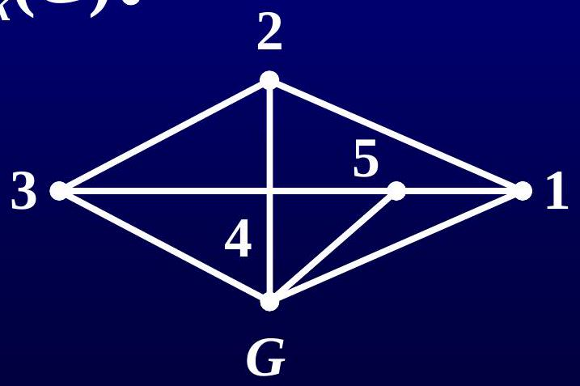

**解**

（1）画出 $G$ 的补图。

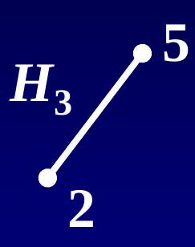

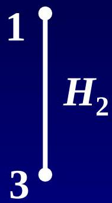

（2）求出补图中各个分支的伴随多项式。

$$
h\left(H_{1}, x\right)=x
$$

$$
h\left(H_{2}, x\right)=x+x^{2}
$$

$$
h\left(H_{3}, x\right)=x+x^{2}
$$

（3）求出补图的伴随多项式。

$$
h(\bar{G}, x)=x\left(x+x^{2}\right)^{2}=x^{3}+2 x^{4}+x^{5}
$$

（4）求出 $G$ 的色多项式。

$$
\begin{aligned}
P_{k}(G)= & k(k-1)(k-2)+2 k(k-1)(k-2)(k-3) \\
& +k(k-1)(k-2)(k-3)(k-4) \\
= & k^{5}-8 k^{4}+24 k^{3}-31 k^{2}+14 k .
\end{aligned}
$$

#### 四、色多项式的性质

> **定理** 对 $n$ 阶简单图 $G$，$P_{k}(G)$ 是 $k$ 的整系数 $n$ 次多项式，首项系数为1，常数项为零，并且各项系数的符号正负相间。

**证明** 对 $G$ 的边数 $m$ 用归纳法证明。

当 $m=0$ 时，$G$ 是空图，有 $P_{k}(G)=k^{n}$，结论成立。

假定对 $m=t$ 的图结论成立。

设 $G$ 是 $m=t+1$ 的图，其中 $m \geq 1$。

取 $G$ 的一条边 $e$，则 $G-e$ 与 $G \cdot e$ 均为 $t$ 边图，满足归纳假设。

因为 $G-e$ 为 $n$ 阶简单图，$G \cdot e$ 对应一个 $n-1$ 阶简单图，所以存在非负整数 $a_{1}, a_{2}, \ldots, a_{n-1}$ 和 $b_{1}, b_{2}, \ldots, b_{n-2}$ 使得

$$
\begin{aligned}
& P_{k}(G-e)=k^{n}-a_{1} k^{n-1}+a_{2} k^{n-2}-\cdots+(-1)^{n-1} a_{n-1} k, \\
& P_{k}(G \cdot e)=k^{n-1}-b_{1} k^{n-2}+b_{2} k^{n-3}-\cdots+(-1)^{n-2} b_{n-2} k .
\end{aligned}
$$

因此，

$$
\begin{aligned}
P_{k}(G) & =P_{k}(G-e)-P_{k}(G \cdot e) \\
& =k^{n}-\left(a_{1}+1\right) k^{n-1}+\left(a_{2}+b_{1}\right) k^{n-2}-\cdots+(-1)^{n-1}\left(a_{n-1}+b_{n-2}\right) k .
\end{aligned}
$$

**注**

1. 满足定理条件的多项式未必是一个图的色多项式，例如，多项式 $k^{4}-3 k^{3}+3 k^{2}$ 便不是任何图的色多项式。

2. 同构的图有相同的色多项式，但其逆不真，例如下图所给的两个不同构的图 $G_{1}$ 与 $G_{2}$ 有相同的色多项式：

$$
P_{k}\left(G_{1}\right)=P_{k}\left(G_{2}\right)=k^{2}(k-1)^{2} .
$$

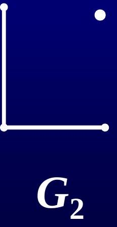
