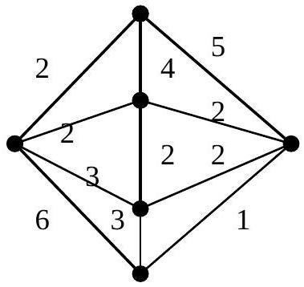
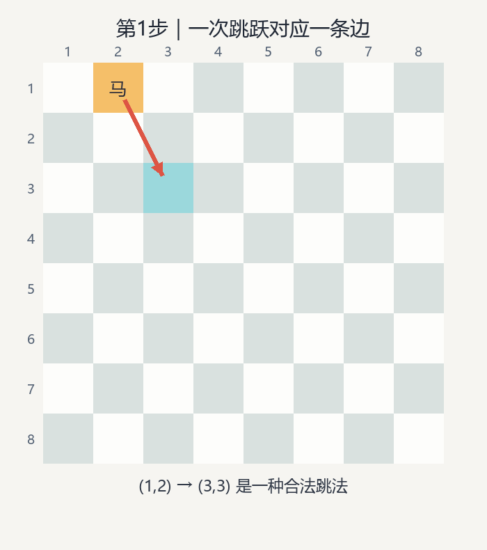
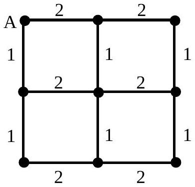

# 图论作业2

> 专栏：图论 · Notion 最后编辑：2026-11-12T12:35:00.000Z
>
> 来源：https://www.notion.so/2e69d7385883831eafd581f49104bffd

### 一、填空题

**1．** 图 $G$ 的顶点数为 25 且 7 连通，则其边数至少为 \_\_88\_\_。

> 
> 
> $$
> \kappa(G)\leq\lfloor \frac{2m}{n}\rfloor\\
> \lfloor\frac{2m}{25}\rfloor\geq \kappa(G)\geq 7\\
> \lfloor2m\rfloor \geq 7\times25\\
> \lfloor m\rfloor\geq 87.5\\
> m\geq 88
> $$

**2．** 彼得森图的点连通度和边连通度分别为 \_\_3\_\_ 和 \_\_3\_\_。

> 
> 
> $$
> \kappa(G)\leq \lambda(G) \leq \delta(G)\\
> \because 彼得森图是3正则图\\
> \therefore \delta(G)=3\\
> \therefore 任取两个顶点，无论外圈两个，内圈两个，还是内外各一个，图均连通\\
> \therefore \kappa(G)\geq 3\\
> \therefore 3\leq \kappa(G) \leq 3,\kappa(G) \leq \lambda(G) \leq3\\
> \therefore \kappa(G)=\lambda(g)=3
> $$

**3．** 非平凡树的点连通度和边连通度分别为 \_\_1\_\_ 和 \_\_1\_\_。

> 设 $T $为非平凡树，即$ |V(T)| ≥ 2$。树的每条边都是割边，故
> $λ(T) = 1$。
> 又因为 T 有叶子，所以最小度$ δ(T) = 1$。由
> $1 ≤ κ(T) ≤ λ(T) ≤ δ(T) = 1，$
> 得 $κ(T) = 1$。
> 因此，非平凡树的点连通度和边连通度分别为 1 和 1。

**4．** 设图 $G$ 是具有 10 个奇度顶点，则在 $G$ 中最少添加 \_\_5\_\_ 条边才能使 $G$ 具有欧拉回路。

> 知识点：欧拉图的性质
> 
> 将十个奇度顶点两两配对加边

**5．** 完全偶图 $K_{10,22}$ 的最优欧拉环游共含 \_\_220\_\_ 条边。

$$
\because 完全偶图K_{10,22} \therefore |E(K_{10,22})|=10\times 22=220\\
又\because K_{10,22}是欧拉图，需要经过每一条边\\
\therefore 最优欧拉环游公含220条边
$$

**6．** 下图的最优欧拉环游的权值为 \_\_38\_\_。

> 很明显该图只有上下两个奇度顶点，，所以要补边，补权值为5和1的两条边，路径权值最小

**7．** 具有5个点的非哈密尔顿简单图最多包含 \_\_7\_\_条边，它们分别为 \_\_$\mathrm{C_{1,5}}$\_\_和 \_\_$\mathrm{C_{2,5}}$\_\_。

> **推论** 设 $G$ 是 $n$ 阶 $(n \geq 3)$ 简单图，若
> 
> $$
> |E(G)|>\binom{n-1}{2}+1,
> $$
> 
> 则 $G$ 是 $H$ 图；并且具有 $n$ 个顶点、$\binom{n-1}{2}+1$ 条边的非 $H$ 图只有 $C_{1, n}$ 以及 $C_{2,5}$。
> 
> 
> $$
> 设 G 是 n 阶(n\ge3)简单图\\
> |E(G)|>\binom{n-1}{2}+1\Rightarrow G是H图
> $$
> 
> **知识点：度极大的非Hamilton图**

### 二、不定项选择题

**1．** 下列说法正确的是（　CD　　）

**（A）** 有割边的图一定有割点；

> 错误。
> 反例：$G = K_2$。它的唯一一条边是割边；但删除任一顶点后，图的连通分支数仍为 1，因此没有割点。

**（B）** 有割点的图一定有割边；

> 错误。
> 反例：两个三角形恰好共用一个顶点$ v$。删除 $v $后，图分成两个连通分支，所以$ v $是割点；但每条边都在三角形中，均不是割边。

**（C）** 割点至少属于图的两个块；

> 正确

**（D）** 割边不在图的任一圈中；

> 正确
> 
> 若边 e 在某个圈中，删除 e 后，其两个端点仍可沿该圈的其余边相连，连通分支数不变，因此 e 不是割边。即
> e 是割边 ⟹ e 不属于任何圈。

**（E）** 图的割点也是子图的割点。

> 错误
> 
> 仍取两个三角形共用顶点 $v $的图$ G$。$v$ 是$ G $的割点，但取其中一个三角形作为子图$ H$，删除 v 后，$H$ 的其余两个顶点仍由一条边相连，所以 $v $不是 $H$ 的割点。

**2．** 下面说法正确的是（　　BDE　）

**（A）** 没有割点的非平凡连通图一定是2连通图；

> 
> 
> $$
>  取 G = K(2)。它是没有割点的非平凡连通图，但 κ(G) = 1，因此不是 2-连通图。\\
> \because 当n \geq 3没有割点的非平凡连通图\\
> \therefore \kappa(G)\geq 2\\
> \therefore G当n\leq 2时不是2连通图，当n\geq 3时是\\
> \therefore A错误
> $$

**（B）** 在 2 连通图中，一定没有割边；

> 
> 
> $$
> \because 图G为2连通图\\
> \therefore \kappa(G)\geq 2\\
> 又\because \kappa(G)\leq \lambda(G) \leq  \delta(G)\\
> \therefore \lambda(G) \geq 2\\
> \therefore 图G中不存在割边
> $$

**（C）** 完全图一定没有割边；

> 错误，$K_2$存在割边 0———0

**（D）** 完全图一定没有割点；

> 对任意完全图 K(n)，删除一个顶点后得到 K(n − 1)，连通分支数不增加，故完全图没有割点。K(1) 同样没有割点。

**（E）** 非平凡树一定有割边；

**（F）** 非平凡树一定有割点。

> 对于非平凡树来说，肯定至少存在两个叶子，则$\delta(T)=1$
> 树的每条边都是割边，故$λ(T) = 1$。
> 
> $1 ≤ κ(T) ≤ λ(T) ≤ δ(T) = 1，\kappa(T)=1$
> 
> 0——0就 没有割点F错误，

**3．** 设图 $G$ 是一个块，下列说法错误的是（　ABC　　）

**（A）** 图中一定有圈；错误$K_2$

**（B）** 图中一定无环；错误，单点，单边都可能又环

**（C）** 图中一定无割边；错误。$K_2$

**（D）** 图中一定无割点；正确

**（E）** 若 $G$ 的阶数大于等于 3 ，则 $G$ 中任意两点必位于某一圈上；正确

**（F）** 若 $G$ 的阶数大于等于 3 ，则 $G$ 中任意两条边必位于某一圈上；正确

**（G）** 若 $G$ 的阶数大于等于 3 ，则 $G$ 中没有割边。正确

**4．** 设 $\kappa(G), \lambda(G), \delta(G)$ 分别表示图 $G$ 的点连通度、边连通度和最小度。下面说法错误的是　  （       D     ）

**（A）** 存在图 $G$ ，使得 $\kappa(G)=\lambda(G)=\delta(G)$ ；**正确**

**（B）** 存在图 $G$ ，使得 $\kappa(G)<\lambda(G)<\delta(G)$ ；**正确**

> 
> 
> $$
> \kappa(G) \leq \lambda(G) \leq \delta(G)\\
> \therefore 肯定存在
> $$

**（C）** 设 $G$ 是 $n$ 阶简单图，若 $\delta(G) \geq n / 2$ ，则 $G$ 连通且 $\lambda(G)=\delta(G)$ ；**正确**

> 

**（D）** 图 $G$ 是 $k$ 连通的，则 $\kappa(G)=k$ ；

> **错误**，由k连通图的定义$\Rightarrow$$\kappa(G)\geq k$

**（E）** 若图 $G$ 是 $k$ 连通的，则 $\lambda(G) \geq k$ 。

> **正确**，由$\kappa(G) \leq \lambda(G) \leq \delta(G)，\kappa(G)\geq k \Rightarrow \lambda(G) \geq k$

**5．** 下面说法正确的是（　　DE　）

**（A）** 若图 $G$ 是 $k$ 连通的，则 $G$ 中必存在 $k$ 点割；**错误**

> 
> 
> $$
> 由题得，\kappa(G)\geq k\\
> \because 最小点割数=\kappa(G)\\
> \therefore 不一定存在k点割
> $$

**（B）** 若图 $G$ 是 $k$ 边连通的，则 $G$ 中必存在 $k$ 边割；**错误**

> 
> 
> $$
> 由题得，\lambda(G)\geq k\\
> \because 最小边割数=\lambda(G)\\
> \therefore 不一定存在k边割
> $$

**（C）** 若图 $G$ 的连通度是 $k$ ，则 $G$ 中必存在 $k$ 点割；**错误**

> 
> 
> $$
> 由题得，\kappa(G)= k\\
> \because 当存在顶点割时，最小点割数=\kappa(G)\therefore 必存在k点割\\
> \because 完全图不存在顶点割\\
> \therefore 当图G是完全图时，不存在k点割\\
> $$

**（D）** 若图 $G$ 的边连通度是 $k$ ，则 $G$ 中必存在 $k$ 边割；**正确**

> 
> 
> $$
> 由题得，\lambda(G)=k\\
> \because 最小边割数=\lambda(G)\\
> \therefore 存在k边割
> $$

**（E）** 若图 $G$ 是 $k$ 连通的，则 $G$ 也是 $k$ 边连通的；**正确**

> 
> 
> $$
> 由题得，\kappa(G)\geq k,由于 \kappa(G)\leq \lambda(G),所以\lambda(G)\geq k
> $$

**（F）** 若图 $G$ 是 $k$ 边连通的，则 $G$ 也是 $k$ 连通的；**错误**

> 
> 
> $$
> 由题得，\lambda(G)\geq k,但由于 \kappa(G)\leq \lambda(G),所以得不到\kappa(G)\geq k
> $$

**（G）** 存在最小度为 3 的 4 连通图。**错误**

> 
> 
> $$
> \because 图G是4连通图\\
> \therefore \kappa(G) \geq 4\\
> 又 \because \kappa(G) \leq \lambda(G) \leq \delta(G)\\
> \therefore \delta(G)\geq 4\\
> \therefore G错误
> $$

**6．** 下面说法错误的是（　AB　　）

**（A）** 顶点度数为偶数的图一定是欧拉图；错误，前提需要是连通图

> 
> 
> > 
> > 
> > 1. $G$ 是欧拉图。
> > 
> > 2. $G$ 的每个点的度是偶数。
> > 
> > 3. $G$ 的边集能划分为边不重的圈的并。

**（B）** 欧拉图一定没有割点；

> 错误
> 
> 两个三角形共用一个顶点。所得图连通，所有顶点的度均为偶数，所以是欧拉图；

**（C）** 欧拉图一定没有割边；

> 正确，

**（D）** 非平凡欧拉图中一定有圈；

> 正确

**（E）** 至少具有 2 个点的无环欧拉图一定是 2 边连通的；

> 正确

**（F）** 两个欧拉图的积图一定是欧拉图。

> 正确

**7．** 关于哈密尔顿图，下列命题正确的是（　ABCDEFG　　）

**（A）** 若 $G$ 是哈密尔顿图，则对于 $V$ 的每个非空顶点真子集 $S$ ，均有 $\omega(G-S) \leq|S|$ ；

正确

**（B）** 设 $G$ 是阶数为 $n(n \geq 3)$ 的简单图，若其最小度 $\delta \geq n / 2$ ，则 $G$ 是哈密尔顿图；

> 正确 Dirac 定理：n ≥ 3 的简单图，若 δ ≥ n/2，则是哈密尔顿图。

**（C）** 设 $G$ 是 $n(n \geq 3)$ 阶简单图，若 $G$ 中任意两个不邻接点 $u$ 与 $v$ ，满足 $d(u)+d(v) \geq n$ ，则 $G$ 是哈密尔顿图；

正确 Ore 定理：n ≥ 3 的简单图，若任意两个不邻接顶点的度数之和至少为 n，则是哈密尔顿图。

**（D）** 设 $G$ 是阶数为 $n(n \geq 3)$ 的哈密尔顿简单图，若 $n$ 为奇数，则 $G$ 一定不是偶图；

 如果 G 是偶图（二部图），它的每个圈长度都是偶数。但 G 是 n 阶哈密尔顿图，所以它有一个经过全部 n 个顶点的圈；当 n 是奇数时，这就是一个奇圈。因此 G 不可能是偶图。

**（E）** 哈密尔顿图一定没有割点；

正确。 删去任意一个顶点后，原来的哈密尔顿圈变成一条经过所有剩余顶点的路径，所以剩余图仍然连通。因此哈密尔顿图没有割点。

**（F）** 哈密尔顿图一定没有割边；

正确

如果 e 在某条哈密尔顿圈上，删去 e 后，这条圈变成一条经过所有顶点的路径；
如果 e 不在这条圈上，删去 e 后，这条圈仍然存在。

**（G）** 两个哈密尔顿图的积图一定是哈密尔顿图。

正确

### 三、解答题

**1．** 证明：设简单图 $G$ 是 $k$ 边连通的，$E^{\prime}$ 是 $G$ 的任意 $k$ 条边构成的集合，则

$$
\omega\left(G-E^{\prime}\right) \leq 2.
$$

> 
> 
> $$
> 由题知简单图G是k边连通，\therefore \lambda(G)\geq k\\
> 当\lambda(G)=k时，\\
> 当G-E'不连通时，|E|=\lambda(G),显然\omega(G-E')=2\\
> 当G-E'连通时，\omega(G-E')=1\\
> 若\lambda(G)>k时，E'不能构成G的最小边割，则G-E'仍连通，\\
> \omega(G-E')=1\\
> 综上，\omega(G-E')\leq 2
> $$

**2．** 证明：若 $n$ 阶简单图 $G$ 满足 $\delta(G) \geq n-2$ ，则 $\kappa(G)=\delta(G)$ 。

> 
> 
> $$
> 由题\delta(G)\geq n-2,令k=\delta(G),则题目要证G是k连通图\\
> 取G中任意k-1个点组成点集V',令H=G-V'\\
> \because \delta(G)\geq n-2 \therefore H最多有三个顶点 \\
> 有\delta(H)\geq \delta(G)-(k-1) \Rightarrow \delta(H)\geq 1 \Rightarrow H连通\\
> \therefore G是k连通图 \\
> \therefore k \leq \kappa(G) \leq \omega(G) \leq \delta (G),k=\delta(G)\\
> \therefore \kappa(G)=\delta(G)
> $$

> 
> 
> $$
> 由题知，当n\leq 2时，结论显然成立。\\
> 当n\geq 3时，有\delta(G)\geq n-2\\
> 当\delta(G)=n-1时，G是完全图，\kappa(G)=n-1=\delta(G)\\
> 当\delta(G)=n-2时，取G中任意n-3个点组成点集V',令H=G-V'\\
> 有|V(H)|=3，\delta(H)\geq \delta(G)-(n-3)=1,显然H连通。\\
> \therefore n-2 \leq \kappa(G)\leq \delta(G)=n-2\\
> \therefore 当n阶简单图G满足\delta(G)\geq2,则\kappa(G)=\delta(G)
> $$

**3．** 设简单图 $G$ 是包含 $n$ 个点、 $m$ 条边的2－边连通图。

（1） 证明：$m \geq n$ 。

> 
> 
> $$
> 由题得，\lambda(G)\geq 2\\
> \because 2\leq \lambda(G)\leq \delta(G)\\
> \therefore \delta(G)\geq 2\\
> 由握手定理得：2m=\sum_i^nd(v_i),v\in V(G)\\
> \therefore 2m=\sum_i^n d(v_i)\geq 2n\\
> \therefore m\geq n
> $$

（2） 对每个 $n \geq 3$ ，构造一个边数最少的2－边连通的简单图。

> 设 $V\left(H_{k, n}\right)=\{0,1,2, \ldots, n-1\},k=2r=2，r=1,\\
> 此时 0 与 1 连线；1 与 2连线；2与 3连线...n-1与0连线，即是圈C_n\\它恰有 n 条边，达到第（1）问证明的下界。
> \\因此，C_n 就是所求的图，最少边数为 n。$

**4．** 在 $8 \times 8$ 黑白方格相间的棋盘上跳动一只马，这只马能否连续地完成每一种可能的跳动恰好一次？（一只马跳动一次是指从一个长为3、宽为2的黑白方格组成的长方形的一个角跳到对角上；在同一个长方形的两个对角之间的相互跳动认为是同一跳动）

> 
> 
> $$
> 将棋盘上的 64 个方格看作图 G 的 64 个顶点。\\若马可以从一个方格直接跳到另一个方格，\\则在对应的两个顶点之间连一条边。\\由于两个方格之间来回跳动视为同一种跳动，\\因此题目要求的连续跳动方式，等价于图 G 中的一条欧拉通路。\\给棋盘的行、列分别编号为 1，2，…，8。\\考虑方格(1, 2)、(2, 1)、(1, 7)、(2, 8)。\\从这四个方格出发，马各有 3 种合法跳法，因此它们对应的顶点度数均为 3，是奇度顶点。\\于是 G 至少有 4 个奇度顶点。\\根据欧拉通路定理，具有欧拉通路的图只能有 0 个或 2 个奇度顶点。\\因此 G 不存在欧拉通路。\\故这只马不能连续地完成每一种可能的跳动恰好一次。
> $$

第4题动画讲解：跳法与边、奇度顶点和欧拉通路判定

**5．** 成华区的某垃圾收集区域由十条街道和六个交叉路口组成。区政府部门拟设计一条路线使垃圾收集车从车库出发，将每条街道的垃圾都收集后再返回车库。该区域的交叉路口为 A、 B、C、D、E、F，两个交叉路口之间的街道表示为 AB、AC、AD、BC、BD、BE、CD、CE、 DF、EF。假设每条街道的长度都是1，试给出一辆垃圾收集车收集完所有街道的垃圾并返回车库的最优路线的长度。

> **解：**
> 
> 将六个交叉路口看作顶点，十条街道看作边，得到图 $G$。各顶点的度数分别为
> 
> $$
> d(A)=3,\quad d(B)=4,\quad d(C)=4,\quad d(D)=4,\quad d(E)=3,\quad d(F)=2.
> $$
> 
> 因此，图 $G$ 的奇度顶点为 $A$ 和 $E$。
> 
> 垃圾收集车要经过每条街道并返回出发点，所走路线必须是闭合路线。由于图中存在奇度顶点，需要重复经过一些边，使所有顶点的度数变为偶数，从而得到欧拉图。
> 
> - $A$ 与 $E$ 不直接相邻，它们之间的最短路径为 $A\to C\to E$，路径长度为 $2$。
> 
> - 将边 $AC$ 和 $CE$ 各重复经过一次后，所有顶点的度数均为偶数。
> 
> 原图共有 $10$ 条边，每条边的长度均为 $1$，故最优路线的长度为
> 
> $$
> 10+2=12.
> $$
> 
> 例如，若车库位于 $A$，可以选择路线
> 
> $$
> A\to C\to A\to B\to C\to D\to B\to E\to C\to E\to F\to D\to A.
> $$
> 
> 该路线经过了所有街道，其中 $AC$ 和 $CE$ 各经过两次，其余街道各经过一次。
> 
> **最优路线的长度为 12**

**6．** 某地的街道如图所示，其中水平方向的街道长度均为2，竖直方向的街道长度均为1。一辆清洁车从 A 点出发经过每条街道至少一次并且返回 A 点，求清洁车的最短行驶距离。

> 添加重复边：B—E、E—H、D—E、E—F。
> 这四条重复边使 B、D、F、H 的度数各增加 1，变成偶数；E 的度数增加 4，仍然是偶数。因此得到的图所有顶点的度数均为偶数，是欧拉图。
> 第二步：计算最短总距离。
> 原图有 6 条横边、6 条竖边，总长度为：
> 6 × 2 + 6 × 1 = 18。
> 加上最少需要重复的长度 6，得到：
> 最短行驶距离 = 18 + 6 = 24。

**7．** 证明：若 $n(n \geq 3)$ 阶简单图 $G$ 满足 $\delta(G) \geq(n-1) / 2$ ，则 $G$ 包含哈密尔顿路。

> 在 $G $中添加一个新顶点 $u$，并将$ u$ 与 $G $的每个顶点相连，得到新图 $G′$。
> 
> $$
> \delta(G')\geq \frac{n+1}{2}\\
> 由dirac定理得 G'由Hamilton圈，设其中一条为uv_1v_2...v_nu\\
> 将u及其两条关联边删去，则得到G的一条Hamilton路
> $$

**8．** 亚瑟王在王宫中召见他的 $2 n$ 位骑士，其中某些骑士之间互有怨仇。已知每个骑士的仇人不超过 $n-1$ 个，证明亚瑟王的谋士摩林能够让这些骑士围着圆桌坐下，使得每一个骑士不与他的仇人相邻。

> 
> 
> $$
> 由题意可设，将骑士都看作顶点，共有2n个顶点，\\若骑士之间无仇就连边，得到图G.\\
> 已知每个骑士的仇人不超过n-1个，则\delta(G)\geq n.\\
> 要让骑士让这些骑士围着圆桌坐下，使得每一个骑士不与他的仇人相邻，\\实则是求G中是否存在Hamilton图\\
> 当n=1时，显然符合条件\\
> 当n\geq 2，2n\geq4时，\delta(G)\geq \frac{2n}{2}=n,由dirac定理得，G中存在H圈\\
> $$
