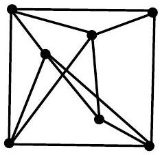
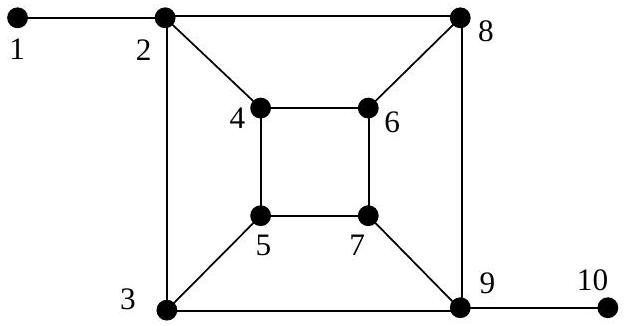
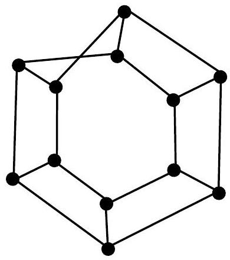

# 图论作业3

> 专栏：图论 · Notion 最后编辑：2026-11-12T05:17:00.000Z
>
> 来源：https://www.notion.so/d5f9d73858838227ae958101163d5c29

<table>
<tr><th>班级</th><th>选课号</th><th>姓名</th><th>学号</th></tr>
<tr><td>＿＿＿＿</td><td>＿＿＿＿</td><td>＿＿＿＿</td><td>＿＿＿＿</td></tr>
</table>

### 一、填空题

#### 第1题

完全图 $K_{10}$ 共有（　　945　　）个不同的完美匹配。

$K_{2n}的完美匹配个数,(2n-1)!!=9\times7\times5\times3\times1=945$

#### 第2题

超立方体 $Q_8$ 的最小覆盖包含的点数为（　　128　　）。
$Q_8有2^8=256个顶点，是8正则偶图，具有完美匹配，\\在偶图中，最小点覆盖数等于最大匹配边数=256/2=128$

#### 第3题

彼得森图的最大匹配包含的边数为（　　5　　）。

10/2=5

#### 第4题

完全图 $K_{60}$ 能分解为（　　59　　）个边不重的 $1$-因子之并。

> $K_{2n}能分解成2n-1个边不重的1-因子之并$

#### 第5题

完全图 $K_{61}$ 能分解为（　　20　　）个边不重的 $2$-因子之并。

> $K_{2n+1}能分解成n个边不重的2-因子之并,即n个H图之并$

#### 第6题

设图 $G$ 与 $K_5$ 同胚，则至少从 $G$ 中删掉（　　1　　）条边才可能使其成为可平面图。

#### 第7题

请判断下图是否为可平面（请填是或否）：（　　否　　）。

---

### 二、不定项选择题

#### 第1题

关于非平凡树 $T$，下面说法**错误**的是：ACE

（A）$T$ 至少包含一个完美匹配；错

（B）$T$ 至多包含一个完美匹配；对

（C）$T$ 恰好有一个完美匹配；不一定，奇数点时没有

（D）$T$ 是只有一个面的平面图；对

（E）$T$ 的对偶图可能是简单图。错

#### 第2题

下列说法**正确**的是：ABD

（A）三正则的偶图一定存在完美匹配；k正则偶图存在完美匹配

（B）三正则的哈密尔顿图一定存在完美匹配；对

（C）存在完美匹配的三正则图一定是哈密尔顿图；不一定，如彼得森图

（D）无割边的三正则图一定存在完美匹配；对

（E）有割边的三正则图一定没有完美匹配。不一定

#### 第3题

下列说法**正确**的是：ABCDE

（A）在偶图中，最大匹配包含的边数等于最小覆盖包含的点数；对

（B）任一非平凡正则偶图包含完美匹配；对

（C）任一非平凡正则偶图可以 $1$-因子分解；对

（D）偶度正则偶图可以 $2$-因子分解；偶度正则图

（E）任意 $k$-正则偶图（$k \geq 2$）一定不包含割边。对

#### 第4题

下列说法中**错误**的是：AF

（A）完全图 $K_{101}$ 包含 $1$-因子；错，奇数点不能有完美匹配

（B）完全图 $K_{101}$ 包含 $2$-因子；

（C）完全图 $K_{102}$ 包含 $1$-因子；

（D）完全图 $K_{102}$ 包含 $2$-因子；

（E）图 $G$ 的一个 $1$-因子对应 $G$ 的一个完美匹配；DUI

（F）图 $G$ 的一个 $2$-因子对应 $G$ 的一个哈密尔顿圈。连通的才是

#### 第5题

下列说法**正确**的是：ACE

（A）超立方体 $Q_n$ 一定可以 $1$-因子分解；n正则偶图，对

（B）最大度小于 $3$ 的偶数阶连通图一定可以 $1$-因子分解；错

（C）三正则的哈密尔顿图一定可以 $1$-因子分解；对

（D）无割边的 $3$ 正则图一定可以 $1$-因子分解；不对，存在完美匹配不代表能因子分解

（E）有割边的 $3$ 正则图一定不可以 $1$-因子分解。对

#### 第6题

下列说法**正确**的是：ACDE

（A）完全图 $K_{2n}$ 是 $2n-1$ 个完美匹配的并；DUI

（B）完全图 $K_{2n}$ 是 $n$ 个哈密尔顿圈的并；CUO K2N+1

（C）完全图 $K_{2n}$ 是 $1$ 个完美匹配与 $n-1$ 个哈密尔顿圈的并；DUI

（D）若图 $G$ 是 $2k$ 正则连通图，则 $G$ 可以分解为 $k$ 个 $2$-因子的并；DUI 

（E）无割边的 $3$ 正则图可以分解为一个 $1$-因子与一个 $2$-因子的并。DUI

#### 第7题

下列说法**错误**的是：C

（A）任何平面图都只有一个外部面；DUI

（B）简单平面图中一定有度数不超过 $5$ 的顶点；DUI

（C）平面图的各个面的次数之和可能为奇数；CUO

（D）只有一个面的连通平面图一定是树；DUI

（E）若 $G=(n,m)$ 是简单平面图且 $n \geq 3$，则 $m \leq 3n-6$；DUI

（F）若 $G=(n,m)$ 是无 $3$ 长圈的简单连通平面图且 $n \geq 3$，则 $m \leq 2n-4$。对

#### 第8题

下列说法**正确**的是：ABCDEF

（A）若无环图 $G$ 是 $2$ 连通的平面图，则其一定不包含割点；DUI

（B）若无环图 $G$ 是 $2$ 连通的平面图，则其一定不包含割边；DUI

（C）若无环图 $G$ 是 $2$ 连通的平面图，则其一定不包含只属于一个面的边；DUI

（D）若无环图 $G$ 是 $2$ 连通的平面图，则其每个面的边界均为圈；DUI

（E）若无环图 $G$ 是 $2$ 连通的平面图，则其任意两个点在同一个圈上；DUI

（F）若无环图 $G$ 是 $2$ 连通的平面图，则其任意两条边在同一个圈上。DUI

#### 第9题

关于平面图 $G$ 和其对偶图 $G^*$ 的关系，下列说法中**错误**的是：DEF

（A）$G^*$ 是连通平面图；dui

（B）$G^*$ 的顶点数等于 $G$ 的面数；DUI

（C）$G^*$ 的边数等于 $G$ 的边数；dui

（D）$G^*$ 的面数等于 $G$ 的点数；cuo

（E）$(G^*)^* \cong G$；CUO前提连通

（F）若 $G_1 \cong G_2$，则 $G_1^* \cong G_2^*$。cuo

---

### 三、解答题

#### 第1题

设 $G$ 是 $2k$ 阶简单图并且最小度 $\delta(G) \geq k \geq 1$。证明：$G$ 存在完美匹配。

$$

$$

#### 第2题

若 $G$ 是一个偶数阶简单连通图且 $\Delta(G)=2$，则 $G$ 一定包含完美匹配。

#### 第3题

由于在考试中获得好成绩，$6$ 名学生将获得下列书籍的奖励，分别是：代数学（$a$）、微积分（$c$）、微分方程（$d$）、几何学（$g$）、数学史（$h$）、规划学（$p$）、拓扑学（$t$）。每门科目只有 $1$ 本书，而每名学生对书的喜好是：

<table>
<tr><th>学生</th><th>喜欢的书籍</th></tr>
<tr><td>A</td><td>$d,\ h,\ t$</td></tr>
<tr><td>B</td><td>$h,\ t$</td></tr>
<tr><td>C</td><td>$c,\ d,\ g,\ p$</td></tr>
<tr><td>D</td><td>$d,\ h$</td></tr>
<tr><td>E</td><td>$d,\ t$</td></tr>
<tr><td>F</td><td>$a,\ c,\ d$</td></tr>
</table>

每名学生是否都可以得到他喜欢的书？为什么？（用图论方法求解）

#### 第4题

假定 $G$ 是具有 $m$ 条边的简单二部图，顶点的最大度为 $\Delta$。证明：$G$ 包含一个至少有 $m/\Delta$ 条边的匹配。

#### 第5题

有一个街区如下图所示，其中所有街道都是直线段。为了在巷战中能控制所有的街道，需要在街口处修筑碉堡，其中一个碉堡可以控制与其关联的所有街道。问最少需要多少个碉堡？并给出一种具体修建的位置。（用图论方法解答）**最小点覆盖问题**

#### 第6题

假设 $G$ 是阶数至少为 $3$ 的简单连通图。若 $G$ 包含割边，则 $G$ 一定不能 $1$-因子分解。

**证明：**设割边为 $e$。删去 $e$ 后，连通图分为两个分支，任选其中一个分支的顶点集记为 $S$。$S$ 与其余顶点之间只有边 $e$。

反设 $G$ 可以分解成若干个 1-因子。由于这些因子的边集覆盖 $E(G)$，其中某个 1-因子 $F_1$ 包含 $e$。$F_1$ 中除 $e$ 外，与 $S$ 中顶点关联的匹配边都在 $S$ 内，它们两两覆盖 $S$ 中剩余顶点，所以

$$
|S|\text{ 是奇数}.
$$

另一方面，$G$ 至少有 3 个顶点且连通，故某顶点度数至少为 2；1-因子分解的因子数等于每个顶点的度数，因此至少有另一个 1-因子 $F_2$。因各因子边不重，$F_2$ 不含 $e$，于是 $S$ 中所有顶点只能在 $S$ 内两两匹配，从而 $|S|$ 是偶数，矛盾。

#### 第7题

证明：完全图 $K_{6n-2}$ 可以 $3$-因子分解。

**证明：**$6n-2$ 是偶数，因此由 PPT 第 279 页的定理，$K_{6n-2}$ 可以 1-因子分解。该完全图为 $(6n-3)$ 正则图，所以恰有

$$
6n-3=3(2n-1)
$$

个 1-因子。

将它们每 3 个分为一组，共 $2n-1$ 组。每组中三个 1-因子边不重，且在每个顶点各提供一条关联边，因此它们的并是一个 3 正则生成子图，即 3-因子。各组边也不重，合起来恰好是原图的全部边，故得到 3-因子分解。证毕。

#### 第8题

有 $8$ 名研究生同学喜欢外出散步，他们每人每天都和一位同学外出散步。试给出一种安排使得每名研究生在一个星期内都和不同的同学出行。（用图论方法解答）K2N,的1-因子分解

#### 第9题

设简单图 $G$ 有 $10$ 个 $4$ 度顶点和 $8$ 个 $5$ 度顶点，其余顶点度数均为 $7$。求 $7$ 度顶点的最大数目，使得 $G$ 保持其可平面性。

#### 第10题

设 $G^*$ 是具有 $k$（$k \geq 2$）个连通分支的平面图 $G$ 的对偶图，已知 $G$ 的边数为 $10$，面数为 $3$，求 $G^*$ 的面数。

#### 第11题

经报道，近年发现了一种由硼和氮元素构成的化学分子，其分子结构呈球状。该分子中每个原子均有 $3$ 个相邻的原子并以化学单键相连，且分子结构中仅有 $4$ 长圈和 $6$ 长圈。试计算该分子中有多少个 $4$ 长圈？（用图论方法求解）

#### 第12题

判断下图是否为可平面图？若是，请给出一种平面嵌入；若否，请给出理由。

