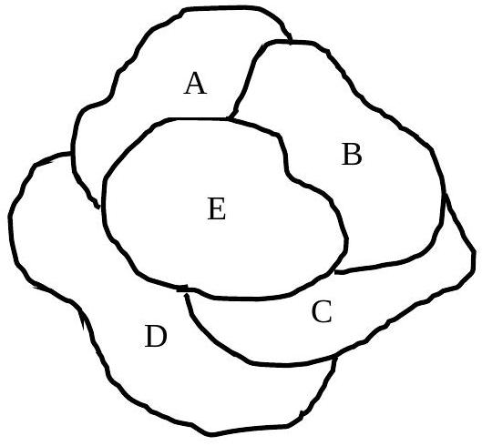

# 图论作业4

> 专栏：图论 · Notion 最后编辑：2026-11-13T01:29:00.000Z
>
> 来源：https://www.notion.so/8e49d7385883834c8a7481caafb698fe

### 一、填空题

1．长度至少为 3 的奇圈的点色数和边色数分别为 \_\_3\_\_ 和 \_\_3\_\_。

> **注** 若 $C_{n}$ 是 $n$ 长圈，则
> 
> $$
> P_{k}\left(C_{n}\right)=(k-1)^{n}+(-1)^{n}(k-1) 。
> $$
> 
> $\chi(G)=\min \left\{k \mid P_{k}(G) \geq 1\right\}$。

> **推论** 设 $G$ 是奇阶 $\Delta$ 正则简单图。若 $\Delta>0$，则 $\chi^{\prime}=\Delta+1$。

2．彼得森图的点色数和边色数分别为 \_\_3\_\_ 和 \_\_4\_\_。

3．已知树 $T$ 的度序列为 $(1,1,1,2,2,2,3)$，则 $T$ 的点色数和边色数分别为 \_\_2\_\_ 和 \_\_\_3\_。

$$
P_k(T)=k(k-1)^{n-1}\geq1 \\
k\geq 2,\chi(T)=2\\
\Delta(T)=3,2m=1\times3+2\times3+3=12,m=6\\
3\times 3=9>m ,\chi^{\prime}=\Delta=3
$$

> **定理** 设简单图 $G$ 具有 $n$ 个点、 $m$ 条边，若 $n=2 k+1$** **且** **$m>k \Delta$，则** **$\chi^{\prime}=\Delta+1$。

> **注** 若 $T$ 是 $n$ 阶树，则 $P_{k}(T)=k(k-1)^{n-1}$。
> 
> 
> 1. 若 $k<\chi(G)$，则 $P_{k}(G)=0$；$\chi(G)=\min \left\{k \mid P_{k}(G) \geq 1\right\}$。

4．方体 $Q_6$ 的点色数和边色数分别为 \_\_2\_\_ 和 \_\_6\_\_。

Q\_6是2^6个点 

5．设 $G$ 是一个 2025 阶 1956 正则图，则 $G$ 的边色数为 \_\_1957\_\_。

6．已知树 $T$ 的度序列为 $(1,1,1,1,2,2,4)$，则其色多项式为 \_\_$P_k(T)=k(k-1)^6$\_\_。

### 
 二、不定项选择题

#### 第 1 题

下列说法**错误**的是：

- （A）在正常着色下，图 $G$ 的每个色组在 $G$ 的补图中导出的子图是完全图；对

- （B）若图 $G$ 非连通，则图 $G$ 的补图必为连通图；对

- （C）图 $G$ 与其补图具有相同的频序列；对

- （D）存在 14 阶的自补图；错，n（mod4）=0或1（自补图的必要条件）

- （E）所有 4 阶图的补图都是可平面图。对，K4是可平面的

#### 第 2 题

关于完全图 $K_n$，下列说法**正确**的是：

- （A）点色数为 $n$；对

- （B）边色数为 $n$；错 ，偶数时n-1,奇数时时n

- （C）点连通度为 $n-1$；对

- （D）边连通度为 $n-1$；对

- （E）色多项式 $P_k(K_n)=k(k-1)\cdots(k-n+1)$。对

#### 第 3 题

关于 $n$（$n\geq 2$）维超立方体图 $Q_n$，下列说法**错误**的是：

- （A）一定是正则图；对

- （B）一定是二部图；对

- （C）一定是欧拉图；错误n是偶数时才是欧拉图

- （D）一定是哈密尔顿图；对。$n\geq2$ 时，$Q_n$ 有哈密尔顿圈（可由二进制反射 Gray 码构造）。

- （E）一定是平面图；错。$Q_n$ 在 $n\geq4$ 时不可平面：它是二部图，且 $|V|=2^n,\ |E|=n2^{n-1}>2|V|-4$。

- （F）点色数一定是 2；对

- （G）边色数一定是 $n$。对
## 三、解答题

#### 第 1 题：桥牌比赛安排

现有 5 个人 $A,B,C,D,E$ 被邀请参加桥牌比赛。比赛的规则是：

- ① 每一场比赛由 2 个二人组进行对决；

- ② 要求每个二人组 $(X,Y)$ 都要与其它二人组 $(U,V)$ 进行对决。

若每个人都要与其他任意一个人组成一个二人组，且每个组在同一天不能有多于一次的比赛，则最少需要安排多少天比赛？

由题意5个人作为顶点，组成二人组就连边，得图K5,由题意得边着色，$\chi^{\prime}=5$

#### 第 2 题：博士生论文答辩安排

有 6 名博士生要进行论文答辩，答辩委员会成员分别是：

- $A_1=\{\text{张教授},\text{李教授},\text{王教授}\}$；

- $A_2=\{\text{赵教授},\text{钱教授},\text{刘教授}\}$；

- $A_3=\{\text{严教授},\text{王教授},\text{刘教授}\}$；

- $A_4=\{\text{赵教授},\text{梁教授},\text{刘教授}\}$；

- $A_5=\{\text{张教授},\text{钱教授},\text{孙教授}\}$；

- $A_6=\{\text{李教授},\text{王教授},\text{严教授}\}$。

要使教授们参加答辩不至于发生时间冲突，至少安排几次答辩时间段？请给出一种最少时间段下的安排。

以6名博士生作为顶点，有冲突就连边得图G      $\chi=3$

#### 第 3 题：中国象棋循环赛安排

有 6 名选手参加中国循环比赛，任意两名选手均要进行一场比赛，每名选手每天最多参加一场比赛。

试确定完成比赛所需要的最少天数，并给出一种对应的赛程安排表。

$K_6$,

#### 第 4 题：光纤网络波长分配

天府新区拟部署一个有 7 个核心节点 $A,B,C,D,E,F,G$ 的光纤网络，节点之间的连接情况如下（两个节点通过一条光纤连接）：

$A$–$B$、$A$–$C$、$A$–$D$、$B$–$E$、$B$–$F$、$C$–$E$、$C$–$G$、$D$–$F$、$D$–$G$、$F$–$G$。

因光网络采用波分复用技术，故要求连接同一节点的光纤必须使用不同波长，并且网络中使用的波长数量越少成本越低。

该网络最少需要多少个波长才能使成本最低？

#### 第 5 题：行政区域着色

某地包含 5 个行政区域 $A,B,C,D,E$，位置关系如下图所示。拟用 4 种颜色对这 5 个区域着色，使得相邻的两个区域的颜色不同，问：

- （a）共有多少种不同的着色方案？

- （b）为使得相邻区域颜色不同，最少需要多少种颜色？

