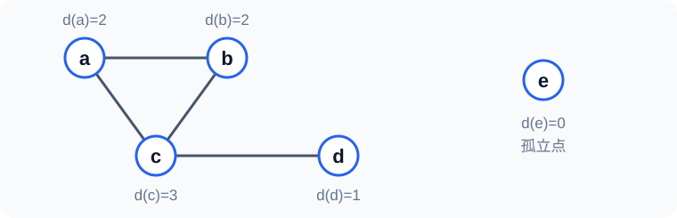

# 图论符号速查表

> 专栏：图论 · Notion 最后编辑：2026-10-27T03:38:00.000Z
>
> 来源：https://www.notion.so/4069d7385883816093fed8c1a4fbb83a

> 先记这一句：点看 $V$，边看 $E$；数点用 $n$，数边用 $m$；一个点的度看 $d(v)$，两点距离看 $d(u,v)$；最小度 $\delta$、最大度 $\Delta$；删点连通度 $\kappa$、删边连通度 $\lambda$；分支数 $\omega$；点着色 $\chi$、边着色 $\chi'$。

本页按你现有的《图论PPT汇总》七章笔记整理，以课件中的定义为准。每行给出“符号 → 中文含义 → 一个例子或辨别办法”。除专门讨论自环、重边的地方外，例子均用有限无向简单图。第一次不用全部背，先看下面的“最容易认错的符号”，做题时再按目录查。

<!-- 目录由各级标题表示 -->

### 最容易认错的符号

<table>
<tr><th>符号</th><th>在你的课件中表示什么</th><th>最容易混在哪里</th></tr>
<tr><td>$d(v)$、$d(u,v)$、$d(G)$</td><td>一个点的度、两点距离、图的直径</td><td>都是 $d$，但括号里分别是一个顶点、两个顶点、整张图</td></tr>
<tr><td>$\delta(G)$、$\Delta(G)$</td><td>最小度、最大度</td><td>小写 delta 记“小的度”，大写 Delta 记“大的度”</td></tr>
<tr><td>$\omega(G)$</td><td>连通分支的个数</td><td>本课件明确用它数“有几块”；查其他资料时不要只凭符号猜定义</td></tr>
<tr><td>$o(G)$</td><td>顶点数为奇数的连通分支个数</td><td>不是所有分支数，也不是奇度顶点数</td></tr>
<tr><td>$\kappa(G)$、$\lambda(G)$</td><td>点连通度、边连通度</td><td>$\kappa$ 删点，$\lambda$ 删边；完全图的点连通度按专门约定处理</td></tr>
<tr><td>$\tau(G)$</td><td>生成树的个数</td><td>本课件中它是“有多少棵生成树”，不是生成树本身</td></tr>
<tr><td>$\Phi$、$\varphi$</td><td>第六章：面集、面数</td><td>$\Phi$ 是集合，$\varphi$ 是数；算法里 $\Phi$ 有时又被写来表示空集</td></tr>
<tr><td>$\chi(G)$、$\chi&#39;(G)$</td><td>点色数、边色数</td><td>撇号表示“边着色”；不是求导</td></tr>
<tr><td>$\Delta_2(G)$</td><td>第七章专门定义的“次大度”</td><td>不能直接当成把所有顶点度数排序后的第二项</td></tr>
<tr><td>$G^*$、$M^*$</td><td>第六章中是对偶图；匹配章节中是上下文指定的匹配</td><td>星号的含义由当前定义决定，不能统一理解成“最优”</td></tr>
</table>

其中 $\omega(G)$ 的来源见 [第一章 图的基本概念](<graph-chapter-1.md>)；$\tau(G)$ 见 [第二章 树](<graph-chapter-2.md>)；$o(G)$ 见 [第五章 匹配与因子分解](<graph-chapter-5.md>)；面与着色记号分别见第六、七章。

### 1 基本对象和集合读法

对应 [第一章 图的基本概念](<graph-chapter-1.md>)。

<table>
<tr><th>符号</th><th>含义和读法</th><th>例子或记法</th></tr>
<tr><td>$G=(V,E)$</td><td>图 $G$ 由顶点集与边集组成</td><td>先列“有哪些点”，再列“连了哪些边”</td></tr>
<tr><td>$V(G)$、$E(G)$</td><td>图 $G$ 的顶点集合、边集合</td><td>$V$ 想 vertex，$E$ 想 edge</td></tr>
<tr><td>$v,u$；$e$</td><td>常用来表示顶点；边</td><td>字母只是名字，先看题目把它定义成什么</td></tr>
<tr><td>$uv$</td><td>连接顶点 $u,v$ 的一条边</td><td>在这里是边的写法，不是 $u$ 乘 $v$；无向图中 $uv$ 与 $vu$ 表示同一对端点</td></tr>
<tr><td>$uv\in E(G)$</td><td>$u,v$ 在 $G$ 中相邻</td><td>读“边 $uv$ 属于 $G$ 的边集”</td></tr>
<tr><td>$\lvert S\rvert$</td><td>集合 $S$ 中元素的个数</td><td>$\lvert\{a,b,c\}\rvert=3$；数集合，不是对集合取绝对值</td></tr>
<tr><td>$n(G)=\lvert V(G)\rvert$</td><td>顶点数，也叫图的阶数</td><td>常简写 $n$</td></tr>
<tr><td>$m(G)=\lvert E(G)\rvert$</td><td>边数</td><td>常简写 $m$；每条边只数一次</td></tr>
<tr><td>$x\in S$；$x\notin S$</td><td>$x$ 属于；不属于集合 $S$</td><td>单个元素与集合之间的关系</td></tr>
<tr><td>$S\subseteq V$；$S\subset V$</td><td>子集；课件采用的真子集记号</td><td>$\subseteq$ 允许相等；真子集还要求不相等。其他资料的 $\subset$ 约定可能不同</td></tr>
<tr><td>$\varnothing$</td><td>空集，没有任何元素</td><td>算法中的 $T=\Phi$ 常是在说 $T=\varnothing$；本页用 $\varnothing$ 避免混淆</td></tr>
<tr><td>$S\cup T$；$S\cap T$</td><td>并集；交集</td><td>并：两边有的都要；交：两边共有的才要</td></tr>
<tr><td>$S\setminus T$ 或 $S\backslash T$</td><td>差集，在 $S$ 中但不在 $T$ 中的元素</td><td>$\{a,b,c\}\setminus\{b\}=\{a,c\}$</td></tr>
<tr><td>$\{x\mid \text{条件}\}$</td><td>满足条件的所有 $x$ 组成的集合</td><td>中间竖线读“使得”或“满足”，不是除号</td></tr>
<tr><td>$\forall$；$\exists$</td><td>对所有；存在至少一个</td><td>“所有顶点”与“至少一个顶点”不能互换</td></tr>
<tr><td>$\Rightarrow$；$\Leftrightarrow$</td><td>推出；当且仅当</td><td>$\Rightarrow$ 只承诺一个方向；$\Leftrightarrow$ 承诺两个方向</td></tr>
</table>

**读公式的小步骤：先判断它是“一个对象、一个集合，还是一个数”。** 例如 $V(G)$ 是集合，$\lvert V(G)\rvert$ 才是数；$M$ 是匹配边集，$\lvert M\rvert$ 才是匹配里的边数。

### 2 度和邻集

对应第一章的“度与度序列”，邻集也用于 [第五章 匹配与因子分解](<graph-chapter-5.md>)。

<table>
<tr><th>符号</th><th>含义</th><th>例子或辨别办法</th></tr>
<tr><td>$d_G(v)$ 或 $d(v)$</td><td>顶点 $v$ 在图 $G$ 中的度</td><td>数与这个点关联的边端；一个自环贡献 $2$</td></tr>
<tr><td>$\delta(G)=\min_{v\in V(G)}d(v)$</td><td>全图最小度</td><td>把各点度数算出来，取最小值</td></tr>
<tr><td>$\Delta(G)=\max_{v\in V(G)}d(v)$</td><td>全图最大度</td><td>把各点度数算出来，取最大值</td></tr>
<tr><td>$(d_1,\ldots,d_n)$</td><td>度序列</td><td>记录每个顶点的度；若重新排序，要看题目要求升序还是降序</td></tr>
<tr><td>$(b_1,\ldots,b_s)$</td><td>课件中的频序列</td><td>若不同度值为 $d_1,\ldots,d_s$，则 $b_i$ 是度为 $d_i$ 的顶点个数；不是度值本身</td></tr>
<tr><td>$N(v)$</td><td>顶点 $v$ 的邻集</td><td>默认简单图时不包含 $v$ 自己；度是一个数，邻集是一组点</td></tr>
<tr><td>$N(S)=\bigcup_{v\in S}N(v)$</td><td>与集合 $S$ 中至少一个点相邻的全部顶点</td><td>一般图中可能与 $S$ 有交集；若偶图二分类为 $(X,Y)$ 且 $S\subseteq X$，才有 $N(S)\subseteq Y$</td></tr>
<tr><td>$k$ 正则</td><td>每个顶点的度都是 $k$</td><td>表示 $\delta(G)=\Delta(G)=k$，不是全图只有 $k$ 条边</td></tr>
</table>

握手定理可以拿来检查度有没有数错：

$$
\sum_{v\in V(G)}d(v)=2m.
$$

“$\sum$”读“求和”；左边把每个点的度加起来，右边是边数的两倍。

### 3 常见图和图的运算

对应 [第一章 图的基本概念](<graph-chapter-1.md>)；收缩边也见 [第二章 树](<graph-chapter-2.md>)。

<table>
<tr><th>符号</th><th>含义</th><th>例子或辨别办法</th></tr>
<tr><td>$K_n$</td><td>$n$ 个顶点的完全图</td><td>任意两个不同顶点都相连；$K_3$ 是三角形，边数为 $n(n-1)/2$</td></tr>
<tr><td>$G=(X,Y)$</td><td>匹配章节中对偶图二分类的简写</td><td>这里的 $X,Y$ 都是顶点集，不是“点集、边集”；注意与 $G=(V,E)$ 区别</td></tr>
<tr><td>$K_{p,q}$</td><td>两部分各有 $p,q$ 个顶点的完全偶图</td><td>同一部分内部不连边，跨部分全部连接；有 $p+q$ 个点、$pq$ 条边</td></tr>
<tr><td>$C_n$</td><td>$n$ 圈</td><td>简单图情形 $n\ge3$，有 $n$ 个点、$n$ 条边</td></tr>
<tr><td>$T$</td><td>通常用来表示一棵树</td><td>字母 $T$ 只是约定，仍应看题目是否已经说明它是树</td></tr>
<tr><td>$G\cong H$</td><td>$G,H$ 同构</td><td>结构相同、允许重新命名顶点；不能仅凭点数、边数相同就认定同构</td></tr>
<tr><td>$H\subseteq G$</td><td>$H$ 是 $G$ 的子图</td><td>点和边都来自 $G$，但不一定保留所选点之间的全部边</td></tr>
<tr><td>$G[S]$</td><td>由顶点集 $S$ 导出的子图</td><td>选定这些点，把原图中它们之间的边全部保留</td></tr>
<tr><td>$G[E&#39;]$</td><td>由边集 $E&#39;$ 导出的子图</td><td>选定这些边，顶点取它们的全部端点；看清中括号里装的是点还是边</td></tr>
<tr><td>$G-v$、$G-S$</td><td>删除一个顶点或一组顶点</td><td>连带删除与所删顶点关联的边</td></tr>
<tr><td>$G-e$、$G-E&#39;$</td><td>删除一条边或一组边</td><td>保留原顶点，即使删完后出现孤立点</td></tr>
<tr><td>$G+e$</td><td>添加一条指定的边</td><td>与两个不相交图的并 $G_1+G_2$ 不是同一个语境</td></tr>
<tr><td>$\overline G$</td><td>简单图 $G$ 的补图</td><td>顶点不变，不同顶点之间原来有边就去掉，原来无边就补上；不是把图画到外面</td></tr>
<tr><td>$G_1\cup G_2$、$G_1\cap G_2$</td><td>并图、交图</td><td>分别对点集和边集做并、交；须满足题目采用的图定义</td></tr>
<tr><td>$G_1+G_2$</td><td>课件中两个不相交图的并</td><td>“不相交”指没有公共顶点；不主动添加跨图边</td></tr>
<tr><td>$G_1\vee G_2$</td><td>联图</td><td>从不相交的并出发，再把两图的顶点两两跨图连接</td></tr>
<tr><td>$G_1\triangle G_2$ 或课件的 $G_1\Delta G_2$</td><td>对称差</td><td>边恰好只在一边出现时保留；这里 $\Delta$ 不是最大度</td></tr>
<tr><td>$G\cdot e$</td><td>收缩边 $e$</td><td>删去这条边，再把它的两个端点合并；收缩后重边等按题目约定处理</td></tr>
</table>

**两个常见区别：**

- $G[S]$ 与一般子图：导出子图不能随意漏掉所选点之间原有的边。

- $G-E'$ 与 $G[E(G)\setminus E']$：前者保留原来的全部顶点，后者只保留剩余边的端点，因此孤立点可能不同。

### 4 路 距离 树和连通度

对应 [第一章 图的基本概念](<graph-chapter-1.md>)、[第二章 树](<graph-chapter-2.md>)、[第三章 图的连通度](<graph-chapter-3.md>)。

<table>
<tr><th>符号或名称</th><th>含义</th><th>例子或辨别办法</th></tr>
<tr><td>$W=v_0e_1v_1\cdots e_kv_k$</td><td>点、边交替的途径</td><td>长度是经过边的次数 $k$；途径可以重复点或边</td></tr>
<tr><td>迹；路；圈</td><td>迹不重复边；路不重复顶点；圈首尾闭合且除首尾外不重复顶点</td><td>按课件用词区分，不要把所有“走法”都叫简单路</td></tr>
<tr><td>$d(u,v)$</td><td>两点间最短路的长度</td><td>无权图数边；赋权图取题目规定的最小总权</td></tr>
<tr><td>$d(G)$</td><td>图的直径</td><td>所有两点距离的最大值；课件对非连通图取 $\infty$</td></tr>
<tr><td>$e(v)=\max_{u\in V(G)}d(u,v)$</td><td>顶点 $v$ 的离心率</td><td>固定一个起点 $v$，看最远能到多远；用于连通图</td></tr>
<tr><td>$r(G)=\min_{v\in V(G)}e(v)$</td><td>图的半径</td><td>在所有点中找一个“最不偏远”的点，看它的离心率</td></tr>
<tr><td>$e(v)=r(G)$</td><td>$v$ 是中心点</td><td>中心点使最远距离尽量小；树的中心与形心不是同一定义</td></tr>
<tr><td>$\omega(G)$</td><td>连通分支数</td><td>数图被分成几个彼此不通的部分，孤立点也单独算一部分</td></tr>
<tr><td>$\omega(G-e)&gt;\omega(G)$</td><td>$e$ 是割边</td><td>删除它后，分支变多；割边也叫桥</td></tr>
<tr><td>$\kappa(G)$</td><td>点连通度</td><td>对非完全的非平凡连通图，最少删几个点会不连通；$\kappa(K_n)=n-1$。非连通图或平凡图按课件取 $0$</td></tr>
<tr><td>$\lambda(G)$</td><td>边连通度</td><td>对非平凡连通图，最少删几条边会不连通；非连通图或平凡图按课件取 $0$</td></tr>
<tr><td>$k$ 连通；$k$ 边连通</td><td>$\kappa(G)\ge k$；$\lambda(G)\ge k$</td><td>是“至少 $k$”，不是必须恰好等于 $k$</td></tr>
<tr><td>$\tau(G)$</td><td>标号图 $G$ 的生成树个数</td><td>$T$ 可以是一棵树，$\tau(G)$ 是一个计数；连通图才有生成树</td></tr>
<tr><td>$w(e)$；$W(G)$</td><td>一条边的权；全图各边权之和</td><td>最小生成树最小化的是总权，不是边数；每棵生成树本来就有 $n-1$ 条边</td></tr>
</table>

可连起来记的两个式子：

$$
\kappa(G)\le\lambda(G)\le\delta(G).
$$

$$
r(G)\le d(G)\le2r(G)\qquad\text{（连通图）}.
$$

前一个式子用于这里的有限无向简单图。后一个式子中，半径取“各点最远距离的最小值”，直径取“全图最远距离”。

> 第四章的口诀：Euler 看边，Hamilton 看点。Euler 迹走遍每条边且不重复边；Euler 闭迹还要回到起点。Hamilton 路走遍每个顶点且不重复顶点；Hamilton 圈还要闭合。课件中的 $E$ 图、$H$ 图分别是 Euler 图、Hamilton 图，不要与边集 $E$、任意子图 $H$ 混为一谈。

来源：[第四章 Euler图与Hamilton图](<graph-chapter-4.md>)。

### 5 匹配和因子

对应 [第五章 匹配与因子分解](<graph-chapter-5.md>)。

<table>
<tr><th>符号或名称</th><th>含义</th><th>例子或辨别办法</th></tr>
<tr><td>$M\subseteq E(G)$</td><td>一个匹配</td><td>选出一些互不共端点的边；不是随便一个边子集都叫匹配</td></tr>
<tr><td>$\lvert M\rvert$</td><td>匹配的边数</td><td>不是被匹配到的顶点数；匹配的 $\lvert M\rvert$ 条边饱和 $2\lvert M\rvert$ 个顶点</td></tr>
<tr><td>$M$ 饱和点</td><td>是 $M$ 中某条边的端点</td><td>非饱和点就是暂时没有被匹配到的点</td></tr>
<tr><td>完美匹配</td><td>饱和全部顶点的匹配</td><td>满足 $2\lvert M\rvert=n$；有奇数个顶点的图不可能有完美匹配</td></tr>
<tr><td>$M$ 交错路；$M$ 可扩路</td><td>匹配边与非匹配边交替的路；两端均非饱和的交错路</td><td>可扩路也常叫增广路，沿路交换边可以使匹配边数加 $1$</td></tr>
<tr><td>$M&#39;=M\triangle E(P)$</td><td>沿可扩路 $P$ 更新匹配</td><td>路上原来选的取消，原来没选的加入；$E(P)$ 是这条路的边集</td></tr>
<tr><td>$K\subseteq V(G)$</td><td>第五章中的点覆盖</td><td>每条边至少一个端点被选入 $K$；它是一组点，不是完全图 $K_n$</td></tr>
<tr><td>$o(G)$、$o(G-S)$</td><td>奇分支个数；删去 $S$ 后的奇分支个数</td><td>“奇”指分支内的顶点数为奇数</td></tr>
<tr><td>$k$-因子</td><td>包含全部顶点且每点度为 $k$ 的生成子图</td><td>$1$-因子等价于完美匹配；$2$-因子在简单图中是覆盖全部顶点的若干个互不相交的圈</td></tr>
</table>

**两个常见公式怎么读：**

- Hall 条件 $\lvert N(S)\rvert\ge\lvert S\rvert$：偶图二分类 $(X,Y)$ 中，要对每一个 $S\subseteq X$ 检查，“这群点总共能找到的邻居不少于这群点本身”。

- Tutte 条件 $o(G-S)\le\lvert S\rvert$：对每一个 $S\subseteq V(G)$，删去这些点后留下的奇分支数，不多于删掉的点数。

**最大与极大不能混：** 四个点的路 $a-b-c-d$ 中，$\{bc\}$ 已不能再直接加一条不冲突的边，所以是极大匹配；$\{ab,cd\}$ 有两条边，才是最大匹配。König 定理中“最大匹配边数＝最小点覆盖点数”要求图是偶图，不能随意用于所有图。

### 6 平面图和着色

对应 [第六章 平面图](<graph-chapter-6.md>)、[第七章 图的着色](<graph-chapter-7.md>)。

<table>
<tr><th>符号</th><th>含义</th><th>例子或辨别办法</th></tr>
<tr><td>$\Phi$</td><td>第六章的面集</td><td>包括外部面；这是集合，不是面数</td></tr>
<tr><td>$f\in\Phi$</td><td>一个面</td><td>同一图形里外面那一大片也算一个面</td></tr>
<tr><td>$\varphi=\lvert\Phi\rvert$</td><td>面的个数</td><td>连通平面图有 $n-m+\varphi=2$；一般平面图为 $n-m+\varphi=1+\omega(G)$</td></tr>
<tr><td>$\deg f$</td><td>面 $f$ 的次数，即边界边的计数</td><td>同一割边在该面的边界上可能走两次，因此贡献 $2$；全体面次数之和为 $2m$</td></tr>
<tr><td>$G^*$</td><td>一个给定平面嵌入的对偶图</td><td>原图的面对应对偶图的点；不是补图 $\overline G$</td></tr>
<tr><td>$F(B,H&#39;)$</td><td>平面性算法中，片段 $B$ 可以画入 $H&#39;$ 的哪些面的集合</td><td>是“可放位置的集合”；集合为空表示当前片段无面可放</td></tr>
<tr><td>$\chi(G)$</td><td>正常顶点着色需要的最少颜色数</td><td>相邻点异色；$K_3$ 要 $3$ 色</td></tr>
<tr><td>$\chi&#39;(G)$</td><td>正常边着色需要的最少颜色数</td><td>共端点的边异色；$K_{1,3}$ 的三条边要 $3$ 色，但它的顶点只需 $2$ 色</td></tr>
<tr><td>$k$ 可着色</td><td>能用给定的 $k$ 种颜色完成正常点着色</td><td>表示 $\chi(G)\le k$；“$k$ 色图”才表示 $\chi(G)=k$</td></tr>
<tr><td>$P_k(G)$</td><td>使用给定的 $k$ 种有名称的颜色时，正常点着色的方案数</td><td>可少用某些颜色，不要求每色都出现；$P_3(K_3)=3!=6$，但 $\chi(K_3)=3$</td></tr>
<tr><td>$N_r(G)$</td><td>课件中具有 $r$ 个分支的理想生成子图个数</td><td>每个分支都是完全图；不是邻集 $N(v)$</td></tr>
<tr><td>$\Delta_2(G)$</td><td>在“存在一个度不小于自身的邻点”的顶点中，取最大的度</td><td>详见下方进阶说明，不能按名称直接猜</td></tr>
</table>

**用一条边 **$e$** 比较两种递推，最容易记住符号：**

$$
\tau(G)=\tau(G-e)+\tau(G\cdot e).
$$

这是生成树计数中的删边、缩边递推（适用于课件的无自环连通图）。分类是“不含这条边”与“含这条边”，所以相加。

$$
P_k(G)=P_k(G-e)-P_k(G\cdot e).
$$

这是简单图的色多项式递推。“删边后多算了两端同色的方案”，所以减去。两个式子的运算相同，数的对象不同，符号也不同。

### 7 矩阵和算法中的字母

对应 [第一章 图的基本概念](<graph-chapter-1.md>)、第二章矩阵树定理及第五章最优匹配。

<table>
<tr><th>符号</th><th>含义</th><th>记法或易混点</th></tr>
<tr><td>$A(G)=[a_{ij}]$</td><td>邻接矩阵，大小 $n\times n$</td><td>行、列都对应顶点；简单图中相邻填 $1$，不相邻填 $0$</td></tr>
<tr><td>$B(G)=[b_{ij}]$</td><td>关联矩阵，大小 $n\times m$</td><td>行对应点、列对应边；无自环图中，点与边关联填 $1$，不关联填 $0$</td></tr>
<tr><td>$(A^k)_{ij}$</td><td>从 $v_i$ 到 $v_j$ 的长度为 $k$ 的途径数</td><td>数的是可重复点、边的途径，不是简单路的条数</td></tr>
<tr><td>$L(G)$</td><td>矩阵树定理中的矩阵，通常称拉普拉斯矩阵</td><td>对无自环图：对角为点的度，非对角为连接两点边数的负值</td></tr>
<tr><td>$L_i$、$\det L_i$</td><td>同时删去 $L$ 的第 $i$ 行和第 $i$ 列后的矩阵；其行列式</td><td>在课件矩阵树定理条件下，$\tau(G)=\det L_i$。矩阵外的竖线也可能表示行列式</td></tr>
<tr><td>$t(a_k)$</td><td>Dijkstra 算法中顶点的距离标号</td><td>课件已确定的标号表示起点到它的最短距离；实现中的临时标号仍可能更新</td></tr>
<tr><td>$l(e)$、$w(e)$</td><td>在赋权图语境中表示边的权</td><td>$l$ 像数字 $1$，但这里是字母</td></tr>
<tr><td>$l(v)$、$G_l$</td><td>第五章最优匹配中的可行顶点标号；对应的相等子图</td><td>$l(v)$ 不是边长；相等边满足 $l(x)+l(y)=w(xy)$</td></tr>
</table>

**同一字母不一定总表示同一种对象。** 例如 $B(G)$ 是关联矩阵，第六章单独的 $B$ 可以是片段；$e$ 可以是边，而 $e(v)$ 在第二章表示离心率。先看它后面是否有括号，以及当前小节的定义。

### 8 用同一张小图把符号串起来

下图为本页新画的学习例图，不是原课件截图。顶点为 $a,b,c,d,e$，边为 $ab,bc,ca,cd$；$e$ 是孤立点。

本页统一例图：三角形 abc，边 cd，以及孤立点 e

<table>
<tr><th>写法</th><th>在例图中的值</th><th>实际在问什么</th></tr>
<tr><td>$V(G)$</td><td>$\{a,b,c,d,e\}$</td><td>有哪些点</td></tr>
<tr><td>$E(G)$</td><td>$\{ab,bc,ca,cd\}$</td><td>有哪些边</td></tr>
<tr><td>$n(G)$、$m(G)$</td><td>$5$、$4$</td><td>分别数点和数边</td></tr>
<tr><td>$d(c)$、$N(c)$</td><td>$3$、$\{a,b,d\}$</td><td>前者是度的数值，后者是邻点集合</td></tr>
<tr><td>$\delta(G)$、$\Delta(G)$</td><td>$0$、$3$</td><td>孤立点使最小度为 $0$；$c$ 的度最大</td></tr>
<tr><td>$d(a,d)$</td><td>$2$</td><td>最短路可取 $a-c-d$，走两条边</td></tr>
<tr><td>$\omega(G)$、$o(G)$</td><td>$2$、$1$</td><td>两个分支；其中只有孤立点所在分支的顶点数为奇数</td></tr>
<tr><td>$G[\{a,b,c\}]$</td><td>三角形 $K_3$</td><td>只选这三个点，原来三条边都保留</td></tr>
<tr><td>$G-c$</td><td>剩下 $a,b,d,e$，只有边 $ab$</td><td>删点还要删去它关联的全部边</td></tr>
<tr><td>$G-cd$</td><td>保留五个点，只删边 $cd$</td><td>此时 $d,e$ 都是孤立点</td></tr>
<tr><td>$\chi(G)$</td><td>$3$</td><td>三角形至少要三种点颜色，其他点不增加所需颜色数</td></tr>
</table>

度数自检：

$$
d(a)+d(b)+d(c)+d(d)+d(e)=2+2+3+1+0=8=2m.
$$

这里 $d(d)$ 外面的 $d$ 表示“度”，括号里的 $d$ 是顶点名字。看到符号时，先把“函数”和“输入对象”分开读，就不容易绕晕。

### 9 希腊字母认读

<table>
<tr><th>符号</th><th>常用中文读法</th><th>本课件中优先联想</th></tr>
<tr><td>$\delta$、$\Delta$</td><td>小写、大写 delta，德尔塔</td><td>最小度、最大度；$\Delta$ 出现在两图之间时也可能是对称差</td></tr>
<tr><td>$\kappa$</td><td>kappa，卡帕</td><td>点连通度</td></tr>
<tr><td>$\lambda$</td><td>lambda，拉姆达</td><td>$\lambda(G)$ 是边连通度；$\lambda_i$ 在矩阵章节可能是特征值</td></tr>
<tr><td>$\omega$</td><td>omega，欧米伽</td><td>连通分支数</td></tr>
<tr><td>$\chi$</td><td>chi，通常读“希”</td><td>点色数；带撇号时是边色数</td></tr>
<tr><td>$\Phi$、$\varphi$</td><td>大写、小写 phi，斐</td><td>面集、面数；算法中的空集写法须另辨</td></tr>
<tr><td>$\tau$</td><td>tau，陶</td><td>生成树的计数</td></tr>
<tr><td>$\sigma$</td><td>sigma，西格玛</td><td>课件中的荫度，见进阶补充</td></tr>
<tr><td>$\alpha$</td><td>alpha，阿尔法</td><td>可能是向量或算法调标量，没有脱离上下文的唯一含义</td></tr>
<tr><td>$\pi$</td><td>pi，派</td><td>着色章节中可表示一个着色方案，不一定是圆周率</td></tr>
</table>

中文音译会有差异，做题关键是“它在当前章节代表什么”，不用纠结读音是否与别人完全一样。

### 进阶补充 不急着一次记完

以下记号在现有课件中出现，但可以在做到对应章节时再查。

<table>
<tr><th>符号</th><th>含义或用法</th><th>特别提醒</th></tr>
<tr><td>$G_1\times G_2$</td><td>第一章按“保持一个坐标不变、另一个坐标沿原图的边变化”定义的积图</td><td>看定义识别；不能把所有教材里的图积符号都当成一样</td></tr>
<tr><td>$G_1[G_2]$</td><td>课件中的合成图</td><td>与 $G[S]$ 的顶点导出子图区别：方括号里这次是一张图</td></tr>
<tr><td>$Q_n$</td><td>$n$ 维方体图，课件递归写为 $Q_1=K_2$、$Q_n=Q_1\times Q_{n-1}$</td><td>下标是维数，不是顶点数；有 $2^n$ 个顶点</td></tr>
<tr><td>$K_{n_1,\ldots,n_l}$</td><td>完全 $l$ 部图</td><td>同部内不连边，不同部之间全连接</td></tr>
<tr><td>$T_{l,n}$</td><td>课件中的 $n$ 阶完全 $l$ 几乎等部图</td><td>共 $n$ 个点分成 $l$ 部，各部大小尽量相等；不要只凭 $T$ 当成树</td></tr>
<tr><td>$\sigma(G)$</td><td>荫度：把全部边分成森林所需的最少组数</td><td>每组形成森林；它是组数，不是图的度</td></tr>
<tr><td>$\lfloor x\rfloor$、$\lceil x\rceil$</td><td>向下取整、向上取整</td><td>$\lfloor2.7\rfloor=2$，$\lceil2.7\rceil=3$</td></tr>
</table>

第七章“次大度”的准确读法是：

$$
V_2(G)=\{v\in V(G):\exists u\in N(v),\ d(u)\ge d(v)\},
$$

$$
\Delta_2(G)=\max_{v\in V_2(G)}d(v).
$$

先筛出“至少有一个邻点的度不比自己小”的点，再在这些点中取最大度。对至少含一条边的简单图，也可以等价地按每条边两个端点度数的较小值来取最大。

例如 $K_{2,3}$ 的度序列是 $(3,3,2,2,2)$，但 $\Delta_2=2$，不是排序第二项的 $3$。

来源：第一章图的运算与极图、[第五章 匹配与因子分解](<graph-chapter-5.md>)、[第七章 图的着色](<graph-chapter-7.md>)。

### 一分钟自测 先遮住答案

1. $d(v)$ 与 $d(u,v)$ 各在数什么？

2. $V(G)$ 与 $\lvert V(G)\rvert$ 哪一个是集合，哪一个是数？

3. $G-v$ 与 $G-e$ 是否都会减少顶点数？

4. 例图中 $\omega(G)$ 和 $o(G)$ 分别是多少？

5. $\chi(G)$ 与 $\chi'(G)$ 分别给点还是给边着色？

6. $\tau(G)$ 是一棵生成树，还是生成树的个数？

7. 课件里的 $\Phi$ 是否在所有章节都表示同一对象？

8. $\Delta_2(G)$ 能否直接按全体顶点度数排序取第二项？

**核对答案**

1. 一个顶点的度；两个顶点的最短距离。

2. 前者是顶点集合，后者是顶点数。

3. 删点会；单纯删边保留全部原顶点。

4. $2$ 个连通分支，$1$ 个奇分支。

5. 无撇号给点着色，带撇号给边着色。

6. 是个数。

7. 不能这样理解：第六章用于面集，部分算法又用它表示空集。

8. 不能，必须使用第七章的专门定义。

### 原课件入口

- [图论PPT汇总](<graph-course-notes.md>)

- [第一章 图的基本概念](<graph-chapter-1.md>)

- [第二章 树](<graph-chapter-2.md>)

- [第三章 图的连通度](<graph-chapter-3.md>)

- [第四章 Euler图与Hamilton图](<graph-chapter-4.md>)

- [第五章 匹配与因子分解](<graph-chapter-5.md>)

- [第六章 平面图](<graph-chapter-6.md>)

- [第七章 图的着色](<graph-chapter-7.md>)

整理于 2026-10-27。释义按当前可读课件笔记改写，例图和自测为本页补充；不是对原 PDF 每一页的重新校勘。
