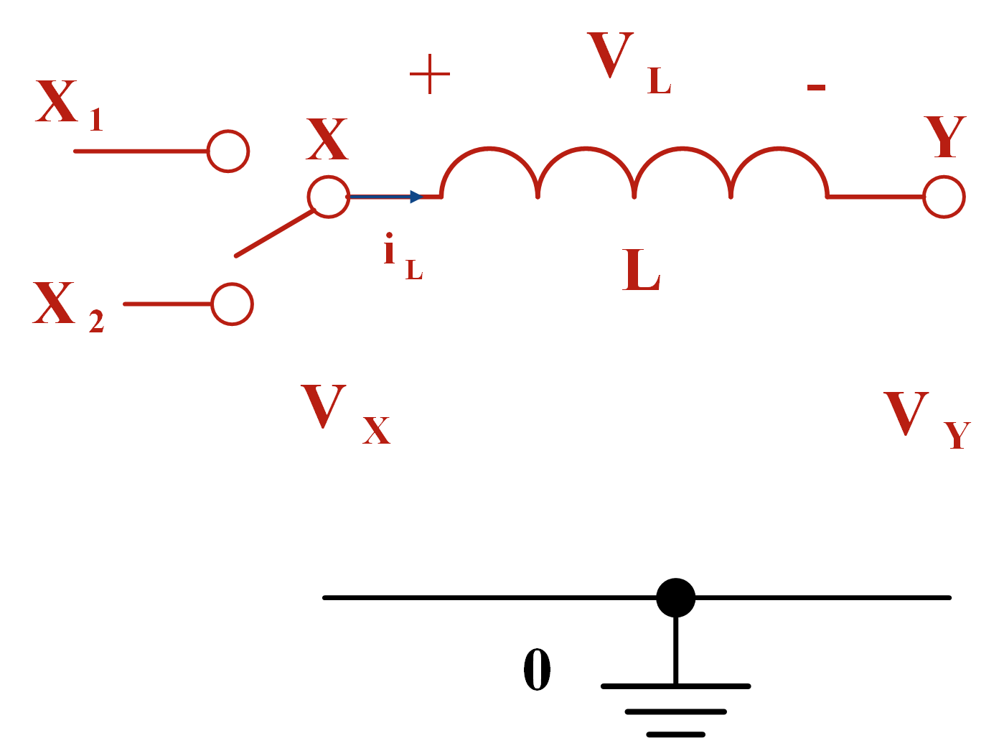
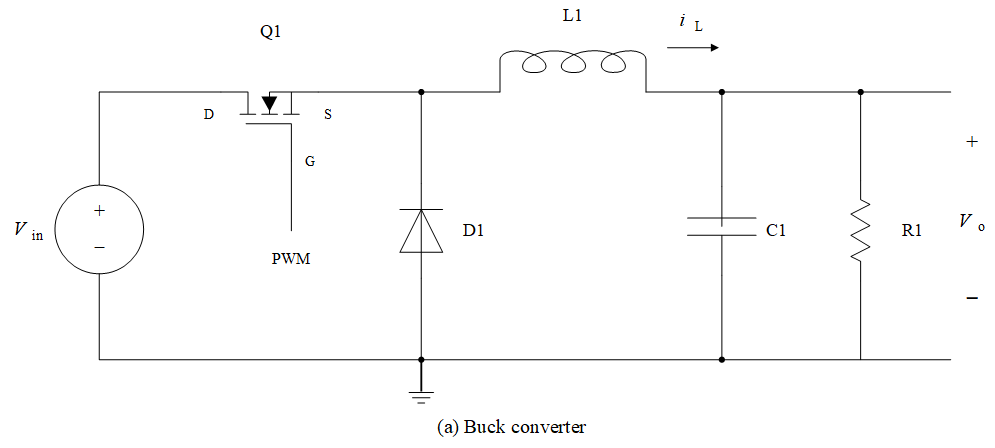
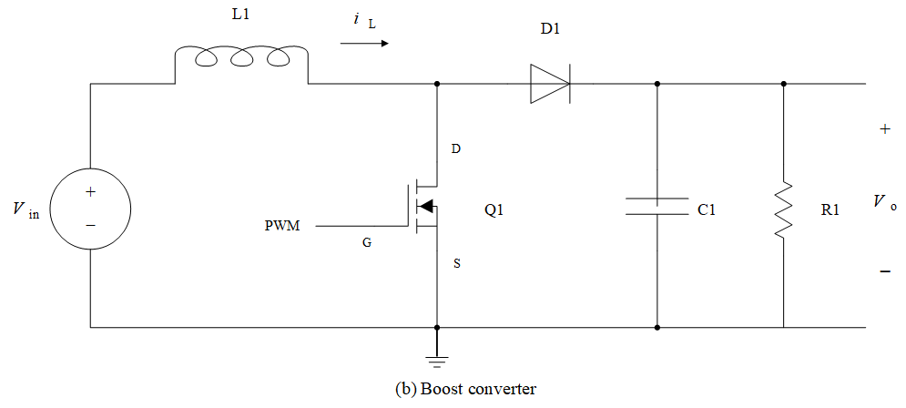
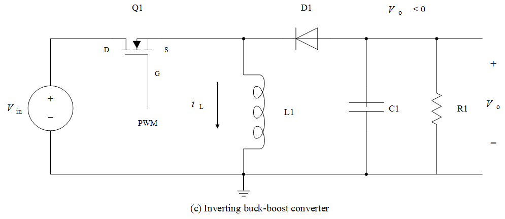
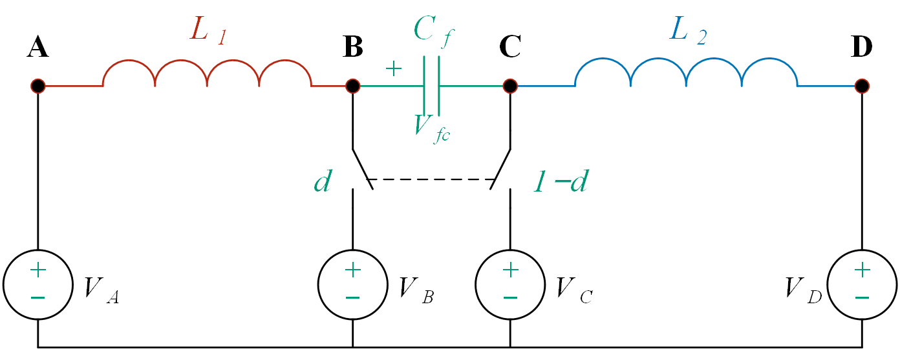
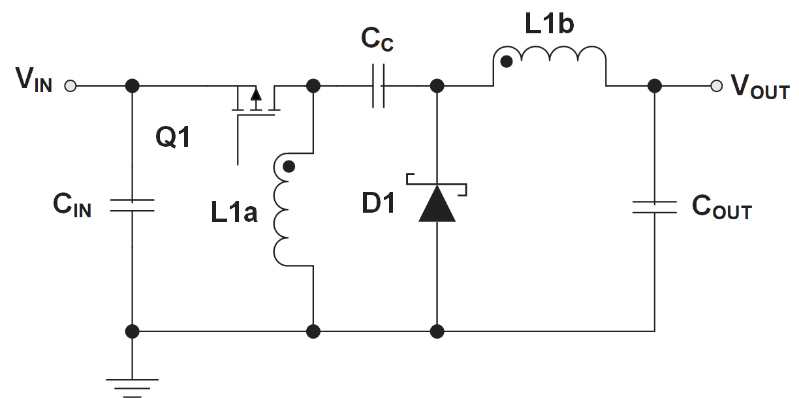
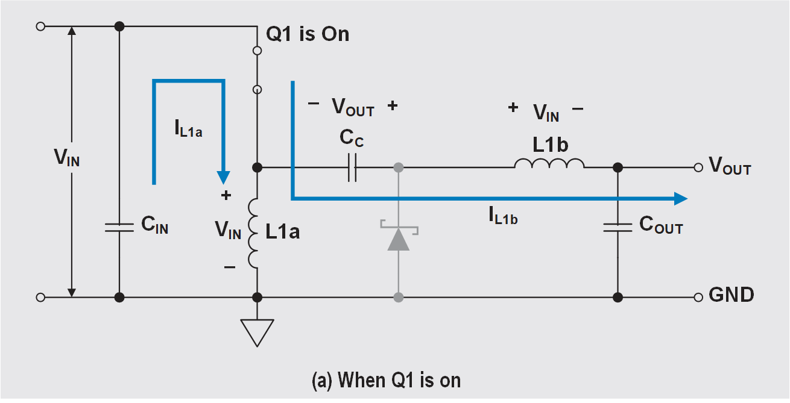
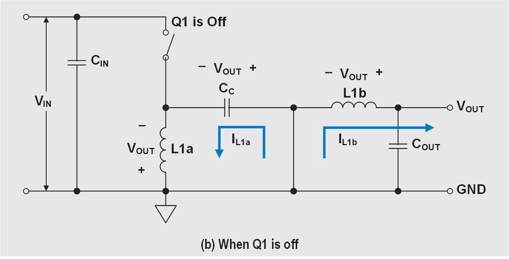

# B站——木秀于林UP主学习

> 专栏：电力电子 · Notion 最后编辑：2026-11-17T13:58:00.000Z
>
> 来源：https://www.notion.so/41a9d738588380b99045c4a4ace82f93

## 单电感统一模型

### 理论基础

$$
V_L=V_X-V_Y\\
V_L=L\frac{\mathrm{d}i}{\mathrm{d}t}\\
\frac{1}{L}\int_0^{T_s}V_L\mathrm{d}t=\Delta i
$$

当系统进入稳定时，$\Delta i=0$, 不妨设$X_1,X_2$导通时间分别为$T_1,T_2$ ,其中$T_s=T_1+T_2$ 有

$$
\Delta i_1=\frac{1}{L}\int_0^{T_1}V_{X_1}-V_Y \mathrm{d}t\\
\Delta i_2=\frac{1}{L}\int_{T_1}^{T_1+T_2}V_{X_2}-V_Y \mathrm{d}t\\
\Delta i=\Delta i_1+\Delta i_2=0\\
\Rightarrow 
\frac{1}{L}\int_0^{T_1}V_{X_1} \mathrm{d}t +\frac{1}{L}\int_{T_1}^{T_1+T_2}V_{X_2} \mathrm{d}t =\frac{1}{L}\int_0^{T_1+T_2}V_{Y} \mathrm{d}t \\ \Rightarrow 
T_{1}V_{X_1}+T_{2}V_{X_2}=(T_{1}+T_{2})V_Y=T_sV_Y\\
$$

<table>
<tr><td></td><td>$V_X$</td><td>$V_Y$</td><td>备注</td></tr>
<tr><td>端口</td><td>$X_1$、$X_2$</td><td>$Y$</td><td></td></tr>
<tr><td>类型1</td><td>$0, V_{\mathrm{in}}$</td><td>$V_{\mathrm{out}}$</td><td>$0 \lt V_{\mathrm{out}} \lt V_{\mathrm{in}}$，Buck</td></tr>
<tr><td>类型2</td><td>$0, V_{\mathrm{out}}$</td><td>$V_{\mathrm{in}}$</td><td>$0 \lt V_{\mathrm{in}} \lt V_{\mathrm{out}}$，Boost</td></tr>
<tr><td>类型3</td><td>$V_{\mathrm{in}}, V_{\mathrm{out}}$</td><td>$0$</td><td>$V_{\mathrm{out}} \lt 0 \lt V_{\mathrm{in}}$，Buck-Boost</td></tr>
</table>

### 经典BUCK电路

#### 用单电感统一模型对buck原理分析

不妨设$PWM$的占空比为$D$,频率为$f$, 当为类型1时，$V_{X1}=0，V_{X2}=V_{in},V_Y=V_{out}$，此时有：

$$
T_s=\frac{1}{f}\\
T_1=(1-D)T_s,T_2=DT_s\\
T_{1}V_{X_1}+T_{2}V_{X_2}=(T_{1}+T_{2})V_Y=T_sV_Y\\
\Rightarrow T_{2}V_{X_2}=T_sV_Y\\
\Rightarrow DT_{s}V_{in}=T_sV_{out}\\
\Rightarrow DV_{in}=V_{out}\\
$$

### 经典Boost电路

#### 用单电感统一模型对boost原理分析

不妨设$PWM$的占空比为$D$,频率为$f$, 当为类型2时，$V_{X1}=0，V_{X2}=V_{out},V_Y=V_{in}$，此时有：

$$
T_s=\frac{1}{f}\\
T_1=DT_s,T_2=(1-D)T_s\\
T_{1}V_{X_1}+T_{2}V_{X_2}=(T_{1}+T_{2})V_Y=T_sV_Y\\
\Rightarrow T_{2}V_{X_2}=T_sV_Y\\
\Rightarrow (1-D)T_{s}V_{out}=T_sV_{in}\\
\Rightarrow (1-D)V_{out}=V_{in}\\
V_{out}=\frac{1}{1-D}V_{in}
$$

### 经典Buck-Boost电路

#### 用单电感统一模型对buck-boost原理分析

不妨设$PWM$的占空比为$D$,频率为$f$, 当为类型3时，$V_{X1}=V_{in}，V_{X2}=V_{out},V_Y=0$，此时有：

$$
T_s=\frac{1}{f}\\
T_1=DT_s,T_2=(1-D)T_s\\
T_{1}V_{X_1}+T_{2}V_{X_2}=(T_{1}+T_{2})V_Y=T_sV_Y\\
\Rightarrow T_{1}V_{X_1}=-T_{2}V_{X_2}\\
\Rightarrow DT_{s}V_{in}=-(1-D)T_sV_{out}\\
\Rightarrow DV_{in}=-(1-D)V_{out}\\
V_{out}=-\frac{D}{1-D}V_{in}
$$

## 双电感统一模型

### 理论基础

由单电感统一模型可得：

$$
T_{s}V_{A}=dT_s V_{B}+(1-d)T_s(V_{C}+V_{fc})\\
T_{s}V_{D}=dT_s (V_{B}-V_{fc})+(1-d)T_sV_{C}\\
\Rightarrow 
V_{fc}=V_A-V_D\\
\Rightarrow
d(V_A-V_B)=(1-d)(V_C-V_D)
$$

### ZETA拓扑

由双电感统一模型可知 ：        $V_{A}=0,V_{B}=V_{IN},V_{C}=0,V_{D}=V_{OUT}$

$$
D(0-V_{IN})=(1-D)(0-V_{OUT})\\
V_{OUT}=\frac{D}{1-D}V_{IN}

$$

属于buck-boost类电路拓扑。

当$Q1 = ON$时

由双电感统一模型理论可知：

$$
V_{Cc}=V_A-V_D=0-V_{OUT}=-V_{OUT}\\
由KVL:V_{L1a}=V_{L1b}=V_{IN}\\
V_{D1}=V_{IN}+V_{OUT}
$$

此时续流二极管$D1$两端电压$V_{D1}=V_{IN}+V_{OUT}$。

当$Q1 = OFF$时

由双电感统一模型理论可知：

$$
V_{Cc}=V_A-V_D=0-V_{OUT}=-V_{OUT}\\
由KVL:V_{L1a}=V_{L1b}=-V_{OUT},V_{Q1}=V_{IN}+V_{OUT}
$$

